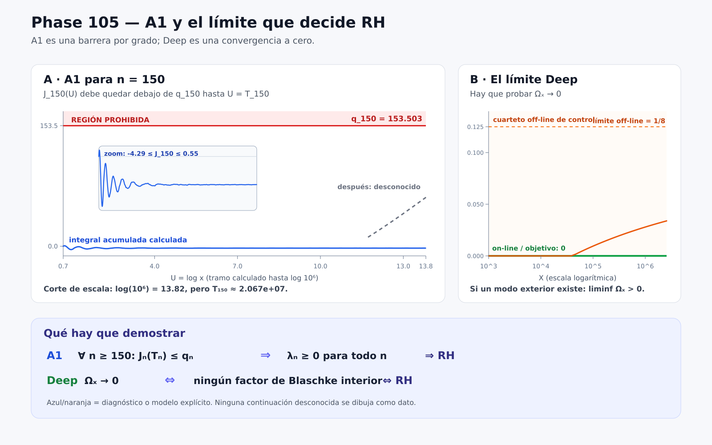

# 105_00 — Visual map of A1 and of the Deep limit

## 1. What panel A shows

For a fixed index,

\[
 J_n(U)=\int_{\log2}^{U}
 (\psi(e^u)-e^u)e^{-u}L_{n-1}^{(2)}(u)\,du,               \tag{1}
\]

and

\[
 q_n={3\over4}A_n+1-L_n^{(1)}(\log2).                    \tag{2}
\]

A1 states

\[
 \boxed{J_n(T_n)\le q_n\quad\hbox{for each }n\ge150.}  \tag{3}
\]

The figure uses (n=150). The blue curve is a direct computation of (1) over
the stretch

\[
 \log2\le U\le\log(10^6),                                \tag{4}
\]

using the exact (\psi(x)) via all prime powers up to
(10^6). The red line is the exact barrier (q_{150}). The red zone is
the forbidden region.

The declared effective cutoff is approximately

\[
 T_{150}(1/4)=2.0669596\times10^7.                        \tag{5}
\]

That is why the figure cuts off the axis: (4) is a tiny fraction of the way
to (5). The gray continuation is neither data nor a prediction. It represents
the part a proof must control. The observation that the initial
curve is far from the barrier does not prove A1.

## 2. What panel B shows

With (H_X=\sum_{n\le X}1/n), define

\[
 \Omega_X={1\over H_X}\sum_{n\le X}{1\over n}
 \mathbf1_{\{\lambda_n+\log(n+1)\le-e^{\sqrt X}\}}.      \tag{6}
\]

The limit that must be proved for the ordinary primes is

\[
 \boxed{\Omega_X\to0.}                                   \tag{7}
\]

The green line shows the theoretical on-line behavior: once
all zeros are on the line, the deep event disappears. The orange
curve does not correspond to ζ: it is the exterior rational control
quartet with (R=201/200). Its logarithmic density approaches (1/8). It serves
to show graphically what an exterior mode would produce: the observable would
not converge to zero.

## 3. Relation between the two panels

\[
 \mathrm{A1}\Longrightarrow
 \lambda_n\ge0\ (n\ge1)\Longrightarrow
 \mathrm{RH}\Longrightarrow
 \Omega_X\to0.                                           \tag{8}
\]

It is also proved directly that (\Omega_X\to0\iff\mathrm{RH}).
Hence the panels are two coordinates of the same logical wall, but they
are not the same quantity:

* A1 requires that no curve (J_n) cross its barrier at the cutoff;
* Deep requires that the logarithmic proportion of deep negative
  excursions tend to zero.

## 4. What is data and what is scheme

| Element | Status |
|---|---|
| blue curve of A1 up to (10^6) | direct computation in double precision; diagnostic |
| (q_{150}), (A_{150}), (T_{150}) | declared formulas evaluated numerically |
| gray continuation up to (T_{150}) | unknown region, not data |
| green line (\Omega_X=0) | on-line scenario of the theorem |
| orange curve toward (1/8) | explicit exterior counter-model, not ζ |
| A1 and (\Omega_X\to0) for ordinary primes | open |

