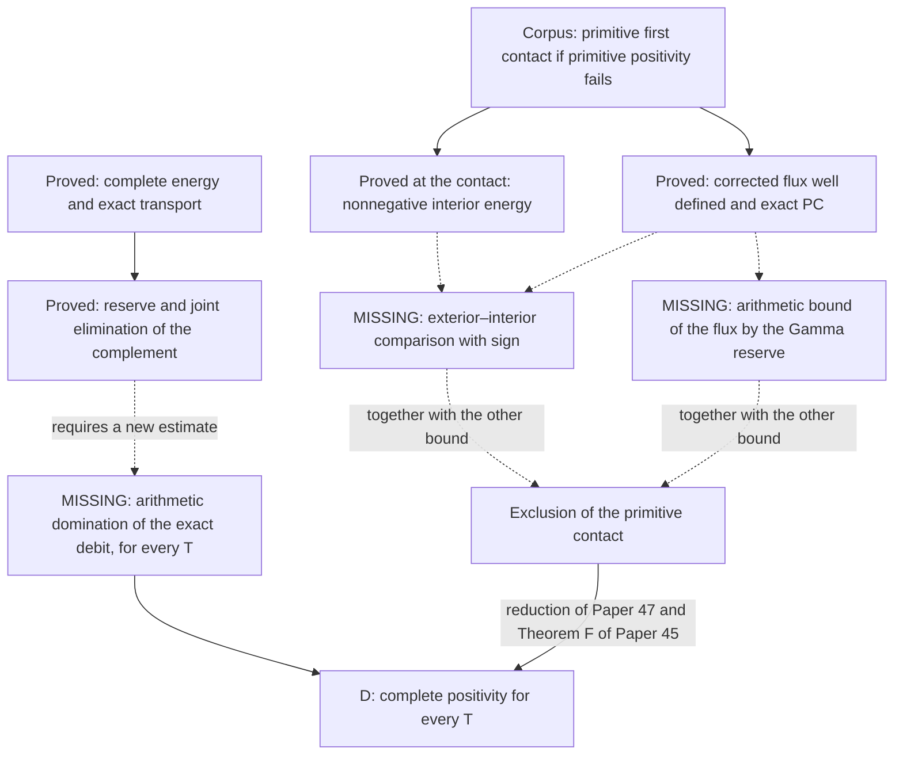

# R170_818 — Map of the D puzzle

Synthesis of the corpus and of R170_801–817; it does not
add a sign theorem. "Proved" means proved in the cited documents, with
their hypotheses; not an external certification of the whole corpus.

## 1. What we know about the complete picture

The goal is W_T(F)≥0 for every T and every F in the energy domain, with
the complete prime, archimedean, and polar terms. For the other F in
L², the archimedean term is interpreted as +∞. We know the final claim
and reductions that would allow proving it. We do not know the shape of
a future proof: this map describes current concrete routes, not a list
of components necessary for any possible proof.

There are two main routes and one additional prime-sum interface. The
primitive and complete contacts, and their operators, must not be
merged.

The dashed arrows are not theorems. In particular, the diagram does not
claim that G or H are true for the chosen flux. The direct route A may
close D without building that flux; the contact route might close D
without separately resolving every certificate of the direct route.

## 2. Available pieces and their connection edges

| Piece | What it provides | What it does NOT provide | Record |
|---|---|---|---|
| Small-window certificate | A positive starting point and control of the complement | Positivity at every scale | Paper 47; local extension conditional on the certificate in R170_703 |
| Exact archimedean transport | W=b−K_L, with scale, primes, and polar term preserved | K_L≤b | R170_806–808 |
| Capacity with common complement | Explicit reserve for means and fluctuations | Permission to discard the entire remaining reserve | R170_805,808 |
| Harmonic extension | Exact debit A*B⁻¹A and full coupling | A favorable bound of that debit | R170_809–810 |
| Divisor identity and PC | Exact interior cancellation and explicit tail | Sign of an oscillating correlation | Paper 47; R170_816 |
| Faithful Gamma detector | Vanishing of enough moments implies F=0 on the radical | Vanishing of those moments | Paper 47; R170_702 |
| Corrected flux Φ | Finite number on Q_log and Tate port with S_N* | Sign of Φ | R170_812–813 |
| Primitive contraction G_ρ | Preserves both moments; E_ρ≥0 at the contact | Φ≤−E_ρ | R170_814–815 |
| Witness geometry and prime sums | Additional interface for an arithmetic contradiction | One-sided upper bound, nor resolution of its auxiliary hypotheses | R163–169; v2 corrections of R169_000 |

The local extension beyond log5/2 does not come from the latest round of
earlier attempts: it is already in R170_703, with extremely small width
and explicit dependence on the earlier certificate. It is not counted
again.

## 3. What would occupy the still-empty central zone

On the direct route, the gap is an arithmetic inequality controlling
the complement's debit with the real reserve. Replacing B⁻¹ by a scalar
bound is legitimate as an estimate, but it may lose the sign exactly at
the contact. The debit identity already exists; its bound is missing.

On the proposed flux route there are TWO gaps, not a single arrow:

    Gamma reserve ≤ Φ                  [not proved],
                    Φ ≤ −E_ρ ≤ 0      [first inequality not proved].

These gaps are not two plausible facts already established by their
names: their joint truth would exclude the contact. The chosen flux
could be inadequate and require replacement. Repairing the adjoint
makes it correct as an object, but does not identify it with the sign
piece we are looking for.

The R167–169 interface asks for a one-sided estimate of prime sums with
the witness's weight. It also keeps obligations such as Dom_θ and the
small regime requiring P_gap. It is not claimed to automatically be the
same inequality as the two bounds on Φ. The map does not erase those
dependencies nor the v2 corrections on frequencies and the Eratosthenes
tail.

## 4. Neighboring pieces worth attempting to build

The following order is a research priority, not a prediction of
success nor a timeline for proving RH.

| Priority | Neighboring piece | Concrete result required to accept it |
|---|---|---|
| 1 | Compatibility between the exterior test S_N U S_LF and the interior variation G_ρF | An identity derived from the operators and domains connecting their terms and leaving an analyzable remainder. Defining the remainder as Φ+E_ρ does not count. |
| 2 | Joint comparison between the Poisson–Tate defect and the divisor tail | A one-sided bound of their combination, preserving correlations; not two separate absolute bounds. It must identify where an exact identity of Λ changes the sign conclusion. |
| 3 | Transport of that bound to the contact or to the complete Schur complement | Preserve Tate/polar terms, domains, and all cross terms; prove that the same witness satisfies every hypothesis. |
| 4 | Uniformity of the new bound | Quantifiers and constants valid at every scale, not depending on an unknown positive gap. A family of finite computations does not yet give this piece. |

The first priority is a compatibility proof for the proposed Φ, not
another detector. If no structural connection appears, it is time to
reconsider that exterior test before accumulating more reformulations.
In parallel, the direct route can investigate an arithmetic bound of
the exact debit without committing to Φ.

## 5. What a piece that truly distinguishes the sought structure would be

In the puzzle metaphor, the current identities and domains determine a
good part of the outline. A specially discriminating piece would be a
cancellation or inequality that:

- is proved for the exact data of the integers and for the correct
  class of witnesses, with the required sign;
- preserves the cost of the complement and the polar term;
- explains why the argument stops applying to the corpus's relevant
  falsifiers, rather than proving a false general positivity;
- supplies a previously absent implication, not merely new notation
  for D.

This is an admission criterion for tools entering our routes, not a
theorem that every imaginable proof of RH must have this architecture.
Unique factorization alone does not guarantee the desired estimate.

## 6. How to count progress

A representation piece improves the exact language of the problem. A
domain piece makes an operation legitimate. An exclusion piece rules
out an invalid inference. All three are useful, but should not be
counted as new sign bounds.

A sign piece would actually prove a previously open inequality for the
relevant class of witnesses. A uniformity piece would carry that
inequality to every scale. The latest rounds contributed mostly
representation, domains, and exclusions; not those last two pieces.

The most informative immediate goal is to find out whether the flux
piece really has an edge compatible with the interior energy. We know
how to write both objects precisely; we do not yet know that they fit
together.
