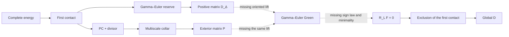

# R170_832 — Puzzle map v2 for D

This map incorporates R170_819–831 and checks the route against
phases 121, 122, 124, 155, and 162. It does not announce a proof of D. Its
function is to separate proved pieces, repeated pieces, and still-absent
connections.

## 1. The picture we want to complete

If a primitive first contact exists, Paper 46 reduces the closure to
proving the vanishing of a finite, faithful family of Gamma moments,

\[
                 R_LF=0 .                                      \tag{1}
\]

The reduction requires that the step producing (1) simultaneously use:

1. the dynamical minimality of the first contact;
2. an oriented identity that preserves exterior collars, the polar part,
   and both Tate ports;
3. the exact arithmetic identity \(\Lambda*1=\log\), in the sign step;
4. quantifiers uniform in \(T\).

The available picture can be represented as follows:

Solid arrows represent reductions or identities already recorded. Dashed
arrows are open obligations.

## 2. Inventory of the pieces we do have

| Piece | Proved content | Main record |
|---|---|---|
| Certified base | Positivity up to \(\tfrac12\log5\) and a quantitative local extension conditional on the certified gap | Paper 46; R170_703 |
| Single energy | Exact transport of the archimedean, primes, and polar parts, without separating their interaction | R170_805–810 |
| Contact geometry | Finite radical, extremal witness, and faithful Gamma detector | Paper 46; R163–166; R170_702 |
| Arithmetic identity | Finite PC and the channel \(\Lambda*1=\log\), with explicit collars | Paper 46; phases 121 and 162; R170_816,820 |
| Multiscale transport | Full conjugation, regularizing average, and compact collar | R170_819–826 |
| Matrix reduction | \(Q=P+E\), \(E\succeq0\), faithful Gram \(B\succ0\), and finite spectral criterion | R170_827–828 |
| Gamma–Euler reserve | \(D_\Delta\succeq(1-q_0)B\succ0\) | Paper 46; R170_829–830 |
| Interface equation | An exterior lift would have to satisfy \(\operatorname{Herm}(\Lambda Y_L)=D_\Delta\) | R170_829–830 |

These pieces determine the outline and turn the gap into a concrete
equation. They still do not force its solvability nor its sign.

## 3. Cross-check with the corpus: what must not be rebuilt

| Tempting construction | Already exists | Limit already proved |
|---|---|---|
| Localizing a translation at the boundaries | P121_EXACT_TATE_COLLAR_LOCALIZATION | Localizes the flux; does not prove it vanishes |
| Evaluating the continuous and discrete Tate collar | P121_RESOLVED_TATE_COLLAR_INTEGRAL; P121_EULER_DIVISOR_COMPRESSED_COLLAR_FORMULA | The cancellation equation remains open |
| Building a finite Green complex between primes | P122_028_TWO_PRIME_FINITE_GREEN_COMPLEX | The null flux is an independent global law |
| Invoking boundary regularity or transmission | P122_029_LIONS_MAGENES_TRANSMISSION_AUDIT | The theory describes the matching; it does not produce it |
| Controlling the collar only by leakage or Cauchy–Schwarz | P124_009_SUPPORT_LEAKAGE_EQUALITY | There is a finite-dimensional counterexample |
| Closing via a generic Schur argument | P124_011_SCHUR_COLLAR_REDUCTION | The rank condition of the real collar is still missing |
| Repeating the exterior Gamma kernel formula | R162_404_G13_COMPRESSED_KERNEL §4–5 | The exterior identity is a consequence of the weak equation and loses the Tate jets at contact |
| Using a universal Euler/Hankel lift | R162_301_C1_NONCOMMUTATIVE_EULER_LIFT | The anomaly is indefinite and does not distinguish \(\Lambda\) |
| Combining sum and product without a new orientation | R162_503_SUM_PRODUCT_AT_CONTACT | It transports to falsifiers; the sign remains open |
| Winning via a small exponential tail | Paper 46, remark on exterior tails; phase 155 | Smallness or decay does not imply exact vanishing |

Hence, a new "Green formula" only counts as progress if it adds a pairing
that the previous formulas do not contain, and if that pairing changes
when using minimality and \(\Lambda*1=\log\).

## 4. The current gap, split into buildable pieces

### G1. Exterior domain and Tate port

Canonically define \(\Lambda z\) for tails outside \(I_T\). The weak
equation only defines the Tate vector inside the window. Extending it by
zero, by an exponential, or by duality produces different functionals.
An extension law derived from the complete energy is needed, not chosen
to obtain the desired equality.

**Acceptance criterion:** a closable sesquilinear formula, compatible
with reflection, that reproduces the interior polar part for interior
tests.

### G2. Oriented Gamma–Euler lift

Build, using both tails, a \(Y_L\) for which

\[
 \operatorname{Herm}(\Lambda Y_L)-D_\Delta                 \tag{2}
\]

can be computed as an explicit boundary term. Merely defining that
boundary term as the difference of the two sides does not count.

**Acceptance criterion:** term-by-term expansion in Gamma, primes, and
Tate, with convergence and domains justified.

### G3. Arithmetic sign law

Prove that the boundary term of (2) has the required sign at a first
contact. Here \(\Lambda*1=\log\) must enter essentially; if the same
proof transports to a Dirichlet system without a positive Euler product,
the piece fails the corpus test.

**Acceptance criterion:** indicate the exact line that stops being valid
when \(\Lambda\) is replaced by a falsifying weight.

### G4. Minimality and uniformity

Use the one-sided derivative or a comparison between windows to turn the
sign of G3 into vanishing, and give constants or monotonicity valid for
every scale.

**Acceptance criterion:** the argument must not hold for a null vector of
a non-minimal window, and it cannot choose \(L\) without control as
\(T\) varies.

## 5. The next piece

The immediate piece is G1, followed by the computable part of G2.
R170_829 proposed the right exponential tail

\[
 (\iota_+c)(t)=\mathbf1_{t>T}\sum_{m\le L}b_mc_me^{-a_mt}.
\]

The off-diagonal Gamma computation and the translation collars already
have exact precedents in R162_404 and phase 121. What remains to be
decided is not another kernel: it is whether the complete energy
determines a unique Tate port for this tail. If it does not determine
one, the candidate \(\iota_+\) is not yet an object of the problem, and
the next construction must be a bilateral extension or a boundary
quotient that removes that ambiguity.

## 6. Honest state of progress

R170_819–830 added a real connection: the sign gap can be written as a
matrix equation between the exterior flux and a positive, faithful
reserve. They also ruled out a purely interior lift solving it. That
reduces the search space.

We do not yet have G1–G4. In particular, compactness, regularization, an
exterior formula, or a finite matrix do not by themselves constitute the
global sign law. The next advance must fix the exterior Tate port
canonically or prove it can be cancelled without choosing an extension.

## 7. Later correction: source port versus test port

R170_834 refines the last paragraph. R161_009 and R161_015 already built
a canonical Tate/Hardy port **for the port produced by the arithmetic
source**. What is not determined is its transfer to the arbitrary test
columns \(\iota_\pm c\) of R170_829. Two natural extensions (global
characters and Hardy evaluation) give different matrices, and the
bilateral sum does not cancel that difference.

Hence G1 must be read as follows: a source--port map is missing that
identifies, before taking limits, the canonical Hardy port with the
Gamma--Euler columns and with \(D_\Delta\). It is not that another Tate
gauge needs to be chosen. The gauge-independent part only lives in the
compression to \(Z_0=\{F\in Z:r_F=0\}\), which does not control the
remaining Tate directions.
