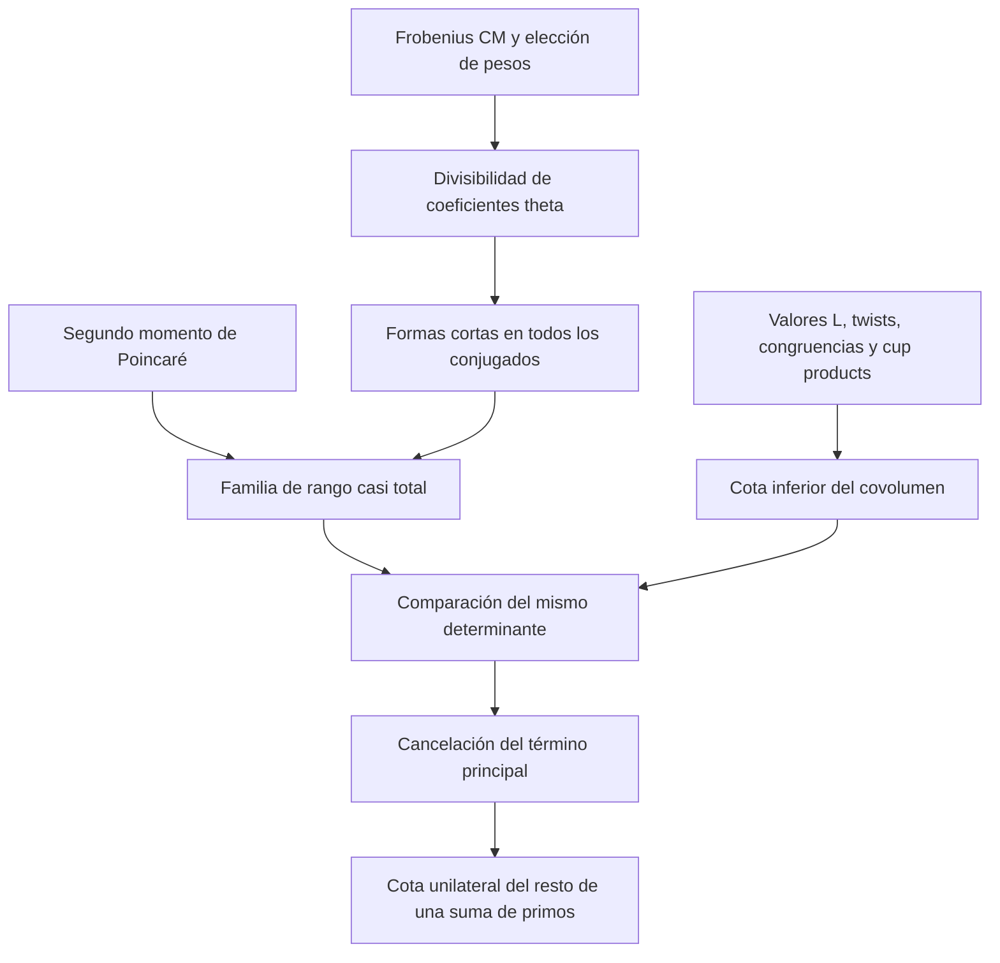

# Qué conexión aporta el enfoque y qué programa puede crecer a partir de ella

28 de noviembre de2026. Objetivo nuevo, separado de la auditoría de corrección. Análisis del agente principal, contrastado con un agente dedicado a la estructura conceptual. Esta nota se refiere a la arquitectura de las fuentes locales y a sus suplementos V2; no convierte el dictamen privado anterior en prueba de prioridad bibliográfica ni en reconocimiento externo.

**Conclusión:** el núcleo que merece desarrollarse es un método cuantitativo para transformar divisibilidad local de coeficientes theta en restricciones sobre sumas de primos, usando cadenas de lifts, generación de retículos y comparación de determinantes. La pregunta fértil es cuándo ese mecanismo funciona para otros datos y qué coste paga. La necesidad de inventar una rama enteramente nueva no es una condición lógica para resolver RH.

## 1. La conexión precisa

El siguiente diagrama describe dependencias matemáticas del enfoque, no relaciones históricamente inéditas entre disciplinas:

La fórmula que hace concreto el primer puente está en57, sección «Two amounts». La divisibilidad agregada contiene

\[
s_{\mathrm{fin}}(y,\sigma)=\sum_{\nu\le a}\Lambda(\nu)(1-\chi_K(\nu))
\left(\frac y\nu-\kappa(u(-\nu)\sigma)\right)^+.
\]

Aquí Frobenius mueve una plaza CM a otra y la función de pesos decide cuánto exceso de divisibilidad sobrevive. Cuando y=a y el peso compañero es b, con x=a/b,

\[
\left(\frac a\nu-b\right)^+=a\left(\frac1\nu-\frac1x\right)^+.
\]

Así aparece el núcleo de una suma suavizada de primos. La distribución de los pesos entre clases produce la condición de congruencia; el factor1−χ_K selecciona el exceso procedente de los primos no escindidos. Los otros pesos producen la escala auxiliar x1. No se está simplemente diciendo que «las funciones theta están relacionadas con los primos»: se identifica cómo una valoración local produce el peso analítico que después entra en R_(d,q).

El segundo puente es la coincidencia de dos mediciones del mismo objeto. Short Forms da familias pequeñas en todas las inmersiones; Spanning garantiza que no estén confinadas a un subespacio demasiado pequeño; Covolume impide que una familia de ese rango, con ese índice, tenga un determinante tan pequeño. El término principal aparece en ambos lados con la misma normalización. Al cancelarlo queda el resto aritmético que se quiere acotar.

Las constantes importan por su efecto acumulado. Un coste multiplicativo K por lift puede dejar m·log K después de tomar logaritmos; dividir por la ganancia m no lo elimina. En cambio, un factor fijo que aparece coherentemente en ambos lados puede cancelarse o absorberse. El objetivo es controlar el presupuesto final, no exigir que toda constante sea literalmente uno.

El tercer puente es que el twist puede elegirse **por primo**. No se busca necesariamente un único twist bueno en todos los primos. Para que esto sea legítimo, las distintas realizaciones deben controlar una estructura integral común y sus comparaciones deben pagar pérdidas sumables. Ese requisito explica por qué entran congruencias, Selmer y Hodge integral en un argumento cuyo resultado final es analítico.

## 2. Qué es nuevo, qué tiene antecedentes y a quién se atribuye

Hay tres preguntas diferentes: si una conexión existe en la serie, si mejora un resultado anterior y quién introdujo el mecanismo. La primera se puede contestar siguiendo las fórmulas; las otras exigen comparar enunciados y fuentes.

| Componente | Antecedente comprobado | Diferencia específica que debe compararse para establecer novedad |
|---|---|---|
| Multiplicidad para controlar un conteo | Stepanov–Bombieri: construir una función con muchos ceros y pocos polos. [Bombieri, exposición430](https://www.numdam.org/article/SB_1972-1973__15__234_0.pdf). | La realización de una multiplicidad aritmética mediante una cadena theta y el control simultáneo de sus costes. |
| Información finita frente a tamaño en infinito | Métodos de pendientes y aplicaciones de evaluación de Bost. [Bost, Evaluation maps](https://ems.press/books/standalone/21/408). | El determinante automorfo concreto y el resto de primos que aparece tras cancelar sus términos principales. |
| Theta, CM y divisibilidad | Katz; Chellali en el caso supersingular; Bannai–Kobayashi para theta algebraica y propiedades p-ádicas. [Chellali](https://www.sciencedirect.com/science/article/pii/0022314X9090110D), [Bannai–Kobayashi](https://arxiv.org/abs/math/0610163). | El acoplamiento de numerosas plazas por Frobenius, el perfil exacto de pesos y la uniformidad requerida al crecer el rango. «Incluye primos supersingulares» por sí solo no es nuevo. |
| Normas de lifts y valores L | La fórmula de producto interno de Rallis y sus extensiones. [Gan–Qiu–Takeda](https://arxiv.org/abs/1207.4709). | El determinante integral de una cadena y el control de sus índices al variar los twists, no la existencia de una relación norma–valor L. |
| Theta y geometría aritmética de retículos | Bost desarrolla invariantes theta y fibrados hermitianos sobre curvas aritméticas. [Monografía](https://arxiv.org/abs/1512.08946). | Un formalismo que conserve exactamente las pérdidas de esta familia de correspondencias automorfas. No sería la primera unión entre theta y Arakelov. |
| Cotas integrales en Hodge p-ádica | Existen cotas explícitas para torsión y ramificación; por ejemplo Caruso–Liu. [Artículo](https://arxiv.org/abs/0805.4227). | Los exponentes concretos que anulan cup products según la disposición de los pesos, y su conversión en pérdidas locales sumables. Son conclusiones distintas de una cota de ramificación. |
| Adeles, traza y fórmula explícita | Connes ofrece esa conexión desde1998. [Artículo original](https://arxiv.org/abs/math/9811068). | Los objetos y resultados particulares de43–45, y sus dominios exactos, no la asociación general entre adeles y ceros de zeta. |

La búsqueda consultó fuentes primarias para identificar estos antecedentes. Para algunos artículos se contrastaron el resumen y el alcance declarado, no una comparación exhaustiva de cada teorema. Por tanto **no se establece prioridad absoluta** de los nuevos enunciados de la serie.

Hay además una atribución decisiva. El reconocimiento de57:833–843 asigna a Alpöge la matemática organizada por SF/Sp/Cv y el camino al semiplano libre de ceros; atribuye a la serie la formulación en esos tres teoremas, sus nombres y la escritura de las pruebas. La [nota original de Alpöge](https://alpo.ge/remark.pdf), p.1 y lista final, describe la analogía con Stepanov, la cadena theta de longitud del orden de √X, las pendientes y la comparación de estructuras integrales. Por ello no corresponde presentar ese mecanismo central como una invención original de la serie. La nota se usa aquí para atribución y motivación, no como comprobación de su afirmación de haber demostrado RH.

**Aporte propio que las fuentes permiten identificar:** organización explícita, formulación y exposición de las conexiones en SF/Sp/Cv, desarrollo del marco A–C y estudio de la forma radial. Para atribuir además un resultado matemático nuevo concreto al autor de la serie, hace falta localizar el enunciado diferencial frente a la fuente de Alpöge y frente a los antecedentes clásicos. La tabla anterior da las comparaciones que hay que efectuar; la auditoría de corrección no las reemplaza.

## 3. Un principio que conviene extraer como teorema autónomo

La pieza algebraica siguiente hace visible lo que tendría que abstraer una teoría. No se propone como descubrimiento nuevo: su utilidad es separar la deducción elemental de las entradas difíciles.

Sean d≥1, m>0, 0≤ε<1 y (1−ε)d≤n≤d. Sean H≥0 y E_S,E_C,δ≥0. Supongamos que una misma familia independiente de n vectores tiene logaritmo de determinante de Gram c y satisface

\[
c\le n(H-mR+E_S),\qquad c+2\delta\ge d(H-E_C).
\]

Entonces

\[
mR\le E_S+\frac{E_C}{1-\varepsilon}
 +\frac{2\delta}{(1-\varepsilon)d}.
\]

**Prueba.** Sustituir la primera desigualdad en la segunda y reordenar da

\[
nmR\le(n-d)H+nE_S+dE_C+2\delta.
\]

Como H≥0 y n≤d, el primer sumando es no positivo. Dividir por n y usar d/n≤1/(1−ε) prueba la afirmación. Si H<0, aparece además un coste acotado por ε|H|/(1−ε). En el caso H≥0 de la aplicación, no hay una pérdida inevitable εH: el signo permite descartarla. El defecto de rango sí importa para d/n y para el coste de completar familias en la demostración de la cota inferior.

Este principio responde a «qué hay que crear»: una teoría útil debe **producir sus hipótesis de forma estable para familias de correspondencias**, no sólo volver a demostrar esta desigualdad. Debe dar simultáneamente:

- un retículo o una línea determinante común;
- mapas integrales con divisibilidad cuantificada;
- normas controladas en todas las inmersiones;
- suficiente rango de la familia construida;
- una cota inferior para el mismo determinante;
- un presupuesto uniforme y sumable de errores.

No alcanza con tener vectores muy pequeños. Tampoco alcanza con una fórmula compleja de normas si se pierden los índices integrales. Éstos son criterios concretos para decidir si otro sistema de lifts admite el método.

## 4. La línea de investigación que propongo

Un nombre descriptivo adecuado sería **«Retículos automorfos y divisibilidad theta»**, dentro de geometría aritmética y formas automorfas. Un subtítulo más específico para el primer trabajo sería **«Comparación de determinantes en cadenas de correspondencias aritméticas»**. Son nombres de un programa propuesto, no denominaciones de una disciplina ya reconocida.

El objeto de estudio sería una familia de espacios automorfos con modelos integrales, métricas en infinito y correspondencias entre ellos. Las cantidades a controlar serían las ganancias locales de divisibilidad, los índices de saturación, las normas, el rango generado y el error de la comparación de determinantes. El teorema central debería explicar cuándo una ganancia acumulada excede los costes permitidos por la fórmula del producto.

Hay una condición de diseño importante: formular todo de modo compatible con cambios racionales de base. La fórmula del producto puede compensar los cambios locales e infinitos correspondientes. Esto **no** implica invariancia ante cambiar arbitrariamente la métrica real; ese cambio altera el grado aritmético. Tampoco se pueden cancelar factores de normalización de rangos n y d diferentes sin controlar el complemento.

La estructura actual no demuestra automáticamente semistabilidad en el sentido completo de pendientes. Controlar familias de rango casi total no equivale a controlar todos los subretículos. Una teoría de Harder–Narasimhan para estos objetos sería una posible extensión, cuya existencia y propiedades habría que demostrar.

## 5. Tres proyectos prioritarios, con resultados verificables

### Prioridad1: extraer el principio de comparación y su primera aplicación independiente

**Resultado buscado:** un teorema autónomo que reciba los seis datos de§3 y produzca una cota explícita, junto con una realización theta que no use RH como premisa. Separar el lema elemental, los resultados de representación y las hipótesis de uniformidad.

**Entregables:** definiciones de retículo e índice; diagrama de mapas; libro de constantes; una aplicación a una familia concreta de pesos o niveles; comparación con el método de pendientes existente.

**Prueba de éxito:** el resultado sigue teniendo contenido al borrar toda mención de RH, y cada cambio de normalización tiene una transformación explícita. Una pregunta estructural es si los perfiles admisibles realizan un cono de núcleos y cuáles son sus obstrucciones; no se presume que realicen toda función de prueba. La primera ampliación razonable consiste en estudiar perfiles de pesos distintos de los dos valores a/x1 y b y determinar qué núcleos sobre primos codifican. La existencia de datos admisibles para esos nuevos perfiles es una obligación nueva, no una consecuencia automática.

### Prioridad2: estructuras integrales compatibles al variar los twists

**Resultado buscado:** un teorema que permita escoger θ_(ℓ,ι) por primo e inmersión y convertir los controles locales en una cota global sobre una línea determinante común.

**Entregables:** condición exacta de compatibilidad; índices de transición; pérdidas locales e_(ℓ,ι); demostración de la cota para su suma ponderada por logℓ; tratamiento de plazas excepcionales y proyectores integrales. Hay que preservar los cuantificadores: un twist común para todas las aplicaciones simultáneas que requiere una pareja de inmersiones, sin imponer innecesariamente uno común a todos los primos.

**Prueba de éxito:** verificar el teorema primero en una sola transferencia y después en dos transferencias compuestas, conservando el mismo objeto global. Como prueba negativa, construir ejemplos donde escoger localmente retículos incompatibles daría una cota falsa: deben quedar excluidos por una hipótesis concreta. Después extender a una cadena de longitud variable con todas las pérdidas declaradas.

Esta es, en mi evaluación, la prioridad conceptual con mayor posibilidad de producir una herramienta reutilizable: aislar la parte que permite elegir buenas realizaciones locales sin perder el control global.

### Prioridad3: extraer los exponentes locales de cup products como resultado autónomo

**Resultado buscado:** una formulación independiente de56 que determine qué rasgos de la distribución de pesos controlan el exponente de anulación, con ejemplos y comparación exacta con los resultados integrales existentes.

**Entregables:** casos de dimensión pequeña; pesos que satisfacen y que violan NM; primos pequeños; caso tame; separación entre cotas de exponente y cotas de longitud. No convertir NM en condición necesaria si sólo se usa como suficiente.

**Prueba de éxito:** identificar al menos una familia donde el nuevo presupuesto sea estrictamente mejor que la cota obtenible de los antecedentes comparables, o donde su conclusión sobre cup products no esté cubierta por ellos. Esa mejora debe probarse comparando teoremas con las mismas hipótesis, no comparando títulos o resúmenes. Una aplicación a congruencias automorfas distinta de la serie original sería la segunda etapa, todavía por construir.

En paralelo, el segundo momento51/52 merece una extracción autónoma: fijar inicialmente campo y rango, identificar la constante principal, y después demostrar el régimen de rango creciente con una función de error explícita. Es la entrada que impide que todo el programa quede en una colección de formas cortas que generan demasiado poco.

## 6. Cuatro ensayos que dirían si el programa se generaliza

| Ensayo | Qué cambiar | Qué debe comprobarse; qué no se da por hecho |
|---|---|---|
| Otros perfiles CM | Sustituir el peso de dos valores por tres o por una familia escalonada | Calcular el núcleo analítico exacto que produce el positivo de diferencias, y verificar existencia de datos y uniformidad. |
| Longitud variable | Mantener simbólico m en las pérdidas hasta el último paso | Determinar el intervalo permitido y la razón error/ganancia. m≈√x no demuestra por sí mismo una cota de raíz cuadrada; importan todos los errores y las restricciones de rango. |
| Transferencia local de retículos | Usar dos twists distintos en dos primos | Comprobar que ambos controlan el mismo determinante y cuánto cuesta la transición. No multiplicar datos de números algebraicos inconexos. |
| Hodge sin objetivo RH | Fijar una familia cristalina y variar las separaciones entre pesos | Comparar anuladores reales de cup products con las cotas y localizar qué hipótesis son suficientes, cuáles son necesarias y cuáles sólo son del método. |

Ninguno de estos ensayos es una extensión ya demostrada en este informe. Son preguntas con criterio de éxito o fracaso, suficientemente delimitadas para iniciar trabajo matemático.

## 7. Qué papel queda para las filas de Weil

Las filas A–C proporcionan otro programa, distinto del mecanismo automorfo que cierra Row D: correspondencias semilocales, trazas y dominios de formas de intersección. El análisis previo de43 identifica un obstáculo concreto para prolongar la forma escalar ingenuamente: diferentes aproximaciones pueden dar límites distintos. Una futura construcción geométrica necesita una elección intrínseca de dominio o regularización y una pairing bien definida antes de pedirle un principio de signo.

Ese proyecto puede ser valioso, pero no debe presentarse como una geometría de intersección ya construida que sustituya el argumento automorfo. La conexión histórica con Connes y con la fórmula explícita tiene antecedentes identificados. Su posible novedad debe localizarse en los teoremas y objetos adicionales de43–45.

## 8. Balance de evidencia y siguiente trabajo concreto

**Identificado:** el mecanismo que codifica una suma de primos en divisibilidad CM y la comparación de determinantes que permite controlarla; el papel separado de SF, Sp y Cv; la importancia de compatibilizar twists locales.

**Respaldado por fuentes:** los antecedentes enumerados y la atribución del mecanismo central a Alpöge que hace el propio57. El conocimiento de esos antecedentes impide afirmar que se conectaron por primera vez áreas antes totalmente separadas.

**Candidato a contribución independiente:** las versiones exactas y uniformes de los teoremas de divisibilidad, generación, comparación integral y cup products, una vez aisladas y comparadas en el mismo rango con sus antecedentes.

**Propuesto, aún por demostrar:** el formalismo general de correspondencias con presupuestos explícitos y sus nuevas aplicaciones. No se declara creado un campo por darle un nombre.

El siguiente trabajo concreto que recomiendo es redactar el teorema de compatibilidad integral de la prioridad2 en un caso de un lift, con todas sus plazas y la línea determinante visibles, y después hacer la composición de dos lifts. Esa prueba decidiría qué parte de la arquitectura es un método general y qué parte depende de elecciones especiales de esta serie. En paralelo, la extracción de56 ofrece un resultado con vida propia y una comparación bibliográfica delimitable.

Evidencia interna:57 §§«Two amounts»,«The three theorems»,«The ideas of the proofs»,«Acknowledgement»;46 y49–56; [ensamblaje V2](revision-v2/ENSAMBLAJE-GLOBAL.md); [suplemento matemático](revision-v2/SUPLEMENTO-MATEMATICO.md); [análisis independiente del agente](revision-v2/CONEXIONES-ANALISIS-AGENTE.md). La corrección de esas pruebas y su prioridad bibliográfica son evaluaciones distintas.
