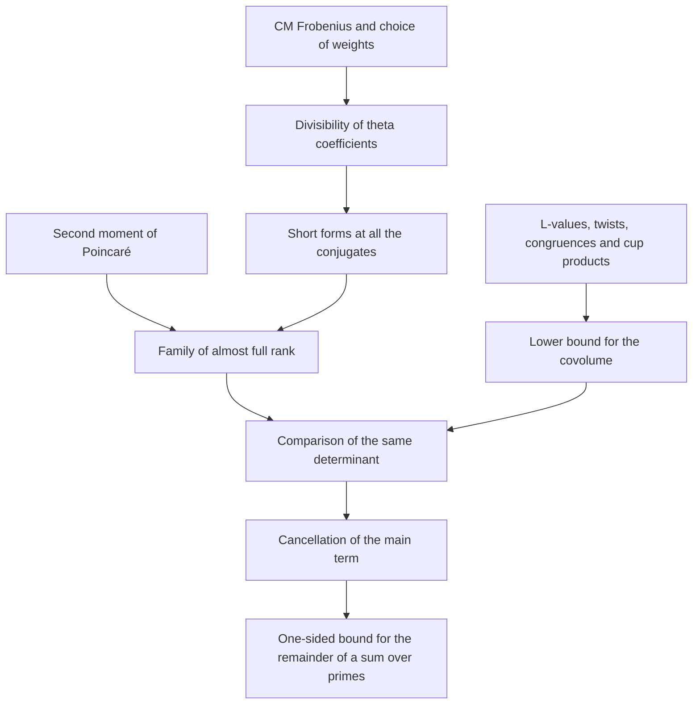

# What connection the approach contributes and what programme can grow from it

28 November 2026. New objective, separate from the audit of correctness. Main analysis, checked against an independent second analysis dedicated to the conceptual structure. This note refers to the architecture of the local sources and to their V2 supplements; it does not turn the earlier private verdict into a proof of bibliographic priority nor into external recognition.

**Conclusion:** the core that deserves to be developed is a quantitative method for transforming local divisibility of theta coefficients into restrictions on sums over primes, using chains of lifts, spanning of lattices and comparison of determinants. The fertile question is when that mechanism works for other data and what cost it pays. The need to invent an entirely new branch is not a logical condition for resolving RH.

## 1. The precise connection

The following diagram describes mathematical dependencies of the approach, not historically unprecedented relations between disciplines:

The formula that makes the first bridge concrete is in 57, section "Two amounts". The aggregated divisibility contains

\[
s_{\mathrm{fin}}(y,\sigma)=\sum_{\nu\le a}\Lambda(\nu)(1-\chi_K(\nu))
\left(\frac y\nu-\kappa(u(-\nu)\sigma)\right)^+.
\]

Here Frobenius moves one CM place to another and the weight function decides how much excess of divisibility survives. When y=a and the companion weight is b, with x=a/b,

\[
\left(\frac a\nu-b\right)^+=a\left(\frac1\nu-\frac1x\right)^+.
\]

Thus the kernel of a smoothed sum over primes appears. The distribution of the weights among classes produces the congruence condition; the factor 1−χ_K selects the excess coming from the non-split primes. The other weights produce the auxiliary scale x1. One is not simply saying that "theta functions are related to the primes": one identifies how a local valuation produces the analytic weight that afterwards enters R_(d,q).

The second bridge is the coincidence of two measurements of the same object. Short Forms gives small families at all the embeddings; Spanning guarantees that they are not confined to too small a subspace; Covolume prevents a family of that rank, with that index, from having so small a determinant. The main term appears on both sides with the same normalisation. On cancelling it there remains the arithmetic remainder that one wishes to bound.

The constants matter through their cumulative effect. A multiplicative cost K per lift can leave m·log K after taking logarithms; dividing by the gain m does not eliminate it. By contrast, a fixed factor that appears coherently on both sides can be cancelled or absorbed. The objective is to control the final budget, not to require that every constant be literally one.

The third bridge is that the twist can be chosen **per prime**. One does not necessarily seek a single twist good at all the primes. For this to be legitimate, the different realisations must control a common integral structure and their comparisons must pay summable losses. That requirement explains why congruences, Selmer and integral Hodge enter an argument whose final result is analytic.

## 2. What is new, what has antecedents and to whom it is attributed

There are three different questions: whether a connection exists in the series, whether it improves an earlier result and who introduced the mechanism. The first can be answered by following the formulas; the others require comparing statements and sources.

| Component | Antecedent checked | Specific difference that must be compared to establish novelty |
|---|---|---|
| Multiplicity to control a count | Stepanov–Bombieri: construct a function with many zeros and few poles. [Bombieri, exposé 430](https://www.numdam.org/article/SB_1972-1973__15__234_0.pdf). | The realisation of an arithmetic multiplicity by means of a theta chain and the simultaneous control of its costs. |
| Finite information versus size at infinity | Slope methods and evaluation maps of Bost. [Bost, Evaluation maps](https://ems.press/books/standalone/21/408). | The concrete automorphic determinant and the remainder over primes that appears after cancelling its main terms. |
| Theta, CM and divisibility | Katz; Chellali in the supersingular case; Bannai–Kobayashi for algebraic theta and p-adic properties. [Chellali](https://www.sciencedirect.com/science/article/pii/0022314X9090110D), [Bannai–Kobayashi](https://arxiv.org/abs/math/0610163). | The coupling of numerous places by Frobenius, the exact profile of weights and the uniformity required as the rank grows. "Includes supersingular primes" by itself is not new. |
| Norms of lifts and L-values | The Rallis inner product formula and its extensions. [Gan–Qiu–Takeda](https://arxiv.org/abs/1207.4709). | The integral determinant of a chain and the control of its indices as the twists vary, not the existence of a norm–L-value relation. |
| Theta and arithmetic geometry of lattices | Bost develops theta invariants and hermitian bundles over arithmetic curves. [Monograph](https://arxiv.org/abs/1512.08946). | A formalism that keeps exactly the losses of this family of automorphic correspondences. It would not be the first junction between theta and Arakelov. |
| Integral bounds in p-adic Hodge theory | Explicit bounds exist for torsion and ramification; for example Caruso–Liu. [Article](https://arxiv.org/abs/0805.4227). | The concrete exponents that annihilate cup products according to the arrangement of the weights, and their conversion into summable local losses. They are conclusions distinct from a ramification bound. |
| Adeles, trace and explicit formula | Connes offers that connection since 1998. [Original article](https://arxiv.org/abs/math/9811068). | The particular objects and results of 43–45, and their exact domains, not the general association between adeles and zeros of zeta. |

The search consulted primary sources to identify these antecedents. For some articles the abstract and the declared scope were checked, not an exhaustive comparison of each theorem. Hence **absolute priority is not established** for the new statements of the series.

There is in addition a decisive attribution. The acknowledgement of 57:833–843 assigns to Alpöge the mathematics organised by SF/Sp/Cv and the route to the zero-free half-plane; it attributes to the series the formulation in those three theorems, their names and the writing of the proofs. The [original note of Alpöge](https://alpo.ge/remark.pdf), p. 1 and final list, describes the analogy with Stepanov, the theta chain of length of the order of √X, the slopes and the comparison of integral structures. For that reason it is not appropriate to present that central mechanism as an original invention of the series. The note is used here for attribution and motivation, not as a check of its assertion of having proved RH.

**Own contribution that the sources allow to be identified:** explicit organisation, formulation and exposition of the connections in SF/Sp/Cv, development of the framework A–C and study of the radial form. To attribute in addition a concrete new mathematical result to the author of the series, one must locate the differential statement against the source of Alpöge and against the classical antecedents. The table above gives the comparisons that must be carried out; the audit of correctness does not replace them.

## 3. A principle worth extracting as an autonomous theorem

The following algebraic piece makes visible what a theory would have to abstract. It is not proposed as a new discovery: its usefulness is to separate the elementary deduction from the difficult inputs.

Let d≥1, m>0, 0≤ε<1 and (1−ε)d≤n≤d. Let H≥0 and E_S,E_C,δ≥0. Suppose that one and the same independent family of n vectors has logarithm of Gram determinant c and satisfies

\[
c\le n(H-mR+E_S),\qquad c+2\delta\ge d(H-E_C).
\]

Then

\[
mR\le E_S+\frac{E_C}{1-\varepsilon}
 +\frac{2\delta}{(1-\varepsilon)d}.
\]

**Proof.** Substituting the first inequality into the second and rearranging gives

\[
nmR\le(n-d)H+nE_S+dE_C+2\delta.
\]

Since H≥0 and n≤d, the first summand is non-positive. Dividing by n and using d/n≤1/(1−ε) proves the assertion. If H<0, there appears in addition a cost bounded by ε|H|/(1−ε). In the case H≥0 of the application, there is no inevitable loss εH: the sign allows it to be discarded. The rank defect does matter for d/n and for the cost of completing families in the proof of the lower bound.

This principle answers "what has to be created": a useful theory must **produce its hypotheses stably for families of correspondences**, not only prove this inequality again. It must give simultaneously:

- a common lattice or determinant line;
- integral maps with quantified divisibility;
- norms controlled at all the embeddings;
- sufficient rank of the family constructed;
- a lower bound for the same determinant;
- a uniform and summable budget of errors.

It is not enough to have very small vectors. Nor is a complex formula for norms enough if the integral indices are lost. These are concrete criteria for deciding whether another system of lifts admits the method.

## 4. The line of research that I propose

A suitable descriptive name would be **"Automorphic lattices and theta divisibility"**, within arithmetic geometry and automorphic forms. A more specific subtitle for the first work would be **"Comparison of determinants in chains of arithmetic correspondences"**. They are names of a proposed programme, not designations of an already recognised discipline.

The object of study would be a family of automorphic spaces with integral models, metrics at infinity and correspondences between them. The quantities to be controlled would be the local gains of divisibility, the saturation indices, the norms, the rank generated and the error of the comparison of determinants. The central theorem should explain when an accumulated gain exceeds the costs allowed by the product formula.

There is an important design condition: to formulate everything compatibly with rational changes of basis. The product formula can compensate the corresponding local and infinite changes. This does **not** imply invariance under arbitrarily changing the real metric; that change alters the arithmetic degree. Nor can normalisation factors of different ranks n and d be cancelled without controlling the complement.

The current structure does not automatically prove semistability in the full sense of slopes. Controlling families of almost full rank is not equivalent to controlling all the sublattices. A Harder–Narasimhan theory for these objects would be a possible extension, whose existence and properties would have to be proved.

## 5. Three priority projects, with verifiable results

### Priority 1: extract the comparison principle and its first independent application

**Result sought:** an autonomous theorem that receives the six data of §3 and produces an explicit bound, together with a theta realisation that does not use RH as a premise. Separate the elementary lemma, the representation results and the uniformity hypotheses.

**Deliverables:** definitions of lattice and index; diagram of maps; book of constants; an application to a concrete family of weights or levels; comparison with the existing slope method.

**Test of success:** the result still has content on deleting every mention of RH, and each change of normalisation has an explicit transformation. A structural question is whether the admissible profiles realise a cone of kernels and what its obstructions are; it is not presumed that they realise every test function. The first reasonable enlargement consists in studying profiles of weights different from the two values a/x1 and b and determining which kernels over primes they encode. The existence of admissible data for those new profiles is a new obligation, not an automatic consequence.

### Priority 2: compatible integral structures as the twists vary

**Result sought:** a theorem that allows θ_(ℓ,ι) to be chosen per prime and embedding and the local controls to be converted into a global bound on a common determinant line.

**Deliverables:** exact compatibility condition; transition indices; local losses e_(ℓ,ι); proof of the bound for their sum weighted by logℓ; treatment of exceptional places and integral projectors. The quantifiers must be preserved: a common twist for all the simultaneous applications that a pair of embeddings requires, without unnecessarily imposing one common to all the primes.

**Test of success:** verify the theorem first in a single transfer and then in two composed transfers, keeping the same global object. As a negative test, construct examples where choosing locally incompatible lattices would give a false bound: they must be excluded by a concrete hypothesis. Then extend to a chain of variable length with all the losses declared.

This is, in my assessment, the conceptual priority with the greatest possibility of producing a reusable tool: isolating the part that allows good local realisations to be chosen without losing global control.

### Priority 3: extract the local exponents of cup products as an autonomous result

**Result sought:** an independent formulation of 56 that determines which features of the distribution of weights control the annihilation exponent, with examples and exact comparison with the existing integral results.

**Deliverables:** cases of small dimension; weights that satisfy and that violate NM; small primes; tame case; separation between exponent bounds and length bounds. Do not turn NM into a necessary condition if it is only used as a sufficient one.

**Test of success:** identify at least one family where the new budget is strictly better than the bound obtainable from the comparable antecedents, or where its conclusion on cup products is not covered by them. That improvement must be proved by comparing theorems with the same hypotheses, not by comparing titles or abstracts. An application to automorphic congruences different from the original series would be the second stage, still to be constructed.

In parallel, the second moment of 51/52 deserves an autonomous extraction: initially fix field and rank, identify the leading constant, and then prove the regime of growing rank with an explicit error function. It is the input that prevents the whole programme from remaining a collection of short forms that span too little.

## 6. Four trials that would tell whether the programme generalises

| Trial | What to change | What must be checked; what is not taken for granted |
|---|---|---|
| Other CM profiles | Replace the two-valued weight by three values or by a stepped family | Compute the exact analytic kernel produced by the positive part of differences, and verify existence of data and uniformity. |
| Variable length | Keep m symbolic in the losses until the last step | Determine the allowed interval and the error/gain ratio. m≈√x does not by itself prove a square-root bound; all the errors and the range restrictions matter. |
| Local transfer of lattices | Use two different twists at two primes | Check that both control the same determinant and how much the transition costs. Do not multiply data of unconnected algebraic numbers. |
| Hodge without the RH objective | Fix a crystalline family and vary the separations between weights | Compare real annihilators of cup products with the bounds and locate which hypotheses are sufficient, which are necessary and which belong only to the method. |

None of these trials is an extension already proved in this report. They are questions with a criterion of success or failure, sufficiently delimited to begin mathematical work.

## 7. What role remains for the Weil rows

Rows A–C provide another programme, distinct from the automorphic mechanism that closes Row D: semilocal correspondences, traces and domains of intersection forms. The previous analysis of 43 identifies a concrete obstacle to prolonging the scalar form naively: different approximations can give different limits. A future geometric construction needs an intrinsic choice of domain or regularisation and a well-defined pairing before a sign principle is asked of it.

That project may be valuable, but it must not be presented as an already constructed intersection geometry that replaces the automorphic argument. The historical connection with Connes and with the explicit formula has identified antecedents. Its possible novelty must be located in the additional theorems and objects of 43–45.

## 8. Balance of evidence and next concrete work

**Identified:** the mechanism that encodes a sum over primes in CM divisibility and the comparison of determinants that allows it to be controlled; the separate role of SF, Sp and Cv; the importance of making local twists compatible.

**Supported by sources:** the antecedents listed and the attribution of the central mechanism to Alpöge made by 57 itself. Knowledge of those antecedents prevents asserting that areas previously totally separate were connected for the first time.

**Candidate for independent contribution:** the exact and uniform versions of the theorems of divisibility, spanning, integral comparison and cup products, once isolated and compared in the same range with their antecedents.

**Proposed, still to be proved:** the general formalism of correspondences with explicit budgets and its new applications. A field is not declared created by giving it a name.

The next concrete work that I recommend is to write out the integral compatibility theorem of priority 2 in a case of one lift, with all its places and the determinant line visible, and then to carry out the composition of two lifts. That proof would decide which part of the architecture is a general method and which part depends on special choices of this series. In parallel, the extraction of 56 offers a result with a life of its own and a delimitable bibliographic comparison.

Internal evidence: 57 §§"Two amounts", "The three theorems", "The ideas of the proofs", "Acknowledgement"; 46 and 49–56; [assembly V2](review-v2/GLOBAL-ASSEMBLY.md); [mathematical supplement](review-v2/MATHEMATICAL-SUPPLEMENT.md); [independent analysis](review-v2/CONNECTIONS-ANALYSIS.md). The correctness of those proofs and their bibliographic priority are distinct evaluations.
