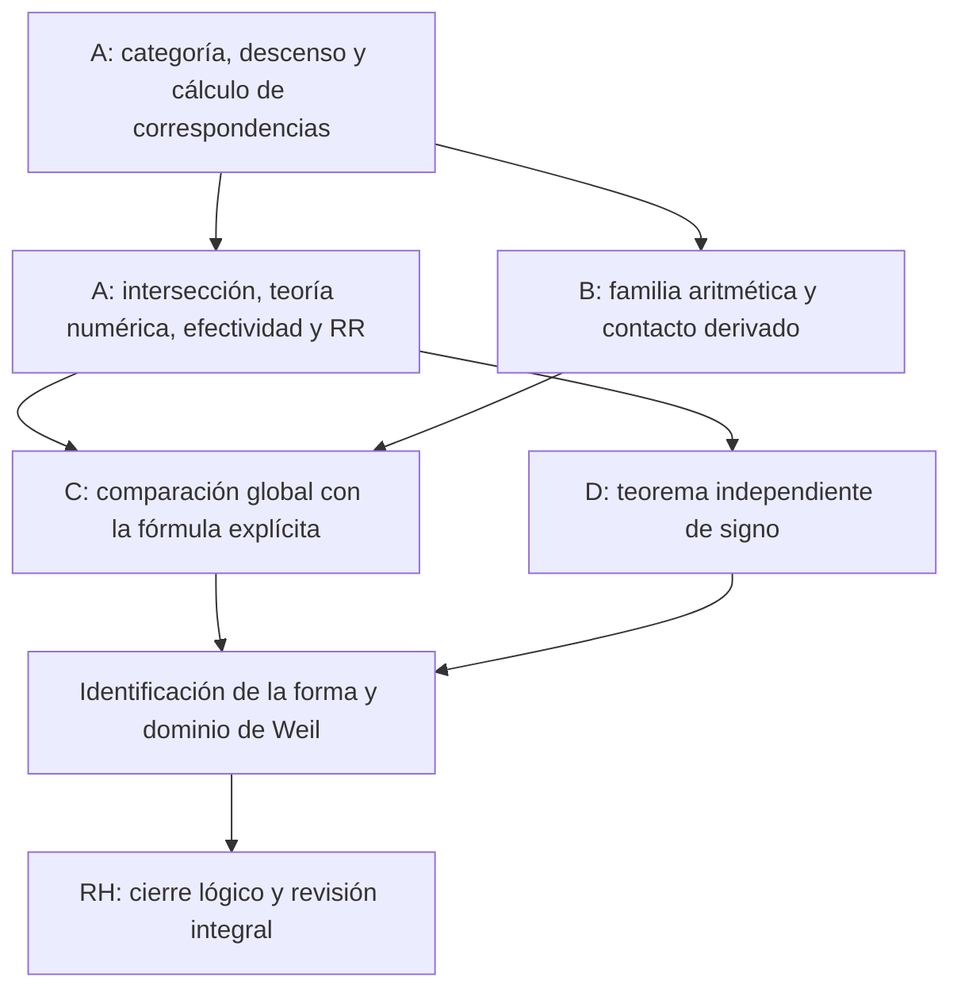

# Plan de cierre A–B–C–D sobre Spec Z

Fecha: 2026-09-05. Estado: **plan de investigación; ningún row queda cerrado por este documento**.

**Ejecución aprobada y objetivo activo.** El [registro de la primera campaña](../../03-research/phase-123-weil-strength-abc/P123_024_FIRST_CAMPAIGN_LEDGER.md) contiene las reparaciones locales, sus pruebas y el resultado del test integral de B. La siguiente construcción es la fuente integral con realización analítica; los hitos completos siguen sujetos a sus criterios de aceptación.

El objetivo es una demostración completa de los cuatro rows en una misma teoría y, mediante el criterio de Weil, de RH. El plan especifica qué habría que demostrar y cómo decidir el siguiente paso. No presupone que los candidatos actuales admitan esos teoremas ni asigna una probabilidad de éxito sin evidencia.

**Recomendación:** comenzar con una campaña corta de viabilidad A/B, acompañada por la especificación del teorema que D debe aportar. Corregir primero las dos obstrucciones de P123.018 y exigir un contacto derivado real para un primo y su cuadrado antes de invertir en la completación global. No reiniciar el cálculo de dos primos de D: ya fue realizado en P122.028.

Documentos complementarios: [primer bloque de trabajo](FIRST_CAMPAIGN.md) y [cobertura del corpus](CORPUS_COVERAGE.md).

## 1. Base de la decisión y alcance de la revisión

Se inventariaron **123 directorios de fases** y **42 directorios de papers**. Un barrido léxico cubrió **5.359 archivos `.md`, `.tex` y `.txt`** en los cinco sectores documentales indicados en el índice de cobertura. Se consultaron los mapas generales, el índice de los 42 papers, resúmenes y extractos de sus fuentes, la auditoría histórica y, con mayor detalle, las notas que sostienen el frente 119–123.

Esto es una revisión estratégica con trazabilidad, **no una nueva auditoría línea por línea de todas las demostraciones**. El inventario distingue lectura de fuentes decisivas, consulta de resúmenes y exploración mecánica. La revalidación de cualquier resultado antiguo que entre en la prueba final es una obligación del plan.

Fuentes internas que gobiernan este plan:

- [P123.018: obstrucciones del portador](../../03-research/phase-123-weil-strength-abc/P123_018_ADVERSARIAL_CARRIER_AUDIT.md).
- [Contrato fuerte de A](../../03-research/phase-123-weil-strength-abc/P123_A_ACCEPTANCE_SPECIFICATION.md).
- [P122: alcance efectivo de A/B/C y fuentes](../../03-research/phase-122-row-d-integrity-and-construction/P122_ROWS_ABC_REFERENCE_AUDIT.md).
- [Fase 119: qué separan los contactos](../../03-research/phase-119-what-a-finite-compression-certifies/RESULTS_119_SEPARATOR.md).
- [Cierre de fase 120](../../03-research/phase-120-global-polarization/PHASE_120_CLOSURE.md) y [auditoría de fase 121](../../03-research/phase-122-row-d-integrity-and-construction/P122_008_PHASE121_LOAD_BEARING_AUDIT.md).
- [P122.028: cálculo finito de Green](../../03-research/phase-122-row-d-integrity-and-construction/P122_028_TWO_PRIME_FINITE_GREEN_COMPLEX.md) y [P122.029: transmisión crítica](../../03-research/phase-122-row-d-integrity-and-construction/P122_029_LIONS_MAGENES_TRANSMISSION_AUDIT.md).
- [Reinicio histórico: fuerza-RH no es un veto](../RH-MASTER-CONTEXT/LIVE_FRONTIER_AND_RESTART_PLAN.md).

## 2. Correcciones que cambian el orden del trabajo

| Afirmación heredada | Estado que debe usarse |
|---|---|
| «Sólo falta D» | Válido únicamente con los contratos restringidos del paper 42. En el contrato fuerte faltan puentes en A, B y C. |
| «P123.014–017 cierran globalmente A.1–A.6» | P123.018 reabre el cambio de levantamiento, el descenso semilocal y operaciones de la completación. |
| «El modelo finito de dos primos es el siguiente cálculo» | Ya existe: P122.028. Falta demostrar flujo cero, no calcular la energía. |
| «Calderón o Lions–Magenes producirán automáticamente R» | P122.029 identifica la condición exacta, pero el cálculo de frontera no demuestra su cumplimiento aritmético. |
| «Una forma equivalente a RH no sirve como blanco» | Una equivalencia es un blanco legítimo; hace falta demostrar el sentido útil sin asumir RH. |
| «Todo argumento construido con Euler–Gamma es sólo un reempaquetado» | No hay aquí un teorema universal de imposibilidad. Una desigualdad nueva demostrada desde esos datos sería válida. Cada no-go debe conservar su clase exacta de hipótesis. |
| «El cono de cuadrados ya es efectividad geométrica» | Debe probarse su relación con ciclos efectivos; positividad de operadores y efectividad de ciclos son nociones distintas. |

Los índices raíz y `OPTIONS.md` contienen estados anteriores y algunas prohibiciones demasiado amplias. Se conservan como historia; no se usan para bloquear un teorema nuevo ni para certificar filas posteriores a sus auditorías.

## 3. Arquitectura de la prueba y organización de la investigación

El orden de dependencia de la prueba será:

El orden de investigación será menos rígido: los tests pequeños de B y las necesidades de D se examinan **antes** de terminar A. Evita construir una categoría que luego no pueda alojar la aritmética o el mecanismo de signo. Esto no autoriza introducir las conclusiones de B/C/D en la definición de A.

Dos frentes conceptuales acompañan la campaña, sin multiplicar portadores:

1. **Construcción A/B/C:** teoría común y teoremas de comparación.
2. **Viabilidad de D:** localizar una identidad que fuerce el signo o la anulación del defecto, manteniendo explícito qué información necesita conservar A.

El esfuerzo inicial se concentra en A/B. El análisis de D debe producir una proposición comprobable; si sólo produce otra coordenada equivalente del defecto, se registra y no desplaza la construcción principal.

## 4. G0 — fijar la contabilidad matemática

Crear un registro por resultado utilizado: identificador, enunciado con cuantificadores, dominio, prueba o referencia exacta, hipótesis importadas, dependencias, retractaciones, alcance computacional y lugar donde se usa.

Estados: `PROBADO-REVISADO`, `IMPORTADO-VERIFICADO`, `CONDICIONAL`, `CANDIDATO`, `REFUTADO-EN-ESTA-CLASE`, `NO-REVISADO`. «Finito» y «completado» deben figurar en el enunciado; no son etiquetas intercambiables.

Fijar además una sola convención de Mellin, media densidad, dagger, orientación y signo. En el perfil balanceado F, la primitividad será la anulación de las dos integrales contra `exp(t/2)` y `exp(-t/2)`. Escribir explícitamente el cambio desde `M_0,M_1` del perfil multiplicativo f. Verificar que `q=-B_nuc` sea el signo positivo usado por D.

Separar los índices: `F^m ∘ F^n=F^(m+n)` para iteraciones de Frobenius; la notación multiplicativa usa etiquetas `Q^m,Q^n`. No afirmar `Gamma_m Gamma_n=Gamma_mn` si m y n denotan simultáneamente exponentes aditivos.

**Cierre G0:** diagrama acíclico de las dependencias seleccionadas y diccionario de convenciones. No exige auditar los miles de documentos que no se usarán.

## 5. A — construir la teoría común

### A0. Elegir la categoría mínima que soporte A, B y D

Primera candidata a estudiar: ideal no unital de kernels, bimódulos esenciales y entrelazadores en multiplicadores. La correspondencia identidad vive en la categoría; no tiene que ser un elemento del ideal de traza.

Como modelo de referencia, las correspondencias de Hilbert sobre el crossed product C* permiten tipar multiplicadores e inversión. Pero el traslado al núcleo rápido/nuclear y a la aritmética integral requiere una comparación; una realización C* no demuestra por sí sola RR ni contacto ciclotómico.

Alternativa de respaldo: un álgebra unital mayor que contenga los multiplicadores necesarios. Elegirla sólo si permite demostrar las estimaciones de los tests y conservar el dato integral. La unitización mínima de P123.014 no sirve para el mapa que allí se escribió.

Para cada candidata especificar objetos, morfismos, tensor balanceado, topología, unidad, dualidad y realización geométrica. Demostrar el tensor sin usar `z tensor 1` donde no existe 1. Los cambios de levantamiento deben ser mapas con dominio y codominio correctos y coherencia triple.

**Salida:** una categoría local válida, o un contraejemplo que descarte precisamente esa candidata.

### A1. Resolver las transiciones semilocales

Mantener como base comprobable las inclusiones de coeficientes `f -> f tensor 1_Zp`. No convertirlas en una aplicación de puntos ni en extensión por uno sobre clases idèlicas.

Comparar dos opciones concretas: correspondencias de cambio de carta mediante inducción/spans de grupoides, o definición inicial sobre el grupoide adélico global y recuperación posterior de los modelos semilocales. En la opción global todavía deben demostrarse la relación con el haz sobre Spec Z y las exhaustiones de tests; «global» no elimina esas obligaciones.

Probar composición de transiciones, coherencia en tres cartas, equivalencia gauge y compatibilidad con tensor/dagger. Rehacer el ejemplo `S={infinito,2}`, `S'={infinito,2,3}` de P123.018 con la nueva operación.

La fuente externa disponible demuestra el haz de crossed products **algebraicos** y describe sus mapas de coeficientes; no importa automáticamente el descenso de la categoría completada. [Connes–Consani, §5, especialmente Teorema 5.3](https://arxiv.org/html/2501.06560v1#S5).

### A2. Someter temprano el control clásico a prueba

Reauditar P123.011: reconstruir la teoría en otra categoría clásica es un control, no una especialización demostrada del candidato aritmético.

Comprobar separadamente: grafos de automorfismos, grafos de endomorfismos finitos, transposición, diagonal, rulings e intersección. Un grafo de Frobenius no es en general invertible como bimódulo de un esquema; si sólo se tienen bimódulos invertibles, explicitar la ampliación o la categoría localizada donde la comparación tendría sentido. Distinguir Frobenius morfismo de esquemas del inverso llamado Frobenius geométrico en cohomología.

Test de efectividad: el grafo de una permutación de tres puntos es un ciclo efectivo, pero su matriz no es autoadjunta y no puede ser una suma de `X*X` en la representación matricial habitual. Esto invalida una identificación automática de ambos conos, no todo posible functor de comparación. Declarar cuál relación entre ellos es realmente necesaria para RR.

### A3. Construir la traza y el determinante con tipos separados

Definir el dominio trazable antes del valor de la traza. Si se escribe pull–tensor–push, demostrar existencia de los funtores, proyección y cambio de base; si se usa una bicategoría de bimódulos, construir su traza y compararla con contacto diagonal.

Verificar también el significado de la representación gauge: pasar a coinvariantes donde U_gamma actúa trivialmente no demuestra automáticamente una representación de toda el álgebra de coeficientes; comprobar covariancia y dominio.

Tratar por separado los contactos no identidad, el exceso en la identidad, los estratos finitos y el arquimediano. Definir la resta de la órbita genérica desde la fuente. La suma de contribuciones locales debe ser un teorema de localización.

Especificar líneas de torsión, normas, grados logarítmicos y determinantes de Fredholm. La identidad `d_rel(h)=exp(T(h))` no es por sí sola una construcción de la línea determinante intrínseca.

### A4. Probar las operaciones topológicas y numéricas

Elegir un núcleo de vectores suaves/localmente constantes preservado por la acción, o probar que el espacio alternativo de secciones es estable. Una acción continua sobre C_0 no implica automáticamente suavidad de todos sus coeficientes.

Probar continuidad conjunta de convolución, dagger y acción sobre tests; completitud; nuclearidad únicamente donde se requiere; descenso; y límites en S. No deducir continuidad bilineal LF sólo de una propiedad universal para mapas lineales.

Rehacer P123.017 usando el anti-dual apropiado. Conservar el radical vectorial `R_partial ∩ ker M`, la sucesión primitivo–numérico–Tate y la separación contra tests. Decidir si la topología es la del cociente o la inducida por J, y demostrar la relación elegida. Probar extensión de dagger y de cada acción utilizada; una acción por cada test fijo no demuestra una acción del portador completado entero.

No se exige multiplicar distribuciones arbitrarias si la prueba sólo usa la acción de correspondencias sobre clases numéricas. Sí se exige un apareamiento suficiente para todos los pares que aparecen en C y D.

### A5. Efectividad, teoría integral y RR mixto

Elegir una clase efectiva desde geometría o categorías exactas, preservando los datos discretos necesarios para la estrategia RR. Resolver qué queda del obstáculo O1 de fase 113: la sola estructura de espacio vectorial complejo no produce el crecimiento clásico de secciones.

Construir su aplicación al cociente numérico. Para un cono real completado K, demostrar `K ∩ (-K)={0}` si ésta es la propiedad utilizada, y declarar si K se obtiene cerrando antes o después del cociente. Probar estabilidad por las operaciones positivas pertinentes; nunca exigir estabilidad de un cono propio no nulo bajo todos los multiplicadores y sus negativos.

Construir un único functor determinante mixto y una comparación natural con el modelo periódico anterior. Si el modelo anterior no admite esa comparación, registrar su reemplazo explícito y demostrar de nuevo todas las propiedades consumidas; no mantener una equivalencia nominal.

La fórmula RR debe contener términos correctamente tipados de traza, exceso y renormalización, identidad, Gamma, Tate y compatibilidad con efectividad. Si D usará crecimiento de `h^0(nD)`, ese crecimiento necesita una teoría de secciones y una prueba específica: una igualdad de grados determinantes no basta.

**Cierre de A:** A0–A5 revisados, controles clásicos con su alcance explícito y ninguna hipótesis de signo pendiente escondida en efectividad/RR. La completitud de A no implicará automáticamente D.

## 6. B — producir las correspondencias aritméticas dentro de A

**Test de viabilidad temprano:** obtener en la candidata de A los objetos para `2,4,3,6` y calcular su contacto. Este test precede a la completación de A; el cierre general de B viene después.

1. Definir la categoría Witt/ciclotómica de origen, sus morfismos y su operación. La igualdad de anillos de Witt con ciertos ciclos finitos no es todavía un functor monoidal a las endocorrespondencias de A.
2. Seleccionar clases externas o correspondencias finitas reales, sin utilizar un racional diagonal que sea gauge. Probar independencia de uniformizantes, cartas y levantamientos con las transiciones reparadas.
3. Construir el functor de realización y demostrar composición, unidad y transposición, incluidas las medias densidades.
4. Derivar `LDelta* Gamma_n` en la categoría elegida. Para `n>1`, probar que su contribución aritmética pertinente se identifica con `[Z --Phi_n(1)--> Z]`; precisar cualquier truncación y demostrar que es compatible con los usos posteriores.
5. Obtener `deg_det(contacto)=log|Phi_n(1)|=Lambda(n)` como consecuencia. Tratar n=1 como identidad/exceso, no mediante esa fórmula.
6. Probar la familia general por estructura, no por extrapolación de casos. Incorporar sus clases, momentos y componentes primitivas al objeto numérico de A.

**Test que puede descartar rápidamente la candidata:** el contacto lineal simple de una dilatación usa `1-u^(-1)`, mientras que el contacto buscado es ciclotómico. Calcular ambos, con anillos y valuaciones, para p y p². Si difieren, localizar el mecanismo geométrico que produce el factor ciclotómico; no sustituir un determinante por otro porque tengan la motivación correcta.

Deninger ofrece un punto de entrada preciso: Teorema 5.1 para esquemas afines normales noetherianos y Proposición 5.2 para Frobenius/Verschiebung. Es una fuente para investigar B, sin un puente ya demostrado hacia nuestro portador ni hacia una norma de Hodge. [Deninger, §5](https://arxiv.org/html/2508.05329v1#S5).

**Cierre B:** functor y contactos derivados generales, verificaciones adversariales de `p,p²,p³,pq,p²q,pqr`, y compatibilidad con A. El índice por lugares debe conservarse: fase 119 muestra que agrupar sólo por normas pierde información.

## 7. C — identificar la intersección con la fórmula explícita

1. Fijar la clase de funciones test y la construcción de `K_h` como sección integrada o superposición admisible en A. Una suma de deltas necesita justificación como multiplicador/distribución; no se declara una función de Schwartz.
2. Construir una realización del complejo de A en el modelo de Poisson de Meyer. Debe identificar acción, cobordes, dualidad y los dos términos Tate. No se requiere una equivalencia de categorías enteras si basta una realización que preserve las operaciones usadas.
3. Probar la identidad de trazas sobre un núcleo común, con contacto finito, arquimediano e identidad. Después extender por continuidad, densidad y las estimaciones apropiadas.
4. Derivar el término primo `sum_(p,k) (log p)p^(-k/2)(h(k log p)+h(-k log p))` con la convención fijada en G0. Demostrar el término Gamma y los polares en la misma comparación.
5. Registrar el orden de límites: cartas S, corte espacial, corte espectral, regularización y ventana T. Cada intercambio necesita una estimación local uniforme o un teorema de convergencia que lo cubra. Evitar exigir uniformidad global innecesaria si una exhaustión de tests compactos basta.
6. Probar finalmente `I_A([K_F],[K_G])=B_nuc(F,G)` y que los tests primitivos de A cubren una clase suficiente para el criterio de Weil.

El resultado externo de Meyer es una realización espectral nuclear y una fórmula de carácter. Probar que esa traza es la intersección de A sigue siendo nuestro teorema de comparación. [Meyer, versión corregida](https://arxiv.org/abs/math/0412277v3).

**Cierre C:** identidad global en el dominio suficiente, con límites, Tate y Gamma, y sin asumir la localización de los ceros. Se pueden usar los ceros en el teorema de comparación de la fórmula explícita; lo prohibido es asumir su posición para demostrar el signo.

## 8. D — demostrar el signo con matemática nueva

**Ejecución, 2026-09-05:** [P123.036](../../03-research/phase-123-weil-strength-abc/P123_036_D_NORMALIZATION_AND_ENDPOINT_REPLAY.md)
reproduce las siete tareas de intervalos del certificado en `T=log2`,
comprueba sus cotas contra los datos de recombinación y verifica los
márgenes finales con Arb. También verifica que el operador de D ya usa
la normalización Gamma correcta. Queda pendiente la ley global descrita
abajo; reproducir el punto inicial no la demuestra.

D es probablemente el problema conceptual más difícil, pero A y B también contienen problemas de investigación. No se asignan porcentajes de avance a partir del número de lemas escritos.

Blanco común: `q_T(F)=-I_A([K_F],[K_F])>=0` en cada ventana y para todo F primitivo del dominio. Hay dos rutas suficientes; basta cerrar una. No acumularlas como requisitos simultáneos.

### D-H: índice de Hodge desde la teoría fuente

Construir una polarización H y demostrar un teorema de índice sobre el espacio numérico apropiado. La signatura del plano hiperbólico Tate tiene que situarse en la forma escalar de intersección pertinente: no se asigna una signatura a un vector de trazas sin especificar su scalarización geométrica.

Probar no positividad en el sector primitivo. Una ruta RR requiere crecimiento de secciones, dualidad y efecto del cono suficientes para deducir la desigualdad; una ruta de energía necesita una desigualdad global con constante exacta y dominio probado. El teorema puede ser específico de los datos aritméticos si su prueba es independiente del signo que busca.

No imponer ausencia de clases nulas globales si sólo se necesita semidefinitud: la clasificación de igualdad se exige en el alcance que efectivamente use la prueba. En rango infinito hay que reemplazar los argumentos dimensionales finitos por estimaciones o aproximaciones demostradas.

### D-E: excluir el primer contacto mediante una ley fuente

Revalidar el punto de entrada: certificado estricto en `T=log2`, teorema compacto de primer contacto P122.002, restricciones primitivas, paridad y nacimientos de canales. El certificado tiene dos niveles: recombinar cotas y regenerar los intervalos; ninguno sustituye al otro.

La reducción existente busca una ley anterior a la supertraza que, para un estado de primer contacto, anule su defecto orientado. R y S son una factorización candidata de esa obligación:

- **R:** una relación fuente de transmisión implica pertenencia del flujo entrante al espacio crítico apropiado, cancelando el salto Tate.
- **S:** la misma estructura global fuerza la coincidencia de dos canales primos pertinentes y elimina el estado mediante la rigidez ya establecida.

P122.028 fija exactamente el detector:

`E_eff(F)=||(E_q,T-E_p,T) h_F||² / log(q/p)`.

Su harmonicidad implica flujo constante, no flujo cero. El objetivo nuevo es demostrar por qué el estado aritmético debe tener flujo cero. P122.029 identifica `H^(1/2)_00` y la condición ponderada de borde; no queda una regularidad genérica por importar.

**Primer trabajo de D:** escribir una sola relación global de borde candidata y la identidad de Green que la produce, con cada término fuente y su dominio. Comprobar qué permite deducir sobre R o S sin añadir la condición de anulación como definición. Una identidad sólo local que funciona para cualquier dato no ha seleccionado todavía el estado aritmético.

Si no aparece tal ley, estudiar D-H o la desigualdad firmada directa de los papers 36–40; no volver a construir detectores fieles. Una prueba directa de un criterio equivalente a RH es válida. Para completar además los cuatro rows solicitados deberá transportarse a la teoría A mediante C y cubrir el sector declarado de D; demostrar RH por otra ruta no rellena retroactivamente los puentes A/B/C.

**Cierre D:** una demostración independiente de D-H o D-E con todas sus hipótesis verificadas, y signo transferido al dominio de C. Ninguna hipótesis «existe una contracción», «hay una métrica positiva» o «la conexión es horizontal» puede quedar sin probar.

## 9. Falsadores y controles permanentes

| Control | Pregunta que decide | Lo que no decide |
|---|---|---|
| Campos finitos | ¿Recuperamos las operaciones e intersecciones clásicas mediante un mapa especificado? | No transporta Hodge a Z por analogía. |
| Cambio de levantamiento/cartas | ¿El objeto es independiente de las elecciones prometidas? | No prueba contacto ni signo. |
| Davenport–Heilbronn | ¿Qué hipótesis aritmética concreta falla en este control? | Un argumento puede distinguirlo y aun no probar RH. |
| Par desplazado `xi(s+a)xi(s-a)` | ¿La hipótesis usa algo más que simetría y pesos positivos? | No es contraejemplo a una clase que lo excluya por otras hipótesis probadas. |
| Modelos matriciales y cambios de puertos | ¿Una identidad formal pierde orientación o confunde conos? | No certifican completitud o descenso. |
| Zeta de cuerpos de números | ¿Qué generalidad tendría el teorema? | Una extensión a GRH necesita comprobar todas las hipótesis de nuevo. |
| Ventanas y discretizaciones | ¿Hay errores de normalización, umbral o colas? | Positividad finita no es positividad del operador completo sin cota del complemento. |

Los contraejemplos deben satisfacer las hipótesis exactas del candidato antes de invalidarlo. Los tests numéricos ayudan a falsar o conjeturar; la prueba final necesita argumentos exactos o intervalos más estimaciones uniformes.

## 10. Hitos y decisiones de continuación

| Hito | Entregable y aceptación | Si falla |
|---|---|---|
| M0 | Registro de dependencias y convenciones coherentes | Corregir el enunciado antes de construir. |
| M1 | Categoría local con cambio de levantamiento bien tipado | Cambiar la categoría, no sólo el nombre del mapa. |
| M2 | Transiciones coherentes y control `S -> S' -> S''` | Evaluar el modelo global con su propio teorema de comparación. |
| M3 | Prototipo B para 2,4,3,6 con contacto derivado | Rechazar la identificación entre grafos simples y dato ciclotómico, o construir su ampliación justificada. |
| M4 | A completa en su dominio, con efectividad/RR | Localizar el lema faltante; no declarar cierre parcial como cierre total. |
| M5 | B general y comparación C global | Conservar resultados aritméticos/analíticos por separado hasta probar el puente. |
| M6 | Ley nueva que pruebe D-H o D-E | Registrar la clase descartada y evaluar la alternativa firmada, sin renombrar el mismo supuesto. |
| M7 | Prueba ensamblada, dependencias sin hipótesis abiertas y revisión integral | Reabrir exactamente las dependencias afectadas. |

M1–M3 son la primera campaña concreta. M6 se prepara desde el principio como una especificación y prueba de viabilidad, pero su aceptación final depende de la teoría identificada.

No hay calendario honesto para M6 ni para RH. Cada bloque se mide por una salida matemática —prueba, comparación o contraejemplo—, no por cantidad de documentos. Tras cada candidata, revisar si cambió un enunciado abierto o sólo su notación.

## 11. Cierre integral de la prueba

1. Redactar el teorema final con exactamente el dominio demostrado y el signo normalizado.
2. Comprobar que los tests cubiertos bastan para el criterio de Weil; demostrar cualquier densidad o aproximación necesaria.
3. Eliminar todas las condiciones abiertas del grafo de dependencias. Las equivalencias circulares no cuentan como demostraciones de sus miembros.
4. Reproducir sólo los certificados que la prueba usa, incluidos generadores de intervalos y cotas de complementos.
5. Auditar independientemente categorías/descenso, determinantes/RR, análisis funcional, aritmética de contactos, fórmula explícita y signo.
6. Actualizar el paper 42 a la teoría realmente demostrada. Si cambia la arquitectura, reescribir el enunciado y no añadir una capa incompatible de notación.

La revisión externa es una etapa de verificación científica, no una premisa matemática. Este plan no envía documentos ni solicita revisión a terceros.

## 12. Qué conviene hacer ahora

**Empezar por M1 y M2, con el test M3 ya escrito.** La primera meta positiva es demostrar que una misma correspondencia conserva su clase al cambiar de levantamiento y carta, compone correctamente y admite un contacto diagonal calculable. Es un avance verificable y necesario.

Al mismo tiempo, mantener una sola pregunta visible para D: **¿qué identidad aritmética global fuerza el flujo cero que P122.028 no obtiene de la harmonicidad?** El plan no promete encontrarla, pero sitúa el trabajo exactamente donde una prueba nueva cambiaría el estado del problema.
