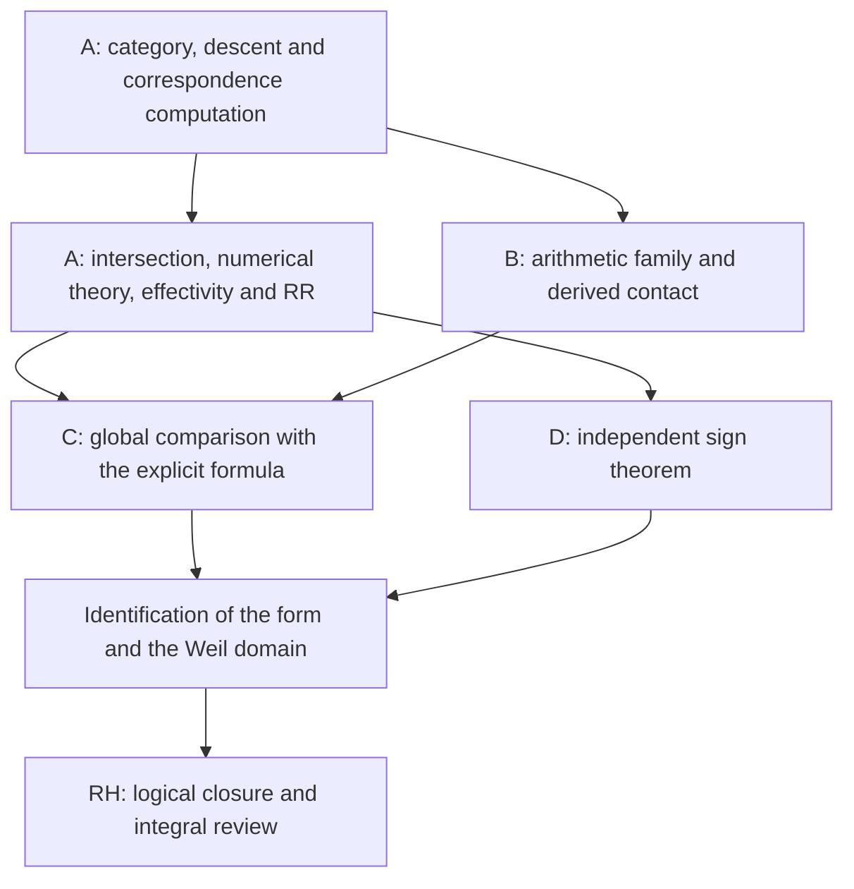

# A–B–C–D closure plan on Spec Z

Status: **research plan; no row is closed by this document**.

**Execution approved and active objective.** The [first-campaign record](../../03-research/phase-123-weil-strength-abc/P123_024_FIRST_CAMPAIGN_LEDGER.md) contains the local repairs, their proofs and the result of B's integral test. The next construction is the integral source with analytic realization; the full milestones remain subject to their acceptance criteria.

The objective is a complete proof of the four rows within a single theory and, via the Weil criterion, of RH. The plan specifies what would need to be proved and how to decide the next step. It does not presuppose that the current candidates admit those theorems, nor does it assign a probability of success without evidence.

**Recommendation:** start with a short A/B viability campaign, accompanied by the specification of the theorem that D must deliver. First correct the two obstructions of P123.018 and require a genuine derived contact for a prime and its square before investing in the global completion. Do not restart D's two-prime computation: it was already carried out in P122.028.

Complementary documents: [first work block](FIRST_CAMPAIGN.md) and [corpus coverage](CORPUS_COVERAGE.md).

## 1. Basis of the decision and scope of the review

**123 phase directories** and **42 paper directories** were inventoried. A lexical sweep covered **5,359 `.md`, `.tex` and `.txt` files** across the five documentary sectors listed in the coverage index. The general maps, the index of the 42 papers, summaries and excerpts of their sources, the historical audit and, in more detail, the notes underlying the 119–123 front were consulted.

This is a strategic review with traceability, **not a new line-by-line audit of every proof**. The inventory distinguishes reading of decisive sources, consultation of summaries, and mechanical exploration. Revalidating any old result that enters the final proof is an obligation of the plan.

Internal sources governing this plan:

- [P123.018: carrier obstructions](../../03-research/phase-123-weil-strength-abc/P123_018_ADVERSARIAL_CARRIER_AUDIT.md).
- [Strong contract for A](../../03-research/phase-123-weil-strength-abc/P123_A_ACCEPTANCE_SPECIFICATION.md).
- [P122: effective scope of A/B/C and sources](../../03-research/phase-122-row-d-integrity-and-construction/P122_ROWS_ABC_REFERENCE_AUDIT.md).
- [Phase 119: what the contacts separate](../../03-research/phase-119-what-a-finite-compression-certifies/RESULTS_119_SEPARATOR.md).
- [Phase 120 closure](../../03-research/phase-120-global-polarization/PHASE_120_CLOSURE.md) and [phase 121 audit](../../03-research/phase-122-row-d-integrity-and-construction/P122_008_PHASE121_LOAD_BEARING_AUDIT.md).
- [P122.028: finite Green computation](../../03-research/phase-122-row-d-integrity-and-construction/P122_028_TWO_PRIME_FINITE_GREEN_COMPLEX.md) and [P122.029: critical transmission](../../03-research/phase-122-row-d-integrity-and-construction/P122_029_LIONS_MAGENES_TRANSMISSION_AUDIT.md).
- [Historical reset: RH-strength is not a veto](../RH-MASTER-CONTEXT/LIVE_FRONTIER_AND_RESTART_PLAN.md).

## 2. Corrections that change the order of work

| Inherited claim | Status that should be used |
|---|---|
| "Only D is missing" | Valid only under the restricted contracts of paper 42. Under the strong contract, bridges are missing in A, B and C. |
| "P123.014–017 globally close A.1–A.6" | P123.018 reopens the lift change, the semilocal descent and completion operations. |
| "The finite two-prime model is the next computation" | It already exists: P122.028. What is missing is proving zero flow, not computing the energy. |
| "Calderón or Lions–Magenes will automatically produce R" | P122.029 identifies the exact condition, but the boundary computation does not prove its arithmetic fulfillment. |
| "A form equivalent to RH is not a valid target" | An equivalence is a legitimate target; what is needed is proving the useful direction without assuming RH. |
| "Any argument built with Euler–Gamma is just a repackaging" | There is no universal impossibility theorem here. A new inequality proved from that data would be valid. Every no-go must keep its exact hypothesis class. |
| "The cone of squares is already geometric effectivity" | Its relation to effective cycles must be proved; operator positivity and cycle effectivity are distinct notions. |

The root indices and `OPTIONS.md` contain earlier states and some overly broad prohibitions. They are kept as history; they are not used to block a new theorem nor to certify rows beyond their audits.

## 3. Architecture of the proof and organization of the research

The dependency order of the proof will be:

The research order will be less rigid: the small tests for B and the needs of D are examined **before** finishing A. This avoids building a category that could later fail to host the arithmetic or the sign mechanism. This does not authorize introducing the conclusions of B/C/D into the definition of A.

Two conceptual fronts accompany the campaign, without multiplying carriers:

1. **A/B/C construction:** common theory and comparison theorems.
2. **D viability:** locate an identity that forces the sign or the vanishing of the defect, keeping explicit what information A needs to preserve.

The initial effort concentrates on A/B. The analysis of D must produce a checkable proposition; if it only produces another equivalent coordinate of the defect, it is recorded and does not displace the main construction.

## 4. G0 — fix the mathematical bookkeeping

Create a record per result used: identifier, statement with quantifiers, domain, exact proof or reference, imported hypotheses, dependencies, retractions, computational scope, and where it is used.

States: `PROVED-REVIEWED`, `IMPORTED-VERIFIED`, `CONDITIONAL`, `CANDIDATE`, `REFUTED-IN-THIS-CLASS`, `NOT-REVIEWED`. "Finite" and "completed" must appear in the statement; they are not interchangeable labels.

Also fix a single convention for Mellin, half-density, dagger, orientation and sign. In the balanced profile F, primitivity will be the vanishing of the two integrals against `exp(t/2)` and `exp(-t/2)`. Write out explicitly the change from `M_0,M_1` of the multiplicative profile f. Verify that `q=-B_nuc` is the positive sign used by D.

Separate the indices: `F^m ∘ F^n=F^(m+n)` for Frobenius iterations; the multiplicative notation uses labels `Q^m,Q^n`. Do not claim `Gamma_m Gamma_n=Gamma_mn` if m and n simultaneously denote additive exponents.

**G0 closure:** acyclic diagram of the selected dependencies and a dictionary of conventions. It does not require auditing the thousands of documents that will not be used.

## 5. A — build the common theory

### A0. Choose the minimal category that supports A, B and D

First candidate to study: non-unital ideal of kernels, essential bimodules and intertwiners in multipliers. The identity correspondence lives in the category; it need not be an element of the trace ideal.

As a reference model, Hilbert correspondences over the crossed-product C* allow typing multipliers and inversion. But the transfer to the fast/nuclear kernel and to integral arithmetic requires a comparison; a C* realization alone does not prove RR nor cyclotomic contact.

Backup alternative: a larger unital algebra containing the necessary multipliers. Choose it only if it allows proving the estimates of the tests and preserving the integral datum. The minimal unitization of P123.014 does not work for the map written there.

For each candidate, specify objects, morphisms, balanced tensor, topology, unit, duality and geometric realization. Prove the tensor without using `z tensor 1` where no 1 exists. Lift changes must be maps with correct domain and codomain and triple coherence.

**Output:** a valid local category, or a counterexample ruling out precisely that candidate.

### A1. Resolve the semilocal transitions

Keep as a checkable base the coefficient inclusions `f -> f tensor 1_Zp`. Do not turn them into a point map nor into extension by one over idelic classes.

Compare two concrete options: chart-change correspondences via induction/spans of groupoids, or an initial definition over the global adelic groupoid with later recovery of the semilocal models. In the global option, the relation with the sheaf over Spec Z and the exhaustions of tests must still be proved; "global" does not remove those obligations.

Prove composition of transitions, coherence across three charts, gauge equivalence and compatibility with tensor/dagger. Redo the example `S={infinity,2}`, `S'={infinity,2,3}` of P123.018 with the new operation.

The available external source proves the sheaf of **algebraic** crossed products and describes its coefficient maps; it does not automatically import the descent of the completed category. [Connes–Consani, §5, especially Theorem 5.3](https://arxiv.org/html/2501.06560v1#S5).

### A2. Subject the classical control to an early test

Re-audit P123.011: reconstructing the theory in another classical category is a control, not a proved specialization of the arithmetic candidate.

Check separately: graphs of automorphisms, graphs of finite endomorphisms, transposition, diagonal, rulings and intersection. A Frobenius graph is not in general invertible as a scheme bimodule; if only invertible bimodules are available, make explicit the enlargement or the localized category where the comparison would make sense. Distinguish the Frobenius scheme morphism from the inverse called geometric Frobenius in cohomology.

Effectivity test: the graph of a permutation of three points is an effective cycle, but its matrix is not self-adjoint and cannot be a sum of `X*X` in the usual matrix representation. This invalidates an automatic identification of the two cones, not every possible comparison functor. State which relation between them is actually needed for RR.

### A3. Build the trace and the determinant with separate types

Define the traceable domain before the value of the trace. If pull–tensor–push is written, prove existence of the functors, projection and base change; if a bicategory of bimodules is used, build its trace and compare it with diagonal contact.

Also verify the meaning of the gauge representation: passing to coinvariants where U_gamma acts trivially does not automatically prove a representation of the whole coefficient algebra; check covariance and domain.

Treat separately the non-identity contacts, the excess at the identity, the finite strata and the archimedean one. Define the subtraction of the generic orbit from the source. The sum of local contributions must be a localization theorem.

Specify torsion lines, norms, logarithmic degrees and Fredholm determinants. The identity `d_rel(h)=exp(T(h))` is not by itself a construction of the intrinsic determinant line.

### A4. Prove the topological and numerical operations

Choose a kernel of smooth/locally constant vectors preserved by the action, or prove that the alternative space of sections is stable. A continuous action on C_0 does not automatically imply smoothness of all its coefficients.

Prove joint continuity of convolution, dagger and action on tests; completeness; nuclearity only where required; descent; and limits over S. Do not deduce bilinear LF continuity merely from a universal property for linear maps.

Redo P123.017 using the appropriate anti-dual. Keep the vector radical `R_partial ∩ ker M`, the primitive–numerical–Tate sequence and the separation against tests. Decide whether the topology is the quotient one or the one induced by J, and prove the chosen relation. Prove extension of dagger and of each action used; an action for each fixed test does not prove an action of the entire completed carrier.

There is no requirement to multiply arbitrary distributions if the proof only uses the action of correspondences on numerical classes. A pairing sufficient for all pairs appearing in C and D is required.

### A5. Effectivity, integral theory and mixed RR

Choose an effective class from geometry or exact categories, preserving the discrete data needed for the RR strategy. Resolve what remains of obstacle O1 from phase 113: the mere structure of a complex vector space does not produce the classical growth of sections.

Build its application to the numerical quotient. For a completed real cone K, prove `K ∩ (-K)={0}` if this is the property being used, and state whether K is obtained by closing before or after the quotient. Prove stability under the relevant positive operations; never require stability of a nonzero proper cone under all multipliers and their negatives.

Build a single mixed determinant functor and a natural comparison with the earlier periodic model. If the earlier model does not admit that comparison, record its explicit replacement and prove again all the properties consumed; do not keep a nominal equivalence.

The RR formula must contain correctly typed terms for trace, excess and renormalization, identity, Gamma, Tate and compatibility with effectivity. If D will use growth of `h^0(nD)`, that growth needs a theory of sections and a specific proof: an equality of determinant degrees is not enough.

**Closure of A:** A0–A5 reviewed, classical controls with their explicit scope, and no sign hypothesis left pending hidden inside effectivity/RR. Completeness of A will not automatically imply D.

## 6. B — produce the arithmetic correspondences within A

**Early viability test:** obtain, in A's candidate, the objects for `2,4,3,6` and compute their contact. This test precedes the completion of A; the general closure of B comes afterward.

1. Define the source Witt/cyclotomic category, its morphisms and its operation. The equality of Witt rings with certain finite cycles is not yet a monoidal functor to A's endocorrespondences.
2. Select external classes or genuine finite correspondences, without using a diagonal rational that is gauge. Prove independence of uniformizers, charts and lifts with the repaired transitions.
3. Build the realization functor and prove composition, unit and transposition, including half-densities.
4. Derive `LDelta* Gamma_n` in the chosen category. For `n>1`, prove that its relevant arithmetic contribution is identified with `[Z --Phi_n(1)--> Z]`; specify any truncation and prove it is compatible with later uses.
5. Obtain `deg_det(contact)=log|Phi_n(1)|=Lambda(n)` as a consequence. Treat n=1 as identity/excess, not via that formula.
6. Prove the general family by structure, not by extrapolation of cases. Incorporate its classes, moments and primitive components into A's numerical object.

**Test that can quickly rule out the candidate:** the simple linear contact of a dilation uses `1-u^(-1)`, while the sought contact is cyclotomic. Compute both, with rings and valuations, for p and p². If they differ, locate the geometric mechanism producing the cyclotomic factor; do not substitute one determinant for another just because they have the right motivation.

Deninger offers a precise entry point: Theorem 5.1 for normal noetherian affine schemes and Proposition 5.2 for Frobenius/Verschiebung. It is a source for investigating B, without an already proved bridge towards our carrier nor towards a Hodge norm. [Deninger, §5](https://arxiv.org/html/2508.05329v1#S5).

**B closure:** functor and general derived contacts, adversarial checks of `p,p²,p³,pq,p²q,pqr`, and compatibility with A. The index by places must be preserved: phase 119 shows that grouping only by norms loses information.

## 7. C — identify the intersection with the explicit formula

1. Fix the class of test functions and the construction of `K_h` as an integrated section or admissible superposition in A. A sum of deltas needs justification as a multiplier/distribution; a Schwartz function is not declared.
2. Build a realization of A's complex in Meyer's Poisson model. It must identify action, coboundaries, duality and the two Tate terms. A whole-category equivalence is not required if a realization preserving the operations used is enough.
3. Prove the trace identity over a common kernel, with finite, archimedean and identity contact. Then extend by continuity, density and the appropriate estimates.
4. Derive the prime term `sum_(p,k) (log p)p^(-k/2)(h(k log p)+h(-k log p))` with the convention fixed in G0. Prove the Gamma term and the poles in the same comparison.
5. Record the order of limits: charts S, spatial cutoff, spectral cutoff, regularization and window T. Each interchange needs a uniform local estimate or a convergence theorem covering it. Avoid requiring unnecessary global uniformity if an exhaustion by compact tests suffices.
6. Finally prove `I_A([K_F],[K_G])=B_nuc(F,G)` and that A's primitive tests cover a class sufficient for the Weil criterion.

Meyer's external result is a nuclear spectral realization and a character formula. Proving that this trace is A's intersection remains our comparison theorem. [Meyer, corrected version](https://arxiv.org/abs/math/0412277v3).

**C closure:** global identity on the sufficient domain, with limits, Tate and Gamma, and without assuming the location of the zeros. The zeros may be used in the comparison theorem for the explicit formula; what is forbidden is assuming their position to prove the sign.

## 8. D — prove the sign with new mathematics

**Execution, :** [P123.036](../../03-research/phase-123-weil-strength-abc/P123_036_D_NORMALIZATION_AND_ENDPOINT_REPLAY.md)
reproduces the seven interval tasks of the certificate at `T=log2`,
checks its bounds against the recombination data, and verifies the
final margins with Arb. It also verifies that D's operator already uses
the correct Gamma normalization. The global law described
below remains pending; reproducing the starting point does not prove it.

D is probably the hardest conceptual problem, but A and B also contain research problems. No progress percentages are assigned based on the number of lemmas written.

Common target: `q_T(F)=-I_A([K_F],[K_F])>=0` in every window and for every primitive F of the domain. There are two sufficient routes; closing one suffices. They should not be accumulated as simultaneous requirements.

### D-H: Hodge index from the source theory

Build a polarization H and prove an index theorem over the appropriate numerical space. The signature of the Tate hyperbolic plane must be placed in the relevant scalar intersection form: a signature is not assigned to a vector of traces without specifying its geometric scalarization.

Prove non-positivity in the primitive sector. An RR route requires growth of sections, duality and cone effect sufficient to deduce the inequality; an energy route needs a global inequality with an exact constant and a proved domain. The theorem may be specific to the arithmetic data if its proof is independent of the sign it seeks.

Do not impose absence of global null classes if only semidefiniteness is needed: the classification of equality is required at the scope that the proof actually uses. In infinite rank, finite dimensional arguments must be replaced by proved estimates or approximations.

### D-E: rule out first contact via a source law

Revalidate the entry point: strict certificate at `T=log2`, compact first-contact theorem P122.002, primitive restrictions, parity and channel births. The certificate has two levels: recombining bounds and regenerating the intervals; neither replaces the other.

The existing reduction seeks a law prior to the supertrace that, for a first-contact state, annihilates its oriented defect. R and S are a candidate factorization of that obligation:

- **R:** a source transmission relation implies that the incoming flow belongs to the appropriate critical space, cancelling the Tate jump.
- **S:** the same global structure forces the coincidence of two relevant prime channels and removes the state via the rigidity already established.

P122.028 fixes exactly the detector:

`E_eff(F)=||(E_q,T-E_p,T) h_F||² / log(q/p)`.

Its harmonicity implies constant flow, not zero flow. The new objective is to prove why the arithmetic state must have zero flow. P122.029 identifies `H^(1/2)_00` and the weighted boundary condition; no generic regularity remains to be imported.

**First task of D:** write a single candidate global boundary relation and the Green identity that produces it, with each source term and its domain. Check what it allows to be deduced about R or S without adding the vanishing condition as a definition. An identity that is only local and works for any data has not yet selected the arithmetic state.

If no such law appears, study D-H or the direct signed inequality from papers 36–40; do not rebuild faithful detectors again. A direct proof of a criterion equivalent to RH is valid. To also complete the four rows requested, it will have to be carried over to theory A via C and cover D's declared sector; proving RH by another route does not retroactively fill in the A/B/C bridges.

**D closure:** an independent proof of D-H or D-E with all its hypotheses verified, and the sign transferred to C's domain. No hypothesis such as "a contraction exists," "there is a positive metric," or "the connection is horizontal" may be left unproved.

## 9. Falsifiers and permanent controls

| Control | Question it decides | What it does not decide |
|---|---|---|
| Finite fields | Do we recover the classical operations and intersections via a specified map? | It does not transport Hodge to Z by analogy. |
| Lift/chart change | Is the object independent of the promised choices? | It does not prove contact nor sign. |
| Davenport–Heilbronn | Which concrete arithmetic hypothesis fails in this control? | An argument may distinguish it and still not prove RH. |
| Shifted pair `xi(s+a)xi(s-a)` | Does the hypothesis use anything beyond symmetry and positive weights? | It is not a counterexample to a class that excludes it via other proved hypotheses. |
| Matrix models and port changes | Does a formal identity lose orientation or confuse cones? | They do not certify completeness or descent. |
| Zeta of number fields | How general would the theorem be? | An extension to GRH needs all hypotheses checked again. |
| Windows and discretizations | Are there normalization, threshold or tail errors? | Finite positivity is not positivity of the full operator without a bound on the complement. |

Counterexamples must satisfy the candidate's exact hypotheses before invalidating it. Numerical tests help to falsify or conjecture; the final proof needs exact arguments or intervals plus uniform estimates.

## 10. Milestones and continuation decisions

| Milestone | Deliverable and acceptance | If it fails |
|---|---|---|
| M0 | Dependency record and coherent conventions | Correct the statement before building. |
| M1 | Local category with well-typed lift change | Change the category, not just the map's name. |
| M2 | Coherent transitions and `S -> S' -> S''` control | Evaluate the global model with its own comparison theorem. |
| M3 | B prototype for 2,4,3,6 with derived contact | Reject the identification between simple graphs and the cyclotomic datum, or build a justified enlargement. |
| M4 | A complete on its domain, with effectivity/RR | Locate the missing lemma; do not declare partial closure as total closure. |
| M5 | General B and global C comparison | Keep arithmetic/analytic results separate until the bridge is proved. |
| M6 | New law proving D-H or D-E | Record the discarded class and evaluate the signed alternative, without renaming the same assumption. |
| M7 | Assembled proof, dependencies with no open hypotheses, and integral review | Reopen exactly the affected dependencies. |

M1–M3 are the first concrete campaign. M6 is prepared from the start as a specification and viability test, but its final acceptance depends on the identified theory.

There is no honest schedule for M6 nor for RH. Each block is measured by a mathematical output — proof, comparison or counterexample —, not by the number of documents. After each candidate, check whether it changed an open statement or only its notation.

## 11. Integral closure of the proof

1. Draft the final theorem with exactly the proved domain and the normalized sign.
2. Check that the covered tests suffice for the Weil criterion; prove any necessary density or approximation.
3. Remove all open conditions from the dependency graph. Circular equivalences do not count as proofs of their members.
4. Reproduce only the certificates the proof uses, including interval generators and bounds on complements.
5. Independently audit categories/descent, determinants/RR, functional analysis, contact arithmetic, the explicit formula and the sign.
6. Update paper 42 to the actually proved theory. If the architecture changes, rewrite the statement and do not add an incompatible layer of notation.

External review is a stage of scientific verification, not a mathematical premise. This plan does not send documents nor request review from third parties.

## 12. What is worth doing now

**Start with M1 and M2, with the M3 test already written.** The first positive goal is to prove that the same correspondence keeps its class under a change of lift and chart, composes correctly, and admits a computable diagonal contact. This is a verifiable and necessary advance.

At the same time, keep a single visible question for D: **which global arithmetic identity forces the zero flow that P122.028 does not obtain from harmonicity?** The plan does not promise to find it, but it places the work exactly where a new proof would change the state of the problem.
