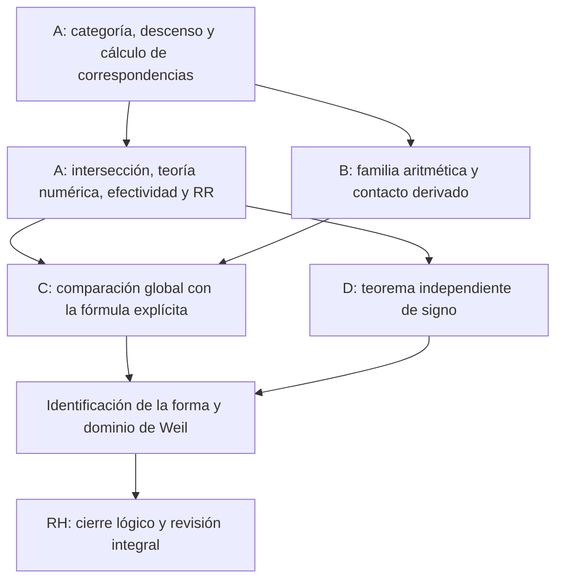

# Plan de cierre A–B–C–D sobre Spec Z

Fecha: 2026-09-05. Estado: **plan de investigación; ningún row queda cerrado por este documento**.

**Actualización 2026-09-12.** Los rows A y B quedan cerrados a fuerza-Weil
sobre el sector de grafos, en
[paper 43](../../04-papers/43-row-a-torsion-theory/main.md) (fase 125) y
[paper 44](../../04-papers/44-row-b-arithmetic-family/main.md) (fase 126).
El bloqueo de B (§6, "test que puede descartar rápidamente la candidata", y
P123.060) se resuelve por soporte coprimo: los dos contactos viven en `V(n)` y
`V(n−1)`, y el factor local de A es su producto.  El requisito §6.6 de
monoidalidad de la extracción primitiva queda **refutado** como requisito
(`Λ(6)=0≠log 6`) y reemplazado por la estructura correcta.  C hereda una
obligación nueva y exacta: absorber `w_unit(Γ_n)=n−1` en los sectores Tate y
Gamma.

**Corrección 2026-09-12 (fase 128).** Tres auditorías adversariales de los
papers 43, 44 y 45 encontraron errores reales. **Las tres etiquetas
`WEIL-STRENGTH-COMPLETE` quedan retiradas.** Etiquetas honestas, hallazgos,
verificaciones y disposiciones en
[fase 128](../../03-research/phase-128-adversarial-audit/), y lo que
efectivamente sobrevive en
[D128.004](../../03-research/phase-128-adversarial-audit/D128_004_WHAT_SURVIVES.md).  Esa obligación queda **descargada** en
[paper 45](../../04-papers/45-row-c-explicit-formula/main.md) (fase 127), que
cierra C sin caja negra analítica: no hay términos de esquina porque
`log p / log q` es irracional, el término arquimediano es el determinante zeta
del operador de módulo, los polos son los rulings, y se cierra además el hueco
—registrado en `113_07` y nunca cubierto— del paso `q_T >= 0` sobre tests
primitivos ⟹ RH.  D hereda un enunciado de índice de Hodge.

**Actualización 2026-09-12 (fase 130).** Row A recupera la etiqueta
`WEIL-STRENGTH-COMPLETE` sobre el carrier declarado (carta finita fija,
sistema de cartas y colímite como estructura adicional, sector invertible),
con A.6 bajo la enmienda aceptada por el propietario y A.8 con target
`Pic_b(B_T)` forzado por el Teorema 10.8 de
[paper 43](../../04-papers/43-row-a-torsion-theory/main.md). Decisión de la
auditoría de registro en
[R130.005](../../03-research/phase-130-row-a-closure/R130_005_LEAD_FINAL_AUDIT_AND_LABEL.md);
disenso del auditor hostil sobre A.8 registrado. B y C siguen con sus
etiquetas de fase 128 hasta sus propias campañas.

**Actualización 2026-09-12 (fase 131).** Row B reconstruido en
[paper 44](../../04-papers/44-row-b-arithmetic-family/main.md) alrededor de la
clase de norma `Γ_n^rad`; contacto finito `Λ(n)n^{-1/2}` como volumen de la capa
de valuación; la obligación `n−1` a C queda retirada. Etiqueta (auditoría de
registro [R131.005](../../03-research/phase-131-row-b-closure/R131_005_LEAD_FINAL_AUDIT_AND_LABEL.md)):
`WEIL-STRENGTH-COMPLETE` sobre el carrier declarado, **condicional a la
aceptación por el propietario de la enmienda B.4** (§6 punto 4, nota).

**Actualización 2026-09-12 (fase 131, cierre final, R131.019).** Row B cerrado
tras siete rondas del constructor y cinco auditorías hostiles. Objeto final: la
familia de Frobenius `Frob_n` (medidas de Haar de los estratos de puntos fijos,
unidad verdadera, semigrupo inverso graduado por conjuntos de primos); sombra
integral `Sh_Z` sobre los objetos (B.4 enmendado probado en grado); dos formas
de Gram: el núcleo de Weil es la forma de Gram de `Frob ⋆ Δ^rad` y la familia
de Frobenius sola lleva la mitad finita (Thm 8bis.1e); `vol(Z_p^×) = log p` es
la única normalización con residuo de Tate universal (Thm 8bis.8, módulo escala
global). Etiqueta: `ROW B: WEIL-STRENGTH-COMPLETE en el portador declarado del
Paper 43`. Registrado junto a la etiqueta: sin signo, sin ceros; la interfaz
con el criterio de Weil es un enunciado de colímite y falso a carta finita;
ningún ritmo de divergencia es libre de convención; el import `(Wgr)` fue
retirado como falso (Lema 8bis.6b) y «positividad en perfiles de Dirichlet ⟹
RH» queda `OPEN`. Sigue la fila C (Paper 45), con la corrección de su §11.

**Actualización 2026-09-12 (fase 132, cierre de C, R132.007).** El Paper 45 estaba
escrito contra la fila A antigua (completación de Fell, `E_u`, estratos de ceros,
`χ_A` ensamblado) y fue reconstruido sobre los Papers 43 y 44 cerrados: la clase
test es `Γ_h ∈ D_A^{rad}` (Paper 44 Def 3bis.6); la identidad de trazas es Paper 43
Thm 8.8 evaluado por el Lema 5.1a; **la fórmula explícita de Weil se prueba en el
repositorio** (Thm 9.4, contorno correcto: reflexión primero, expansión en
`Re s = c > 1`, desplazamiento de cada término primo con integrando entero); el
teorema de comparación `T_∞(Γ_{F⋆F^†}) = 2Φ_F(0)Φ_F(1) − Σ_ρ Φ_F(ρ)Φ_F(1−ρ)` con
cuantificador de colímite (C1); `c = 0` deja de ser declaración de A y es la única
constante con `I_∞ = B_nuc` (Cor 9.6a, cierra D128 C9); los polos de Tate por
residuos del símbolo de Euler continuado (Thm 9bis.2′: `|S_f|+1` y `0` a carta,
`1` y `1` en la continuación); suficiencia de los tests primitivos (Thm 10.4 con
la corrección C10). Etiqueta: `ROW C: WEIL-STRENGTH-COMPLETE en el portador
declarado`, otorgada tras tres rondas y dos auditorías hostiles. Registrado junto
a la etiqueta: normalización `c = 0` portante y fijada; aditividad por lugares
definicional (no localización); sin signo; imports (E1)–(E8), (R1) nombrados;
Mertens en cuarentena. Filas A, B, C completas; sigue el panel de revisión de
tres agentes y luego la fila D.

**Actualización 2026-09-12 (fase 133, panel de revisión A/B/C).** Tres revisores
independientes (pruebas; conexiones; etiquetas y cadena a RH). Sin FATAL. Panel 1:
más de treinta teoremas portantes re-derivados, cuatro MAJOR de exposición reparados.
Panel 2: una teoría consistente, sin contradicción cruzada; referencia colgante y
relabel no propagado reparados; objetivo de la fila D ahora encajonado idénticamente
en los tres papers. Panel 3: etiquetas honestas tal como están registradas; el
nombre sobreafirma frente a la especificación §1 (igualdad de carga estructural con
Weil, no establecida según Paper 43 §11bis); los disensos de A.8 y B.7 los gana el
auditor hostil y deben ir al propietario como enmiendas (síntesis §4.2, decisión
pendiente). Mapa paso a paso frente a Weil (síntesis §3): cadena completa por
encima del signo; falta exactamente un functor a algo con invariante no negativo
más un teorema de anulación que convierta la igualdad (10.10) en desigualdad. La
fila D se abre tras la decisión del propietario sobre A.8 y B.7.

**Actualización 2026-09-12 (fase 133, enmiendas A.8 y B.7 aceptadas).** `[phase 133, amendment accepted 2026-09-12]` El propietario (D. Trejo Pizzo) aceptó las dos enmiendas propuestas en PANEL_SYNTHESIS §4.2: A.8 (Paper 43, row A) y B.7 (Paper 44, row B). Ambas cláusulas pasan a `REFUTADO TAL COMO ESTÁ ESCRITO + PROBADO COMO ENMENDADO`; las decisiones por fallo del lead (R130.005 para A.8, R131.019 para B.7) quedan superadas por la decisión del propietario y los disensos de los auditores hostiles quedan registrados como historia. Las etiquetas `WEIL-STRENGTH-COMPLETE` de los rows A y B quedan **incondicionales** sobre el portador declarado. Ningún teorema, ninguna demostración y ninguna otra graduación cambian. Registro: `03-research/phase-133-abc-review-panel/AMENDMENTS_A8_B7_RECORD.md`. Queda abierta la fila D.

**Actualización 2026-09-12 (fase 134, apertura de D, R134.007).** Paper 46
abierto sin etiqueta y sin signo, por diseño. Probado: `Π = −∂²+¼` es biyección
sobre la clase primitiva (las dos condiciones de Tate son exactamente el soporte
compacto de `e^{−|t|/2}∗F`); `Λ(g) = 𝔏(g⋆g^†)` con `𝔏 = −Π²(W_fin+ω_∞)` y
`Π²ϖ = 0`; la reformulación de estado (RESTATEMENT): RH ⟺ objetivo de D ⟺ `𝔏`
positiva definida ⟺ representación unitaria del grupo módulo del portador con
`Λ(g) = ‖π(g)Ω‖²` — el invariante no negativo que falta es una **norma**; ley de
swap (`Σ(T)` Toeplitz, objetivo de P124.013 partido en par/impar); Thm 5.8 (la
diagonal arquimediana domina a `ε` pequeño: la inercia finita no informa; D.3
retirado); cinco negativos y la lista (R1)–(R5): **no existe en A–C una dualidad
que saque al sector primitivo de sí mismo (sin `K`-twist)**, así que no hay
forma de Riemann–Roch que porte un signo; batería de falsadores (`Ξ_a` no tiene
familia de Frobenius en el sentido de B; DH no tiene ni Frobenius ni bloque de
Tate). Retirada la Prop 3.6a(iii) (falsa bajo RH; el lead también la había
aceptado). Hallazgos contra el corpus registrados en fases 124 y 118 (autovalores
de Galerkin = cotas superiores variacionales; brackets de P124.014 inestables).
Recomendación para la próxima campaña de D: empezar por (R5).

**Ejecución aprobada y objetivo activo.** El [registro de la primera campaña](../../03-research/phase-123-weil-strength-abc/P123_024_FIRST_CAMPAIGN_LEDGER.md) contiene las reparaciones locales, sus pruebas y el resultado del test integral de B. La siguiente construcción es la fuente integral con realización analítica; los hitos completos siguen sujetos a sus criterios de aceptación.

El objetivo es una demostración completa de los cuatro rows en una misma teoría y, mediante el criterio de Weil, de RH. El plan especifica qué habría que demostrar y cómo decidir el siguiente paso. No presupone que los candidatos actuales admitan esos teoremas ni asigna una probabilidad de éxito sin evidencia.

**Recomendación:** comenzar con una campaña corta de viabilidad A/B, acompañada por la especificación del teorema que D debe aportar. Corregir primero las dos obstrucciones de P123.018 y exigir un contacto derivado real para un primo y su cuadrado antes de invertir en la completación global. No reiniciar el cálculo de dos primos de D: ya fue realizado en P122.028.

Documentos complementarios: [primer bloque de trabajo](FIRST_CAMPAIGN.md) y [cobertura del corpus](CORPUS_COVERAGE.md).

## 1. Base de la decisión y alcance de la revisión

Se inventariaron **123 directorios de fases** y **42 directorios de papers**. Un barrido léxico cubrió **5.359 archivos `.md`, `.tex` y `.txt`** en los cinco sectores documentales indicados en el índice de cobertura. Se consultaron los mapas generales, el índice de los 42 papers, resúmenes y extractos de sus fuentes, la auditoría histórica y, con mayor detalle, las notas que sostienen el frente 119–123.

Esto es una revisión estratégica con trazabilidad, **no una nueva auditoría línea por línea de todas las demostraciones**. El inventario distingue lectura de fuentes decisivas, consulta de resúmenes y exploración mecánica. La revalidación de cualquier resultado antiguo que entre en la prueba final es una obligación del plan.

Fuentes internas que gobiernan este plan:

- [P123.018: obstrucciones del portador](../../03-research/phase-123-weil-strength-abc/P123_018_ADVERSARIAL_CARRIER_AUDIT.md).
- [Contrato fuerte de A](../../03-research/phase-123-weil-strength-abc/P123_A_ACCEPTANCE_SPECIFICATION.md).
- [P122: alcance efectivo de A/B/C y fuentes](../../03-research/phase-122-row-d-integrity-and-construction/P122_ROWS_ABC_REFERENCE_AUDIT.md).
- [Fase 119: qué separan los contactos](../../03-research/phase-119-what-a-finite-compression-certifies/RESULTS_119_SEPARATOR.md).
- [Cierre de fase 120](../../03-research/phase-120-global-polarization/PHASE_120_CLOSURE.md) y [auditoría de fase 121](../../03-research/phase-122-row-d-integrity-and-construction/P122_008_PHASE121_LOAD_BEARING_AUDIT.md).
- [P122.028: cálculo finito de Green](../../03-research/phase-122-row-d-integrity-and-construction/P122_028_TWO_PRIME_FINITE_GREEN_COMPLEX.md) y [P122.029: transmisión crítica](../../03-research/phase-122-row-d-integrity-and-construction/P122_029_LIONS_MAGENES_TRANSMISSION_AUDIT.md).
- [Reinicio histórico: fuerza-RH no es un veto](../RH-MASTER-CONTEXT/LIVE_FRONTIER_AND_RESTART_PLAN.md).

## 2. Correcciones que cambian el orden del trabajo

| Afirmación heredada | Estado que debe usarse |
|---|---|
| «Sólo falta D» | Válido únicamente con los contratos restringidos del paper 42. En el contrato fuerte faltan puentes en A, B y C. |
| «P123.014–017 cierran globalmente A.1–A.6» | P123.018 reabre el cambio de levantamiento, el descenso semilocal y operaciones de la completación. |
| «El modelo finito de dos primos es el siguiente cálculo» | Ya existe: P122.028. Falta demostrar flujo cero, no calcular la energía. |
| «Calderón o Lions–Magenes producirán automáticamente R» | P122.029 identifica la condición exacta, pero el cálculo de frontera no demuestra su cumplimiento aritmético. |
| «Una forma equivalente a RH no sirve como blanco» | Una equivalencia es un blanco legítimo; hace falta demostrar el sentido útil sin asumir RH. |
| «Todo argumento construido con Euler–Gamma es sólo un reempaquetado» | No hay aquí un teorema universal de imposibilidad. Una desigualdad nueva demostrada desde esos datos sería válida. Cada no-go debe conservar su clase exacta de hipótesis. |
| «El cono de cuadrados ya es efectividad geométrica» | Debe probarse su relación con ciclos efectivos; positividad de operadores y efectividad de ciclos son nociones distintas. |

Los índices raíz y `OPTIONS.md` contienen estados anteriores y algunas prohibiciones demasiado amplias. Se conservan como historia; no se usan para bloquear un teorema nuevo ni para certificar filas posteriores a sus auditorías.

## 3. Arquitectura de la prueba y organización de la investigación

El orden de dependencia de la prueba será:

El orden de investigación será menos rígido: los tests pequeños de B y las necesidades de D se examinan **antes** de terminar A. Evita construir una categoría que luego no pueda alojar la aritmética o el mecanismo de signo. Esto no autoriza introducir las conclusiones de B/C/D en la definición de A.

Dos frentes conceptuales acompañan la campaña, sin multiplicar portadores:

1. **Construcción A/B/C:** teoría común y teoremas de comparación.
2. **Viabilidad de D:** localizar una identidad que fuerce el signo o la anulación del defecto, manteniendo explícito qué información necesita conservar A.

El esfuerzo inicial se concentra en A/B. El análisis de D debe producir una proposición comprobable; si sólo produce otra coordenada equivalente del defecto, se registra y no desplaza la construcción principal.

## 4. G0 — fijar la contabilidad matemática

Crear un registro por resultado utilizado: identificador, enunciado con cuantificadores, dominio, prueba o referencia exacta, hipótesis importadas, dependencias, retractaciones, alcance computacional y lugar donde se usa.

Estados: `PROBADO-REVISADO`, `IMPORTADO-VERIFICADO`, `CONDICIONAL`, `CANDIDATO`, `REFUTADO-EN-ESTA-CLASE`, `NO-REVISADO`. «Finito» y «completado» deben figurar en el enunciado; no son etiquetas intercambiables.

Fijar además una sola convención de Mellin, media densidad, dagger, orientación y signo. En el perfil balanceado F, la primitividad será la anulación de las dos integrales contra `exp(t/2)` y `exp(-t/2)`. Escribir explícitamente el cambio desde `M_0,M_1` del perfil multiplicativo f. Verificar que `q=-B_nuc` sea el signo positivo usado por D.

Separar los índices: `F^m ∘ F^n=F^(m+n)` para iteraciones de Frobenius; la notación multiplicativa usa etiquetas `Q^m,Q^n`. No afirmar `Gamma_m Gamma_n=Gamma_mn` si m y n denotan simultáneamente exponentes aditivos.

**Cierre G0:** diagrama acíclico de las dependencias seleccionadas y diccionario de convenciones. No exige auditar los miles de documentos que no se usarán.

## 5. A — construir la teoría común

### A0. Elegir la categoría mínima que soporte A, B y D

Primera candidata a estudiar: ideal no unital de kernels, bimódulos esenciales y entrelazadores en multiplicadores. La correspondencia identidad vive en la categoría; no tiene que ser un elemento del ideal de traza.

Como modelo de referencia, las correspondencias de Hilbert sobre el crossed product C* permiten tipar multiplicadores e inversión. Pero el traslado al núcleo rápido/nuclear y a la aritmética integral requiere una comparación; una realización C* no demuestra por sí sola RR ni contacto ciclotómico.

Alternativa de respaldo: un álgebra unital mayor que contenga los multiplicadores necesarios. Elegirla sólo si permite demostrar las estimaciones de los tests y conservar el dato integral. La unitización mínima de P123.014 no sirve para el mapa que allí se escribió.

Para cada candidata especificar objetos, morfismos, tensor balanceado, topología, unidad, dualidad y realización geométrica. Demostrar el tensor sin usar `z tensor 1` donde no existe 1. Los cambios de levantamiento deben ser mapas con dominio y codominio correctos y coherencia triple.

**Salida:** una categoría local válida, o un contraejemplo que descarte precisamente esa candidata.

### A1. Resolver las transiciones semilocales

Mantener como base comprobable las inclusiones de coeficientes `f -> f tensor 1_Zp`. No convertirlas en una aplicación de puntos ni en extensión por uno sobre clases idèlicas.

Comparar dos opciones concretas: correspondencias de cambio de carta mediante inducción/spans de grupoides, o definición inicial sobre el grupoide adélico global y recuperación posterior de los modelos semilocales. En la opción global todavía deben demostrarse la relación con el haz sobre Spec Z y las exhaustiones de tests; «global» no elimina esas obligaciones.

Probar composición de transiciones, coherencia en tres cartas, equivalencia gauge y compatibilidad con tensor/dagger. Rehacer el ejemplo `S={infinito,2}`, `S'={infinito,2,3}` de P123.018 con la nueva operación.

La fuente externa disponible demuestra el haz de crossed products **algebraicos** y describe sus mapas de coeficientes; no importa automáticamente el descenso de la categoría completada. [Connes–Consani, §5, especialmente Teorema 5.3](https://arxiv.org/html/2501.06560v1#S5).

### A2. Someter temprano el control clásico a prueba

Reauditar P123.011: reconstruir la teoría en otra categoría clásica es un control, no una especialización demostrada del candidato aritmético.

Comprobar separadamente: grafos de automorfismos, grafos de endomorfismos finitos, transposición, diagonal, rulings e intersección. Un grafo de Frobenius no es en general invertible como bimódulo de un esquema; si sólo se tienen bimódulos invertibles, explicitar la ampliación o la categoría localizada donde la comparación tendría sentido. Distinguir Frobenius morfismo de esquemas del inverso llamado Frobenius geométrico en cohomología.

Test de efectividad: el grafo de una permutación de tres puntos es un ciclo efectivo, pero su matriz no es autoadjunta y no puede ser una suma de `X*X` en la representación matricial habitual. Esto invalida una identificación automática de ambos conos, no todo posible functor de comparación. Declarar cuál relación entre ellos es realmente necesaria para RR.

### A3. Construir la traza y el determinante con tipos separados

Definir el dominio trazable antes del valor de la traza. Si se escribe pull–tensor–push, demostrar existencia de los funtores, proyección y cambio de base; si se usa una bicategoría de bimódulos, construir su traza y compararla con contacto diagonal.

Verificar también el significado de la representación gauge: pasar a coinvariantes donde U_gamma actúa trivialmente no demuestra automáticamente una representación de toda el álgebra de coeficientes; comprobar covariancia y dominio.

Tratar por separado los contactos no identidad, el exceso en la identidad, los estratos finitos y el arquimediano. Definir la resta de la órbita genérica desde la fuente. La suma de contribuciones locales debe ser un teorema de localización.

Especificar líneas de torsión, normas, grados logarítmicos y determinantes de Fredholm. La identidad `d_rel(h)=exp(T(h))` no es por sí sola una construcción de la línea determinante intrínseca.

### A4. Probar las operaciones topológicas y numéricas

Elegir un núcleo de vectores suaves/localmente constantes preservado por la acción, o probar que el espacio alternativo de secciones es estable. Una acción continua sobre C_0 no implica automáticamente suavidad de todos sus coeficientes.

Probar continuidad conjunta de convolución, dagger y acción sobre tests; completitud; nuclearidad únicamente donde se requiere; descenso; y límites en S. No deducir continuidad bilineal LF sólo de una propiedad universal para mapas lineales.

Rehacer P123.017 usando el anti-dual apropiado. Conservar el radical vectorial `R_partial ∩ ker M`, la sucesión primitivo–numérico–Tate y la separación contra tests. Decidir si la topología es la del cociente o la inducida por J, y demostrar la relación elegida. Probar extensión de dagger y de cada acción utilizada; una acción por cada test fijo no demuestra una acción del portador completado entero.

No se exige multiplicar distribuciones arbitrarias si la prueba sólo usa la acción de correspondencias sobre clases numéricas. Sí se exige un apareamiento suficiente para todos los pares que aparecen en C y D.

### A5. Efectividad, teoría integral y RR mixto

Elegir una clase efectiva desde geometría o categorías exactas, preservando los datos discretos necesarios para la estrategia RR. Resolver qué queda del obstáculo O1 de fase 113: la sola estructura de espacio vectorial complejo no produce el crecimiento clásico de secciones.

Construir su aplicación al cociente numérico. Para un cono real completado K, demostrar `K ∩ (-K)={0}` si ésta es la propiedad utilizada, y declarar si K se obtiene cerrando antes o después del cociente. Probar estabilidad por las operaciones positivas pertinentes; nunca exigir estabilidad de un cono propio no nulo bajo todos los multiplicadores y sus negativos.

Construir un único functor determinante mixto y una comparación natural con el modelo periódico anterior. Si el modelo anterior no admite esa comparación, registrar su reemplazo explícito y demostrar de nuevo todas las propiedades consumidas; no mantener una equivalencia nominal.

La fórmula RR debe contener términos correctamente tipados de traza, exceso y renormalización, identidad, Gamma, Tate y compatibilidad con efectividad. Si D usará crecimiento de `h^0(nD)`, ese crecimiento necesita una teoría de secciones y una prueba específica: una igualdad de grados determinantes no basta.

**Cierre de A:** A0–A5 revisados, controles clásicos con su alcance explícito y ninguna hipótesis de signo pendiente escondida en efectividad/RR. La completitud de A no implicará automáticamente D.

## 6. B — producir las correspondencias aritméticas dentro de A

**Test de viabilidad temprano:** obtener en la candidata de A los objetos para `2,4,3,6` y calcular su contacto. Este test precede a la completación de A; el cierre general de B viene después.

1. Definir la categoría Witt/ciclotómica de origen, sus morfismos y su operación. La igualdad de anillos de Witt con ciertos ciclos finitos no es todavía un functor monoidal a las endocorrespondencias de A.
2. Seleccionar clases externas o correspondencias finitas reales, sin utilizar un racional diagonal que sea gauge. Probar independencia de uniformizantes, cartas y levantamientos con las transiciones reparadas.
3. Construir el functor de realización y demostrar composición, unidad y transposición, incluidas las medias densidades.
4. Derivar `LDelta* Gamma_n` en la categoría elegida. Para `n>1`, probar que su contribución aritmética pertinente se identifica con `[Z --Phi_n(1)--> Z]`; precisar cualquier truncación y demostrar que es compatible con los usos posteriores.
**Enmienda al punto 4 — ACEPTADA por el propietario (D. Trejo Pizzo) el 2026-09-12; texto propuesto en fase 131:** El punto 4 es `REFUTADO TAL COMO ESTA ESCRITO` y `PROBADO COMO ENMENDADO`; el texto original se conserva arriba sin cambios. `LDelta^* Gamma_n` es el complejo de puntos fijos, con diferencial `n-1`, no el ciclotomico (P123.060), y ninguna categoria `C`-lineal puede portar `Z/p` (P123.022); ademas la clase del elemento `a_S(n)` en el portador es `delta_S(1/n)=(1/n en infinito; 1 en cada lugar finito)`, que no esta en la imagen de ningun mapa de rebanada `j_q`, de modo que la clausula literal no tiene objeto. Texto enmendado propuesto, para decision del propietario: «el contacto derivado de la **clase ideal** `Gamma_n^rad` — el promedio unitario sobre `K = {+-1} x prod_p Z_p^x` de las clases de todos los generadores del ideal `(n)` — con la diagonal, calculado en la categoria declarada, es decir **la masa en `t = log n` de la unica medida de Radon `omega_fin` que representa a `T` en el sector radial `D_A^rad ∩ D_A^0`** (Paper 44 Thm 3bis.7; existencia y unicidad en Def-Thm 3bis.8, la unicidad porque una medida de Radon queda determinada por sus integrales contra tests `C_c^inf`), cuyo integrando es lugar por lugar el rango Haar-regularizado de la sombra de Hochschild relativa por el peso semidensidad-Lefschetz (Paper 43 Thm 7.1, Thm 8A.9 (8A.24)-(8A.24')), tiene grado en los lugares finitos `Lambda(n) n^{-1/2}`, igual a `n^{-1/2} deg_det [Z --Phi_n(1)--> Z]`, el modelo cotangente integral de P123.037 transportado al reticulo `L_S subset X_S` (P123.038); la identificacion es de **grados**, y una identificacion a nivel de objetos es imposible en una categoria `C`-lineal (P123.022)». Esta enmienda refleja la decision tomada para A.6 (Paper 43 §14.2): la propone el constructor y la adopta el propietario. Demostrada en el Paper 44 §6.2a' y Teorema 6.3a. **Aviso de tipo (ronda 2, hallazgo F2 de R131.002):** `T(Gamma_n^rad)` esta **indefinida** — `T` solo esta definida en `D_A` y la clase es una medida, no un elemento de `D_A` — y la evaluacion ingenua lugar por lugar da **0**, porque la imagen de `j_p` es un conjunto nulo para la clase; por eso la enmienda se formula mediante `omega_fin`. La lectura «`Lambda` es el volumen de Haar multiplicativo de la capa `p^k Z_p^x`» es la del Paper 43 Rem 9.7a y el row B la **hereda**; lo que el row B anade es adjuntarla a la familia y a su **lugar de contacto** (Thm 3bis.7'): la parte finita de `T` en el sector radial es una medida puramente atomica con soporte exactamente `{+-k log p}`. Ningun cero, ninguna RH, ningun signo y ninguna funcion de von Mangoldt se usan como entrada.

5. Obtener `deg_det(contacto)=log|Phi_n(1)|=Lambda(n)` como consecuencia. Tratar n=1 como identidad/exceso, no mediante esa fórmula.
6. Probar la familia general por estructura, no por extrapolación de casos. Incorporar sus clases, momentos y componentes primitivas al objeto numérico de A.

**Test que puede descartar rápidamente la candidata:** el contacto lineal simple de una dilatación usa `1-u^(-1)`, mientras que el contacto buscado es ciclotómico. Calcular ambos, con anillos y valuaciones, para p y p². Si difieren, localizar el mecanismo geométrico que produce el factor ciclotómico; no sustituir un determinante por otro porque tengan la motivación correcta.

**Enmienda al punto 7 — ACEPTADA por el propietario (D. Trejo Pizzo) el 2026-09-12; texto propuesto en la fase 133 (PANEL_SYNTHESIS §4.2):** `[phase 133, amendment accepted 2026-09-12]` El punto 7 (el test discriminante en `p`, `p²` y la localización del mecanismo) es `REFUTADO TAL COMO ESTÁ ESCRITO` y `PROBADO COMO ENMENDADO`; el texto original se conserva arriba sin cambios. Texto enmendado, aceptado: «el test discriminante en `p, p²` está `PROBADO`; el mecanismo está localizado en el portador (volumen de la capa, peso de punto fijo trivial, Paper 44 Thm 6.5) y en el modelo `Z` (deck `μ_n`, Thm 6.4(iv)); un mapa entre ambas localizaciones está `REFUTADO` sobre un portador `C`-lineal (P123.022), de modo que la exigencia de la clausula de un único mecanismo que produzca el factor ciclotómico es insatisfacible tal como está escrita». Esta enmienda refleja la decisión tomada para A.6 (Paper 43 §14.2) y para el punto 4 (arriba): la propone el panel, la adopta el lead y la acepta el propietario. La Rem. 6.5a′ del Paper 44 queda **sin cambios**, de modo que quien siga al auditor sigue leyendo allí `PARCIAL` y no pierde nada; ningún teorema depende de qué graduación se adopte. Con esta aceptación, el disenso del auditor hostil sobre B.7 queda registrado como historia y la etiqueta del row B queda **incondicional**.

Deninger ofrece un punto de entrada preciso: Teorema 5.1 para esquemas afines normales noetherianos y Proposición 5.2 para Frobenius/Verschiebung. Es una fuente para investigar B, sin un puente ya demostrado hacia nuestro portador ni hacia una norma de Hodge. [Deninger, §5](https://arxiv.org/html/2508.05329v1#S5).

**Cierre B:** functor y contactos derivados generales, verificaciones adversariales de `p,p²,p³,pq,p²q,pqr`, y compatibilidad con A. El índice por lugares debe conservarse: fase 119 muestra que agrupar sólo por normas pierde información.

## 7. C — identificar la intersección con la fórmula explícita

1. Fijar la clase de funciones test y la construcción de `K_h` como sección integrada o superposición admisible en A. Una suma de deltas necesita justificación como multiplicador/distribución; no se declara una función de Schwartz.
2. Construir una realización del complejo de A en el modelo de Poisson de Meyer. Debe identificar acción, cobordes, dualidad y los dos términos Tate. No se requiere una equivalencia de categorías enteras si basta una realización que preserve las operaciones usadas.
3. Probar la identidad de trazas sobre un núcleo común, con contacto finito, arquimediano e identidad. Después extender por continuidad, densidad y las estimaciones apropiadas.
4. Derivar el término primo `sum_(p,k) (log p)p^(-k/2)(h(k log p)+h(-k log p))` con la convención fijada en G0. Demostrar el término Gamma y los polares en la misma comparación.
5. Registrar el orden de límites: cartas S, corte espacial, corte espectral, regularización y ventana T. Cada intercambio necesita una estimación local uniforme o un teorema de convergencia que lo cubra. Evitar exigir uniformidad global innecesaria si una exhaustión de tests compactos basta.
6. Probar finalmente `I_A([K_F],[K_G])=B_nuc(F,G)` y que los tests primitivos de A cubren una clase suficiente para el criterio de Weil.

El resultado externo de Meyer es una realización espectral nuclear y una fórmula de carácter. Probar que esa traza es la intersección de A sigue siendo nuestro teorema de comparación. [Meyer, versión corregida](https://arxiv.org/abs/math/0412277v3).

**Cierre C:** identidad global en el dominio suficiente, con límites, Tate y Gamma, y sin asumir la localización de los ceros. Se pueden usar los ceros en el teorema de comparación de la fórmula explícita; lo prohibido es asumir su posición para demostrar el signo.

## 8. D — demostrar el signo con matemática nueva

**Ejecución, 2026-09-05:** [P123.036](../../03-research/phase-123-weil-strength-abc/P123_036_D_NORMALIZATION_AND_ENDPOINT_REPLAY.md)
reproduce las siete tareas de intervalos del certificado en `T=log2`,
comprueba sus cotas contra los datos de recombinación y verifica los
márgenes finales con Arb. También verifica que el operador de D ya usa
la normalización Gamma correcta. Queda pendiente la ley global descrita
abajo; reproducir el punto inicial no la demuestra.

D es probablemente el problema conceptual más difícil, pero A y B también contienen problemas de investigación. No se asignan porcentajes de avance a partir del número de lemas escritos.

Blanco común: `q_T(F)=-I_A([K_F],[K_F])>=0` en cada ventana y para todo F primitivo del dominio. Hay dos rutas suficientes; basta cerrar una. No acumularlas como requisitos simultáneos.

### D-H: índice de Hodge desde la teoría fuente

Construir una polarización H y demostrar un teorema de índice sobre el espacio numérico apropiado. La signatura del plano hiperbólico Tate tiene que situarse en la forma escalar de intersección pertinente: no se asigna una signatura a un vector de trazas sin especificar su scalarización geométrica.

Probar no positividad en el sector primitivo. Una ruta RR requiere crecimiento de secciones, dualidad y efecto del cono suficientes para deducir la desigualdad; una ruta de energía necesita una desigualdad global con constante exacta y dominio probado. El teorema puede ser específico de los datos aritméticos si su prueba es independiente del signo que busca.

No imponer ausencia de clases nulas globales si sólo se necesita semidefinitud: la clasificación de igualdad se exige en el alcance que efectivamente use la prueba. En rango infinito hay que reemplazar los argumentos dimensionales finitos por estimaciones o aproximaciones demostradas.

### D-E: excluir el primer contacto mediante una ley fuente

Revalidar el punto de entrada: certificado estricto en `T=log2`, teorema compacto de primer contacto P122.002, restricciones primitivas, paridad y nacimientos de canales. El certificado tiene dos niveles: recombinar cotas y regenerar los intervalos; ninguno sustituye al otro.

La reducción existente busca una ley anterior a la supertraza que, para un estado de primer contacto, anule su defecto orientado. R y S son una factorización candidata de esa obligación:

- **R:** una relación fuente de transmisión implica pertenencia del flujo entrante al espacio crítico apropiado, cancelando el salto Tate.
- **S:** la misma estructura global fuerza la coincidencia de dos canales primos pertinentes y elimina el estado mediante la rigidez ya establecida.

P122.028 fija exactamente el detector:

`E_eff(F)=||(E_q,T-E_p,T) h_F||² / log(q/p)`.

Su harmonicidad implica flujo constante, no flujo cero. El objetivo nuevo es demostrar por qué el estado aritmético debe tener flujo cero. P122.029 identifica `H^(1/2)_00` y la condición ponderada de borde; no queda una regularidad genérica por importar.

**Primer trabajo de D:** escribir una sola relación global de borde candidata y la identidad de Green que la produce, con cada término fuente y su dominio. Comprobar qué permite deducir sobre R o S sin añadir la condición de anulación como definición. Una identidad sólo local que funciona para cualquier dato no ha seleccionado todavía el estado aritmético.

Si no aparece tal ley, estudiar D-H o la desigualdad firmada directa de los papers 36–40; no volver a construir detectores fieles. Una prueba directa de un criterio equivalente a RH es válida. Para completar además los cuatro rows solicitados deberá transportarse a la teoría A mediante C y cubrir el sector declarado de D; demostrar RH por otra ruta no rellena retroactivamente los puentes A/B/C.

**Cierre D:** una demostración independiente de D-H o D-E con todas sus hipótesis verificadas, y signo transferido al dominio de C. Ninguna hipótesis «existe una contracción», «hay una métrica positiva» o «la conexión es horizontal» puede quedar sin probar.

## 9. Falsadores y controles permanentes

| Control | Pregunta que decide | Lo que no decide |
|---|---|---|
| Campos finitos | ¿Recuperamos las operaciones e intersecciones clásicas mediante un mapa especificado? | No transporta Hodge a Z por analogía. |
| Cambio de levantamiento/cartas | ¿El objeto es independiente de las elecciones prometidas? | No prueba contacto ni signo. |
| Davenport–Heilbronn | ¿Qué hipótesis aritmética concreta falla en este control? | Un argumento puede distinguirlo y aun no probar RH. |
| Par desplazado `xi(s+a)xi(s-a)` | ¿La hipótesis usa algo más que simetría y pesos positivos? | No es contraejemplo a una clase que lo excluya por otras hipótesis probadas. |
| Modelos matriciales y cambios de puertos | ¿Una identidad formal pierde orientación o confunde conos? | No certifican completitud o descenso. |
| Zeta de cuerpos de números | ¿Qué generalidad tendría el teorema? | Una extensión a GRH necesita comprobar todas las hipótesis de nuevo. |
| Ventanas y discretizaciones | ¿Hay errores de normalización, umbral o colas? | Positividad finita no es positividad del operador completo sin cota del complemento. |

Los contraejemplos deben satisfacer las hipótesis exactas del candidato antes de invalidarlo. Los tests numéricos ayudan a falsar o conjeturar; la prueba final necesita argumentos exactos o intervalos más estimaciones uniformes.

## 10. Hitos y decisiones de continuación

| Hito | Entregable y aceptación | Si falla |
|---|---|---|
| M0 | Registro de dependencias y convenciones coherentes | Corregir el enunciado antes de construir. |
| M1 | Categoría local con cambio de levantamiento bien tipado | Cambiar la categoría, no sólo el nombre del mapa. |
| M2 | Transiciones coherentes y control `S -> S' -> S''` | Evaluar el modelo global con su propio teorema de comparación. |
| M3 | Prototipo B para 2,4,3,6 con contacto derivado | Rechazar la identificación entre grafos simples y dato ciclotómico, o construir su ampliación justificada. |
| M4 | A completa en su dominio, con efectividad/RR | Localizar el lema faltante; no declarar cierre parcial como cierre total. |
| M5 | B general y comparación C global | Conservar resultados aritméticos/analíticos por separado hasta probar el puente. |
| M6 | Ley nueva que pruebe D-H o D-E | Registrar la clase descartada y evaluar la alternativa firmada, sin renombrar el mismo supuesto. |
| M7 | Prueba ensamblada, dependencias sin hipótesis abiertas y revisión integral | Reabrir exactamente las dependencias afectadas. |

M1–M3 son la primera campaña concreta. M6 se prepara desde el principio como una especificación y prueba de viabilidad, pero su aceptación final depende de la teoría identificada.

No hay calendario honesto para M6 ni para RH. Cada bloque se mide por una salida matemática —prueba, comparación o contraejemplo—, no por cantidad de documentos. Tras cada candidata, revisar si cambió un enunciado abierto o sólo su notación.

## 11. Cierre integral de la prueba

1. Redactar el teorema final con exactamente el dominio demostrado y el signo normalizado.
2. Comprobar que los tests cubiertos bastan para el criterio de Weil; demostrar cualquier densidad o aproximación necesaria.
3. Eliminar todas las condiciones abiertas del grafo de dependencias. Las equivalencias circulares no cuentan como demostraciones de sus miembros.
4. Reproducir sólo los certificados que la prueba usa, incluidos generadores de intervalos y cotas de complementos.
5. Auditar independientemente categorías/descenso, determinantes/RR, análisis funcional, aritmética de contactos, fórmula explícita y signo.
6. Actualizar el paper 42 a la teoría realmente demostrada. Si cambia la arquitectura, reescribir el enunciado y no añadir una capa incompatible de notación.

La revisión externa es una etapa de verificación científica, no una premisa matemática. Este plan no envía documentos ni solicita revisión a terceros.

## 12. Qué conviene hacer ahora

**Empezar por M1 y M2, con el test M3 ya escrito.** La primera meta positiva es demostrar que una misma correspondencia conserva su clase al cambiar de levantamiento y carta, compone correctamente y admite un contacto diagonal calculable. Es un avance verificable y necesario.

Al mismo tiempo, mantener una sola pregunta visible para D: **¿qué identidad aritmética global fuerza el flujo cero que P122.028 no obtiene de la harmonicidad?** El plan no promete encontrarla, pero sitúa el trabajo exactamente donde una prueba nueva cambiaría el estado del problema.

**Fase 135 (2026-09-12/13) — fila D, primera campaña de construcción: la clase canónica.** Hallazgo de partida: el requisito (R5) del Paper 46 buscaba una involución del álgebra; la dualidad de Weil es afín (`E ↦ K − E`), así que faltaba una *clase*, no una involución. Se construyó `K` con `Φ_K = ξ` (núcleo de Pólya, positivo; `I_∞(F,K) = ½ deg F`, `K·K = ½`), la compleción de Weil `D^W` (no es el colímite), el radical `𝓝_∞ ≠ 0` (nulo en soporte compacto por conteo de ceros distintos, importando Conrey), la dualidad afín `σ_K` (cierra el ítem 3a de §9.1) y el **teorema de transferencia de índice de Hodge** (Thm 12.3): cualquier `h⁰` con (a) no negatividad, (b′) positividad ⇒ efectiva no nula módulo el radical, (c) desigualdad de Riemann–Roch, implica RH. Para el falsador `Ξ_a` esos tres axiomas son inconsistentes (Thm 12.4, sector primitivo de rango 4). Dos construcciones naturales de `h⁰` examinadas: la integral (trasladados de `ΠK` por potencias de primos) cumple (a) y (b′) y falla (c) en toda truncación finita; retículo completo OPEN. Tres rondas de constructor, dos auditorías hostiles (un FATAL: el Corolario 12.4a era un non sequitur, recast a esquema), auditoría del lead (R135_003) con cuatro hallazgos propios no vistos por el lead y atrapados por el auditor. Sin etiqueta, sin signo (R135_007). Próxima campaña: secciones indexadas por pares `Frob_m ⋆ Frob_n^†` con la unimodularidad `Frob_n ⋆ Frob_n^† = Δ^{(n)}` en la definición; matemática pura primero.

**Fase 136 (2026-09-13) — el mapa de "por dónde no ir" y la decisión para D.** Cinco agentes de búsqueda semántica (Sonnet) reconstruyeron la cuadrícula: ~200 mecanismos en 135 fases; casi todos los "imposibles probados" son imposibilidades de construcciones concretas, ~65 son reformulaciones equivalentes a RH, y las positividades incondicionales reales son solo de primos (pureza `|α| = √p`: Docs 131/135) o solo arquimedianas (Connes–Consani, `T ≤ log 2`). Meta-teorema del mapa: **el signo es el término de interacción entre el bloque polar/arquimediano y el retículo de Frobenius, y es un fenómeno de coherencia de fase de raíces unimodulares** (fase 60 "fase, no magnitud" = Paper 46 Restatement 12.4a = el "cuadrado pequeño Δ" de CC 2006.13771). Decisión: la página analítica está pintada; la geométrica tiene un solo objeto no realizado (MW-5); la página aritmético-combinatoria (Riemann–Roch con dimensión de secciones sobre el **cuadrado**) está casi en blanco y tiene todos los ingredientes. Se reabren MW-5/R16 (respondido solo para la curva), P122.007 (prohíbe importar, no reconstruir el mecanismo de Hilbert–Samuel) y GAP-135.B; se ordena auditoría hostil del `RH-PROOF.md` de la fase 65 (una prueba pretendida nunca auditada). Campaña 136: S1 crecimiento del retículo completo (ítem 23), S2 positividad semilocal con bloque polar, S3 diccionario con la teoría de intersección de CC sobre el cuadrado del sitio de escala, S4 `H⁰` sobre el cuadrado por cohomología CC fibra a fibra con transporte de Frobenius isométrico (la matemática nueva). Documento: `03-research/phase-136-row-d-map/PHASE_136_MAP_SYNTHESIS_AND_PLAN.md`.

**Fase 137 (abierta 2026-09-13) — acoplamiento de la clase canónica con el retículo de Frobenius.** Blueprint `03-research/phase-137-row-d-canonical-coupling/R137_000_LEAD_BLUEPRINT.md`: D.0 auditoría hostil del `RH-PROOF.md` de la fase 65; D.11 crecimiento de `h⁰_Z(mK)` en el retículo completo (ítem 23); D.12 positividad semilocal con bloque polar (GAP-135.B); D.13 diccionario con el cuadrado del sitio de escala de Connes–Consani; D.14 condicional. Constructor + auditor hostil por ronda. En paralelo, por pedido del dueño: Papers 43, 44 y 45 reescritos en LaTeX (estilo del Paper 42), solo construcciones probadas con demostraciones completas, títulos que nombran lo construido, sin mención de RH ni lenguaje interno del programa, con revisión hostil de fidelidad y completitud.

## Fase 137 — cerrada (2026-09-13)

Veredictos: D.0 `RH-PROOF.md` (fase 65) REFUTADO como prueba, correcto como reducción de RH a la uniformidad
en `P` de una familia renormalizada (bifurcación Prop. 1.1 de R137_005: la cota y la identificación viven en
objetos distintos); D.11 crecimiento `≫ (log m)^{3/2}/log log m` en el retículo completo, umbral por
generador `e^{πq²} ≤ m ≲ e^{5.1q²}`, ítem (23) reducido unilateralmente a acotar `Q(m)`, la condición (c)
exige `Q(m) ≫ m√log m`; D.12 signo del blueprint corregido, `S={∞}` vacuo en la ventana CC; D.13 solo
`Q = Π` exacto. D.14 no abierto. Sin cambio de etiqueta en D. Hallazgo permanente: la clase con la forma de
G4 (polo simple, átomos positivos, ecuación funcional) contiene a todas las `ζ_K` pero ningún miembro con
ceros fuera de la línea probados: el test `Ξ_a` no adjudica argumentos que usen divergencia polar de rango
uno. Decisión: `R137_007_LEAD_CLOSING_DECISION.md`.

Reparaciones de registro colaterales (conversión LaTeX de los papers 43–45, aceptados tras dos rondas
hostiles cada uno): Thm 8A.12 (A.2) repuesto en Paper 43; continuidad del splitting de producto cruzado
(Paper 43 Thm 7.1(a)) marcada CONDICIONAL; Paper 44 constante de Gram fuera de la diagonal y estructura de
`Prim_n` corregidas (§12 del md).

## Fase 138 — abierta (2026-09-13): sector primitivo y conos detectores

Dirección del propietario: una sola pregunta — qué distingue intrínsecamente al sector radial primitivo de
las direcciones positivas que hacen indefinida a `I_A`; encontrar una razón no circular para que las clases
aritméticas relevantes vivan en un cono con `I_∞ ≤ 0`; no atacar el signo desde la fórmula explícita;
estructura anterior a los ceros. Formulación del lead: **conos detectores** (RH ⟺ índice de Hodge sobre
cualquier cono que contenga detectores del Teorema F). Ítems: D.15 caracterización intrínseca (sector =
radical del bloque polar; criterio lorentziano; Cauchy–Schwarz inversa sobre el cono efectivo `{F ≥ 0}`);
D.16 clausura detectora (qué operación crea detección y destruye la prueba estructural de CC); D.17 cono de
Pólya (convexo decreciente ⟹ tipo positivo sin ceros; ¿detector?; localizar el término con información de
ceros, posiblemente el error del PNT — en tal caso registrar no-go). Blueprint `R138_000_LEAD_BLUEPRINT.md`.

**Fase 138 — cerrada (2026-09-13).** Verificación previa contra el corpus (`CORPUS_CHECK_R138.md`, regla
del dueño). Respuesta a Q: el sector primitivo es el complemento `I_∞`-ortogonal del plano hiperbólico
`Λ = span(K, K_odd)` (splitting `D^W = Λ ⊥ P^W`, Thm D.15.1); el bloque polar cumple Hodge idénticamente
(no detecta); la familia de triángulos detecta todo cero fuera de la línea (`RH ⟺ W(h_T) ≥ 0 ∀T`, criterio
de un parámetro por Landau, novedad OPEN), por lo que el cono efectivo `{F ≥ 0}` es detector pero su signo
es el resto del PNT (no-go fase 114); invariante separador sin ceros: equimodularidad de `|p−½|` (para `Ξ_a`
falla Hodge en una clase efectiva por Cauchy–Schwarz estricta), con techo en `ζ_K`. Q: PROVED en forma
restringida, OPEN en forma existencial (cláusula (iii) sobre `E`). Sin cambio de etiqueta. Decisión:
`R138_005_LEAD_CLOSING_DECISION.md`. Fase 139 recomendada: cláusula (iii) sobre `E`, empezando por la
tarea negativa (¿alguna desigualdad estructural distingue `ξ` de datos con forma `ζ_K`?).

**Plan de completado de D (2026-09-13).** `ROW-D-COMPLETION-PLAN.md`: fases 139–143 organizadas por dos
teoremas de método — T1 (probado, R137/R138): toda estructura local sin ceros la comparten las `ζ_K`, así
que la prueba del signo debe ser uniforme en el cuerpo; T2 (a probar en 139): las zetas de Epstein con
`h > 1` comparten todo salvo el producto de Euler y tienen ceros fuera de la línea, así que la prueba debe
usar la multiplicatividad de Frobenius esencialmente. Tres falsadores permanentes: `Ξ_a`, Epstein `Z_Q`,
test de no-distinción `ζ_K`. Verificación de corpus previa: `CORPUS_CHECK_ROW_D_PLAN.md` (Bost–Connes/KMS
no-go robusto; pilares de Weil nombrados 3 veces pero sin ledger consolidado; Thm B fase 15 y juguete
tropical fase 41 reutilizables; el índice de Hodge sobre el cuadrado es la dificultad única del programa).

**Fase 139 (abierta 2026-09-13) — los dos falsadores y el teorema de método.** Blueprint
`03-research/phase-139-row-d-two-falsifiers/R139_000_LEAD_BLUEPRINT.md`: D.19 falsador de Epstein en el
marco de D (clase canónica `K_Q`, bloque polar equimodular, fallo de Hodge, T2); D.20 marco uniforme en
cuerpos y cambio de base (formalismo de Artin al nivel de las formas); D.21 ledger línea por línea de la
prueba de Weil con etiquetas PRESENT / CONDITIONAL / ABSENT y el problema de construcción `(P139)`.

**Fase 139 — cerrada (2026-09-13).** T2 establecido como METHOD-CONSTRAINT con lista de axiomas y lema
de transferencia: la zeta de Epstein `Ξ_Q` (forma principal, `h > 1`) tiene clase canónica `K_Q`
explícita, bloque polar equimodular, coeficientes positivos, y **falla el índice de Hodge** en el cono
efectivo (Landau + Davenport–Heilbronn fuerte; los ceros de Voronin no bastan; `Λ_Q` tiene ceros reales,
así que `K_Q > 0` es falso). Toda prueba del signo debe usar A3 (equimodularidad) y al menos uno de
A7/A8/A9, y ser uniforme en el cuerpo; escapar de Epstein por A9 equivale a excluir ceros de Siegel.
Marco uniforme en cuerpos probado (`K_K` por corrimiento de contorno); cambio de base aditivo en paquetes
conjugados (incondicional abeliano). Ledger de Weil: solo W2 (Riemann–Roch sobre el cuadrado) AUSENTE.
Problema `(P139)` formulado con tests (AT-1..3). Sin cambio de etiqueta. `R139_005_LEAD_CLOSING_DECISION.md`.

**Fase 140 (abierta 2026-09-13) — el lado de Frobenius de `(P139)`: el cuadrado como estructura tensorial.**
Idea del lead a construir o refutar: en la prueba de Weil el crecimiento cuadrático `h⁰(m(F_1+F_2)) ≍ m²`
es automático por la estructura producto del cuadrado (`H⁰ ⊗ H⁰`); W2 no es un problema de conteo nuevo
sino el cuadrado tensorial del RR de la curva más la teoría de intersección de las correspondencias. La
ley `Frob_m ⋆ Frob_n = Frob_{mn}` (que Epstein no tiene) es la estructura producto; el `H⁰` de CC para
`Spec Z̄` (crecimiento lineal) es el candidato de nivel curva. Ítems: D.22 `Sh_Z` para cuerpo general (O-9);
D.23 `Div_□`, bigrado, semigrupo multiplicativo, matriz de intersección con regularizaciones nombradas, tabla
con Weil; D.24 candidatos `h⁰_□ = h_c ⊗ h_c` con análisis cláusula por cláusula ((b′) como problema de
momentos en los ceros; (c) como desigualdad explícita) y tests AT-1..3; D.25 síntesis. Blueprint
`03-research/phase-140-row-d-frobenius-square/R140_000_LEAD_BLUEPRINT.md`.

**Fase 140 — cerrada (2026-09-13).** O-9 cerrado (`Frob_𝔫`, `Sh_{O_K}` para todo cuerpo). El cuadrado
tensorial `h⁰_□ = h_c(deg⁻)h_c(deg⁺)` alcanza exactamente el crecimiento `(r²/4)m²` que exige (c) (el
"muro ¼m²" de la fase 136 queda superado por este objeto), pero **ningún `h⁰` que factorice por el bigrado
satisface (b′)** (Thm D.24.7). Falla complementaria: `h⁰_Z` cumple (b′) y falla (c); `h⁰_□` cumple (c) y
falla (b′). La realización `r(Frob_n) = τ_{log n}(2K)` colapsa a `NS(P¹×P¹)` porque borra los pesos
aritméticos; tres formas de Gram: (A) Frobenius pura (no signada en cartas finitas, 8bis.4a), (B)
promediada = núcleo de Weil completo, (C) realización de Pólya, rango 2. Cor. D.24.12: un `h⁰` admisible
debe leer los ceros a través de pareos `I_∞(E,X)` con `Z(X) ≠ 0` (familia A = axioma A8 leído
directamente). `χ` óptimo `1/8`. Sin cambio de etiqueta. `R140_005_LEAD_CLOSING_DECISION.md`.

**Fase 141 (abierta 2026-09-13) — un `h⁰` que lee las trazas de Frobenius.** Trazas
`t_n(E) := I_∞(E, τ_{log n} g)` (aritméticas, sin nombrar ceros); determinan `E` mod `𝓝_∞`; cono de
momentos `𝔐` (herramienta, modelo-uniforme); candidato cuadrático `h⁰_C = (Σ C_{mn} t_m t_n)_+` con (c) como
desigualdad entre formas cuadráticas y (b′) como contención de conos definida sin ceros; elección
aritmética `C` = Gram de Frobenius del Paper 44 con la advertencia 8bis.4a; O-17 puente primitivo para
Epstein. Blueprint `03-research/phase-141-row-d-frobenius-traces/R141_000_LEAD_BLUEPRINT.md`.

**Fase 141 — cerrada (2026-09-13).** Las trazas de Frobenius `t_n(E) = I_∞(E, τ_{log n}g)` determinan `E`
mod `𝓝_∞`; el cono de momentos `𝔐` es convexo y puntiagudo; los funcionales 2-homogéneos de las trazas son
la forma equivocada (la dicotomía reproduce la prueba del Thm 12.3). O-17 cerrado (puente primitivo para
Epstein). **Resultado principal (§D.30, construcción del árbitro hostil):** el `h⁰` definido por
Riemann–Roch, `h⁰_RR⁺(E) = max(R(E),0)·1_{deg E>0}`, `R(E) = ½I_∞(E,E) − ¼deg E + χ`, cumple (a) y (c)
**incondicionalmente** (simetría de Serre `R(K−E) = R(E)`), crece `¼m²`, `χ > 0` refutado, `χ = 0`
calibrado. **Toda la fila D es una sola cláusula sin ceros, (b′)⁺:** `deg E > 0 ∧ R(E) > 0 ⟹ E ≡ E' ≥ 0`
mod `𝓝_∞`. (b′)⁺ ⟹ RH; falsa para `Ξ_a` (A3 debe entrar); para `Ξ_Q` el marco se rompe antes (A7). Si
RH ⟹ (b′)⁺ es O-18 (problema de momentos exponenciales). `R141_005_LEAD_CLOSING_DECISION.md`.

**Fase 142 (abierta 2026-09-13) — la cláusula.** Q-A: consistencia de `S_0` con todas las condiciones
necesarias conocidas de `𝔐`, empezando por (C4.1) `C_F ≥ √(−I_∞(F,F)/2)` (barata y capaz de refutar);
modificación si falla. Q-B: criterio de suficiencia para el problema de momentos exponenciales; dónde
entran A3 y A8; si (b′)⁺ ⟺ RH, enunciarlo como reducción final. FATAL desde la primera línea.
Blueprint `03-research/phase-142-row-d-the-clause/R142_000_LEAD_BLUEPRINT.md`.

**Fase 142 — resultado principal (2026-09-13, confirmación final pendiente).** (C4.1) es FALSA y (b′)⁺
queda refutada dado (X19) (primer cero simple y en la línea): **ningún `h⁰` satisface (a),(b′),(c) del
Thm 12.3 para `ξ` con ningún `χ`** (Thm D.31.12, confirmado por el árbitro y verificado numéricamente por
el lead). Mecanismo: cota del coseno hiperbólico para clases efectivas, `|Re e^{iθ}Φ_{E'}(ρ₁)| ≤ ½ s₁ deg E'`
con `s₁ = 0.99846 < 1`, y testigo explícito `E = 53.11911·e^{−u²/18}sin(γ₁u) + 400K`, `R(E) = 10`. Vale
para toda `Z` admisible con un cero simple en la línea (`ξ_K`). Diagnóstico: el marco conserva la teoría de
intersección de `C×C` y descarta sus sistemas lineales (en geometría `D²>0, D·H>0 ⟹ D` grande; aquí el cono
efectivo es un cono de momentos fino). Dos salidas para la fase 143 (§D.32): Horn A, defecto en (c) nulo en
los grados 0 y 1 que usa la prueba de 12.3; Horn B, agrandar la efectividad (único candidato vivo: trazas de
Frobenius no negativas). Nota de registro añadida junto al Thm 12.3 en Paper 46; mapa actualizado en
`ROW-D-MAP-2026-09-13b.md`. Sin cambio de etiqueta.

**Fase 142 — cerrada (2026-09-13).** Confirmación final: Thm D.31.12 se sostiene; §D.32 auditado. Hallazgo
favorable (J3): toda la familia testigo cae dentro del cono B4 de trazas de Frobenius no negativas, que pasa
el test D.32.4 con igualdad. Orden para la 143 (del árbitro): (0) `s_*` (O-19); (1) Horn B/B4, empezando por
la pregunta cero-libre "¿existe `F` primitiva fuera del radical con todas las trazas ≥ 0?"; (2) Horn A con
puerta primitiva, bloqueador O-18′. `R142_005_LEAD_CLOSING_DECISION.md`.

**Fase 143 (abierta 2026-09-13) — `s_*`, el cono B4 y un teorema de transferencia reparado.** D.33 `s_*`
certificado; D.34 B4 (definición sin ceros, (T1) mod `𝓝_∞`, (T2), teorema 12.3-B4, cálculo exacto de si
`R>0, deg>0 ⟹ t_n ≥ 0`), falsadores y lectura de A8; D.35 Horn A barato; D.36 síntesis. Blueprint
`03-research/phase-143-row-d-trace-positive-cone/R143_000_LEAD_BLUEPRINT.md`.

**Fase 143 — cerrada (2026-09-13).** `s_* = m(γ₁) ∈ [0.99845824, 0.99846016]` (la constante de cono
sigue abierta). (T1′) probado incondicionalmente por Landau sobre la serie de Dirichlet de las trazas
(`B4 ∩ P^W ⊆ 𝓝_∞`). **Teorema de transferencia 12.3-B4 incondicional** (sin clase amplia ni Thm 11.14).
`(G⁺)` incondicional para `g = K + λh`. `(b′)_{B4}` para `h⁰_RR⁺` **verdadera bajo RH**; luego
**RH ⟺ positividad de las trazas de Frobenius sobre el conjunto RR-positivo** (PROVED + RESTATEMENT);
falsa para `Ξ_a` (regla FATAL invocada y resuelta). Prop. D.34.16: sin RH las trazas son positivas para
`n ≥ N(E)`; bajo RH `N ≤ 64d²` por rebanada de grado; para `Ξ_a` la violación está en un índice fijo (la
línea A3 está en la cabeza). `R143_005_LEAD_CLOSING_DECISION.md`.

**Fase 144 (abierta 2026-09-13) — la desigualdad de índice fijo.** D.37 el menor índice donde `Ξ_a` falla
y el lema de conjuntos de exponentes polares (dos puntos equimodulares dan piso AM–GM; cuatro no); D.38
`(P_m)` para `ξ` en ese índice y en `m = 1` (traza diagonal `I_∞(E,g) ≥ 0` sobre `S_0`, una cota de
densidad acotada sobre `S_0` en lugar del cono efectivo); la cabeza como sistema finito en la rebanada
`d = 1`. Blueprint `03-research/phase-144-row-d-fixed-index/R144_000_LEAD_BLUEPRINT.md`.

**Fase 144 — cerrada en lo sustantivo (2026-09-13; confirmación breve pendiente).** La línea A3 propuesta
por el lead (piso AM–GM de dos exponentes frente a cuatro) queda REFUTADA (todo conjunto polar simétrico
tiene piso, alcanzado en `n = 1`). `(P_m) ⟺ RH` en **cada** índice fijo (construcción de un índice
`E_t = tF + K`); densidad acotada sobre `S_0` ⟺ RH (cierra (★) en negativo); O-29 y O-30 cerrados en
negativo. Forma final de la ruta: **RH ⟺ `I_∞(E, g_λ) ≥ 0` sobre `S_0`** (Restatement D.38.3a). §D.40:
un solo rayo `tF + K`, con `(a,b,deg,R)` congelados, refuta las seis debilitaciones; el marco no ve que
`W` es una norma ni que `|n^{½−ρ}| = 1` (hechos de posición de ceros). **Conclusión de registro: el marco
Riemann–Roch/Hodge produce reformulaciones, no reducciones; el signo debe venir de fuera.** Síntesis y
opciones (α cambiar la forma con término cruzado de Frobenius; β modelo de cuerpo de funciones del marco
con el teorema del defecto como test; γ seguir dentro) en `ROW-D-SYNTHESIS-PHASES-135-144.md`;
recomendación del lead: β, luego α. Decisión del dueño pendiente.

**Decisión del dueño (2026-09-13):** β en la fase 145 (modelo de cuerpo de funciones del marco, juzgado
por si nombra el ingrediente faltante), α en la fase 146 (pareo `J ≥ I_∞` con `J ≤ 0` en `P^W`, desde la
multiplicatividad de Frobenius). Estado de D: ~55 %; falta una sola cosa: una estructura que vea que `W` es
una norma — el análogo aritmético del functor de secciones, o un pareo distinto de `I_∞`.

**Fase 145 (abierta 2026-09-13) — modelo de cuerpo de funciones.** Blueprint
`03-research/phase-145-row-d-function-field-model/R145_000_LEAD_BLUEPRINT.md`: D.41 el modelo sobre `C/F_q`
(portador discreto, forma `I_∞^C`, diccionario con `Div(C×C)`, `K_C`, cono efectivo puntual vs cono de
secciones, `s_C`, cono de trazas); D.42 nombrar el ingrediente y formular `(P145)`; D.43 síntesis.
Predicción escrita: el teorema del defecto falla en el modelo; el valor es el nombre del ingrediente.

**Fase 145 — cerrada (2026-09-14).** Predicción del lead refutada: el teorema del defecto del marco vale
también sobre la curva elíptica `E/F_2` (constante afilada `s_C* = √(7/11) = 0.798`, testigo en grado 3),
donde RH es teorema: `s < 1` es propiedad del cono, no de los ceros. Diccionario `I_∞^C = +(D·D)`; el cono
efectivo del marco = gráficas de Frobenius; la `K` del marco es la clase amplia `½(F₁+F₂)`, no la canónica.
Ingrediente nombrado (afilado por el árbitro): **el marco tiene `⋆` y no tiene `+`**; las clases efectivas
que faltan son las gráficas de las sumas `Γ_{m+nπ}`; para `g = 1` la "grandeza" es la semidefinición positiva
de la forma norma `deg(m+nπ) = #ker` sobre `Z[π]`, un conteo. Cláusula de grandeza ⟺ RH (Prop. D.42.5);
blanco de registro `(P145′)` = el mecanismo (functor `H⁰` con mapa divisor, puerta de grado, densidad
acotada). Obstrucción nombrada: género infinito `Δ·Δ = −∞`. `R145_005_LEAD_CLOSING_DECISION.md`.

**Fase 146 (abierta 2026-09-14) — la forma grado sobre `Z[Frob]` con interpretación de conteo.** Nuevo en el
corpus (CORPUS_CHECK_R146b). Q0: la forma ya está en el producto de Euler (interpretación); la sombra da
`Z[Frob] → Z` de rango 1 con `deg_det = log|m+nℓ|` (rigidez). Q1: ¿admite `Z⟨Frob_n⟩` una forma simétrica
finita (contratérmino `2−2g`, forma de diferencias `deg(α−β)`) que sea conteo en sumas? Clases suma `c_{m,n}`
y test del coseno hiperbólico; teorema "conteo en monomios y diferencias, nunca en sumas". Advertencias:
entregar el conteo, nunca la positividad (positividad de la forma = RH); `g = 1` degenerado. Blueprint
`03-research/phase-146-row-d-coupled-pairing/R146_000_LEAD_BLUEPRINT.md`.

**Fase 146 — cerrada (2026-09-14).** La forma grado sobre `Z⟨Frob_n⟩` existe, es indefinida y **no es un
conteo**; es `2ab − W` sin la suma de ceros: ciega a los ceros y `Ξ_a`-uniforme. Nuevo y probado: la diagonal
de Frobenius del Paper 44 (Thm 8bis.1b) tiene parte arquimediana independiente de `n`, sus diferencias viven en
`P(m) △ P(n)` y `P(m) = P(n) ⟹ δ_m = δ_n` exactamente. Torre de un primo: Gram de Toeplitz de un parámetro,
PSD ⟺ `τ_p ≥ 2/(√p+1)`; pero es magnitud pura (fase 60, P122.028): su signo no informa sobre `ξ`; "A3 no
entra" retirado (sin diagonal de `Ξ_a`; Doc 131 Thm 6.7 es sensible a `a = ½`). O-46.6 refutado. Hilo de la
torre cerrado en negativo salvo un objeto con dato de fase explícito. Estado de programa y opciones para el
dueño en `R146_005_LEAD_CLOSING_DECISION.md` §4.

**Decisión del dueño (2026-09-14): opción (iii).** Parte III del Paper 46 (redactor en curso: §§17–23,
correcciones P46-xx en Partes I–II, `PART_III_NOTES.md`; luego revisor hostil) y fase 147.

**Respuesta del lead sobre "¿se puede crear el `+`?":** de la forma literal de Weil, prohibido
(`Hom(Spec Z, Spec Z) = {id}`; el Frobenius aritmético es una traslación del grupo de clases, no un
homomorfismo; traslaciones más enteros generan el grupo afín, no un anillo); las sumas formales existen pero
son ciegas a los ceros (fase 146); la única puerta abierta es `Z[Gal(K/Q)]` sobre `Spec O_K` (automorfismos
genuinos, gráficas efectivas, grados como conteos de puntos fijos, `Frob_𝔭 ∈ G`; colapsa a `Z` sobre `Q`, que
es la razón de T1; `Ξ_a` sin estructura de Galois; Epstein como combinación de signo mixto).

**Fase 147 (abierta 2026-09-14) — el anillo de Galois como el `+` faltante.** Nuevo en el corpus
(CORPUS_CHECK_R147b). D.50 correspondencias `Γ_σ` sobre `C_{K,S}`, pareos vía descomposición de Artin (la
tabla de caracteres entra en los números de intersección), el anillo `Z[G]` y los conos `𝓔_G`, `𝓔_{G,Frob}`,
constante del coseno hiperbólico del cono nuevo frente a `s₁`; D.51 falsadores por estructura (test de
Epstein temprano: ¿la zeta de Epstein principal es una clase efectiva con ceros fuera de la línea?); D.52
qué exigiría la grandeza sin RH ((4a) vía representación regular); D.53 modelo: curva con automorfismos
sobre `F_q`. Advertencia vinculante: ninguna afirmación de positividad de formas traza sobre `Z[G]` (eso es
RH); solo cómputos de función soporte. Blueprint `03-research/phase-147-row-d-galois-ring/R147_000_LEAD_BLUEPRINT.md`.

**Paper 46, Parte III (2026-09-14) — escrita, en revisión hostil.** §§17–23 (197 enunciados numerados con
demostración o puntero; tablas "Withdrawn" por sección), importaciones (X19)–(X29a), siete correcciones de
registro en las Partes I–II (convención `M(F)`, Remark 12.3c, splitting con `K_odd`, cono amplio, ítem (23)
unilateral, Remark 13.6a bidireccional, `K` = clase amplia). Registro editorial en `PART_III_NOTES.md`.
Revisor hostil: lista de afirmaciones retiradas que no pueden aparecer como teoremas, etiquetas, 12
demostraciones leídas completas, importaciones, correcciones, §23 contra `R146_005` §4.

**Paper 46, Parte III — revisión hostil R1 (2026-09-14): ACCEPT WITH MINOR REPAIRS.** Un hallazgo MAJOR: la
fase 140 (§§D.22–D.24: `h⁰_□`, colapso de Pólya a `NS(P¹×P¹)`, Thm D.24.7/D.24.11, Cor D.24.12, formas de Gram
D.23.12–13, O-9, residuo R2) no aparece ni está registrada como exclusión; consecuencia: la Prop. 19.7 cita un
testigo nunca introducido y §23.1 no es completa. Nueve hallazgos MENORES (referencias cruzadas, tipos de
enunciado, etiqueta RESTATEMENT en 21.21, hipótesis `Φ_E(0)>0` en §23.1 ítem 9, puntero `Sh_Z`, colisión de
tags (T1)/(T2), vocabulario de programa en la nota §12.2, orden de (X19)). Verificado sin fallo: las 18
afirmaciones retiradas solo en tablas Withdrawn, 34 etiquetas, 12 demostraciones completas, importaciones,
siete correcciones, §23 contra `R146_005`/`R144_005`. Órdenes de reparación enviadas al redactor (añadir la
fase 140 como sección, no como exclusión). `PART_III_HOSTILE_REVIEW_R1.md`.

**Paper 46, Parte III — reparaciones aplicadas (2026-09-14), en confirmación.** Nueva §19bis (fase 140: familia
de Frobenius indexada por ideales sobre todo cuerpo de números, `Sh_{O_K}`, colapso de la realización de Pólya
a `NS(P¹×P¹)`, tres formas de Gram con el residuo R2, `h⁰_□` con `χ = 1/8` óptimo, Thm 19bis.19/22 y Cor
19bis.23; tabla Withdrawn de nueve filas), 23 enunciados; Prop. 19.7 ahora nombra su testigo; §23.1–23.3
completadas; los nueve menores corregidos; 220 referencias cruzadas resueltas. `main.md` 10182 líneas.
Revisor hostil en pase de confirmación (`PART_III_HOSTILE_REVIEW_R2.md`).

**Fase 147 — ronda 1 recibida (2026-09-14), en auditoría hostil.** Resultado del constructor: **colapso**
(Lema D.50.2): todo `σ ∈ Gal(K/Q)` conserva el módulo idélico y la portadora del marco es radial, luego
`Γ_σ = Δ` y `Z[G]` actúa por la aumentación; `𝓔_G = 𝓔`, la tabla de caracteres no entra en ningún número de
intersección, `dim H⁰ = 1`, todo `Ξ_a`-uniforme. El modelo `E/F_5` (`Aut = μ_4`) sí gana: `[Γ_i] = ½[Γ_π] −
½[Δ] − F_1 + F_2` efectiva con coeficientes negativos, `s` pasa de `2/3` a `cos(π/4)`, acotado por
`cos(π/|G|) < 1`. Test de Epstein: la pertenencia de `K_{Q_0}` al cono efectivo no correlaciona ni con `h` ni
con la posición de los ceros (`D = 15`, `h = 2`, efectiva con ceros a la derecha de 1; `D = 163`, `h = 1`, no
efectiva): el cono efectivo es ciego a los ceros en ambas direcciones, lo que mata el cuerno "agrandar el cono".
Subproducto D.50.6: `Σ_{σ≠1}(Γ_σ·Δ)_Arak = log|d_K|` (diferente de Hilbert + conductor-discriminante). Lectura
del lead: es una sentencia sobre la **portadora radial**, no sobre el anillo; cierra por un solo mecanismo
toda la familia "más correspondencias". Pendiente: auditoría `R147_002`, reparaciones, `R147_005`.

**Paper 46, Parte III — confirmación R2 (2026-09-14): ACCEPT.** §19bis fiel a la fase 140 (el FATAL H1 de
R140 sobre `L_S` no reaparece; residuo R2 presente; división PROVED/GUIDANCE exacta). Cinco defectos
residuales enviados al redactor: afirmación de cerrar un ítem inexistente de §14.5 (reformular: el paso de
`Q` a un cuerpo de números general; §19bis estrecha el ítem (18) sin cerrarlo), una referencia 19bis.18→19,
script `certify_chi.py` en §23.6, tres OPEN de §19bis en §23.4, mención en el frontispicio. Línea del Paper 46
actualizada en `04-papers/README.md`.

**Paper 46, Parte III — CERRADA (2026-09-14).** Los cinco residuos de R2 aplicados (`PART_III_NOTES.md` §7);
ítem (18) de §14.5 marcado NARROWED, no cerrado; §23.4 gana (27a)–(27c); 220 enunciados, cero referencias
colgantes; `main.md` 10207 líneas. Sin etiqueta, sin signo. Conversión a LaTeX pendiente de decisión del
dueño.

**Fase 147 — auditoría R147_002 (2026-09-14): ACCEPT WITH REPAIRS, sin FATAL, seis MAJOR.** (1) `K ∈ 𝓔` ya
es Def–Thm 11.7(i) del Paper 46; (2) el testigo de "efectiva con ceros a la derecha de 1" es trivial
(`3e^{−t²} + e^{−(t−log 2)²}`), sin Epstein; (3) "mata el cuerno agrandar el cono" es un non sequitur (el
cuerno es sobre la función soporte); (4) dos portadoras confundidas: `Γ_σ` vive en `C_{K,S}` (no radial); el
colapso es "la realización radial `R(Γ_σ) = id`"; (5) **fallo de corpus decisivo: la fase 139 (Thm D.20.2) ya
tiene las formas de Weil graduadas por caracteres `Ŵ^{(Λ_[χ])}`; sobre `⊕_χ D^W` el anillo `Z[G]` actúa por
`χ(σ)`, así que el pareo pedido por el blueprint existe y no está refutado**; (6) lema `cos(π/m)` mal
demostrado (valor `cos(π/(2m))` para `m` impar). Verificados: números de intersección, Riemann–Hurwitz,
`d₀ = 5`, F-147-1. Ronda 2 ordenada: reparaciones + la portadora graduada `𝒟_K = ⊕_χ D^W` (acción diagonal
`χ(σ)`, forma `Σ_χ I_∞^{(χ)}`, clase canónica `Σ K_χ`, tres candidatos de cono efectivo y su función soporte
frente a `s₁`, chequeo FATAL/GRH, Epstein como imagen del idempotente trivial, modelo con `Aut = G`).

**Fase 147 — ronda 2 recibida (2026-09-14), en auditoría hostil R147_004.** Parte A: los 17 hallazgos de
R147_002 descargados (correcciones de registro C1–C19 en R147_001; `K ∈ 𝓔` retirado como resultado; testigo
trivial `3e^{−t²} + e^{−(t−log 2)²}`; "mata el cuerno" retirado; portadoras separadas: el colapso es
`R(Γ_σ) = id`; lema `cos` corregido). Parte B, portadora graduada `𝒟_K = ⊕_χ D^W`: la fórmula del blueprint
`I(Γ_σE, Γ_τF) = Σ_χ χ(στ⁻¹) I^{(χ)}(E_χ,F_χ)` se confirma (abeliano, incondicional, fase 139 D.20.2); cono
correcto = imagen isotípica de tests no radiales no negativos sobre `C_{Q,S}`, con `Γ_σ` realizado como
traslación por ideles de norma uno; `Z[G]`-estable, con puerta de grado, contiene estrictamente a `ι(𝓔)`;
**sí aporta un `+`** (rayos `δ_{(u,g)}` con coordenada `χ(g) = −1`, análogo de `[Γ_i]`). Pero no alcanza a
`ζ`: función soporte `S(γ,θ,m) = max_k s(γ, θ − 2πk/m)`, `σ(γ,m) < 1` para todo `m` finito
(`0.998456 → 0.999613 (m=4) → 0.999956 (m=12)`); Thm D.55.9: el sector `G`-invariante es exactamente la
componente `χ = 1`, así que en los ceros de `ζ` la constante sigue siendo `s(γ,θ)` para todo `K` abeliano;
Thm D.55.11: `𝒟_K` es suma de líneas propias, `dim H⁰ ≤ 1`, el objeto faltante se llama **multiplicidad**.
Punto FATAL examinado: `S(γ,π/2,m) = 1` si `4 ∣ m`, solo en ceros de `L(s,χ)`, sin teorema de transferencia
que corra; a verificar por el auditor (¿es la dirección trivial `θ = 0` ya presente?). Thm D.55.10: la clase
de Epstein es la traza de una clase graduada bajo una proyección no isométrica que destruye la graduación.
Recomendación del constructor: cerrar en negativo; única apertura O-47.3′ (multiplicidad = (4a)).

**Fase 147 — auditoría R147_004 (2026-09-14): Parte A ACCEPT; Parte B con 7 MAJOR reparables, 0 FATAL.**
(1–2) graduación por caracteres individuales (el error que la fase 139 ya evitó con paquetes `[χ] = {χ, χ̄}`:
para `χ` complejo la forma no es real ni simétrica; la fórmula bilineal da `χ(στ)`, no `χ(στ⁻¹)`); (3) rayos
`δ_{(u,g)} ∉ D^W`, la fórmula de la función soporte necesita la prueba en dos mitades (cosh por coclase +
concentración); (4) `s(γ,0) = 1` siempre (Paper 46 (19.2)): "primera función soporte que llega a 1" retirada,
es la órbita `μ_m` de `π/2` tocando `πZ`; (5) el teorema de defecto no "elige θ": no existe análogo de
19.19–19.23 para `L(s,χ)` (O-47.7); (6) `t` sí manda el cono al cono efectivo; queda la mitad no isométrica;
(7) D.55.11 vacuo en `m`, "multiplicidad" es consigna. El cierre en negativo se sostiene **solo por D.55.9**;
quedan abiertos `K` no abeliano y los sectores `χ ≠ 1` para un teorema de marco sobre `ζ_K`. Ronda 3 de
reparación ordenada; luego `R147_005`.

**Fase 147 — CERRADA en negativo (R147_005, 2026-09-14).** Tres rondas, dos auditorías hostiles más
confirmación (ACCEPT con C1–C7 finales, mecánicas). Tres teoremas: (1) colapso en la portadora radial
(`R(Γ_σ) = id`); (2) la portadora graduada por paquetes `𝒟_L = ⊕_χ D^W ⊗ C` **sí** aporta el `+` (fórmula
`Σ_χ χ(στ⁻¹) I^{[χ]}`, cono `𝓒` `Z[G]`-estable con puerta de grado y clases de coordenada `χ(g) = −1`, análogo
exacto de `[Γ_i]` en el modelo), con `σ(γ,m) < 1` para todo `m`; (3) **Thm D.55.9′: el sector `G`-invariante
es la componente trivial, así que en los ceros de `ζ_F` nada cambia.** Lectura de registro: el signo de `ζ`
vive en el sector radial, `G`-invariante, de carácter trivial, donde toda estructura aditiva galoisiana actúa
trivialmente; toda propuesta futura de "más correspondencias" debe mostrar primero que no conmuta con la
proyección radial. Abiertos: O-47.7 (sectores `χ ≠ 1`, teorema de defecto para `L(s,χ)`), O-47.8 (no
abeliano), O-47.1′, O-47.3′. Fila D: sin etiqueta, sin signo. Recomendación al dueño: pausar la construcción;
o atacar O-47.7 si vale la pena un teorema de marco para `ζ_L`, o cerrar D en el mapa y registrar 134–147 en
la Parte IV del Paper 46.
Correcciones finales C1–C9 aplicadas y verificadas por el lead (D.55.9′ con enunciado y prueba en
`R147_003b` §R3.3; `deg K_L = 1` restringido a `F = Q`; `K_H ∉ closure(𝓒)` probado/certificado). `R147_005`
incondicional. Fase 147 cerrada de registro (2026-09-14).

**Fase 148 (abierta 2026-09-14) — efectividad mixta sobre el cuadrado completo.** Dirección del dueño: D
necesita una idea matemática nueva, no otra analogía; todo `+` debe no conmutar con la proyección radial.
Chequeo de corpus: la extensión al cuadrado `C_Q × C_Q` fue nombrada (113, 136, 146) y nunca construida;
núcleos de rango uno `φ⊗ψ` como generadores del cono y clases mixtas `Φ(y/x) − φ(x)ψ(y) ≥ 0` son NEW; el "no
perseguir" de 146 (D.49.4, vía P122.028) se refiere a datos nuevos, y esta fase no aporta datos sino una
**restricción de efectividad** nueva. Idea del lead: la condición de efectividad mixta es `Φ ≥ φ ⊛ ψ` con la
convolución max-plus (tropical), primer encuentro de `+` y `×` de los enteros dentro del marco. Test de
muerte primero (D.56): ¿mejora la constante de la función soporte en `ρ₁` respecto de `s₁`? (i) igual ⟹
cierre negativo; (ii) mejora `< 1`; (iii) llega a 1 ⟹ bandera FATAL, correr `Ξ_a`. Blueprint
`03-research/phase-148-row-d-mixed-effectivity/R148_000_LEAD_BLUEPRINT.md`; constructor en curso.
Fase 148, ronda 1 (2026-09-14): test de muerte con resultado (i), constante sin cambio. Razón elemental: los
factores de rango uno decaen, luego `φ ⊛ ψ ≥ 0` y la efectividad mixta implica `Φ ≥ 0` (Thm D.56.4: la
sombra del cono mixto es exactamente `𝓔`). Hallazgos sobre la forma `B`: dos densidades representantes
distintas (`w_Φ` en (T), `Φ` en (R)), sin proyección radial ni grado sobre el cuadrado, divergencia lineal en
el corte a lo largo del límite de promedio (el "valor principal delicado" de Connes–Consani, reproducido
elementalmente); el bloque (T)×(R) es ciego a los ceros. Todo `Ξ_a`-uniforme. Doc 125 de la fase 41
localizado en `phase-41-build-G2/125-forma-interseccion-cuadrado.md`. Auditor hostil en curso, con la orden
de atacar el negativo: ¿fuerza el colapso la hipótesis de decaimiento? ¿el cuadrante `k_Φ + φ⊗ψ ≥ 0` con
factores no decayentes agranda la sombra?
Fase 148, auditoría R148_002 (2026-09-14): ACCEPT WITH REPAIRS; el negativo se sostiene pero estaba mal
probado. `L²` no implica anulación en infinito (A-1); el reemplazo D.56.3′ es más fuerte: para `φ, ψ ≥ 0`,
`φ ⊛ ψ ≥ 0` sin ninguna hipótesis de decaimiento, y con factores signados una `w` mala destruye el bloque
(T)×(R) (`χ = −∞`). El cuadrante `k_Φ + φ⊗ψ ≥ 0` (O-148.3) también cierra (D.56.4′). Título de D.55.5
retirado (no hay una sola traza que dé los tres bloques). Fila del corpus corregida: el Doc 125 de la fase 41
es el mismo objeto y muestra que el cuadrado sí admite números de intersección finitos (`f₁·f₂ = 1`) en
clases que `B` no puede parear: la fase 148 probó que `B` es trivial en su dominio, no que el cuadrado no
tenga teoría de intersección. Residuo principal: O-148.2, una clase de núcleos con grado, fuera del dominio
de `B`. Reparaciones ordenadas (R148_003).

**Fase 148 — CERRADA en negativo por teorema (R148_005, 2026-09-14).** La idea del lead (efectividad mixta
en el cuadrado completo) refutada en dos líneas: para factores no negativos `φ ⊛ ψ ≥ 0` sin hipótesis, así
que `Φ ≥ φ ⊛ ψ ⟹ Φ ≥ 0`; con factores signados el bloque (T)×(R) es infinito. Sombra del cono mixto = `𝓔`,
`s₁` sin cambio, sin FATAL, `Ξ_a`-uniforme. Establecido además: `B` existe pero sin representación radial
común, sin proyección radial ni grado; el bloque (T)×(R) es un conteo ciego a los ceros; Doc 125 (fase 41)
localizado, mismo objeto un nivel arriba, con `f₁·f₂ = 1` entero en clases que `B` no parea. Error del lead
registrado (debió verse en el blueprint). Lectura de registro tras 145–148: **el dato de los ceros entra al
marco solo por la traza regularizada del sector radial; todo objeto con grado-conteo genuino o está
soportado ahí (y es `Φ ≥ 0`) o parea infinitamente.** Única pregunta que queda: O-148.2, una regularización
de la traza sobre el cuadrado que no sea la radial, con grado y dato de ceros — la pregunta que
Connes–Consani dejaron abierta en el sitio de escala. Confirmación `R148_004`: ACCEPT; cierre incondicional.

**Fase 149 (abierta 2026-09-15) — el haz aditivo de `Spec Z` y la extracción de Deligne.** Cambio de ruta:
transportar el mecanismo de Deligne (Rankin, Landau, polos a priori por teoría de invariantes de una FAMILIA,
extracción fibra ≤ familia, Künneth) en lugar del de Weil. Familia = haz aditivo `Σ Λ(n)e(nα)n^{−s}`; fibras
racionales = `L(s,χ)`; `α = 0` es `ζ`; tamaño de cuerpo = longitud `N`. D.59 teorema de extracción: momentos
`2k` gaussianos de sumas de primos centradas sobre Farey `q ≤ N^c`, para todo `k` con constantes solo en `k`
⟹ RH (cadena folclórica, nunca enunciada: verificado en literatura). D.60 test de muerte: qué dan los momentos
PROBADOS (gran cribado/BDH, Hooley, Green–Tao) y si la refutación de Hooley (Bober–Goldmakher) ya mata la
hipótesis. D.61 bloque de coinvariantes: correspondencias aditivas `T_h`, pareo `κ(d) = Σ_{q|d}1/φ(q)`,
definido positivo (Bochner), ciego a los ceros = serie singular; Künneth del cuadrado aditivo (Fujii,
Languasco–Perelli) con la suma doble sobre ceros. D.62 el problema a crear: una simetría cuya teoría de
invariantes compute los momentos de la familia sin mirar fibras, compatible con las desviaciones grandes
conocidas. Corpus: todo NEW salvo NG-B8/NG-B1 adyacentes. Blueprint
`03-research/phase-149-row-d-additive-pencil/R149_000_LEAD_BLUEPRINT.md`; constructor en curso.

**Fase 149 — auditoría hostil hecha (2026-09-19).** `R149_002_HOSTILE_AUDIT.md`: D.59 STANDS (es Hölder, no
Weil I 3.2); D.60 STANDS, D.60.7 rebajado de alcance, falta correr el chequeo Ω de de la Bretèche–Fiorilli /
Harper–Soundararajan contra `H(k,c)`; **D.61.10 DOWNGRADE** (Parseval sobre `χ` y Goldston–Montgomery sí
transportan momentos; lo que no cruza es la estructura polar/positiva: "promover la serie singular de densidad
a divisor polar"); **(P149) DOWNGRADE**: conjetura de `k`-tuplas en traje de Deligne. D.62.2 debe citar
Granville 2007 + corrigendum 2008 (Bhowmik–Ruzsa da sólo cuasi-RH). Pendientes `R149_003`–`R149_005`.
Fila D: sin etiqueta.

**Plan de cierre de la fila D (2026-09-19).** `ROW-D-CLOSURE-PLAN-2026-09-19.md`: diagnóstico (los dos
cuadrados son `A/Q` y `A/Q^×`, puente único = Tate; dlVP = Deligne `k=1` arquimediano; calibración de Beurling
⇒ T3; la finitud no es esencial en Deligne, sí la holomorfía del bloque de ceros; las conjeturas de Weil se
probaron por cuatro vías y el corpus transpuso dos). Fases: 150 T3 + **ruta de Laumon** (Fourier ℓ-ádica,
sumas de Gauss unimodulares: 0 apariciones en el corpus); 151 Dolgopyat / Bourgain–Dyatlov (cota superior sin
positividad; resonancias de la superficie modular = `ρ/2`); 152 Mayer / Lewis–Zagier (un objeto con `+` y `×`);
153 síntesis o cierre en el mapa con Parte IV.

**Fase 150 (2026-09-19) — teoremas de método T3, T4, T5. CERRADA.** `R150_005_LEAD_CLOSING_DECISION.md`.
T5 PROVED (ningún momento de tipo Parseval extrae una fibra más allá de la cota trivial; cierra toda "extracción de
Deligne sobre Z" alimentada por ortogonalidad `L²`). T4 rebajado: el enunciado correcto es la clasificación clásica
**polar-en-los-ceros / entera-en-los-ceros** (Thm 4.12/4.13): la obstrucción es la estructura polar en los ceros, no el
régimen; Voronoi da ahorro de potencia en régimen liso para coeficientes de formas cuspidales sin información de ceros.
T3 condicional a (H-DMV), lectura bloqueante O-150.1; la observación ya estaba en `114_d_240`/`114_d_246`.
Ningún signo. Recomendación: cerrar D en el mapa con T1, T2, T5 y la clasificación como enunciado exacto del muro y
escribir la Parte IV del Paper 46; MW-5 sólo con idea concreta.

**Cierre de la fila D en el mapa (2026-09-19, decisión del dueño).** Paper 46 Parte IV §§24–28 escrita (fases
147–150), revisión hostil R1 ACCEPT WITH REPAIRS (3 MAJOR, 8 MINOR, todos reparados), R2 ACCEPT. §28.2 fija el muro
con T1 (Thm 18.1), T2 (Thm 18.16), T5 (Thm 27.3) y la clasificación polar/entera (Thms 27.10–27.11): *el signo es
`ψ(x) − x ≪ x^{1/2+ε}`, una cota de sumas parciales de una sucesión polar en los ceros; toda prueba es uniforme en el
cuerpo, usa el producto de Euler esencialmente, no se obtiene por extracción de una fibra desde ningún momento de
ortogonalidad `L²`, y no se obtiene de cotas de sumas parciales de sucesiones enteras en los ceros.* §28.4: criterio
de reapertura en seis cláusulas. Fases 149 y 150 cerradas (`R149_005`, `R150_005`). **Filas A–D: A, B, C
WEIL-STRENGTH-COMPLETE; D cerrada en el mapa, sin etiqueta.** Pendientes: LaTeX de Partes III–IV; O-150.1 (leer DMV
2006); commit/push.

## 2026-09-19 (late) — Phase 153 opened: does the certified endpoint carry sign?

Owner directive: advance D, no editorial work, real mathematics. Corpus re-checked (phases 46/106/114/118/119/137/138,
Paper 42 §row-d). Frontier: the log 2 certificate is the only theorem ahead of Connes–Consani (primes 2,3 coupled vs
CC's prime-free T = ½ log 2). Phase 137's open acceptance test D.12-α (ζ ≥ 0 but Ξ_a < 0 at finite (S,T)) has never
been run on the endpoint. Phase 153 blueprint: `03-research/phase-153-row-d-sign-carrying-endpoint/R153_000_LEAD_BLUEPRINT.md`
(Q1 D.12-α at log 2; Q2 prime-blindness / sign flip; Q3 identify v1, capacity identity in T). Builder + hostile audit pending.

### Phase 153 closed (2026-09-19, late)
D.12-α **PROVED** for `(S,T) = ({∞,2,3}, log 2)`: `ξ ≥ 0` (Paper 42 certificate) and `Ξ_a < 0` for `a ∈ {0.30, 0.45}`
(interval certificate, hostile-confirmed). Theorem A: `A_T^{(a)} = E_{-a}A_TE_a + E_aA_TE_{-a}` (Ξ_a form = cross term
of two ξ forms). First sign-carrying theorem of row D. New diagnostic object `T*(a) ≈ 0.62 + 0.027 log(1/a)`.
Endpoint critical (`λ_min(A_{log2}) ≲ 1e-7`); prime-blindness refuted. Row D label unchanged (no sign for ζ past log 2).
Open: (P153.1)–(P153.5) in `03-research/phase-153-row-d-sign-carrying-endpoint/R153_005_LEAD_CLOSING_DECISION.md`.
Paper 46 §§26–28 must receive Theorem A, C1/C3, the certificate, D.12-α (pending; not editorial priority per owner).
Round 3 of phase 153 (same day): (P153.5) single off-line pair → closed negative (Q_T = A_T − 4ReX measures Weil-mass
concentration; a-independent at short support; conditional exclusions subsumed by Platt–Trudgian; "γ_0^max ≈ 201" refuted,
non-monotone in γ_0). (P153.4) b = log 3 needle → closed negative (exact even/odd crossing, drifts with T, T_c ≈ 0.703).
R153_005 amended (R153_010 §2). Standing substance of phase 153: Theorem A + D.12-α certificate. New low-priority open:
(P153.4′), (P153.6), (P153.10). Expect the ½log5 obstruction in the odd parity block.
Round 4 of phase 153: decay law of the sign in the certified window. λ(T) from 0.69 (T=0.30) to ≈1e-7 (log 2), c(T) → ≈76;
Slepian prediction refuted; the minimiser clears zeros up to height ≍ 2πe^{2T+1} (the prime scale) and leaks above; rate is a
5–6-order cancellation of O(1) Gamma/prime transport terms ⇒ no term-by-term induction (D.133 with a number). Theorem 4.1
(second-order expansion of A_T^{(a)}) PROVED. New open: (P153.11) clearing inequality, (P153.12), (P153.13). R153_014.
Round 5 of phase 153: Φ_N constructed at the symbol level (σ_T, wells N_T to τ≍e^{2T}, prime bands (2.27,4.29)); hand proof by
uncertainty fails at both endpoints by factors 3.7 and 20; no soft minorant proof exists (Bochner; corpus ES-14). Ξ_a separation is
depth (weights n^a+n^{-a}), not width. Phase 153 closed. R153_015–R153_017.
Round 6 of phase 153 (2026-09-20): body W_T (prime-free) vs half-space H_w (arithmetic). W_T ≠ projection box (deficit 1.28 in
direction w_ζ): no Ingham/Boas–Kac-only argument can reach Weil positivity. Lemma 3.1 PROVED (autocorrelation extrema ±cos(π/m),
m = ⌈2T/a⌉+1). Krein-band "edge" percentages withdrawn (= λ_min/(2x_n), Hellmann–Feynman). One curvature datum: apex offset of
w_2, 12× first order (P153.16). λ_min(A_{½log5}) ≤ 3.2e-12 (upper bound only). Phase 153 closed. R153_018–R153_021.

## 2026-09-20 — Phase 154 opened: the law of the body
Owner: construct to completion. Target: analytic form / proved lower bound for λ_min(M₀ − v·S) on P_T via the Z²-orbit fibration of
the shift part coupled with the Gamma kernel; hand proof at ½log3 then log 2; 3-smooth breakpoint theorem; Hessian at w_ζ.
`03-research/phase-154-row-d-law-of-the-body/R154_000_LEAD_BLUEPRINT.md`. Builder round 1 running.
Phase 154 round 1 (2026-09-20): Theorem A exact — λ_min(A_T(v)) = C₀ − Λ_T(v), C₀ = ψ(¼) − log π, Λ_T = sup over normalised
positive-definite Φ supported in [−2T,2T] of Σ v_nΦ(log n) − 𝔈(Φ), 𝔈 = Lévy energy with K(u) = ½/sinh(u/2) + ½/cosh(u/2)
(Lévy–Khintchine form of the archimedean multiplier verified to 1e-26; partial RESTATEMENT of phase 64). Audit: builder's class
imposed only one of the two primitivity conditions (order-1 condition ∫Φ·u·sinh(u/2) = 0 missing) → values 62×/206× too small;
one-multiplier dual not tight. Orbit fibration does not exist at log 2 (dense subgroup, ergodic). 3-smooth breakpoints dense.
Lead's anchors for round 2: phase 64 Lévy generator + Γ₂ ≥ 0 marginal; D.98 killed-process gap formulation (RESTATEMENT);
NEW: archimedean exponent is a complete Bernstein function of τ² (the D.76 ladder) ⇒ subordinate BM ⇒ subordination upper bound
≈ 9.98 vs required 9.87 at log 2 (1% margin). Round 2 blueprint R154_003 running.
Phase 154 round 2 (2026-09-20): Theorem W PROVED (E-L = finite-interval Wiener–Hopf, symbol σ_T − λ non-elliptic; primes destroy
factorisation); Theorem O PROVED (LP dual never attained; forbids attainment only — certificates in (0, λ_min) still suffice; zero
duality gap OPEN). Constants settled: 2Σw − C₀ = 6.3524 (½log3), 7.6210 (log 2); subordination UB 1.29 / 2.33 > 0 (FATAL ok).
Archimedean generator = pure-jump subordinate BM (ν CM, φ CBF) — phase 64 §5 diffusion reading untenable in that scaling. Two-multiplier
certificate at ½log3: −3.02e-2 provable (target > 0); Kwaśnicki two-term law 1e-2 off at n = 1,2. Round 3 (R154_006): strong duality
theorem, explicit certificate at ½log3 with c > 0, structure of near-optimal ν, log 2 diagnostic.
Phase 154 round 3 (2026-09-20): **Theorem D1 PROVED** (strong duality, zero gap, sup exhausted by finitely atomic ν; repair RJ) —
together with Theorem O: the dual-certificate route is COMPLETE (equivalence, not proof). Equivalent formulation of Weil positivity at
support T: ∃ finite atomic ν on |u| ≥ 2T and β₀, β₁ with σ_T + ν̂ + β₀ĝ₀ + β₁ĝ₁ ≥ 0 on R. Lemma D2.1 PROVED (lattice atoms ⇒ periodic
ν̂ ⇒ tail certified on one period). Certified record at ½log3: λ_min ≥ −1.65e-3 (auditor's exhaustive cover; builder's −3.70e-3 had a
verifier defect). Optimal duals have β₀ → 2, β₁ → 0: the dual restores exactly the polar term of the explicit formula (exact). Contact set
is a comb; ν has no arithmetic structure. log 2 diagnostic −8.5e-2. Round 4 (R154_009): close c > 0 at ½log3 with exhaustive verification.
Phase 154 round 4 (2026-09-20): **Theorem C(½log3) PROVED, hostile confirmation PROOF ACCEPTED** — explicit dual certificate (437 atoms,
β₀ = 2.0026, β₁ = −0.0097) gives λ_min(A_{½log3}) ≥ 4.43e-5 > 0 on P_T; exhaustive B&B 2.37e8 evals, iv enclosures, independent replay.
First proof of Weil positivity with a prime coupled by an explicit outside-window dual certificate (Galerkin-certified windows beyond ours exist: Zhu 2608.24827, Groskin 2607.02828). Lemma D2.3 (phase collapse of the tail). Rounds 1–4
closed in R154_012; phase open on (P154.1) certificate at log 2 (incommensurable contacts). Row D: global sign unchanged.
Phase 154 round 5 opened (2026-09-20): (P154.1) two-frequency staircase T = 0.58 → 0.62 → 0.65 → 0.68 → log 2 with outside-window dual
certificates; (F1) two-frequency tail lemma, (F2) high-precision active-set polish. Literature review R154_013 applied (Theorem C wording
narrowed; CBF credit to D.69/D.182; read Zhu 2608.24827, Groskin 2607.02828, Suzuki screw functions before write-up).
Phase 154 round 5 interim (2026-09-20, verified on disk): (F2) high-precision polish raised the certified bound at ½log3 to
c = 8.8577e-5 (CERT_log3_R5.json, ALL CHECKS PASSED; B&B 2.4e6 evals vs 2.4e8 in round 4). Step 1 (T = 0.58, contacts {2,3}) in
progress: first LP shape −3.17e-3 (M = 24), β₀ = 2.04; M = 32/44 runs pending. Two harness interruptions; builder resumed from disk.
Phase 154 round 5 delivered (2026-09-20/21): (F1) two-frequency tail lemma PROVED — the "log 3 incommensurability obstruction" of
R154_010/011 is WITHDRAWN (periodicity is used only for ν̂); (F3, new) second-order Taylor B&B: 100× cheaper verification, ½log3 bound
doubled to 8.8577e-5 (CERT_log3_R5.json); (F2) polish sound but not binding. Step 1 T = 0.58 (two contacts): certified only
λ_min ≥ −3.1964e-3 (M = 24); saturating factor = atom budget M; dense LP at M = 32 > 45 min. Round 6: cutting-plane LP, M-sweep.
Hostile audit of round 5 (F3 bound) running.
Phase 154 round 5 audit (R154_016): F3 second-order B&B SOUND, reproduced from scratch (8.8578e-5 at ½log3 stands; 437 atoms bit-identical
to round 4 — the doubling is verification power, not a new certificate). F1 confirmed; incommensurability obstruction withdrawn (amendments
A–H to R154_010/011/012 pending). Six text/justification repairs (false auxiliary inequality −1/(96y²) → −1/(50y²); D2.3 is "⟸" only;
ε_fp sampled; tail row binding but worth 0.05% of deficit; shape transfer untested). Passed to round 6 builder.
Phase 154 round 6 (2026-09-20/21) closed INTERIM: cutting-plane/column-generation LPs at T = 0.58 did not converge for M ≥ 32 (machine
crashes under load); M = 24 converged at −3.1802e-3; shape transfer 0.58 → 0.62 gives −0.404 (REFUTES round 5's transfer claim).
Owner directive 2026-09-21: pure mathematics, compute only when strictly necessary. Round 7 (R154_018): Weil positivity at support T as
a one-sided approximation problem with spectral gap (−2T,2T); Jackson-type rate theorem for lattice certificates (predict M needed at
½log3, 0.58, log 2); analytic cost of the off-lattice atom log 3; analytic near-certificates from the E-L; β₀ → 2 analytically.
Phase 154 round 7 (2026-09-21, pure math): reformulation = one-sided majorant problem with spectral gap 2T (Beurling–Selberg with the band
condition complemented; no rate theory on the gapped side in the literature). **Theorem K** (rate; hostile audit running): forced zeros
N in (0,u_max] ⇒ exponential type ≥ πN/(e·u_max) ⇒ wall M_crit(T) = 2eTτ₁(T)/π, α = 1; calibrates to the measured sign crossing at
½log3 (15.9 vs crossing between M=16 and 19); predicts 59.8 at 0.58, 71.4 at log 2; τ₁ ≍ 2πe^{2S_T} ⇒ M_crit doubly exponential in T
(quantitative "no uniform family"). Second-contact cost = τ₁ jump 16.7 → 59.5 (incommensurability irrelevant — lead's hypothesis refuted).
Remedy candidate: cluster atoms on [2T,V] (density is what matters) — ~175 columns at log 2. Prop E: E-L near-certificates impossible.
Prop P: β₀ = 2 unique polar multiplier; limit OPEN (data drift to 2.04). (P154.6) Turán/Remez stability of K.
Phase 154 round 7 audit + closing (R154_020/021): Theorem K's constant correct but K is a SUPPORT bound, not a rate (Fejér witness);
"M_crit"/α=1/calibration WITHDRAWN (calibration cited fictitious LP values); incommensurability refutation stands; Props E, P as identities;
β₀→2 limit OPEN (values at different T, no drift). Missing lemma = mass-vs-value (logarithmic exchange) — unfavourable; uniform route
closed. Round 8: single authorised falsifier LP (clustered atoms on [2T, 2T+2], N=175, vs matched control) at 0.58, ≤ 15 min.
Phase 154 round 8 (2026-09-21): clustering REFUTED (deficit 4× worse than matched control; 63 s). Binding object = tail-lemma slack
(0.60 / 0.096 / 0.018 vs targets 2e-4 … 1e-7). Phase 154 open only on pure-math problems (P154.7) tail problem, (P154.8) mass-vs-value;
no further LP/B&B authorised. Standing: Theorems A, W, O, D1, C(½log3) at 8.8577e-5. Uniform route closed (τ₁ doubly exponential).
Phase 154 round 9 opened (2026-09-21): owner demands an aggressive, non-stopping effort on (P154.7)/(P154.8). Lead's idea: smooth
exponential (Laplace) columns for ν outside the window — tail controlled analytically (1/τ decay), no period, incommensurability
irrelevant; one LP ≤ 10 min after Lemma T is proved; mass-vs-value on atomic minimisers (Cor. K0); Riemann-tools identity search (C1)
against Theorem O. Corpus semantic check running in parallel (owner's standing rule). R154_024.
Phase 154 round 9 (2026-09-21): **Lemma T PROVED** (exponential/Laguerre columns: exact transforms, single monotone tail row, no period;
Cor. T2 tail row vacuous beyond explicit τ₁) — (P154.7) solved by construction; Theorem E (exponential class exhausts the sup); one LP
at 0.58 (60 params → −0.217; class dimension binds, tail no longer); **Lemma V** (mass-vs-value exchange exactly logarithmic, Fejér
witness attains it) — (P154.8) closed NEGATIVE (rate lemma false; audit to check moment constraints of the witness); C1 identity:
σ_T + ν̂_K = const + ∫_0^{2T}(1−cos τu)K − Σv_n cos(τ log n) with ν_K = ½K·1_{|u|≥2T}: the outside-window Lévy tail band-limits the symbol;
K ≈ 2e^{−u/2} picks s = ½. Hostile audit running. Next: re-optimise the 437-atom class at 0.58 with Lemma T's row (F1 slack 1.8e-2 > deficit 3.2e-3).
Phase 154 round 9 audit (R154_026): Lemma T PROVED but tail cost is linear in ℓ¹ (not removed; Theorem O forces A → ∞); useless for atomic
classes (τ₁ ~ 1e41); F1 stays for the lattice part. Lemma V hole: Fejér witness violates both primitivity moments (1.193, 0.133) — repair
prescribed. Theorem E, Identity M confirmed (ν_K = 2e^{−T}ν_{½,0}). Licensed next: HYBRID certificate (F1 block rows + monotone column term,
canonical Lévy column s = ½). Round 10 (R154_027) running: repair V, Hybrid Lemma, one LP at 0.58 vs control.
Phase 154 round 10 (2026-09-21): Lemma W (moment interior) + Lemma V′ PROVED on the primitive relaxation — logarithmic mass-vs-value
exchange is sharp; (P154.8) closed negative unconditionally. Hybrid Lemma PROVED. Hybrid LP at 0.58: solver sub-optimal at size, iterates
diagnostic; Prop. X: canonical column costs 2.7–3.9e-3 in the active worst-case block row > deficit 3.18e-3 (audit to decide whether this
refutes all c₀ or only the canonical value). Remedy: push worst-case block out (N ≥ 6), logarithmic return. Audit running.
Phase 154 rounds 5–10 CLOSED (R154_030, 2026-09-21). Tail theory finished (F1, Lemma T, Hybrid Lemma); F3 verification; Theorem E; Identity M;
Lemma W/V′ (no rate uniform in R). Two-prime step at 0.58 = value problem with logarithmic returns; solver void at size; not runnable on the
owner's machine. Prop. X UNRESOLVED. Owner decisions: Paper 47 write-up; off-machine N ≥ 6 computation; pure-math phase on class-dependent
value bounds.
Phase 154 → Paper 47 (2026-09-21, owner's order: (1) Paper 47 after reading Zhu/Groskin/Suzuki/Bombieri/Yoshida; (2) LP off-machine;
(3) pure-math phase on class-dependent value bounds; (4) LaTeX paper of D with a reasoned closing path). Done: R154_031 literature
reading (all five primary texts; Zhu uses literally our symbol Ψ_L and certifies support 1.6 by envelope+Cholesky, Thm 1.4 doubly
exponential barrier; Bombieri Thm 3 = primal attained ↔ our O dual never attained; Yoshida = prime-free window; Suzuki: Kreĭn rep of
the ZERO measure, not of the archimedean multiplier → our CBF/Lévy claim stands). **Paper 47 written in LaTeX**
(`04-papers/47-row-d-dual-certificates/main.tex`, 22 pp.): §2 Lévy form (A, S), §3 D1/O/W/P, §4 tails F1/T/Hybrid/E/Identity M/F3,
§5 Theorem C, §6 Lemma W/V′/envelope threshold + honest two-prime state, **§7 NEW Theorem Z: the dual certificate = Weil explicit
formula on w(u)cos(τu), value = flat-top smoothing Σ_ρ ŵ(τ−γ_ρ) of the zero measure; exhaustion sup_w inf f_w = λ^W; RH ⟺ ∀T a
flat-top one-sided smoothing exists; certificates are unconditional zero inequalities; β₀→2 explained; certificate at infinity = primes
outside the window** (Sonnet corpus check: not in the corpus), §8 what a closing argument must do / cannot be (O, V′, envelope,
monotonicity, prime-side ≡ zero-side), Problems A (class-dependent value bound) and B (arithmetic certificate = RH). Hostile TeX
review R1 running. Off-machine package written: `phase-154/scripts/offmachine/` (E1 M-sweep r6cg M=32..128 N=3; E2 hybrid N=6 with
IPM + control feasibility check (control reproduces −3.180338e-3); E3 polish→cover→archive). **Phase 155 opened**
(`03-research/phase-155-row-d-flat-kernel-criterion/R155_000`): Problem A, levers L1–L4, four pure-math rounds. Global sign unchanged.
**Phase 155 round 1 (builder, `R155_001`, 2026-09-21):** L1 — the primal minimiser's endpoint profile is *logarithmic* (`|log(T−|t|)|^{−1/2}`, log-symbol boundary regularity already in the corpus), **not** the power law the blueprint expected, so the predicted tail is `μ⋆(|τ|>R) ≍ R^{−1}(log R)^{−1}` (`CONDITIONAL`); unconditionally only the Chebyshev tail `(λ+B)/(m(R)−C₀)` (`PROVED`); the "Bombieri Lemma 2 ⇒ Hölder-½" attribution is withdrawn (it is the Morrey embedding for `W₀^{1,2}`). Bounded-set reduction `PROVED`, without a rate. L2 — **Theorem TK** (`PROVED`, new): non-negative trigonometric polynomials of degree `< M` are orthogonal to every lattice `ν̂` over one period, so `c(T,2T/M,U;β) ≤ λ_min(C_M(τ₀,β))` with `C_M` an explicit Hermitian Toeplitz matrix (Fejér–Riesz); `DIAGNOSTIC` at `½log3`: ceiling `4.15·10⁻⁴` at `M = 24` (the certified `8.86·10⁻⁵` is 21 % of its class's maximum, not 9 % of `λ^prim`), and **negative** for `M ≤ 8` (no lattice certificate of that step can prove positivity). Problem A (the *lower* bound) remains `OPEN`: the test direction is one-sided and its sharp form is the lattice LP itself. Global sign unchanged.
Paper 47 hostile TeX review R1 (2026-09-21): ACCEPT WITH REPAIRS, no FATAL; 8 MAJOR (ε_fp a priori bound for Theorem C; abstract
overclaimed λ_min(A_T|P_T) — only λ^prim is the LP value; K^prim moment gloss wrong (two real conditions, not double zeros);
Identity M "bounded" false (log growth, band-limited yes); Prop 8.1 negative branch/proof; τ_env with vs without ‖ν‖_TV
(10⁴⁰ for the real certificate — periodic lemma is what closes the tail); "factor 5–10 per contact" unlabelled) + 11 MINOR
+ 4 COSMETIC; all applied, recompiled (22 pp., 0 errors). Phase 155 round 1 delivered (R155_001): **Theorem TK** — test-kernel
ceiling: c(class) ≤ λ_min of an M×M Toeplitz matrix of windowed Fourier coefficients of σ_T + β·ĝ, independent of ν; at ½log3
M ≤ 8 impossible (−1.33e-2), M = 24 ceiling 4.15e-4 (certificate at 21% of its class ceiling), saturation ≈ 4.17e-4 ⇒
λ^prim(½log3) ≲ 4.17e-4 (DIAGNOSTIC, β-conditional); L1 hints (Bombieri Hölder-½, power boundary rate) withdrawn — log-Laplacian
boundary rate |log ρ|^{-1/2} (corpus 114_d_174). Hostile audit R155_002 running.
Phase 155 round 1 CLOSED (R155_002 audit, R155_003 decision, 2026-09-21): Theorem TK PROVED and new (distinct from the ES-13
Fejér–Riesz operator no-go); auditor's β-uniform form (concave in β): Ceil(8,½log3) = −5.4e-3 < 0 (class impossibility, interval
enclosure = round 2 task), Ceil(12) = 7.6e-5 ≤ c(24) (sublattice check), Ceil(24) = 5.9e-4 (certificate at 15 % of ceiling); reading
"λ^prim ≲ 4.17e-4" WITHDRAWN; λ^P/λ^A conflation to repair. Prop. TK added to Paper 47 §8 (23 pp., recompiled clean). Round 2
orders: interval enclosure of Ceil(8)<0; Ceil(M,0.58) for M=24…128 by eigenvalues (decides whether off-machine sweep E1 can succeed);
a priori |β| bound; rate λ^P − Ceil(M) → 0.
**Phase 155 REVERSE-ENGINEERING track (`R155_005`, builder, 2026-09-21, owner's idea "use the verified zeros as training data"):** Odlyzko's first 10⁵ zeros (γ ≤ 74920.83) + an LP over flat-top weights that never sees the primes, at T = ½log3, 0.58, 0.62, 0.65, log2, 0.75, 0.80. **Theorem Z verified numerically for the first time (2.4e-8)**; new structural point: the weight must be C² across the window edge or the far-zero residual (Γ⁻¹logΓ for a jump, Γ⁻²logΓ for a kink, Γ⁻³logΓ for C²) swamps any attainable c — a refinement of Cor. 7.4 that Paper 47 does not state. All results DIAGNOSTIC and all negative for the programme: the reverse-engineered w_T is a structureless smooth shoulder (≈ e^{−1.2v}, no log p spacing, edge scale 2.5 not ½ — neither of Rem. 7.6's guesses supported); its shape is destroyed (‖w‖_∞ 1 → 262) as the value approaches the class optimum (Theorem O in the weight); the single positive LP value (+1.4e-6 at ½log3) is refuted by the prime-side check (min f_prime = −8.7e-5) and even tame grid values are 2× optimistic; c(T) is a step function of N_T (four orders across the entry of 3, factor 1.3 within {2,3}); contacts sit at the class's Nyquist comb 2π/U, at neither zero sparsity nor prime alignment; the difficulty index is τ_env/2πe^{2T} (0.89 at ½log3 — the last window entirely below the resolution scale — and 2.4–4.2 afterwards). Extrapolation test fails (61×, 234×). Two pure-math items proposed: the smoothness⇒decay lemma for Cor. 7.4, and a bounded-‖w‖_∞ value bound as a weight-side Theorem O (a genuine Problem-A lower bound if provable). Global sign unchanged; no label changes.
**Phase 155 round 2 DELIVERED (`R155_004`, builder, 2026-09-21):** four new theorems and the first **proved negative class statement** of the programme. **Theorem N `PROVED (machine-verified)`** — interval enclosure `Ceil(8, ½log3) ≤ −5.6974e-3 < 0`, β-uniformly: *no lattice certificate of step ≥ 2T/8 proves λ^P(½log3) > 0*, for any β, range, atom count or tail lemma (certified for M = 3,5,6,7,8; M = 1,2,4 by sublattice inclusion; mpmath intervals, ψ-series with a convex-midpoint tail bracket, Simpson with explicit C₄; 42 s). **Theorem B `PROVED`** — a priori multiplier bound ‖β‖₂ ≤ (V⋆−c)/r₀; at ½log3, r₀ = 8.45e-5, V⋆ = 3.8175, so ‖β‖_∞ ≤ 45169 for c ≥ 0 (this is what makes Theorem N β-uniform); B = O(T^{-4}) structurally, since g₀ − ¼g₁ = 1 + O(u⁴) makes the two Tate moment functionals nearly parallel. **Theorem SC `PROVED`** (owner's question) — any non-negative sub-comb of total mass A < −C₀ = 5.3721834 gives a NEGATIVE form for all T ≥ T₀(A), T₀ explicit; ten random primes < 10⁶ have A = 0.5637 and λ ≤ −2.1228 at T = ½log(908861)+0.01: **positivity is a collective property of the complete initial segment {n < e^{2T}} and cannot be built prime by prime**. **Theorem R `PROVED`** — the P-periodisation of any (P)-feasible measure IS a test kernel (Poisson + Fejér–Riesz), giving Ceil(M,T;β) ≤ ∫σ_T dμ + Δ(M,β)·μ(|τ|>πM/2T) with Δ = O(log M), hence Ceil(M,T;β) → λ^P: the test-kernel family is not lossy in the limit (settles the M→∞ half of audit MAJOR-4); rate O(1/M) CONDITIONAL, fit p = 1.25, extrapolated limit 9.82e-4 vs Galerkin 9.893e-4 (DIAGNOSTIC). **E1 verdict (DIAGNOSTIC):** Ceil(M, 0.58) is POSITIVE and rises 9.67e-5 (M=24) → 2.00e-4 (M=128, 92 % of the Galerkin 2.16e-4), so the off-machine sweep is NOT refuted but is capped at 2.00e-4 while the recorded certificate sits at −3.196e-3; and Ceil(24, 0.68) = −2.28e-7 and Ceil(24, log2) = −6.82e-7 are NEGATIVE, so M = 24 provably cannot carry the last two steps (two more enclosures would make these the first proved negatives at a two-prime window). R155_001 amended in place with the ten repairs of R155_003 §2 (λ^P vs λ^A, β qualifier, maximum-principle caveat, §4.4 → OPEN, crossing 10–11, reading 5 withdrawn, 15 %, ES-13 entry, exec path, sign slip, direct L1.3). Global sign unchanged; no label change for row D. Recommended next: owner decision on inserting Theorem N into Paper 47 §8 (main.tex:1272), and the two cheap enclosures at T = 0.68 and log 2.

**Phase 155 REVERSE-ENGINEERING track, 103-window regime scan (`R155_008`, builder, 2026-09-21, owner's request "100 casos donde ya sabemos que RH se cumple"):** one C² flat-top class fixed in `v = u − 2T` and scanned over 103 windows `T ∈ [½log3, 1.20]` covering all eight prime regimes `{2} … {2,3,4,5,7,8,9,11}`, LP trained on the 491 zeros below `γ = 800` (beyond that the change is `< 1e−9`, because the C² edge gives `ŵ = O(t⁻⁴)`), every value re-certified on a `0.005` grid with the Bernstein slack `0.0133`, and Theorem Z verified on both sides in every regime (`2.6e−7 … 2.8e−6`). **The pattern exists and is provable without any zeros:** (E) `A_T` jumps by exactly `v_n = 2Λ(n)/√n` at `T = ½log n`, so the verification threshold `τ_env = 2πe^{A_T}` is multiplied by exactly `e^{v_n}` — measured 6/6 to five significant figures (`2.0000, 4.2187, 4.3535, 1.6325, 2.0801, 4.2460`); (D) the difficulty index is the closed form `D(T) = τ_env/2πe^{2T} = e^{A_T−2T}`, so `R155_005`'s empirical index needs no experiment and the expensive steps are exactly the primes (`e^{v_p} ≈ 3.6–4.4`) while prime powers are cheap (`1.6–2.1`); (C) **the objective is CONTINUOUS across every prime entry** (measured value ratios `0.999–1.011`, profile jumps `≤ 0.023`), proved from Theorem Z because `w(2T) = 1` makes every prime coefficient `v_n w(log n)` continuous in `T` — so `R155_005`'s "`c(T)` is a step function of `N_T`, four orders across the entry of 3" is **superseded**: the step was produced by letting the LP domain `min(τ_env,200)` move with `T`, and what jumps at an entry is only the length of the interval on which the certificate must be defended; (M) `W_{T'} ⊆ W_T`, so `λ^W(T)` is non-increasing and there is no upward induction in `T`. **Lemma R (`PROVED`, answering the owner's ten-zero question):** an even `w ∈ L¹` with `w ≡ 1` on `[−2T,2T]` and `ŵ ≥ 0` is positive definite (Bochner) and therefore, by `|φ(u+a)−φ(u)|² ≤ 2φ(0)(φ(0)−Re φ(a))` with `|a| ≤ 2T`, periodic with every small period, hence `w ≡ 1`; so **no non-trivial flat-top weight has a non-negative transform, `f_w ≥ 0` is never a termwise statement, and no finite universe of zeros admits a flat-top certificate at all** — positivity is cancellation against the infinite zero density, which is why a toy universe informs nothing (its optimal dual certificate is the spectrum itself, trivially, and determines no prime comb). `DIAGNOSTIC` findings: the reverse-engineered profile is **universal** — every one of the 103 windows is within `0.0785` sup of a single shape `1.000, 0.859, 0.790, 0.735, 0.662, …`, with `‖w‖_∞ = 1.0002 ± 0.0014`, non-negative tail, `∫w = 3.128 ± 0.067`, decay `0.173 ± 0.014`, `23.8 ± 1.7` contacts, the support cap binding at 102/103 windows; in-regime training predicts the first window of the **next** regime to `2–6 %` in profile and `0.3–11 %` in value (`0.2–1.1 %` for the trivial last-value predictor), keeping the sign 6/6 — **and the sign is negative every time, so the pattern that extrapolates is the pattern of not closing**; un-capping the LP domain from `[0,60]` to `[0,τ_env]` costs a further `2.4×` at `|N_T|=3` and `4.6×` at `|N_T|=4` with the argmin at the right end, which is where the real wall sits; the cancellation budget at `½log3` is `4.0e−4` with 10 zeros, `6.0e−6` with 100 and the `1.2e−7` floor by 1000, i.e. the first ~100 zeros are the whole budget of a certificate of value `8.86e−5`. Two `R155_005` readings **not reproduced**: contacts at the Nyquist comb `2π/U` (class-specific), and "no law for `w_T` in `T`". One new reproducible artefact recorded: truncating the prime sum at `e^U` costs `1.6e−4` two-sided, larger than the certified `λ_min(A_{½log3})`, because the `ψ_s` edge functions are not compactly supported. Proposed for Paper 47: the regime dichotomy (E+D+C) in §8.2, Lemma R beside Cor. 7.4, Prop. M in §8.3(4), the sharpened bounded-profile conjecture `0 ≤ w ≤ 1` for Problem A, and a verification-budget lemma (a finite table can falsify a certificate, never verify one). Global sign unchanged; no label change for row D; endpoint of record unchanged (`λ_min(A_{½log3}) ≥ 8.8577e−5`).

**Phase 155 round 2 and reverse track CLOSED (`R155_010`, lead, 2026-09-21, after hostile audits `R155_007` on `R155_004` and `R155_009` on `R155_008`):** labels of record set. Theorem N **`PROVED (machine-verified)`** with scope corrected to *step `2T/M, M ≤ 8`* (not "≥ 2T/8"); Theorem B, Theorem SC and Theorem R/Cor. R2/Cor. R3 **`PROVED`**; the `M = 64` positivity claim and "the sweep must start at `M ≥ 64`" are **WITHDRAWN** (unsupported — the refinement run could not complete inside budget); `Ceil(24,0.68)<0` and `Ceil(24,log2)<0` remain **DIAGNOSTIC**, sign robust but digits spurious; two cosmetic slips fixed (`T₀(0.563667)=1.313456` vs the table's rounded-mass entry; the faithful window's contact set is sixteen prime powers, not "the first ten primes"); the surviving "21 %" figure in `R155_001`/README corrected to **15 %**. Reverse-engineering track: the `t_sanity` weight is **C¹, not C²**; the one apparently positive LP value (`+1.39e−6`) is not a prime-side refutation (that was a Gauss–Legendre quadrature-order artefact) but dies on the fine `τ`-grid; "no law in `T`" is **withdrawn** — an in-regime (non-prime-straddling) extrapolation fits and predicts to `1.3e−2`/`4 %`, so the obstruction is the *value* functional's conditioning, not the absence of a profile law; the 103-window regime scan's universal-profile statistics are corrected (sup deviation `0.1332`, mean `0.060`, not `0.0785`/`0.041`; `‖w‖_∞=1` within `10⁻²` at 102/103 but within `10⁻⁶` at only 98/103; `τ` capped at 82/103, not 79/103); Proposition C's continuity is real but its corollary ("nothing jumps but the domain") and "`R155_005`'s step was a moving-domain artefact" are **not established**, and "the domain is the whole of it" and "real analytic off `{½log n}`" are withdrawn; Lemma R's consequence (b) is restricted to compactly supported `w`; the missing end-to-end conditioning test was run and costs `1.2–1.6×` against re-optimising. **Answer of record to the owner's reverse-engineering question:** a finite universe of zeros determines no prime comb (its optimal certificate is the zero measure itself, positivity automatic by Bochner); what must hold "sí o sí" is prime-side positive-definiteness (Weil, rows A/B/C) — building row D from the prime side alone, without the zeros, is Problem B and is RH; the zero-side LP does learn a universal profile that extrapolates in-regime and stays negative at all 103 windows, traced to the lattice class (`h=0.25`, effective order `M≈4.4`) sitting inside Theorem N's impossibility region — the rule for every future track is to start above the TK ceiling; positivity is collective (Theorem SC), never termwise (Lemma R), for both primes and zeros. Paper 47 change orders: Theorem N (§8, replacing the `main.tex:1269–1272` parenthesis) with Theorem B; Theorem SC after Cor. mono; Lemma R + consequence (a) and the smoothness/far-zero lemma (extends Thm Z(ii) to `C_c^k`) beside Cor. 7.4; the Bernstein grid lemma in §5; one paragraph on the (E)+(D) regime dichotomy in §8.2; Theorem R/Cor. R3 as the resolution of the `M→∞` ceiling-convergence question at `main.tex:1276–1277` (fixed-`M` rate left `OPEN`); §9 tables relabelled accordingly, nothing beyond one significant figure from `R155_004 §3`, no `M=64` claims, nothing from the zero table beyond `DIAGNOSTIC`. Round 3 ordered: interval enclosures of `Ceil(24,0.68)<0` and `Ceil(24,log2)<0`; the `λ^P` version of Theorem 3.3; Problem A's proper lower bound (everything so far is upper-bound-side). Global sign unchanged; no label change for row D; endpoint of record unchanged (`λ_min(A_{½log3}) ≥ 8.8577e−5`).

**Phase 155 REVERSE-ENGINEERING track, `D` for a bounded zero universe (`R155_011`, builder, 2026-09-21, owner's request "acotemos el universo de ceros a 1000 y construyamos ya mismo el D que los satisface sólo a esos"):** protocol **zeros to FIND, primes to PROVE** — an LP over C² flat-top weights on a lattice of step `h = 2T/24` (above Theorem N's impossibility region `M ≤ 8`, obeying `R155_010 §2.3`), trained on Odlyzko's first 1000 zeros (`γ ≤ 1419.42`) and never seeing a prime, every optimum then re-evaluated from the prime/Γ side of (7.2) with the complete prime-power sum to `e^{14}` (no `e^U` truncation) and Gauss–Legendre order 800, every interval minimum certified with the `‖f″‖_∞δ²/8` form of `lem:bern` and a computed `B₂ = 4∫u²|w||Z|`. The zero side is evaluated through the identity `f_w(τ) = 4∫_0^U w(u)cos(τu)Z(u)du`, `Z(u) = Σ_γ cos γu`, which makes every LP row one matrix product (checked against the closed-form transforms to `1.8e−11`). **The headline number is positive and it is not a certificate.** At `T = ½log3`, with the two primitivity multipliers free, `min_{[0,16.75]} f_w = +1.3744·10⁻³` **on the prime/Γ side**, certified `≥ +1.3703·10⁻³` on that interval — `15.5×` the endpoint of record `8.8577·10⁻⁵`. But `[0, 2πe^{A_T}]` is only the *multiplier-free* part of Prop. env's threshold: the same `f_w` is `−7.321` at `τ = 17.436`, and `+1.38e−3` **exceeds its own β-uniform lattice ceiling** `Ceil(24, ½log3) ≈ 5.9e−4`, so Prop. TK proves it cannot be positive on `ℝ` with no far scan needed, and `cor:nontermwise`(ii) says the same from the C² edge. Re-running the identical LP over `[0,60]` flips the sign to `−2.8633·10⁻³`; at `0.58`, `0.62`, `log 2` — whose own multiplier-free envelope is already `59.54` — the values are `−5.865e−3`, `−2.381e−2`, `−3.440e−2`, each confirmed prime-side to 3–4 significant figures. **The wall is the LENGTH of the interval that must be defended, not the window `T` and not the resolution of the class**; the honest Prop.-env threshold for these weights is `10^{22.6}…10^{44.3}` (`E = ‖ν_w‖ = 50.1–100.2`, dominated by the `cosh` term, which is exactly what a large `‖w‖_∞` far from the origin buys). **A new and provable residual law:** the far-zero residual at `Γ = 1419` is `3.6e−6 … 1.1e−5`, four orders above the naive `Γ⁻³logΓ ≈ 1e−9`, because for a cubic-B-spline lattice of step `h` the `O(t⁻⁴)` amplitude of `ŵ` is `32Σ|x_j|/h³`; hence `Γ ≳ (‖x‖₁M³/c)^{1/3}` — **lattice fineness (needed to escape Theorem N) and zero economy conflict as `h⁻³`**, a two-sided constraint on every future zero-trained experiment, proposed as a one-page lemma for Paper 47 §7 beside `lem:smooth`. Below that threshold the LP optimises *into* the truncation residual: a weight trained on 100 zeros is prime-side **negative** (`−5.07e−4`), on 10 zeros `−1.303`. `DIAGNOSTIC` insight into the shape of `D`: `ŵ` carries 12 negative lobes on `[0,60]`, the first at `t = 2.6–3.6`, i.e. at the mean gap of the **lowest** zeros (`3.03` at `γ≈50`, not `1.16` at `γ≈1400`), and at `½log3` deeper than the central peak (`−2.55` vs `ŵ(0)=+0.93`); the contacts sit on the class Nyquist comb `2π/U ≈ 0.81` and have **no relation to zero positions** (at `½log3` the entire verification interval lies below `γ₁ = 14.135`), growing `21 → 56` as the domain lengthens exactly as Theorem O requires; five of the first nine zeros carry `50–76 %` of the absolute mass at each contact, rotating from contact to contact, with individual terms of size `≈1` against a value of `10⁻³` — **three orders of cancellation among the first ten zeros**, the quantitative shadow of `lem:Rrig`; and Remark 7.6's "mass at `log p` for `p ∉ N_T`" is **rejected** as a general pattern (by `T = log 2` the optimal `w` is positive, smooth and comb-free on `[1.6,3.4]`), with the one `log 4` bin carrying `8.4 %` of `∫|w|` at `½log3` recorded as a single-window coincidence pending reproduction at another `|N_T| = 1` window. First quantitative measurement of `λ^P − λ^W` in a flat-top class: at `½log3` it is the **whole** value (`+1.38e−3` with `β` free against `−2.24e−5` without), bought by multipliers of size `3.6e−3` and `2.6e−2`. Proposals: the resolution/zero-economy lemma (P1), the envelope-budget lemma with `E₃ ≤ 8e^{U/2}` under `0 ≤ w ≤ 1` — which turns `R155_008`'s bounded-profile conjecture into the quantitative hypothesis that makes `τ_env` singly rather than doubly exponential (P2), a one-LP test of the bounded class on the long domain (P3), the `λ^P−λ^W` sweep (P4), and a recommendation not to repeat the finite-universe experiment (P5). Compute-budget deviation declared (`§2.5`): the LPs run in 12–64 s each, but the eight prime-side checks took `≈ 35 min` of single-process wall time. Global sign unchanged; **no label change for row D; no new endpoint at any `T`; endpoint of record unchanged (`λ_min(A_{½log3}) ≥ 8.8577e−5`)**.

**Phase 155, row D for the universe of the first 1000 zeros (`R155_014`, builder, 2026-09-21, owner's end goal "provide, in pure mathematics, the row D that, alongside rows A/B/C already proven, gives RH for the small universe of the first 1000 zeros"):** pure mathematics, no experiment in any proof. **The row D that does hold for `Z_1000` is the zero measure itself and it is empty.** Theorem D_N (`PROVED`, trivial): `W_N(F⋆F̃) = Σ_{j≤1000}|F̂(γ_j)|² ≥ 0`, the dual certificate in the sense of Paper 47's programme (D) is `μ_N = Σ_j(δ_{γ_j}+δ_{−γ_j})` and it is the **unique** positive representing measure; the prime side of the toy universe is `g_N(u) = Σ_j 2cos(γ_j u) = μ̂_N`, and positivity of `W_N` ⟺ `g_N` positive definite ⟺ `Z_N ⊂ ℝ` (Bochner) — a tautology whose only input is that the 1000 ordinates are real. Of the proven rows, **only row C transfers, and only as a definition** (the toy "explicit formula" *is* the definition of `g_N`, so paper 45's comparison theorem has no analogue); **rows A and B do not transfer at all** — a finite set of reals carries no idele class group, no Frobenius family and no Tate residue, so asserting them for `Z_1000` would be a category error. **The real result is negative and it is new: Theorem 2.2 (`PROVED`) — no finite zero universe admits a flat-top certificate.** For every `T > 0`, every finite symmetric multiset `Z` of non-zero reals and every even continuous integrable `w` with `w ≡ 1` on `[−2T,2T]` and `w(u) → 0`, the truncated smoothing `Σ_{γ∈Z} ŵ(τ−γ)` takes negative values on `ℝ`; **no compact support, no regularity beyond continuity, no genericity in `T`, no hypothesis on the exponential sums `Σ_γ e^{isγ}`**. The proof runs through the dictionary `f_{w,Z} ≥ 0 ⟺ φ = w·g_Z` positive definite (Bochner), then observes that on a lattice of step `a ≤ 2T/|Z|` the Toeplitz forms of `φ` inherit the rank `|Z|` of the finite exponential sum, so positive semidefiniteness against the kernel vector `v` = coefficients of `Π_γ(z − e^{iγa})` forces the linear recursion of that polynomial for **all** `m`, i.e. `φ(ma) = g_Z(ma)` for every `m`; by Weyl `limsup_m|g_Z(ma)| ≥ √|Z| > 0`, contradicting `φ(ma) → 0`. This **closes negatively the case Paper 47's `cor:nontermwise`(ii) explicitly leaves open** (non-compactly-supported weights, vanishing edge amplitude) and supplies the proof that `R155_008 §7bis` consequence (b) never had — its argument was a non sequitur, and `R155_010` had rightly restricted it to compactly supported `w`. **Corollary: row D is intrinsically infinite.** Theorem Z's certificates for ζ exist, when they exist, only through the infinitely many zeros; the structural reason is the Kreĭn/de Branges dichotomy — a finite zero set makes the extension problem determinate (finite-dimensional `ℋ(E_N)`, rank-deficient Toeplitz data, unique positive-definite extension = the non-decaying comb), while for ζ no finite rank exists and the problem is indeterminate at every scale, which is exactly the room a certificate lives in. The asymptotic route is kept (Prop. 2.7/Cor. 2.8) because it *locates* the violation: leading tail `τ^{−k−2}`, frequency given by the edge positions `s` of finite regularity, amplitude `Σ_s J_s Σ_γ cos(sγ)`, with the exceptional set of `T` discrete (and, by Theorem 2.2, empty) — this is what the numerics see (`R155_011`: `f_w(17.436) = −7.321` just outside the trained domain). What it dictates for the shape of `D` for ζ: never termwise (`lem:Rrig`); the tail of `f_w` pairs the edge regularity with `Σ_ρ e^{−2iTγ_ρ}`, dual to the prime comb `Σ_n v_nδ_{log n}` evaluated at the window edge `u = 2T` (entry law (E), continuity (C), Theorem SC — positivity is a property of the complete initial segment of the comb); contacts on the class Nyquist comb `2π/U` are **necessary**, not observed; and `N ≥ N(T)` (`lem:smooth`(iii), with `R155_011`'s P1 kept only as an upper bound per `R155_012 §7`) is a budget for **evaluating** a candidate `f_w`, never for proving it. Paper 47 untouched. Global sign unchanged; **no label change for row D; no new endpoint at any `T`; endpoint of record unchanged (`λ_min(A_{½log3}) ≥ 8.8577e−5`)**; the remaining problem is Paper 47's Problem B.

**Phase 155, hostile audit of `R155_011` and the decay-based tail lemma (`R155_012` auditor, `R155_013` builder, 2026-09-21):** the audit reproduced every headline number of `R155_011` and struck its two structural arguments as **category errors** — `prop:TK`/`thm:N` hypothesise a finite even measure supported on the lattice `{±jd : j ≥ M}` and use exactly that (periodicity of `ν̂` with modes `|j| ≥ M`, hence orthogonality to every non-negative degree-`≤M−1` trigonometric polynomial), whereas a flat-top `ν_w` is an absolutely continuous shoulder plus atoms at `{log n}`: so `Ceil(24,½log3) ≈ 5.9e−4` is no ceiling for this class, "effective order 24, above Theorem N" is void, `R155_010 §2.3`'s "start above the TK ceiling" is **inapplicable** to flat-top classes rather than obeyed, and the far negativity of the `½log3` optimum rests **only** on the far scan (`−7.321 @ 17.436`, three independent routes), with `cor:nontermwise`(ii) forcing *some* far negativity of the truncated sum without locating it. `R155_011` was amended in place (marker `[amended 2026-09-21 per R155_012]`, struck text kept): the TK/Theorem-N arguments struck; the `λ^P−λ^W` reading demoted to "releasing `(β₀−2,β₁)` moves this budgeted LP from `−2.2e−5` to `+1.4e−3`, both non-certificates"; "12 negative lobes" identified as an `insight.py:31` `[:24]` artefact and recounted (**16–33** on `[0,60]`); the first-lobe/zero-gap attribution withdrawn (`π/2T = 2.3–2.9` explains the same numbers from class geometry); contacts-on-Nyquist moved from *observed* to **necessary** (band-limitation + Theorem O); the top-5 share corrected to `0.35–0.76` of a first-60-zero denominator; P1 kept as an **upper bound** that overshoots the measured residual by `10³`; the envelope constants recomputed (`A_T` had been omitted; `‖ν_w‖_TV = 39.9–89.9`, `log₁₀τ_env = 18.5–40.3`), the audit's proposed factor 2 on `E₂` **rejected with proof** (the atoms are `(v_n/2)δ_{±log n}`); and the enclosure repaired — the audit's own `+1.364e−3` rests on `B₂(0.005)²/8 = 1.03e−5` whose correct value is `1.03e−2`, so at `δ = 0.005` the Bernstein pad swamps the value and a dense `δ = 2.5e−4` grid of `[0,16.75]` was run instead: **`min f_w ≥ +1.3486e−3` on the prime side**, still not a certificate. **`R155_013` supplies the object the audit named as the track's highest-value open item. Theorem D (`PROVED`):** for `w ∈ W_T ∩ C²` (compactly supported, or with exponential decay `s > ½` — the same threshold that makes the `cosh`-weighted integrals and the prime-atom sum converge), `|Ψ_w| ≤ D_Kτ^{−2}` and `|Φ_w| ≤ D_cτ^{−2}` with `D_K = ∫_{2T}^∞|((1−w)K)″|`, `D_c = 4∫_0^∞|(w cosh(u/2))″|`, so `f_w(τ) ≥ log(τ/2π) − 1/τ − 1/(2τ²) − A_T − E_at(w) − |β₀−2|k₀ − |β₁|k₁ − D(w)τ^{−2}`, a nondecreasing lower bound, and positivity need only be checked on `[0,τ_stop]`. The structural point (§1.1) is that the `cosh` tail **cannot** be treated alone: its density jumps by `2cosh T` at the window edge and gives an irreducible `O(τ^{−1})`, which the canonical column `2ĝ₀` cancels exactly — the lemma is a statement about `ν̂_w + 2ĝ₀`. The prime atoms carry **no decay** and enter only through their mass `E_at = Σ_{log n>2T}v_n|w(log n)|`, i.e. exponentially: `τ_stop = 10⁹…10²⁰` for the `R155_011` optima (`D(w) = 2.6e4…5.1e4`, `D_c ≫ D_K` by `20–40×`), against `10^{18.5}…10^{40.3}` from `prop:env`. **Cor. D.2 (`PROVED`):** `E_at = 0` is a *finite* set of linear conditions — `w(log n) = 0` at the `373…491` prime powers in `(2T,U]` — and then `τ_stop = O(D^{1/2}) = 118, 196, 170, 179` at `½log3, 0.58, 0.62, log 2`: **the corpus's first non-doubly-exponential tail bound for flat-top classes, and the exact analogue of what `lem:F1` does for lattice atoms** (Remark D.2: `lem:F1` meets the comb by exact evaluation on `N` periods, Theorem D meets it by its mass; the hybrid does not exist yet and is the natural Paper-47 §7 question). **Cor. D.3 (`PROVED`):** `0 ≤ w ≤ 1` gives `D = O(e^{U/2})`, `τ_stop = O(e^{U/4})`, but bounds `E_at` only by `Σ_{2T<log n≤U}v_n = 185–219`, four to ten times the measured `E_at` — so the audit's recommended pair (decay lemma **+ bounded profile**) is the wrong pair; the right one is **decay lemma + comb-vanishing**, and the successor experiment is the same LP with the `373` comb equalities added (`≈ 60 s`, and by `R155_011 §5(iv)` the constraint bites exactly where the value lives, so the honest expectation is that it is worse — which is what makes the measurement decisive). **P3 was run and the answer is NO:** the bounded-profile class `0 ≤ w ≤ 1` (pointwise on an `h/8` grid, same `C²` `ψ`-edge + B-spline lattice `h = 2T/24`, 1000 zeros, `[0,60]`, `β` free and `β = (2,0)`) gives **eight negative values** — `−1.71e−2`/`−3.10e−2` (`½log3`), `−2.91e−2`/`−3.18e−2` (`0.58`), `−2.82e−2`/`−3.08e−2` (`0.62`), `−3.85e−2`/`−4.64e−2` (`log 2`) — each confirmed on the prime side at the argmin to `5e−6`, and **worse than the unconstrained class at every window** (`6.0×` at `½log3`, `5.0×` at `0.58`). By the standing rule of `R155_012 §12` — *until P3 returns a non-negative value on `[0,60]` there is no path to a new endpoint at any `T ∈ (½log3, log 2]`* — **the flat-top LP track is measured negative on every honest interval at every window tested**, and what Theorem D changes is that the interval is now honestly `O(10²)` rather than `10^{40}`, so the negative is a real negative and not an artefact of an unreachable verification threshold. Paper 47 untouched. Compute deviation declared (eight P3 LPs, `47–78 s` each, `≈ 7.5 min` single-process, over the `5 min` budget). Global sign unchanged; **no label change for row D; no new endpoint at any `T`; endpoint of record unchanged (`λ_min(A_{½log3}) ≥ 8.8577e−5`)**.

**Phase 155, the comb-vanishing LP (`R155_016`, builder, 2026-09-21, executing `R155_013 §8(1)`):** the successor of (P3) and the end of the tail programme. Corollary D.2 says that forcing `w(log n) = 0` at every prime power with `2T < log n ≤ U` makes `E_at(w) = 0` and closes the tail at `τ_stop = O(D(w)^{1/2}) ≈ 10²`; this note builds the class in which that hypothesis is admissible (a compactly supported `C²` cubic-spline flat top — the `ψ`-edge basis of `R155_011` has infinite support and therefore an infinite `E_at`, so Cor. D.2 could never have applied to it), imposes the equalities exactly by SVD elimination, and solves the LP on `[0,200] ⊃ [0,τ_stop]` at the four windows. **Certificate on `ℝ`: NO, at no `T`** — LP values `−1.166e−2` (`½log3`), `−1.704e−2` (`0.58`), `−5.193e−2` (`0.62`), `−8.907e−2` (`log 2`), certified on the dense `δ = 0.005` grid with the honest Bernstein pad `B₂δ²/8` and **confirmed on the prime side at every argmin to `1.3e−5…6.3e−5`**. What is new and survives is the *shape* of the negative: with `τ_stop = 135.6, 182.9, 168.8, 183.1` computed from Theorem D for the weights the LP actually returned, and `L_w(200) = +1.50, +0.27, +0.47, +0.26 > 0`, this is **the first flat-top run in the corpus whose failure is a statement about all of `ℝ` rather than about a conveniently chosen interval**. Two findings: (F1) `DIAGNOSTIC` — the comb system is always *feasible* (least-squares residual `0` even with `450` equalities against `147` unknowns, because it is rank-deficient and almost homogeneous) but its null space **saturates**, `dim null = 41` for every `U ≥ 5` at lattice `M = 24` and `126` for every `U ≥ 6` at `M = 48`, so **comb-vanishing implies an effectively bounded support `U_eff ≈ log(1/h) + 1.9`** and `U = 5` and `U = 6` return the same LP value to `5e−8`; (F2) the diagnosis — against the no-comb control on the same interval the comb costs `2.68×` at `M = 24` but only `1.36×` at `M = 48`, while lengthening `[0,60] → [0,115]` costs `3.0×`, so **both bind and the interval binds harder**, yet neither is the obstruction: the binding minimum sits at `τ ≈ 4–8`, well inside `[0,60]`, where no tail lemma of any kind is in force. The tail programme (`prop:env` `10^{40}` → Theorem D `10^{20}` → Cor. D.2 `10²`) is therefore **finished, and the sign did not change**. Next: `M = 96` to settle whether the comb penalty tends to `1` as `h → 0`; then a Toeplitz-type ceiling for `min_{τ ≤ 10} f_w` over the whole flat-top class (the Theorem-TK style closure of the class by proof rather than by LP); the graded/decay hybrid of `R155_013 §8(2)` remains untouched. Paper 47 not modified; endpoint of record unchanged (`λ_min(A_{½log3}) ≥ 8.8577e−5`, Thm C); **no sign for `ζ` beyond `log 2`**.

**Phase 155, lead closing decision, reverse-engineering track cycle 2 (`R155_018`, lead, 2026-09-21, after audits `R155_015` on `R155_014` and `R155_019` on `R155_016`):** answer of record to the owner's 1000-zero end goal, delivered in Paper 47 §7 — the row D that satisfies exactly `Z_1000` is trivial (its own spectrum, `prop:finuniv`) and does not exist in the programme's certificate form; **Theorem finZ (`PROVED`, `thm:finZ`): no finite zero set carries a flat-top certificate** (multiplicities repaired via `R155_015`'s distinct-value construction); **Cor. infinite (`cor:infinite`): row D in the form of Theorem Z is intrinsically infinite**, certified, when it exists, only through infinitely many zeros; **Theorem D (decay tail, `PROVED`, `thm:Dtail`)** and Cor. D.2/D.3 stand. The reverse-engineering track is declared **CLOSED** as a constructive route to a new endpoint: its constructive side is exhausted (bounded-profile P3 and the comb-vanishing LP both measured negative on all of `ℝ` for the class tried, the comb-vanishing verdict subject to `R155_019`'s `≈29 %` margin on the `D(w)` quadrature and its `E_at(w) ≤ 2e−14` correction). Round 3 opened in the phase: a Toeplitz-type ceiling for `min_{τ≤10} f_w` over the compactly supported flat-top class, the graded/decay hybrid, enclosures of `Ceil(24,0.68)<0`/`Ceil(24,log2)<0`, the `λ^P` version of Theorem 3.3, and Problem A's lower bound. Row-D label unchanged; endpoint of record unchanged (`λ_min(A_{½log3}) ≥ 8.8577e−5`); no sign for `ζ` beyond `log 2`.

**Phase 155, round 3a (2026-09-22, `R155_023`).** The archimedean block of the Weil form was isolated and its bottom computed as a function of the window for the first time in the programme. `PROVED`: `λ^∞_min(T)` (bottom of `pole + gamma` on `L²(−T,T)`) and `λ^{∞,P}_min(T)` (its restriction to the primitive subspace `P_T`, where the pole term vanishes) are non-increasing, non-negative for `2T < log 2` by the prime-free citation, and bounded above by `C₀ + φ((3π/2T)²)`, which is Paper 47 `cor:mono`/`thm:SC` at `A = 0` and is negative from `T₀(0) = 0.74921` on; so each has a threshold in `[½log2, 0.74921]`. `DIAGNOSTIC` (Galerkin, `N = 18`, validated against the known `λ_min(W_T) > 0` at eight windows `T ≤ log 2`): `T*_∞ = 0.3716` and `T*_{∞,P} = 0.5958`. The structural consequence for row D is that **the two windows Paper 47 works in, `½log3` and `0.58`, are both *below* the primitive archimedean threshold**: there the archimedean form is already positive on `P_T` (`+0.0826`, `+0.0274`) and the prime comb is a net *cost* (the bottom falls to `+9.77·10⁻⁴`, `+2.16·10⁻⁴`), which is why Theorem C's multipliers sit at `β ≈ (2,0)`, the polar multiplier almost exactly — the certificate pays for the comb, it does not create positivity. From `T = 0.5958` on the job changes: the archimedean block is indefinite (`η_P(log2) = 0.154`), there is at least one direction on which it is actively negative (asymptotically `(2τ₀/π)T` of them, `τ₀ = 6.2898` the root of `m`), and a certificate must use the outside prime atoms to reach the inside comb — which is the structural reason `R155_016`'s comb-vanishing LP got strictly worse. Together with `thm:SC` (positivity is collective in the comb) this pins the shape of a closing argument at both ends. The order's guess `λ^{∞,P}_min ≤ λ^∞_min` was refuted (the inclusion runs the other way). Row-D label unchanged; endpoint of record unchanged (`λ_min(A_{½log3}) ≥ 8.8577e−5`); no sign for `ζ` beyond `log 2`; Paper 47 not edited.

**Phase 155, round 3a hostile audit (2026-09-22, `R155_025`, applied in place to `R155_023`).** All four scripts rerun, every number reproduced to the digits printed. The Theorem 1 chain (monotonicity, prime-free positivity, the `C₀+φ((3π/2T)²)` bound, existence of the two archimedean thresholds) and Corollary 2 stand as `PROVED`. Eight repairs (E1–E8) corrected mislabelled or overreaching claims without changing the conclusions: the two thresholds are now stated explicitly as Galerkin **upper bounds** on the true values (`T*_∞,true ≤ 0.3716` on all of `L²`, `T*_{∞,P},true ≤ 0.5958` on the primitive subspace `P_T`); the "`ν` reaches the inside comb only via `|τ|≲τ₀`" mechanism was withdrawn (Paper 47's explicit formula combines inside and outside prime terms at all `τ`), demoting the §5.1–5.2 causal readings to `HEURISTIC`; Proposition 3(ii)'s asymptotic count of negative directions was downgraded from `PROVED` to `HEURISTIC` (only the min–max upper bound `n₋ ≤ 2Tτ₀/π + O(log T) + 2` is proved); and several numerical/labelling slips (a mislabelled Lévy cross-check, a mis-stated table row, a notation collision between the prime quadratic form and the subspace `P_T`, renamed `Π_T`) were fixed. Net picture for row D, now on the corrected footing: two archimedean thresholds exist with the structure `PROVED` and the values `DIAGNOSTIC` upper bounds — `≤ 0.3716` on all of `L²`, `≤ 0.5958` on `P_T`. Theorem C's certificate window (`½log3`) sits below the `P_T` threshold, so there the primes are a net cost, not a resource, for positivity; `log 2` sits above it, so there the primes are necessary and the necessity size `η_P(log2) = 0.154` is `DIAGNOSTIC` (a Galerkin deficit, not a certified obstruction). Endpoint of record unchanged; no sign for `ζ` beyond `log 2`; Paper 47 not edited.

**Phase 155, round 3b (2026-09-22, `R155_024`).** The two enclosures that `R155_010 §5` and `R155_018 §4(iii)` ordered are done, and they close with room: at the two-prime windows `T = 0.68` and `T = log 2` (contact set `{2,3}`, `A_T = 2.24882634`), **no dual certificate supported on a lattice of step `2T/M` with `M ≤ 24` has non-negative value**, uniformly in the two polar multipliers `β`, for any range, any atom count and any tail lemma. `Ceil(24, 0.68) ≤ −7.493129·10⁻⁶` and `Ceil(24, log 2) ≤ −6.584324·10⁻⁷`, by interval arithmetic; thirty further enclosures cover the rest of `M ≤ 24` (sixteen values certified directly at each window, the divisors of `16, 20, 24` by sublattice inclusion). These are the programme's **first proved negative class statements at a window with two primes** — the place where the staircase is actually stuck — and they upgrade the two entries that the round-2 record carried as `DIAGNOSTIC, sign robust, digits spurious`. Their sharpest reading is structural, not numerical: `M = 24` is exactly the resolution of the 437-atom certificate that carries the endpoint of record `λ_min(A_{½log3}) ≥ 8.8577·10⁻⁵` (Paper 47 Thm C), and at `0.68` and `log 2` that class is provably empty. The rule of `R155_010 §2` item 3, *"start above the TK ceiling"*, now has its numbers at the two-prime windows: any search over lattice certificates of order `M ≤ 24` there is searching an empty set. The `β`-box objection `R155_007 R-2` is retired by a tolerance rather than a sharper constant — the certified bound stays negative for every `B` up to `4.7·10⁹` in the worst of the thirty-two rows, against Theorem-B constants `1.89·10⁴` and `1.70·10⁴`. Two methodological records, both honest: the composite-Simpson enclosure of round 2 could not reach these windows (it would need `~10⁵` interval nodes), and was replaced by composite **Gauss–Legendre with the classical panel remainder** on the corpus's own Bernstein/Leibniz derivative bounds extended to order `2p` (`≈3300` nodes); and the first version of those Gauss–Legendre nodes was **wrong** — two Newton seeds converged to the same root, `Σw_i = 2.189`, and the resulting "enclosure" did not contain the true value. It was caught by an independent `2²²`-node cross-check and is now guarded by a `Σw_i = 2` test archived in every run. *An interval computation is only as rigorous as its least-checked input.* On the theory side the round also pays the debt that `R155_003` repair (1) and `R155_018 §4(iv)` recorded: the **`λ^P` version of Theorem 3.3**. Round 1 proved the bounded-set reduction for `λ^A`, through the minimiser of the form on `P_T`; the programme (P) whose value is `λ^P` has **no** minimiser (Theorem O forbids attainment), so the statement had to be made uniform over the near-optimal feasible set. It now is, with an explicit radius `R(ε,η;T) = 2π exp(1 + C₀ + (λ^P + ε + B)/η)`, `B = A_T − C₀ = 7.62100976`, beyond which every (P)-feasible measure of value `≤ λ^P + ε` has mass `≤ η` (`R(0.5,0.5) = 8.98·10⁵`, `R(0.1,0.1) = 2.70·10³²`, between Paper 47's multiplier-free envelope threshold `59.5` and the `~10⁴⁰` of the §5 certificate) — and the doubly exponential shape is **not** an artefact of Chebyshev: Theorem V′(iii) forces it. The consequences are a window-only verification bound `c ≤ (λ^P + ε + Wη)/(1−η)` with `W` explicit in `‖ν‖_TV` and `|β|`, and the first explicit `M`-rate for the test-kernel ceiling, `Ceil(M,T;β) ≤ λ^P + ε + O(K(log M)^{−δ})` on the sub-family with a finite `(1+δ)`-moment of `m` — while unconditionally, on the whole feasible set, Theorem R's convergence admits **no** rate, again by V′. Problem A proper (a class-dependent **lower** bound on `c`) remains untouched: everything in rounds 1–3b is upper-bound side. Row-D label unchanged; endpoint of record unchanged; no sign claimed for any `T > log 2`; Paper 47 untouched, with six changes proposed in `R155_024 §5`.

**Phase 155, hostile audit of round 3b (2026-09-22, `R155_027`).** The independent audit reproduces round 3b in full and upholds it, with repairs now folded into `R155_024`. **Theorem N′ UPHELD**: all 32 enclosures of Table 2.2 reproduced exactly from the archived JSONs and by one live re-run, and every `M ≤ 24` is covered — either directly (16 values per window) or via sublattice inclusion (`5,10 | 20`; `1,2,3,4,6,8,12 | 24`). **Theorem 3.3ᴾ PROVED with the `(E_R+C₀)⁺` repair**: the tail step silently needed `E_R + C₀ ≥ 0`, which fails for small certificates since `C₀ = −5.372 < 0`; the statement is now made unconditional by replacing `E_R+C₀` with its positive part. **Remark P3 corrected**: the boxed claim that no radius `R'(ε,η) = o(e^{cB/η})` can work overstated Theorem V′(ii) (misattributed to V′(iii)); the proved form is the weaker, honest one — no radius with `log R'(ε,η) = o(1/η)` can work, exponential dependence on `1/η` is forced, and the constant in the exponent is open between `ε` and `G(ε)`. Five further defects, all cosmetic or minor, were fixed in place in `R155_024` (marked `[amended 2026-09-22 per R155_027]`): `M = 6` also needed the placement-scan remedy (`ncand = 8`), previously disclosed only for `M = 9`; a stale tolerance digit (`9.7·10¹⁰ → 1.0·10¹¹` at `M=24, T=0.68`) now agrees with §0.3 and Table 2.2; `M = 9` was mislabelled `DIAGNOSTIC` in §5 while §4 correctly had it `PROVED (machine-verified)` — §5 corrected; a rigour note records that the Gauss–Legendre node widening (`10⁻⁴⁵`) is not itself a certified node-error bound, covered by margin rather than by a certificate (same species as `R155_007` R-2); and `φ = re²+im²` is noted as making non-negativity of the test kernel structural for any complex `q`, not a certified eigenvector property. FATAL-rule compliance of `R155_024` verified: no statement concerns the zeros of `ζ`, no sign claimed for `T > log 2`, endpoint of record untouched. Paper 47, `scripts/`, and `R155_026` untouched.

**Phase 155, round 3c (2026-09-22, `R155_026`).** The positivity question on the primitive subspace was split exactly in two at the archimedean ground state. `PROVED` (Prop. 3c.1, algebraic, valid for unbounded forms): writing `F = xF* + G` with `F*` the ground state of the **archimedean** block `A_∞|P_T` and `G ∈ V = F*^⊥ ∩ P_T`, `W_T[F] = w₁₁(x + β(G)/w₁₁)² + s[G]` with `w₁₁ = W_T(F*)`, `β(G) = W_T(F*,G)` and `s = W_T|_V − β²/w₁₁`; so when `w₁₁ > 0`, `W_T ≥ 0` on `P_T` holds **iff** the Schur form `s ≥ 0` on `V`, and the reduction is a congruence (it preserves the sign, not the values). `PROVED` (Theorem 3c.3, machine-verified in 9.5 s): for the explicit degree-17 polynomial `F*` archived in `scripts/r3c/r3c_02.json`, `W_{log2}[F*] ∈ [0.0341712660, 0.0342537492] > 0` — a rigorous two-sided Lévy-side enclosure (exact polynomial autocorrelation, monotone `K`, `3·10⁶` panels, exact prime atoms, the tiny pole defect paid for), width `8.25·10⁻⁵` against a value `3.4·10⁻²`. This is the corpus's first **rigorous** positivity value of the complete Weil form at `log 2`, and it is a statement about **one named direction**, not a sign for the form: the endpoint of record is unchanged (`λ_min(A_{½log3}) ≥ 8.8577·10⁻⁵`) and no sign for `ζ` is claimed anywhere. The structural payoff is negative and sharp. `w₁₁` is *large* — `0.092, 0.063, 0.042, 0.034` at `T = 0.58, 0.62, 0.65, log 2`, three to five orders above `λ_min(W_T|P_T)` — so the one direction on which the archimedean block is negative is **not** where the form is nearly failing: the primes over-cover its deficit there by a factor `1.2`–`2.5`. All the difficulty is in `s ≥ 0` on the codimension-one complement, and no norm inequality reaches it: the crude condition `λ₂ − ‖Π_T|_V‖ − c²/w₁₁ > 0` fails by `1.07`–`1.49`, and — after the `PROVED` parity splitting `S = S_even ⊕ W_T|_{V_odd}` (the Schur correction is inert on the odd half, and its ground state is `99.7 %` the third archimedean eigenvector) — even the ideal even-sector condition `λ₃ − c²/w₁₁ > 0`, in which the primes cost nothing, fails by `0.064` at `0.58` growing to `0.310` at `log 2`. The rank-one Schur coupling is by itself bigger than the archimedean positivity available where it acts, so positivity on `V` is a cancellation between `bb^*/w₁₁` and the comb inside one parity sector, never a margin. In the dual language this locates every class impossibility proved so far: Prop. TK and Theorem N′ are obstructions to certifying the **second** half (`s ≥ 0` on `V`); the first half (`w₁₁ > 0`) is cheap, one-dimensional, and now proved at `log 2`. Hypothesis (H1) (`n₋(A_∞|P_T) = 1` past `T*_{∞,P}`) remains `DIAGNOSTIC` and is stated as a hypothesis wherever it is used. Row-D label unchanged; Paper 47 not edited (§7 of `R155_026` proposes three additions).

**Phase 155, hostile audit of round 3c (2026-09-22, `R155_028`), repairs applied.** The independent audit reruns the round-3c scripts, **reproduces Theorem 3c.3 exactly** and upholds the mathematics: Prop. 3c.1, Cor. 3c.2, the parity splitting and the sign-consistency test stand, and the structure of the enclosure (exact polynomial autocorrelation, `g ≥ 0`, a genuine `sup|g'|`, `K` decreasing, the closed form of `∫_{2T}^∞K`, the contact set `{2,3}`, the pole defect **paid for** rather than assumed zero) is verified step by step. Four defects, now repaired in place in `R155_026` under the marker `[amended 2026-09-22 per R155_028]`. (1) **Rigour.** The published enclosure was rigorous in structure but not in arithmetic — `EPS = 1e−9` was an error *budget*, not directed rounding — and the script recomputed the coefficient vector instead of loading the archived one the theorem names. Both are fixed by a new script `scripts/r3c/r3c_04_enclosure_iv.py` (`18.2 s`), which **loads** `a` from `scripts/r3c/r3c_02.json`, works throughout in `mpmath` interval arithmetic at `dps = 60` with **no error budget at all**, builds the autocorrelation as an **exact** polynomial of degree `≤ 35` by rational/interval algebra (Legendre recurrence over `Fraction`s, binomial expansions, term-by-term integration), bounds `sup|G'| ≤ 4.7518` from the exact Chebyshev expansion, and encloses the body integral by squeezing `K` between two **affine** functions on each panel — using the convexity of `1/(2 sinh(u/2))` and the concavity of `1/(2 cosh(u/2))` on `u < 1.7627 > 2T` — integrated against `g ≥ 0` with `∫G` and `∫sG` exact, so that no quadrature remainder and no derivative bound on `g` enter. The singular end uses `G(s) ≤ G₁s`, `K ≤ 1/u + 1/2`, `δ = 10⁻⁶`; `C₀ = −γ − 3log2 − π/2 − logπ`, the tail, the atoms `v_2c(log2)`, `v_3c(log3)` and `2|A||B| ≤ 3.4·10⁻²⁸` are all intervals. Hardened result: **`W_{log2}[F*] ∈ [0.0342113430, 0.0342182500]`**, width `6.91·10⁻⁶` — contained in, and `12×` narrower than, the superseded float interval `[0.0341712660, 0.0342537492]`, which is an independent cross-check of two quite different implementations. The theorem is restated in the audit's permissible wording: it is about **the archived direction `F*`** (never "the ground state", which would need (H1) plus Galerkin convergence), and it is **one direction at `log 2`, not a sign for the form**. (2) **Attribution.** The corpus row `Schur | 2 documents only` was false: **177 files** contain "Schur complement". `114_d_56` (D.56) — exact reflection splitting of a Schur core plus **Feshbach/Schur elimination with interval enclosures**, a `rank one minus positive` congruence and the inertia `(1,1,0)` — and `114_d_49` (D.49, the Lévy ground state and its rank-two jet defect) are now cited as the closest prior art, and the "no overlap" claim is **withdrawn**. What is a re-application is said to be one (the Schur/Feshbach congruence and its parity splitting, here generalised from a finite matrix core to an unbounded form on a form domain); what is new is stated narrowly: the **archimedean-only, prime-independent ground state as pivot** inside the already-primitive `P_T`, the **rigorous Lévy-side enclosure at `log 2` actually run**, and the **even-sector obstruction numbers** `c²/w₁₁ − λ₃ = 0.064, 0.101, 0.154, 0.310`. (3) **Masses vs amplitudes.** `0.9973` and `0.9243` are overlap amplitudes; the masses are `99.46 %` and `85.43 %`. (4) **Prop. 3c.1(i).** The coercive clause is `⟹` unconditionally; the converse needs `β` bounded, which holds under Cor. 3c.2 but not for a general form. §6's label table is updated accordingly. Row-D label unchanged; endpoint of record unchanged (`λ_min(A_{½log3}) ≥ 8.8577·10⁻⁵`); no sign for `ζ` anywhere. Paper 47, `scripts/r3a`, `scripts/r3b` and `R155_024` untouched.
**Phase 155, round 4c (2026-09-22) — the Li/Keiper dictionary: P4 closed by a proved mismatch.**
`R155_031` §4 ranked P4 ("Li/Keiper and Báez-Duarte criteria as flat-top dual certificates") fourth,
as the only unattempted move connecting the corpus's two culminations — Paper 36's chain ending at
`λ_n ≥ 0` and Paper 42/47's row D. `R155_034` runs it and lands on the *failure* branch P4 itself
anticipated, with a theorem. **Theorem L1:** `λ_n = Σ_ρ Φ_n(γ_ρ)` where `Φ_n = 1 − ½(B^n + B^{−n})`,
`B(γ) = (2iγ−1)/(2iγ+1)`, is an even rational kernel whose only poles are of order `n` at `γ = ±i/2`
— on the boundary of the Weil admissibility strip — with `Φ_n = ŵ_n`, `w_n(u) = P_n(|u|)e^{−|u|/2}`,
and `Φ_n = 1 − cos(nθ(γ)) ≥ 0` on `ℝ`; the `√m` of the Weil comb is consumed by the `e^{−u/2}`,
returning the Bombieri–Lagarias arithmetic side `−2Σ_m Λ(m)P_n(log m)/m`. **Theorem L2:**
`w_n ∉ 𝒲_T` for every `n` and every `T`, for three independent reasons (`ŵ_n ≥ 0`, which
`cor:nontermwise` forbids for flat-top weights; decay exactly `e^{−|u|/2}`, i.e. `δ = 0`; no flat
top). The two families are **disjoint**: no Li coefficient is a dual certificate, no certificate is a
`λ_n`, and no window map `T(N)` is derivable through Theorem Z in either direction. The structural
reading is that Li positivity is precisely the *termwise* strategy Paper 47 proves empty inside
`𝒲_T`; it survives only outside, which is why `thm:finZ` has no Li analogue. **Theorem L4** is the
finding worth carrying: the Li version of Theorem SC is **false**. Under RH
`λ_n = (n/2)(log n + γ_E − 1 − log 2π) + O(√n log n)`, so a finite sub-comb perturbs `λ_n` by
`o(n log n)` and leaves it eventually positive, where `thm:SC` makes every sub-comb of mass below
`−C₀ = 5.372` negative in a large window. The separation is the normalisation and nothing else —
`Λ(m)m^{−1/2}` (critical, comb mass `∼ 4e^T` against a constant archimedean budget) versus
`Λ(m)m^{−1}` (subcritical, against a budget growing like `(n/2)log n`). At `n = 1000` the entire
prime contribution to `λ_n` is `2.5` out of `2326.1`. Consequence for how the programme reads
evidence: the numerical positivity of `λ_n` to `n ∼ 10⁵` is almost entirely archimedean and is not
commensurable with a window certificate. Báez-Duarte/Nyman–Beurling: the NB dual is a witness of
*non*-approximability (it certifies against RH) while the Paper 47 dual certifies positivity, and the
Mellin route substitutes `|ζ(½+it)|²dt` for the zero measure, so any bridge crosses the
magnitude→phase gap — `HEURISTIC`, no further rounds recommended. **P4 is CLOSED**; the endpoint of
record is unchanged (`T = ½log3`, `c ≥ 8.86·10⁻⁵`); the live path remains P1/P2/P3. Paper 47 gets one
proposed subsection in §7 and one remark in §8; the paper itself was not touched.

**Phase 155, hostile audit of round 4c (2026-09-22, `R155_035`), repairs applied to `R155_034`.**
`R155_035` reruns `scripts/r4c/li_phi_check.py` (bit-for-bit) and confirms Theorem L1, strengthening it
with the closed form `w_n(u) = −½e^{−|u|/2}L_n'(|u|)` (`P_n = −½L_n'`, Laguerre), and fixes a pairing
slip: the sum `λ_n = Σ_ρ Φ_n(γ_ρ)` uses `ρ↔1−ρ` unconditionally, not `ρ↔\barρ` (the two coincide only
on the critical line). The material finding: **§2.2's arithmetic identity is downgraded
`PROVED → FORMAL`.** The prime sum `Σ_mΛ(m)P_n(log m)/m` does not converge — for `n=1` it behaves like
`−log X` (reproduced: truncations `−3.986, −6.329, −8.635, −11.629` against `−(log X−γ_E)=−11.639`).
This is in fact the sharp form of Theorem L2(b): `δ=0` means `ŵ_n(±i/2) = Φ_n(±i/2) = ∞`, a pole on
the boundary of the admissibility strip, and the prime sum diverges in step — the two infinities
cancel to give the finite `λ_n`. Consequently `w_n` is **not an admissible test function for the
explicit formula**, and `λ_n` is not a Weil-functional evaluation in the sense of `thm:Z`: it is only
the *zero-sum half* of one. Proposition L3's two asymmetries are demoted `PROVED → REMARK` (motivation
for the absence of a window map `T(N)`, not part of its proof). **Theorem L4 is re-sourced and split**:
Paper 36's `ng:envelope` states only that `|λ_n^{prime}| ≤ c√n log n` is an RH-strength *sufficient
route* to RH and never defines `λ_n^{prime}` itself, so it cannot be cited as the source of the
Bombieri–Lagarias/Coffey asymptotic used here. **L4a** (the `{2,3}` sub-comb `λ_n^{(S)}` is eventually
positive) is **unconditional** — an explicit arithmetic fact with no zero-sum content. **L4b**
(`λ_n^{(S)}` differs from the full `λ_n` by `o(n log n)`) is `CONDITIONAL` on RH via the correctly
sourced asymptotic. The §4.4 numerics are corrected: the script measures **no prime sum** — its
"residue" column is `λ_n(10⁴ zeros + tail model) − archimedean asymptotic`, dominated by the tail
model's own error (`5.8 %` of `λ_n` at `n=1000`, the same order as the quoted residue), so the earlier
readings `2.5`/`≈0.1 %`/"two orders of magnitude below `√n log n`" and "entire prime contribution" are
withdrawn. The true `{2,3}` prime side, computed in closed form from `w_n`, is small and bounded —
`n=1: −1.2425`, `n=10: +0.6305`, `n=100: −0.3098`, `n=1000: −1.6374` — supporting L4a/L4b but at a
different scale (`−1.64`, not `2.5`, at `n=1000`). The programme-level reading of §4.4 is relabelled
`INTERPRETIVE`, scoped explicitly to the computed range `n ≲ 10⁵`, since `{λ_n ≥ 0 ∀n}` is itself
equivalent to RH and so is not logically weaker evidence in general. All repairs applied in place to
`R155_034` under the marker `[amended 2026-09-22 per R155_035]`; endpoint of record, Paper 47, and
`scripts/r4a`/`scripts/r4b`/`R155_032`/`R155_033` untouched. P4 stays **CLOSED**.

**Phase 155, round 4a (`R155_032`, 2026-09-22): positivity of the Weil form on explicit
finite-dimensional subspaces at `log 2`, and the withdrawal of the Galerkin bottom.** Order (a) of
`R155_029 §3` asked for the even-sector Schur complement. What came back is a genuine partial and a
correction. **The partial:** at `T = log 2` the complete Weil form `W = A_∞ + Π_{log2}`, primes
included, is **rigorously positive definite on every nested subspace `E_k = span{e₁,…,e_{2k−1}}` for
`k ≤ 7`**, where `e₁ = F*` is the archived archimedean ground state and `e₃,…,e₁₃` the next six even
archimedean eigenvectors — certified `λ_min ≥ 6.57·10⁻⁶` on the `7`-plane, by interval arithmetic
with no error budget (Theorems 4a.A, 4a.B). This extends the round-3c theorem (`W[F*] > 0.0342`, one
direction) from a line to a `7`-plane, and it is the first statement in the corpus about the Weil
form on a subspace of dimension greater than one. It remains **not** a positivity statement for the
form. Two devices made it affordable and both are new here: the matrix is built by **polarisation**,
so that only quadratic values are ever enclosed and the affine kernel sandwich (which needs
`c(0) − c ≥ 0`, true for autocorrelations and false for cross-correlations) stays licensed; and the
panel integration is refactored into two fixed linear functionals on the coefficients of `c`,
computed once, so each additional form value costs one dot product. Certification is by interval
Cholesky. **The structure:** the Schur coupling vector is *purely prime*, `b = P_VΠ_TF*` (Thm 4a.1,
two lines) — so the `0.06`–`0.31` failure of the ideal even-sector condition recorded in round 3c is
a statement about the primes cancelling against themselves, with the archimedean form entering only
through the gap `λ₃` and the denominator `w₁₁`. At `log 2` the prime form is exactly two shift forms,
and the single entry that decides the `2`-plane, `π₁₃ = 0.1867 − 0.1410 = 0.0457`, is a **76 %
cancellation between the atom at `2` and the atom at `3`**; with the `log 2` atom alone the `2 × 2`
determinant would be `−0.033` and the form indefinite already in two dimensions. Positivity at
`log 2` is therefore visible, in two dimensions, as an arithmetic cancellation. `Π_T` itself is minus
the real part of a finite sum of **truncated shifts**, each a partial isometry with
infinite-dimensional defect, hence neither finite rank nor compact (Prop. 4a.4); the honest matrix
bound is the row-`ℓ²` bound `Σ_j π_ij² ≤ A_T²` (Prop. 4a.5), and no `|i−j|`-decay strong enough to
truncate the even sector exists — the measured band maxima fall only by a factor `24` over seven
bands, with the diagonal not dominant. **The correction:** the trend `λ_min(W|E_k)` decreases
monotonically, but the near-zero bottom appears **only at the last even mode included**, at
`N = 18` (`k = 8`, `9.9·10⁻⁷`) and again at `N = 36` (`k = 17`, `1.0·10⁻⁷`), falling by an order
between the two truncations. The Galerkin value is an upper bound on the infimum; it has not
stabilised, and the `DIAGNOSTIC` figure `λ_min(W_{log2}|P_{log2}) ≈ 10⁻⁶` carried since round 3c is
**withdrawn as unsupported**. Nothing here bears on `ζ`; the endpoint of record remains
`λ_min(A_{½log3}) ≥ 8.8577·10⁻⁵`. Paper 47 untouched; four additions proposed, one of them a
cautionary sentence forbidding any numerical value of the infimum at `log 2` in print.

**Phase 155, hostile audit of round 4a (`R155_036`, 2026-09-22): repairs applied, verdict stands.**
The mathematics and the enclosures of `R155_032` are correct and the §4/§6 withdrawal above is
confirmed as correct and mandatory — the audit's independent rerun at `M = 16000, k ≤ 7` (97.5 s)
reproduced `R155_032 §0` to every printed digit. Four bookkeeping repairs applied in place under the
marker `[amended 2026-09-22 per R155_036]`: the printed determinant `2.136·10⁻⁴` was above its own
enclosure and is corrected to `2.10·10⁻⁴`; the `67 %`/`8 %` figures are mass fractions, now stated
alongside the norm fraction `b₇/‖b‖ = 0.820`; four of the eight row-norm entries were misprinted and
are corrected to `0.249, 0.446, 0.821, 0.623, 0.427, 0.544, 0.377, 0.141`; and "`k = 8` will not be
by this method" is softened to "out of reach at feasible panel cost" (the widths are `1.6`, not one,
order above the `N = 18` float bottom), since round 4a's own `N`-inconsistency shows the `N = 18`
`k = 8` value is not even the right target. Prop. 4a.4's non-compactness proof for `#contacts ≥ 2` is
rewritten with the audit's clean argument (functions supported in `(−T,−T+a₀)`, where every reverse
shift vanishes). The Galerkin caveat is propagated to every place in `R155_023`, `R155_026`, and
`R155_029` that quotes the `9.9416·10⁻⁷` bottom or a ratio built from it: these are unstabilised
Rayleigh–Ritz upper bounds and no numerical value of `inf W_{log2}|P_T` is supported by them (only
the sign). Theorem C's `λ_min(A_{½log3}) ≥ 8.8577·10⁻⁵` is a certified lower bound and is confirmed
unaffected. `scripts/r4a/r4a_02_nested_enclosure.py` now keys its output filename by
`(T, panels, kmax)` so a rerun at different resolution cannot silently overwrite an archived
certificate. Paper 47, `R155_033`, `R155_034`, `R155_037` untouched.

**Phase 155, round 4b (`R155_033`, 2026-09-22): Problem A is not about the primes.** The owner's
round-4(c) order asked whether the class-dependent **lower** bound of Paper 47 `prob:A` can be proved
where no primes intervene — for the archimedean form `A_∞` on `P_T` alone — and said that if not, it
should be recorded as a structural negative. It cannot, and the negative is now quantitative. Paper 47
`thm:O` (non-attainment of the dual) is already stated "for every finite weight family, including
`v = 0`", and its proof locates the obstruction in the Lévy density's singularity `K(u) ~ 1/u` at
`u → 0⁺` — *inside* the window, at its edge, where the dual variable is forbidden to live. The new
Theorem AL closes the argument from the other side: if one *samples* a smooth flat-top weight onto the
lattice (Poisson summation in a third direction — rounds past periodised the dual measure, `lem:F1`,
and the primal measure, `lem:R1`; nobody had sampled), the resulting atomic measure is dual feasible
and loses only `ε_r(M) = 2(1−2^{−r})ζ(r)‖G^{(r)}‖_1(πM/2T)^{−r}`, an arbitrarily fast polynomial rate.
So the lattice class is *free*, and the entire Problem-A deficit is the continuous one-sided problem
that `thm:O` shows is never solved exactly: closing it forces the edge smoothness constant `V_r` to
blow up, at a rate the measured ceilings bound from below. The same round measures the archimedean
ceilings of `prop:TK` for `M = 8…64`: they converge **from below** to `λ^{∞,P}_min` at
`≈ 0.28·M^{−1.17}`, and — the sharpest reading in the round — the deficit is **independent of `T`** for
`M ≥ 24`, agreeing to `<1 %` at `½log3` and `log2` although the two limits differ by `0.24` and have
opposite signs. Since `prop:TK` is an upper bound on every certificate in the class, this is a proved
**floor** on any `D` answering `prob:A`: `D = O(M^{−2})` is refuted and `D ≍ M^{−1}` is the target.
Order 4(b) — proving `(H1)`, that `A_∞|P_T` has exactly one negative direction above `T*_{∞,P}` — is
answered only in the upper-bound half: Proposition NC turns the round-3a Landau–Widom sketch into a
proved, explicit min–max count against the Slepian/prolate spectrum, `n₋ ≤ ⌊inf_{τ₁>τ₀}2Tτ₁/(πθ(τ₁))⌋`
with `θ = m(τ₁)/(m(τ₁)−C₀)`, giving `37/47/54` at `½log3/log2/0.80` and `4/5/5` with computed prolate
eigenvalues, against a true `0/1/1`. The overcount is structural and proved: `m` grows only
logarithmically, so buying a larger threshold `θ` costs more bandwidth than it buys — the same wall as
Prop. L1.1. `(H1)` remains a `HYPOTHESIS` and no `T₂` is produced; a bound reaching `1` needs a
Birman–Schwinger count for the variable symbol `m`, not a two-level majorisation. Paper 47 is untouched
(three additions proposed: Theorem AL and Corollary AL′ into `§8.4`, the ceiling table into
`subsec:R`, Proposition NC into `subsec:arch`). Row-D label and the endpoint of record
(`λ_min(A_{½log3}) ≥ 8.8577·10⁻⁵`) unchanged; no sign for `ζ` beyond `T ≤ log 2`.

**Phase 155, hostile audit of round 4b (`R155_037`, 2026-09-22): the wall survives, with the
displays repaired.** Theorem AL is sound but was stated with an unspelled hypothesis: `G_e ∈
C^{r−1}`, `G_e^{(r)} ∈ L¹` must be unpacked as two-sided `C^{r−1}` contact of `w` with the constant
`1`, at the window edge `2T⁺` and again at `U⁻`, and the feasibility objection the audit checked for
is void — `(D)`'s only constraints on the dual measure `ν` are support and finiteness, with no
moment equalities, so a boundary atom at `±2T` is harmless. Corollary AL′'s quantitative display had
the deficit bracket and the prefactor both wrong (`Def(M) − δ`, not `δ − Def`; `(π/2T)^rM^r`, not
`(2T/π)^rM^r`), and its "`V_r ↑ ∞`" reading is conditional on the numerical ceilings, not a
consequence of `thm:O` alone; "none of the deficit is the lattice" is true only at fixed smoothness,
since in the joint optimisation `V_r(w)M^{−r}` *is* the lattice cost. The measured claim
**`D = O(M^{−2})` "REFUTED" does not survive**: the Galerkin reference and the numerical `sup_β`
ceiling both err the same unsafe way, `β` had not converged at `M ≤ 16`, and the local slope still
drifts over `M ≤ 64` — the claim is downgraded to `DIAGNOSTIC`, leaving only the honest floor
`D_∞ ≳ 0.28M^{−1.17}` and the `T`-independence of the deficit as the round's real content. Proposition
NC stands as `PROVED`, with three numerical slips corrected (`37/47/54` and `4/5/5`, not `38/48/55`
and `4/5/6`; the trace-bound infimum is the exact `68.5135·T` at `τ₁ = 14.8815`, not `≳30T`) and its
scope narrowed — it replaces only the upper-bound half of `R155_023` Prop. 3(ii), never its
`HEURISTIC` lower/asymptotic half. Two overclaims are withdrawn: dictionary (2.1) is algebra, not
`thm:Z`, since it drops the polar term `2ĝ₀` along with the primes and so carries no explicit-formula
reading; and "Problem A is hard because of the primes — REFUTED" is restated as the narrower, actually
proved claim, "the primes are not necessary for the obstruction: non-attainment and the edge
singularity survive at `v = 0`". All repairs applied in place to `R155_033`, marked `[amended
2026-09-22 per R155_037]`; row-D label and the endpoint of record unchanged.

**Phase 155, round 5b (`R155_040`, 2026-09-22): the Kreĭn frame is an equivalence, not a shortcut.**
Item (iii) of the round-5 order (`R155_038 §3`) asked for P5 — Kreĭn indeterminacy for ζ — "as a
theorem, turning `thm:finZ` into a dichotomy". It is now a theorem, and it says the opposite of what
the ranking assumed. Write `KEP(T)` for the extension problem *find the positive symmetric tempered
measures `ν` with `ν̂ = g` on `(−2T,2T)`*, where `g` is the explicit-formula distribution of Paper 47
`thm:Z` (prime atoms `−(v_n/2)δ_{±log n}`, the Lévy pair `C₀δ₀ − ½Pf K` whose transform is `m ≥ 0`, and
the polar term `2cosh(u/2)`). Then: every flat-top certificate at `T` is an absolutely continuous
solution of `KEP(T)`, and a strict certificate generates a continuum of them; conversely solvability of
`KEP(T)` forces `λ^W_T ≥ 0`. Hence `λ^W_T > 0 ⟹ indeterminate ⟹ λ^W_T ≥ 0`, and — quantifying over
windows — **RH is equivalent to `KEP(T)` being indeterminate for every `T > 0`**. The dichotomy the order
asked for exists, in the form: *at each window, either the solution set contains `μ_ζ` together with a
continuum of absolutely continuous measures, or RH is false.* What this removes is the hope recorded in
`R155_031 §4 P5` that indeterminacy is a "moderate, likely routine" obstruction-removal, merely
necessary and not sufficient: it is neither routine nor merely necessary, and no certificate can be
extracted from the Nevanlinna parametrisation of a solution set one must already know a member of. P5 is
closed as a route. Two things are gained. First, `thm:finZ` is superseded by a clean determinacy theorem:
for a finite symmetric zero multiset `Z`, `μ_Z` is the **unique finite positive symmetric** solution of
the corresponding window problem — no decay hypothesis, no product form — proved by letting the lattice
step of `thm:finZ` Steps 1–4 vary and invoking continuity, with `thm:finZ` following in three lines.
Second, a correction of record: `thm:C` does **not** give an unconditional flat-top certificate at
`½log3`, because its multipliers are `β = (2.00256…, −0.00965…) ≠ (2,0)` while `g₀, g₁` are supported
*inside* the window; it solves the perturbed datum `g + (β₀−2)g₀ + β₁g₁`, and the defect
`|β₀−2|·ĝ₀(0) = 5.9·10⁻³` dwarfs `c = 8.86·10⁻⁵`. Whether `λ^W_{½log3} > 0` unconditionally is therefore
`OPEN`, and it is the sharp form of the remaining question, since every unconditional positivity known at
that window (`Paper 42`, `Zhu 2026`, `thm:C`) is for the primitive form and `λ^W ≤ λ^P ≤ λ^A`. A reusable
by-product: the polar kernel `2cosh((s−t)/2)` has Gram matrix `ab^T + ba^T`, signature `(1,1)`, so it
carries exactly one negative square at every window — the extension-problem shadow of the phase-21–26
Kreĭn index and the structural reason `β₀ = 2` is the unique flat-top value (`rem:RHcert`, previously
heuristic). Remark 2.5 of `R155_014` is reclassified `HEURISTIC → RH-EQUIVALENT`. Paper 47 untouched;
four additions proposed (a §7 subsection carrying the equivalence, the determinacy theorem placed before
`thm:finZ`, an amendment to open item (5), and the pointer from `R155_014`). Row-D label and the endpoint
of record unchanged; no sign.

**Phase 155, hostile audit of round 5b (`R155_041`, 2026-09-22, amends `R155_040`).** Lemma 2.2 and
Theorems 1, 3, 4, 5 confirmed `PROVED` (Thm 2/3 modulo one added form-core line). One major correction:
"`λ^W_{½log3} > 0` unconditionally is `OPEN`" was **false** — Zhu 2026 Thm 1.2 certifies the **complete**
Weil form `W_T` (not merely the primitive form) on `supp ⊆ [−0.8,0.8]` (`main.tex` l. 994–997,
`CITED-NOT-VERIFIED`), and `λ^W_T` is nonincreasing in `T`, so `λ^W_{½log3} ≥ λ^W_{0.8} ≥ 8.9·10⁻¹⁸ > 0`;
by `R155_040`'s own Thm 3(a), `KEP(T)` is therefore **unconditionally indeterminate for every `T ≤ 0.8`**,
`½log3` included — via Zhu, not via `thm:C`, whose defect argument (`β ≠ (2,0)`) stays correct as a
separate, narrower fact. Two minor corrections: Lemma 2.2 explains the polar term's rank (one negative
square), not the coefficient `β₀ = 2` itself, which `prop:P` already proves independently; and the
perturbing test function transported below `½log2` must be supported in `{|u| ≥ log2}`, not merely
outside the window. The genuinely open question is pushed to `λ^W_T > 0` for `T > 0.8`. Repairs applied
in place to `R155_040` (marked `[amended 2026-09-22 per R155_041]`); no change to Paper 47. Row-D label
and the endpoint of record unchanged; P5 stays closed as a route, with the unconditional half of the
dichotomy now correctly attributed to Zhu 2026 rather than left open.

**Phase 155, round 5a (`R155_039`, 2026-09-22): (H1) is bounded above by nothing better, and bounded
below for the first time.** Item (i) of the round-5 order (`R155_038 §3`) asked for a Birman–Schwinger
count of `n₋(A_∞|P_T)` with the variable symbol `m`. The route is a **closed negative**, and for a
reason worth recording: writing `A_∞|P_T = M₊ − M₋` with `m₋` supported in `|τ| < τ₀ = 6.28983599`,
the operator `M₊` is strictly positive by Paley–Wiener (`PROVED`) but **has no spectral gap** — its
symbol vanishes identically on a whole band, so `M₊^{−1}` is not bounded and the Birman–Schwinger
operator is not trace class. Numerically `λ_min(M₊) = 2.9·10⁻³` at `½log3` and `5.0·10⁻⁴` at `log 2`
(falling with the truncation), giving `tr(M₊^{−1}M₋) = 584` and `3548` against Proposition NC's
`37` and `47`: the count is two orders of magnitude worse than the min–max bound it was meant to
replace. The `ε`-regularisations move the count the wrong way (`A_∞ ≤ (M₊+ε) − M₋`), and a
Cwikel/CLR bound is unavailable in one dimension with a band-vanishing symbol. **`(H1)` remains
`HYPOTHESIS`, no `T₂` is produced, and `n₋ ≤ 68.5135·T` stands as the best proved upper bound.**
What the round does produce is the other side, which had never been proved: **Theorem J** — on the
span of the first `k` Dirichlet modes of `(−T,T)`, Plancherel bounds `‖F′‖²` by `(kπ/2T)²`, and
the *concavity* of the complete Bernstein function `φ` of `thm:S` (`m − C₀ = φ(τ²)`) turns Jensen
into `A_∞ ≤ C₀ + φ((kπ/2T)²)`, negative exactly when `kπ/2T < τ₀`, since `φ(τ₀²) = −C₀` identically.
Hence `n₋(Γ_T) ≥ ⌈2Tτ₀/π⌉ − 1` and `n₋(A_∞|P_T) ≥ ⌈2Tτ₀/π⌉ − 3` (`PROVED`), sharp at `½log3`. This
upgrades the heuristic half of `R155_023` Prop 3(ii): `n₋(T) = (2τ₀/π)T + O(log T)` is now proved on
both sides, `2τ₀/π = 4.00405`. It also puts a hard ceiling on the hypothesis itself: **any `T₂` in
(H1) satisfies `T₂ < 2π/τ₀ = 0.998988`**, so `(H1)` is a bounded-window statement with `log 2` well
inside it. And it explains the pattern of failures: **Theorem J′**, the concavity no-go — because `φ`
is concave, every moment/Jensen/Dirichlet argument yields a *ceiling* and never a floor, so a floor
is equivalent to an explicit prolate concentration estimate. That is one and the same wall behind
Proposition NC, the `R155_001` Chebyshev tail and the Birman–Schwinger count, and it is why the
Bonami–Karoui import (still uncited in `00-references`) would give `n₋ ≤ 5` at `log 2` and not `1`.
Item (ii) — the analytic structure of the even Schur complement at `log 2` — came out **structural**.
**Lemma N** (`PROVED`, two lines): for even `F, e`, `⟨Re(R_Tτ_aR_T)F, e⟩ = ∫_{a−T}^{T}F(z−a)e(z)dz`,
so each prime atom is a one-sided overlap through the window `(a−T, T)`, and the `76 %` cancellation
`π₁₃ = +0.1867 − 0.1410` is a **nodal** fact: the overlap function `I(a) = ⟨Re(R_Tτ_aR_T)F*, e₃⟩`
has zeros at `a = 0.2128, 0.6087, 1.0225` at `log 2`, and the contact set `{log 2, log 3}` straddles
the third; the same straddle holds at `0.62` and `0.65`, with the outer zero tracking `T + z_F`
(`z_F` the node of the ground state `F*`) to `0.015`. So the cancellation that makes the `2`-plane
positive at `log 2` is not an arithmetic coincidence of the primes `2` and `3`: it is the statement
that an **archimedean** zero — the position of `F*`'s node — falls in the gap `(log 2, log 3)`.
**Proposition G** (`PROVED`) makes the other half explicit: the atom sign is *forced* once
`a > T + max(z_e, z_F) = 1.1717`, and `log 3 = 1.0986` misses that threshold by `6 %` — the sign is
free exactly where the cancellation lives. The order's hypothesis that `F*` is a positive bump is
**refuted** (`F*` has nodes at `±0.3152`; the two Tate constraints force a sign change). Row-D label
and the endpoint of record are unchanged (`λ_min(A_{½log3}) ≥ 8.8577·10⁻⁵`); no sign for `ζ` beyond
`log 2`; no value of `inf W` at `log 2` is asserted. Paper 47 untouched; five additions proposed
(Theorem J, the `T₂ < 0.998988` remark, Theorem J′ as a no-go after `cor:mono`, Lemma N and
Proposition G in the Schur subsection). Scripts: `scripts/r5a/` with its own README.

**Phase 155, hostile audit of round 5a (`R155_042`, 2026-09-22, amends `R155_039`).** Mathematics
sound, four numerical/scope errors and one label demoted, no endpoint change. `2π/τ₀ = 0.9989426`
(not `0.998988`), and `T₂ ≤ 2π/τ₀`, non-strict; `tr M₋ = 4.495774·T` (not `4.4956·T`); the mixed-space
`2 ≤ n₋(Γ_{log2}) ≤ 47` is corrected to `0 ≤ n₋(A_∞|P_{log2}) ≤ 47` on `P_T`; the ceiling was missing
from `n₋(A_∞|P_T) ≥ ⌈2Tτ₀/π⌉ − 3`; Theorem J's `P_T` bound is **vacuous** (`= 0`) at both `½log3` and
`log 2` and first bites (`≥ 1`) only for `T > 3π/(2τ₀) ≈ 0.74922`. **Theorem J′ is demoted** from a
`PROVED` theorem to an unlabelled remark: it quantifies over an unformalised class of arguments, and
only the ceiling `A_∞(F) ≤ C₀ + φ(‖F′‖²)` is actually proved. The log-3 miss of Proposition G's
threshold is `6.65 %` (not `6 %`); Lemma N's numerical check agrees to `3` digits (not `4`); runtime
is `≈ 6.7 min` (not `4 min`). "Both sides proved" now cites `R155_023` Prop 3(ii) (min–max upper
bound, `PROVED`) rather than Proposition NC's `68.51·T`, which is a different, non-matching bound.
The audit also flags that the true `tr(M₊^{−1}M₋)` is plausibly `+∞`, since `M₊`'s spectrum
accumulates at `0` and the Galerkin `584`/`3548` are lower bounds growing with the truncation `N`.
Row-D label and endpoint of record unchanged.

### Phase 155, round 6a (P8): the nodal criterion, and why the tail is the obstruction (2026-09-22)

`R155_044` executes the round-6 order (a). The nodal picture of the even archimedean modes is now
explicit and, in its base case, proved: the two Tate constraints `{e^{t/2},e^{-t/2}}` form a
Chebyshev system, so **every** nonzero element of `P_T` has at least two sign changes (Prop N2),
while the unconstrained ground state of the archimedean form is nodeless (Prop N1, Beurling-Deny on
the kernel `c\delta - K(|x-y|)`); the codim-2 compression therefore shifts the Sturm index by exactly
one nodal pair, and the numerics then show the `k`-th even mode carrying exactly `k` nodes in
`(0,T)`, with strict interlacing, for `k \le 8` (CONJECTURE N-Sturm). The oscillation theorem the
order hoped for is **closed negative**: the Levy density `K` is completely monotone, hence
log-convex, hence `K(|\cdot|)` is not a Polya frequency function, so Karlin's total-positivity route
does not apply (Theorem N3) - the same verdict the corpus already recorded for two other kernels
(`106_42`, Paper 37 `thm:pf2`), now with a one-line cause. As a *diagnostic law* the nodes work
well: a node-only rule predicts the sign of every one-sided overlap `J_n(i,j)` with `|J| \ge 0.10`
correctly (100 %), covering 90-96 % of the mass, and fails only on the small near-cancelling entries
- exactly the ones that carry arithmetic. The round's real gain is quantitative and negative:
`\lambda_{2k+1}(A_\infty|P_T) \le m((2k+3)\pi/2T) = \log k + O(1)` (Theorem N4), so the
archimedean gap grows only logarithmically while the prime form is bounded and non-compact; the
arena `#\{k : \lambda_{2k+1} \le \mathsf A_T\}` has at least 12 even modes at `log 2` (Galerkin
finds exactly 12) and, since `\mathsf A_T \sim 4e^{T}`, at least `\exp(4e^{T}(1+o(1)))` in general
(Theorem N5). That is the structural explanation of the `R155_032` withdrawal: `E_7` sits strictly
inside the arena, and no fixed truncation can close `S_even`. **P8 is closed as a route and kept as
a diagnostic law**; the live formulation of the tail problem is unchanged - an explicit prolate
concentration estimate (a floor, not a ceiling). Row-D label and the endpoint of record unchanged.

### Phase 155, round 6a hostile audit: three corrections, no endpoint change (2026-09-22)

`R155_045` audits `R155_044` (ACCEPT). The written kernel of Prop N1 was divergent; the correct
object is the pure-jump Dirichlet form with killing `\kappa(x) = \int_{|y|>T}K(|x-y|)dy`, plus a
compact-resolvent remark, and the label `PROVED` stands. Theorem N3 was overstated: "closed
negative" is corrected to a route closure for the kernel `K` specifically (not an impossibility for
`PF_2` structure in general), the `t \ge 1` semigroup case stays `OPEN`, and the `p_t \asymp
|x|^{t-1}` claim for `t<1` is demoted to `HEURISTIC` since the Tauberian step was never supplied.
Theorem N4's index bookkeeping did not actually prove the even-sector statement it was used for; the
fix is free and sharper - restrict to `P_T^{even}`, where the two Tate constraints coincide into one
and the even Dirichlet trial modes give `\lambda^{even}_{k+1}(A_\infty|P_T) \le m((2k+3)\pi/2T)`
directly. The arena's closed form was off by one half-unit (`\lfloor T\tau_*/\pi - 1/2\rfloor`, not
`-1`), and exact `lem:mbounds`(ii) evaluations upgrade `N^* \ge 12` at `log 2` and `N^* \ge 2` at
`\frac12\log 3` from asymptotic to genuinely `PROVED`; Theorem N5's prefactor is `2T`, not `4T`. The
N-Sturm base case is downgraded from "proved" to "lower bound proved" (N1+N2 give at least one nodal
pair, not exactly one). All corrections applied in place to `R155_044`; Row-D label and the endpoint
of record unchanged, no sign for `\zeta`.

**Phase 155, round 7a (2026-09-22) - the prolate concentration floor (`R155_047`).** The single
analytic lever named independently by rounds 4, 5 and 6 has been built, and it is elementary.
Theorem P: expanding `L^2(-T,T)` in Legendre polynomials makes the diagonal of the time--band-limiting
operator `S_c = Q_T B_s Q_T` a spherical-Bessel integral `R_j(c) = (2(2j+1)/\pi)\int_0^c j_j^2`, whose
sum over `j` is exactly the trace `2c/\pi`; Ky Fan and positivity then bound every eigenvalue,
`\lambda_k(S_c) \le (2/\pi)\int_0^c (1-\sum_{j<k}(2j+1)j_j^2)`, with a quadrature-free series variant.
Fed into Proposition NC this gives the first small **proved** bounds on the negative index of the
archimedean form: `n_-(A_\infty|P_T) \le 5, 6, 7` at `T = \frac12\log 3, \log 2, 0.80` (or `5, 7, 8`
using only the explicit series), replacing `37, 47, 54`, and a two-sided proved interval `[2,5]`,
`[2,6]`, `[3,7]` with Theorem J. No literature import was needed: Landau--Widom is asymptotic, and the
Bonami--Karoui non-asymptotic bounds - now listed in `00-references/PROLATE-REFERENCES.md` - are cited
but unused. The round also **closes** the lever: at the optimal band `\tau_1` the exact count
`\#\{\lambda_n > \theta(\tau_1)\}` already equals `5` at `\log 2`, so no sharpening of the prolate
estimate can prove `n_- = 1`; the remaining distance is charged to the two-value relaxation of the
symbol `m` and to `\mathrm{codim} P_T = 2`. Problem A is untouched: the floor is a min--max statement
(one direction per subspace) whereas the deficit `\Delta` needs a floor uniform over the feasible set,
which fails precisely because the flat top is itself the extremal concentrator. Row-D label and the
endpoint of record are unchanged; no sign for `\zeta` beyond `\log 2`; Paper 47 was not touched.

**[amended 2026-09-22 per R155_048] Hostile audit of round 7a.** ACCEPT with one numerical erratum
and three scope caveats; all labels stand. Erratum: the `0.80` diagnostic prolate count is `6`, not
`5` (so `4, 5, 6`, not `4, 5, 5`). Caveat: "the route cannot reach `1`" is proved for the two-value
relaxation of `m` only; a multi-band relaxation `\sum_i c_i \mathbf{1}_{B_i}` is the untested
refinement, exact in the limit. Caveat: Remark PA's closing clause ("no such uniform-codimension `d`
exists") is heuristic, not proved. Minor script corrections: measured runtimes `6.4 s + 2 s`, not
`\sim 55 s`; the closed-form series overflows and skips `\tau_1` with `c \gtrsim 100` (optimum
unaffected); the quadrature-free bound is a partial sum `j<80` with tail `< 10^{-170}`. Repairs applied
in place to `R155_047` and `scripts/r7a/README.md`. Row-D label and the endpoint of record remain
unchanged; Paper 47 was not modified.

### Phase 155, `thm:AL` correction: the lattice costs the edge, not the smoothness (2026-09-22)

`R155_049` executes finding 1 of the R2 hostile review of Paper 47's LaTeX, which was FATAL on
`thm:AL`. The theorem as printed sampled the wrong density: by `eq:nuw` the absolutely continuous
part of `ν_w` is `½(1−w)K + 2w cosh(u/2)`, and at the window edge `u = 2T⁺` this equals `2cosh T`,
not `0` — the very jump that `thm:Dtail` regroups with `2ĝ₀`. A jump kills the `O(M^{−r})` Poisson
bound, so `thm:AL` and `cor:ALdef` are **RETRACTED** as printed. The correct theorem is proved in
`R155_049`: with the boundary atom at `±2T` given half weight (admissible, since `(D)` imposes no
moment equality on `ν`), the lattice sampling of a flat-top certificate is dual feasible at
`β = (2,0)` and loses exactly `Θ(1/M)` — precisely `(4/π)cosh T·(2T/M) + O(M^{−2})`, a constant
attained and independent of the smoothness `r`, confirmed numerically to three digits. The whole
loss is the quadrature error of the polar block `2cosh(u/2)1_{|u|<2T}` on the window, whose edge
jump aliases coherently because `2T` is a lattice point; the two smooth blocks still cost only
`O_r(M^{−r})`. Three consequences for the programme: the claim that "the deficit of Problem A is
never the lattice" is **withdrawn**; the `Θ(M^{−1})` sampling rate now agrees with, instead of
contradicting, the measured ceiling deficit `≈0.28M^{−1.17}`, making `D ≍ M^{−1}` the coherent
reading; and the identity `f_lat − f_w = 2ĝ₀ − T_d + O(M^{−r})` exhibits the flat-top class as the
lattice class plus a trigonometric polynomial of degree `< M`, which is the structural reason
`prop:TK`'s ceiling does not bind flat-top certificates. `R155_033`'s archimedean Theorem AL stands
in `(D_∞)`, where the sampled density does vanish at the edge. Exact replacement text for
`subsec:lat` is supplied in `R155_049 §4`; `main.tex` is not touched. Row-D label and the endpoint
of record are unchanged.

`R155_050`'s hostile audit confirms the retraction and Theorem AL′ but finds four defects, now fixed
in place (`R155_049`, marked amended): `ν_lat` has countably many atoms, not finitely many (`G = ½K
> 0` off the window), with finite total variation the only thing the proof needs, and no `G ≥ 0`/
`0 ≤ w ≤ 1` hypothesis, since `(D)` allows signed `ν`; the alleged pole of the Mittag-Leffler `cot`
sum is spurious (`π cot πz − 1/z` is regular at `z = 0`, no two-jump cancellation needed); the plain
(uncorrected) sampling's sharp constant is `cosh T·√(4+16/π²) = 2.3708 cosh T`, so the `±2T` boundary
atom improves the constant by a factor of `1.862`, not the previously claimed `2.57`; and the reading
that the edge rate `Θ(M^{−1})` is "coherent with" the measured archimedean `Ceil_∞` deficit
`0.28·M^{−1.17}` is a **conflation** of two different programmes (no polar block, no jump in
`(D_∞)`) and is struck, taking "`D ≍ M^{−1}` natural" and the `prop:TK`-applicability remark down to
`READING`. None of this touches Theorem AL′ itself, the `(4/π)cosh T·d` edge rate, or the endpoint of
record.

**2026-09-22 — Paper 47 whole-paper hostile review R2 → MAJOR REVISION, applied (R155_051).** No headline theorem false. One FATAL: thm:AL (round 4b) had the wrong certificate density and a hypothesis contradicting def:W; it had passed audit R155_037 — retracted and replaced by Theorem AL′ (lattice sampling of a comb-vanishing flat-top certificate loses exactly Θ(1/M), E_edge = (4/π)cosh T·d; R155_049/050). Constants unified (A_T(log 2) = 2.24883), cor:KEP08 extended to T < ½log 2, abstract attributes the unconditional T ≤ 0.8 indeterminacy to Zhu, "necessary at log 2" made conditional on the diagnostic threshold, Theorem P (n₋ ≤ 5/7/8) added, paper restructured to core §1–§11 + appendices A/B/C (57 pp.). Process rule of record: the integrating editor must check every new statement against the paper's own definitions; whole-paper review after every three rounds. Confirmatory review R3 pending. Rounds 1–7 of phase 155 closed; round 8 optional (multi-band relaxation for n₋); owner decisions pending on P6/P7 and on committing phases 147–155 + Paper 47 + repo-root scripts/.
