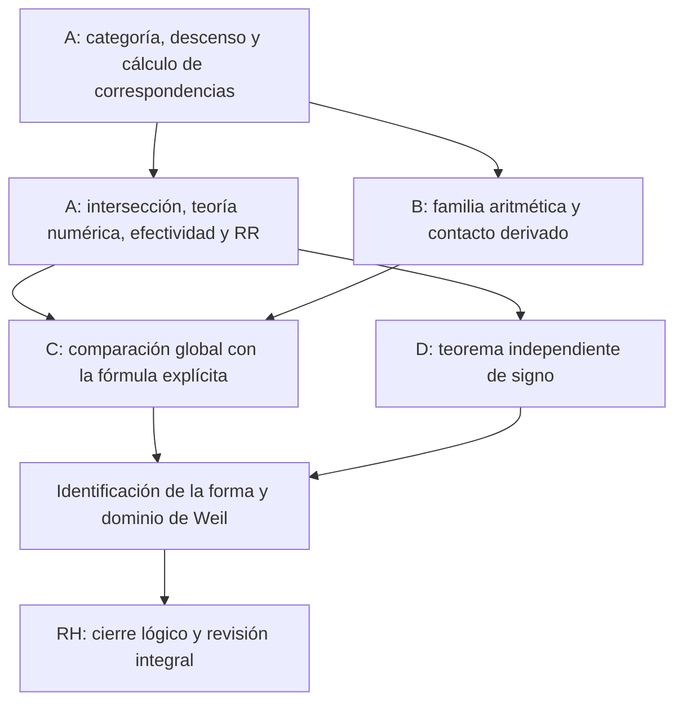

# Plan de cierre A–B–C–D sobre Spec Z

Fecha: 2026-09-05. Estado: **plan de investigación; ningún row queda cerrado por este documento**.

**Actualización 2026-09-12.** Los rows A y B quedan cerrados a fuerza-Weil
sobre el sector de grafos, en
[paper 43](../../04-papers/43-row-a-torsion-theory/main.md) (fase 125) y
[paper 44](../../04-papers/44-row-b-arithmetic-family/main.md) (fase 126).
El bloqueo de B (§6, "test que puede descartar rápidamente la candidata", y
P123.060) se resuelve por soporte coprimo: los dos contactos viven en `V(n)` y
`V(n−1)`, y el factor local de A es su producto.  El requisito §6.6 de
monoidalidad de la extracción primitiva queda **refutado** como requisito
(`Λ(6)=0≠log 6`) y reemplazado por la estructura correcta.  C hereda una
obligación nueva y exacta: absorber `w_unit(Γ_n)=n−1` en los sectores Tate y
Gamma.

**Corrección 2026-09-12 (fase 128).** Tres auditorías adversariales de los
papers 43, 44 y 45 encontraron errores reales. **Las tres etiquetas
`WEIL-STRENGTH-COMPLETE` quedan retiradas.** Etiquetas honestas, hallazgos,
verificaciones y disposiciones en
[fase 128](../../03-research/phase-128-adversarial-audit/), y lo que
efectivamente sobrevive en
[D128.004](../../03-research/phase-128-adversarial-audit/D128_004_WHAT_SURVIVES.md).  Esa obligación queda **descargada** en
[paper 45](../../04-papers/45-row-c-explicit-formula/main.md) (fase 127), que
cierra C sin caja negra analítica: no hay términos de esquina porque
`log p / log q` es irracional, el término arquimediano es el determinante zeta
del operador de módulo, los polos son los rulings, y se cierra además el hueco
—registrado en `113_07` y nunca cubierto— del paso `q_T >= 0` sobre tests
primitivos ⟹ RH.  D hereda un enunciado de índice de Hodge.

**Actualización 2026-09-12 (fase 130).** Row A recupera la etiqueta
`WEIL-STRENGTH-COMPLETE` sobre el carrier declarado (carta finita fija,
sistema de cartas y colímite como estructura adicional, sector invertible),
con A.6 bajo la enmienda aceptada por el propietario y A.8 con target
`Pic_b(B_T)` forzado por el Teorema 10.8 de
[paper 43](../../04-papers/43-row-a-torsion-theory/main.md). Decisión de la
auditoría de registro en
[R130.005](../../03-research/phase-130-row-a-closure/R130_005_LEAD_FINAL_AUDIT_AND_LABEL.md);
disenso del auditor hostil sobre A.8 registrado. B y C siguen con sus
etiquetas de fase 128 hasta sus propias campañas.

**Actualización 2026-09-12 (fase 131).** Row B reconstruido en
[paper 44](../../04-papers/44-row-b-arithmetic-family/main.md) alrededor de la
clase de norma `Γ_n^rad`; contacto finito `Λ(n)n^{-1/2}` como volumen de la capa
de valuación; la obligación `n−1` a C queda retirada. Etiqueta (auditoría de
registro [R131.005](../../03-research/phase-131-row-b-closure/R131_005_LEAD_FINAL_AUDIT_AND_LABEL.md)):
`WEIL-STRENGTH-COMPLETE` sobre el carrier declarado, **condicional a la
aceptación por el propietario de la enmienda B.4** (§6 punto 4, nota).

**Actualización 2026-09-12 (fase 131, cierre final, R131.019).** Row B cerrado
tras siete rondas del constructor y cinco auditorías hostiles. Objeto final: la
familia de Frobenius `Frob_n` (medidas de Haar de los estratos de puntos fijos,
unidad verdadera, semigrupo inverso graduado por conjuntos de primos); sombra
integral `Sh_Z` sobre los objetos (B.4 enmendado probado en grado); dos formas
de Gram: el núcleo de Weil es la forma de Gram de `Frob ⋆ Δ^rad` y la familia
de Frobenius sola lleva la mitad finita (Thm 8bis.1e); `vol(Z_p^×) = log p` es
la única normalización con residuo de Tate universal (Thm 8bis.8, módulo escala
global). Etiqueta: `ROW B: WEIL-STRENGTH-COMPLETE en el portador declarado del
Paper 43`. Registrado junto a la etiqueta: sin signo, sin ceros; la interfaz
con el criterio de Weil es un enunciado de colímite y falso a carta finita;
ningún ritmo de divergencia es libre de convención; el import `(Wgr)` fue
retirado como falso (Lema 8bis.6b) y «positividad en perfiles de Dirichlet ⟹
RH» queda `OPEN`. Sigue la fila C (Paper 45), con la corrección de su §11.

**Actualización 2026-09-12 (fase 132, cierre de C, R132.007).** El Paper 45 estaba
escrito contra la fila A antigua (completación de Fell, `E_u`, estratos de ceros,
`χ_A` ensamblado) y fue reconstruido sobre los Papers 43 y 44 cerrados: la clase
test es `Γ_h ∈ D_A^{rad}` (Paper 44 Def 3bis.6); la identidad de trazas es Paper 43
Thm 8.8 evaluado por el Lema 5.1a; **la fórmula explícita de Weil se prueba en el
repositorio** (Thm 9.4, contorno correcto: reflexión primero, expansión en
`Re s = c > 1`, desplazamiento de cada término primo con integrando entero); el
teorema de comparación `T_∞(Γ_{F⋆F^†}) = 2Φ_F(0)Φ_F(1) − Σ_ρ Φ_F(ρ)Φ_F(1−ρ)` con
cuantificador de colímite (C1); `c = 0` deja de ser declaración de A y es la única
constante con `I_∞ = B_nuc` (Cor 9.6a, cierra D128 C9); los polos de Tate por
residuos del símbolo de Euler continuado (Thm 9bis.2′: `|S_f|+1` y `0` a carta,
`1` y `1` en la continuación); suficiencia de los tests primitivos (Thm 10.4 con
la corrección C10). Etiqueta: `ROW C: WEIL-STRENGTH-COMPLETE en el portador
declarado`, otorgada tras tres rondas y dos auditorías hostiles. Registrado junto
a la etiqueta: normalización `c = 0` portante y fijada; aditividad por lugares
definicional (no localización); sin signo; imports (E1)–(E8), (R1) nombrados;
Mertens en cuarentena. Filas A, B, C completas; sigue el panel de revisión de
tres agentes y luego la fila D.

**Actualización 2026-09-12 (fase 133, panel de revisión A/B/C).** Tres revisores
independientes (pruebas; conexiones; etiquetas y cadena a RH). Sin FATAL. Panel 1:
más de treinta teoremas portantes re-derivados, cuatro MAJOR de exposición reparados.
Panel 2: una teoría consistente, sin contradicción cruzada; referencia colgante y
relabel no propagado reparados; objetivo de la fila D ahora encajonado idénticamente
en los tres papers. Panel 3: etiquetas honestas tal como están registradas; el
nombre sobreafirma frente a la especificación §1 (igualdad de carga estructural con
Weil, no establecida según Paper 43 §11bis); los disensos de A.8 y B.7 los gana el
auditor hostil y deben ir al propietario como enmiendas (síntesis §4.2, decisión
pendiente). Mapa paso a paso frente a Weil (síntesis §3): cadena completa por
encima del signo; falta exactamente un functor a algo con invariante no negativo
más un teorema de anulación que convierta la igualdad (10.10) en desigualdad. La
fila D se abre tras la decisión del propietario sobre A.8 y B.7.

**Actualización 2026-09-12 (fase 133, enmiendas A.8 y B.7 aceptadas).** `[phase 133, amendment accepted 2026-09-12]` El propietario (D. Trejo Pizzo) aceptó las dos enmiendas propuestas en PANEL_SYNTHESIS §4.2: A.8 (Paper 43, row A) y B.7 (Paper 44, row B). Ambas cláusulas pasan a `REFUTADO TAL COMO ESTÁ ESCRITO + PROBADO COMO ENMENDADO`; las decisiones por fallo del lead (R130.005 para A.8, R131.019 para B.7) quedan superadas por la decisión del propietario y los disensos de los auditores hostiles quedan registrados como historia. Las etiquetas `WEIL-STRENGTH-COMPLETE` de los rows A y B quedan **incondicionales** sobre el portador declarado. Ningún teorema, ninguna demostración y ninguna otra graduación cambian. Registro: `03-research/phase-133-abc-review-panel/AMENDMENTS_A8_B7_RECORD.md`. Queda abierta la fila D.

**Actualización 2026-09-12 (fase 134, apertura de D, R134.007).** Paper 46
abierto sin etiqueta y sin signo, por diseño. Probado: `Π = −∂²+¼` es biyección
sobre la clase primitiva (las dos condiciones de Tate son exactamente el soporte
compacto de `e^{−|t|/2}∗F`); `Λ(g) = 𝔏(g⋆g^†)` con `𝔏 = −Π²(W_fin+ω_∞)` y
`Π²ϖ = 0`; la reformulación de estado (RESTATEMENT): RH ⟺ objetivo de D ⟺ `𝔏`
positiva definida ⟺ representación unitaria del grupo módulo del portador con
`Λ(g) = ‖π(g)Ω‖²` — el invariante no negativo que falta es una **norma**; ley de
swap (`Σ(T)` Toeplitz, objetivo de P124.013 partido en par/impar); Thm 5.8 (la
diagonal arquimediana domina a `ε` pequeño: la inercia finita no informa; D.3
retirado); cinco negativos y la lista (R1)–(R5): **no existe en A–C una dualidad
que saque al sector primitivo de sí mismo (sin `K`-twist)**, así que no hay
forma de Riemann–Roch que porte un signo; batería de falsadores (`Ξ_a` no tiene
familia de Frobenius en el sentido de B; DH no tiene ni Frobenius ni bloque de
Tate). Retirada la Prop 3.6a(iii) (falsa bajo RH; el lead también la había
aceptado). Hallazgos contra el corpus registrados en fases 124 y 118 (autovalores
de Galerkin = cotas superiores variacionales; brackets de P124.014 inestables).
Recomendación para la próxima campaña de D: empezar por (R5).

**Ejecución aprobada y objetivo activo.** El [registro de la primera campaña](../../03-research/phase-123-weil-strength-abc/P123_024_FIRST_CAMPAIGN_LEDGER.md) contiene las reparaciones locales, sus pruebas y el resultado del test integral de B. La siguiente construcción es la fuente integral con realización analítica; los hitos completos siguen sujetos a sus criterios de aceptación.

El objetivo es una demostración completa de los cuatro rows en una misma teoría y, mediante el criterio de Weil, de RH. El plan especifica qué habría que demostrar y cómo decidir el siguiente paso. No presupone que los candidatos actuales admitan esos teoremas ni asigna una probabilidad de éxito sin evidencia.

**Recomendación:** comenzar con una campaña corta de viabilidad A/B, acompañada por la especificación del teorema que D debe aportar. Corregir primero las dos obstrucciones de P123.018 y exigir un contacto derivado real para un primo y su cuadrado antes de invertir en la completación global. No reiniciar el cálculo de dos primos de D: ya fue realizado en P122.028.

Documentos complementarios: [primer bloque de trabajo](FIRST_CAMPAIGN.md) y [cobertura del corpus](CORPUS_COVERAGE.md).

## 1. Base de la decisión y alcance de la revisión

Se inventariaron **123 directorios de fases** y **42 directorios de papers**. Un barrido léxico cubrió **5.359 archivos `.md`, `.tex` y `.txt`** en los cinco sectores documentales indicados en el índice de cobertura. Se consultaron los mapas generales, el índice de los 42 papers, resúmenes y extractos de sus fuentes, la auditoría histórica y, con mayor detalle, las notas que sostienen el frente 119–123.

Esto es una revisión estratégica con trazabilidad, **no una nueva auditoría línea por línea de todas las demostraciones**. El inventario distingue lectura de fuentes decisivas, consulta de resúmenes y exploración mecánica. La revalidación de cualquier resultado antiguo que entre en la prueba final es una obligación del plan.

Fuentes internas que gobiernan este plan:

- [P123.018: obstrucciones del portador](../../03-research/phase-123-weil-strength-abc/P123_018_ADVERSARIAL_CARRIER_AUDIT.md).
- [Contrato fuerte de A](../../03-research/phase-123-weil-strength-abc/P123_A_ACCEPTANCE_SPECIFICATION.md).
- [P122: alcance efectivo de A/B/C y fuentes](../../03-research/phase-122-row-d-integrity-and-construction/P122_ROWS_ABC_REFERENCE_AUDIT.md).
- [Fase 119: qué separan los contactos](../../03-research/phase-119-what-a-finite-compression-certifies/RESULTS_119_SEPARATOR.md).
- [Cierre de fase 120](../../03-research/phase-120-global-polarization/PHASE_120_CLOSURE.md) y [auditoría de fase 121](../../03-research/phase-122-row-d-integrity-and-construction/P122_008_PHASE121_LOAD_BEARING_AUDIT.md).
- [P122.028: cálculo finito de Green](../../03-research/phase-122-row-d-integrity-and-construction/P122_028_TWO_PRIME_FINITE_GREEN_COMPLEX.md) y [P122.029: transmisión crítica](../../03-research/phase-122-row-d-integrity-and-construction/P122_029_LIONS_MAGENES_TRANSMISSION_AUDIT.md).
- [Reinicio histórico: fuerza-RH no es un veto](../RH-MASTER-CONTEXT/LIVE_FRONTIER_AND_RESTART_PLAN.md).

## 2. Correcciones que cambian el orden del trabajo

| Afirmación heredada | Estado que debe usarse |
|---|---|
| «Sólo falta D» | Válido únicamente con los contratos restringidos del paper 42. En el contrato fuerte faltan puentes en A, B y C. |
| «P123.014–017 cierran globalmente A.1–A.6» | P123.018 reabre el cambio de levantamiento, el descenso semilocal y operaciones de la completación. |
| «El modelo finito de dos primos es el siguiente cálculo» | Ya existe: P122.028. Falta demostrar flujo cero, no calcular la energía. |
| «Calderón o Lions–Magenes producirán automáticamente R» | P122.029 identifica la condición exacta, pero el cálculo de frontera no demuestra su cumplimiento aritmético. |
| «Una forma equivalente a RH no sirve como blanco» | Una equivalencia es un blanco legítimo; hace falta demostrar el sentido útil sin asumir RH. |
| «Todo argumento construido con Euler–Gamma es sólo un reempaquetado» | No hay aquí un teorema universal de imposibilidad. Una desigualdad nueva demostrada desde esos datos sería válida. Cada no-go debe conservar su clase exacta de hipótesis. |
| «El cono de cuadrados ya es efectividad geométrica» | Debe probarse su relación con ciclos efectivos; positividad de operadores y efectividad de ciclos son nociones distintas. |

Los índices raíz y `OPTIONS.md` contienen estados anteriores y algunas prohibiciones demasiado amplias. Se conservan como historia; no se usan para bloquear un teorema nuevo ni para certificar filas posteriores a sus auditorías.

## 3. Arquitectura de la prueba y organización de la investigación

El orden de dependencia de la prueba será:

El orden de investigación será menos rígido: los tests pequeños de B y las necesidades de D se examinan **antes** de terminar A. Evita construir una categoría que luego no pueda alojar la aritmética o el mecanismo de signo. Esto no autoriza introducir las conclusiones de B/C/D en la definición de A.

Dos frentes conceptuales acompañan la campaña, sin multiplicar portadores:

1. **Construcción A/B/C:** teoría común y teoremas de comparación.
2. **Viabilidad de D:** localizar una identidad que fuerce el signo o la anulación del defecto, manteniendo explícito qué información necesita conservar A.

El esfuerzo inicial se concentra en A/B. El análisis de D debe producir una proposición comprobable; si sólo produce otra coordenada equivalente del defecto, se registra y no desplaza la construcción principal.

## 4. G0 — fijar la contabilidad matemática

Crear un registro por resultado utilizado: identificador, enunciado con cuantificadores, dominio, prueba o referencia exacta, hipótesis importadas, dependencias, retractaciones, alcance computacional y lugar donde se usa.

Estados: `PROBADO-REVISADO`, `IMPORTADO-VERIFICADO`, `CONDICIONAL`, `CANDIDATO`, `REFUTADO-EN-ESTA-CLASE`, `NO-REVISADO`. «Finito» y «completado» deben figurar en el enunciado; no son etiquetas intercambiables.

Fijar además una sola convención de Mellin, media densidad, dagger, orientación y signo. En el perfil balanceado F, la primitividad será la anulación de las dos integrales contra `exp(t/2)` y `exp(-t/2)`. Escribir explícitamente el cambio desde `M_0,M_1` del perfil multiplicativo f. Verificar que `q=-B_nuc` sea el signo positivo usado por D.

Separar los índices: `F^m ∘ F^n=F^(m+n)` para iteraciones de Frobenius; la notación multiplicativa usa etiquetas `Q^m,Q^n`. No afirmar `Gamma_m Gamma_n=Gamma_mn` si m y n denotan simultáneamente exponentes aditivos.

**Cierre G0:** diagrama acíclico de las dependencias seleccionadas y diccionario de convenciones. No exige auditar los miles de documentos que no se usarán.

## 5. A — construir la teoría común

### A0. Elegir la categoría mínima que soporte A, B y D

Primera candidata a estudiar: ideal no unital de kernels, bimódulos esenciales y entrelazadores en multiplicadores. La correspondencia identidad vive en la categoría; no tiene que ser un elemento del ideal de traza.

Como modelo de referencia, las correspondencias de Hilbert sobre el crossed product C* permiten tipar multiplicadores e inversión. Pero el traslado al núcleo rápido/nuclear y a la aritmética integral requiere una comparación; una realización C* no demuestra por sí sola RR ni contacto ciclotómico.

Alternativa de respaldo: un álgebra unital mayor que contenga los multiplicadores necesarios. Elegirla sólo si permite demostrar las estimaciones de los tests y conservar el dato integral. La unitización mínima de P123.014 no sirve para el mapa que allí se escribió.

Para cada candidata especificar objetos, morfismos, tensor balanceado, topología, unidad, dualidad y realización geométrica. Demostrar el tensor sin usar `z tensor 1` donde no existe 1. Los cambios de levantamiento deben ser mapas con dominio y codominio correctos y coherencia triple.

**Salida:** una categoría local válida, o un contraejemplo que descarte precisamente esa candidata.

### A1. Resolver las transiciones semilocales

Mantener como base comprobable las inclusiones de coeficientes `f -> f tensor 1_Zp`. No convertirlas en una aplicación de puntos ni en extensión por uno sobre clases idèlicas.

Comparar dos opciones concretas: correspondencias de cambio de carta mediante inducción/spans de grupoides, o definición inicial sobre el grupoide adélico global y recuperación posterior de los modelos semilocales. En la opción global todavía deben demostrarse la relación con el haz sobre Spec Z y las exhaustiones de tests; «global» no elimina esas obligaciones.

Probar composición de transiciones, coherencia en tres cartas, equivalencia gauge y compatibilidad con tensor/dagger. Rehacer el ejemplo `S={infinito,2}`, `S'={infinito,2,3}` de P123.018 con la nueva operación.

La fuente externa disponible demuestra el haz de crossed products **algebraicos** y describe sus mapas de coeficientes; no importa automáticamente el descenso de la categoría completada. [Connes–Consani, §5, especialmente Teorema 5.3](https://arxiv.org/html/2501.06560v1#S5).

### A2. Someter temprano el control clásico a prueba

Reauditar P123.011: reconstruir la teoría en otra categoría clásica es un control, no una especialización demostrada del candidato aritmético.

Comprobar separadamente: grafos de automorfismos, grafos de endomorfismos finitos, transposición, diagonal, rulings e intersección. Un grafo de Frobenius no es en general invertible como bimódulo de un esquema; si sólo se tienen bimódulos invertibles, explicitar la ampliación o la categoría localizada donde la comparación tendría sentido. Distinguir Frobenius morfismo de esquemas del inverso llamado Frobenius geométrico en cohomología.

Test de efectividad: el grafo de una permutación de tres puntos es un ciclo efectivo, pero su matriz no es autoadjunta y no puede ser una suma de `X*X` en la representación matricial habitual. Esto invalida una identificación automática de ambos conos, no todo posible functor de comparación. Declarar cuál relación entre ellos es realmente necesaria para RR.

### A3. Construir la traza y el determinante con tipos separados

Definir el dominio trazable antes del valor de la traza. Si se escribe pull–tensor–push, demostrar existencia de los funtores, proyección y cambio de base; si se usa una bicategoría de bimódulos, construir su traza y compararla con contacto diagonal.

Verificar también el significado de la representación gauge: pasar a coinvariantes donde U_gamma actúa trivialmente no demuestra automáticamente una representación de toda el álgebra de coeficientes; comprobar covariancia y dominio.

Tratar por separado los contactos no identidad, el exceso en la identidad, los estratos finitos y el arquimediano. Definir la resta de la órbita genérica desde la fuente. La suma de contribuciones locales debe ser un teorema de localización.

Especificar líneas de torsión, normas, grados logarítmicos y determinantes de Fredholm. La identidad `d_rel(h)=exp(T(h))` no es por sí sola una construcción de la línea determinante intrínseca.

### A4. Probar las operaciones topológicas y numéricas

Elegir un núcleo de vectores suaves/localmente constantes preservado por la acción, o probar que el espacio alternativo de secciones es estable. Una acción continua sobre C_0 no implica automáticamente suavidad de todos sus coeficientes.

Probar continuidad conjunta de convolución, dagger y acción sobre tests; completitud; nuclearidad únicamente donde se requiere; descenso; y límites en S. No deducir continuidad bilineal LF sólo de una propiedad universal para mapas lineales.

Rehacer P123.017 usando el anti-dual apropiado. Conservar el radical vectorial `R_partial ∩ ker M`, la sucesión primitivo–numérico–Tate y la separación contra tests. Decidir si la topología es la del cociente o la inducida por J, y demostrar la relación elegida. Probar extensión de dagger y de cada acción utilizada; una acción por cada test fijo no demuestra una acción del portador completado entero.

No se exige multiplicar distribuciones arbitrarias si la prueba sólo usa la acción de correspondencias sobre clases numéricas. Sí se exige un apareamiento suficiente para todos los pares que aparecen en C y D.

### A5. Efectividad, teoría integral y RR mixto

Elegir una clase efectiva desde geometría o categorías exactas, preservando los datos discretos necesarios para la estrategia RR. Resolver qué queda del obstáculo O1 de fase 113: la sola estructura de espacio vectorial complejo no produce el crecimiento clásico de secciones.

Construir su aplicación al cociente numérico. Para un cono real completado K, demostrar `K ∩ (-K)={0}` si ésta es la propiedad utilizada, y declarar si K se obtiene cerrando antes o después del cociente. Probar estabilidad por las operaciones positivas pertinentes; nunca exigir estabilidad de un cono propio no nulo bajo todos los multiplicadores y sus negativos.

Construir un único functor determinante mixto y una comparación natural con el modelo periódico anterior. Si el modelo anterior no admite esa comparación, registrar su reemplazo explícito y demostrar de nuevo todas las propiedades consumidas; no mantener una equivalencia nominal.

La fórmula RR debe contener términos correctamente tipados de traza, exceso y renormalización, identidad, Gamma, Tate y compatibilidad con efectividad. Si D usará crecimiento de `h^0(nD)`, ese crecimiento necesita una teoría de secciones y una prueba específica: una igualdad de grados determinantes no basta.

**Cierre de A:** A0–A5 revisados, controles clásicos con su alcance explícito y ninguna hipótesis de signo pendiente escondida en efectividad/RR. La completitud de A no implicará automáticamente D.

## 6. B — producir las correspondencias aritméticas dentro de A

**Test de viabilidad temprano:** obtener en la candidata de A los objetos para `2,4,3,6` y calcular su contacto. Este test precede a la completación de A; el cierre general de B viene después.

1. Definir la categoría Witt/ciclotómica de origen, sus morfismos y su operación. La igualdad de anillos de Witt con ciertos ciclos finitos no es todavía un functor monoidal a las endocorrespondencias de A.
2. Seleccionar clases externas o correspondencias finitas reales, sin utilizar un racional diagonal que sea gauge. Probar independencia de uniformizantes, cartas y levantamientos con las transiciones reparadas.
3. Construir el functor de realización y demostrar composición, unidad y transposición, incluidas las medias densidades.
4. Derivar `LDelta* Gamma_n` en la categoría elegida. Para `n>1`, probar que su contribución aritmética pertinente se identifica con `[Z --Phi_n(1)--> Z]`; precisar cualquier truncación y demostrar que es compatible con los usos posteriores.
**Enmienda al punto 4 — ACEPTADA por el propietario (D. Trejo Pizzo) el 2026-09-12; texto propuesto en fase 131:** El punto 4 es `REFUTADO TAL COMO ESTA ESCRITO` y `PROBADO COMO ENMENDADO`; el texto original se conserva arriba sin cambios. `LDelta^* Gamma_n` es el complejo de puntos fijos, con diferencial `n-1`, no el ciclotomico (P123.060), y ninguna categoria `C`-lineal puede portar `Z/p` (P123.022); ademas la clase del elemento `a_S(n)` en el portador es `delta_S(1/n)=(1/n en infinito; 1 en cada lugar finito)`, que no esta en la imagen de ningun mapa de rebanada `j_q`, de modo que la clausula literal no tiene objeto. Texto enmendado propuesto, para decision del propietario: «el contacto derivado de la **clase ideal** `Gamma_n^rad` — el promedio unitario sobre `K = {+-1} x prod_p Z_p^x` de las clases de todos los generadores del ideal `(n)` — con la diagonal, calculado en la categoria declarada, es decir **la masa en `t = log n` de la unica medida de Radon `omega_fin` que representa a `T` en el sector radial `D_A^rad ∩ D_A^0`** (Paper 44 Thm 3bis.7; existencia y unicidad en Def-Thm 3bis.8, la unicidad porque una medida de Radon queda determinada por sus integrales contra tests `C_c^inf`), cuyo integrando es lugar por lugar el rango Haar-regularizado de la sombra de Hochschild relativa por el peso semidensidad-Lefschetz (Paper 43 Thm 7.1, Thm 8A.9 (8A.24)-(8A.24')), tiene grado en los lugares finitos `Lambda(n) n^{-1/2}`, igual a `n^{-1/2} deg_det [Z --Phi_n(1)--> Z]`, el modelo cotangente integral de P123.037 transportado al reticulo `L_S subset X_S` (P123.038); la identificacion es de **grados**, y una identificacion a nivel de objetos es imposible en una categoria `C`-lineal (P123.022)». Esta enmienda refleja la decision tomada para A.6 (Paper 43 §14.2): la propone el constructor y la adopta el propietario. Demostrada en el Paper 44 §6.2a' y Teorema 6.3a. **Aviso de tipo (ronda 2, hallazgo F2 de R131.002):** `T(Gamma_n^rad)` esta **indefinida** — `T` solo esta definida en `D_A` y la clase es una medida, no un elemento de `D_A` — y la evaluacion ingenua lugar por lugar da **0**, porque la imagen de `j_p` es un conjunto nulo para la clase; por eso la enmienda se formula mediante `omega_fin`. La lectura «`Lambda` es el volumen de Haar multiplicativo de la capa `p^k Z_p^x`» es la del Paper 43 Rem 9.7a y el row B la **hereda**; lo que el row B anade es adjuntarla a la familia y a su **lugar de contacto** (Thm 3bis.7'): la parte finita de `T` en el sector radial es una medida puramente atomica con soporte exactamente `{+-k log p}`. Ningun cero, ninguna RH, ningun signo y ninguna funcion de von Mangoldt se usan como entrada.

5. Obtener `deg_det(contacto)=log|Phi_n(1)|=Lambda(n)` como consecuencia. Tratar n=1 como identidad/exceso, no mediante esa fórmula.
6. Probar la familia general por estructura, no por extrapolación de casos. Incorporar sus clases, momentos y componentes primitivas al objeto numérico de A.

**Test que puede descartar rápidamente la candidata:** el contacto lineal simple de una dilatación usa `1-u^(-1)`, mientras que el contacto buscado es ciclotómico. Calcular ambos, con anillos y valuaciones, para p y p². Si difieren, localizar el mecanismo geométrico que produce el factor ciclotómico; no sustituir un determinante por otro porque tengan la motivación correcta.

**Enmienda al punto 7 — ACEPTADA por el propietario (D. Trejo Pizzo) el 2026-09-12; texto propuesto en la fase 133 (PANEL_SYNTHESIS §4.2):** `[phase 133, amendment accepted 2026-09-12]` El punto 7 (el test discriminante en `p`, `p²` y la localización del mecanismo) es `REFUTADO TAL COMO ESTÁ ESCRITO` y `PROBADO COMO ENMENDADO`; el texto original se conserva arriba sin cambios. Texto enmendado, aceptado: «el test discriminante en `p, p²` está `PROBADO`; el mecanismo está localizado en el portador (volumen de la capa, peso de punto fijo trivial, Paper 44 Thm 6.5) y en el modelo `Z` (deck `μ_n`, Thm 6.4(iv)); un mapa entre ambas localizaciones está `REFUTADO` sobre un portador `C`-lineal (P123.022), de modo que la exigencia de la clausula de un único mecanismo que produzca el factor ciclotómico es insatisfacible tal como está escrita». Esta enmienda refleja la decisión tomada para A.6 (Paper 43 §14.2) y para el punto 4 (arriba): la propone el panel, la adopta el lead y la acepta el propietario. La Rem. 6.5a′ del Paper 44 queda **sin cambios**, de modo que quien siga al auditor sigue leyendo allí `PARCIAL` y no pierde nada; ningún teorema depende de qué graduación se adopte. Con esta aceptación, el disenso del auditor hostil sobre B.7 queda registrado como historia y la etiqueta del row B queda **incondicional**.

Deninger ofrece un punto de entrada preciso: Teorema 5.1 para esquemas afines normales noetherianos y Proposición 5.2 para Frobenius/Verschiebung. Es una fuente para investigar B, sin un puente ya demostrado hacia nuestro portador ni hacia una norma de Hodge. [Deninger, §5](https://arxiv.org/html/2508.05329v1#S5).

**Cierre B:** functor y contactos derivados generales, verificaciones adversariales de `p,p²,p³,pq,p²q,pqr`, y compatibilidad con A. El índice por lugares debe conservarse: fase 119 muestra que agrupar sólo por normas pierde información.

## 7. C — identificar la intersección con la fórmula explícita

1. Fijar la clase de funciones test y la construcción de `K_h` como sección integrada o superposición admisible en A. Una suma de deltas necesita justificación como multiplicador/distribución; no se declara una función de Schwartz.
2. Construir una realización del complejo de A en el modelo de Poisson de Meyer. Debe identificar acción, cobordes, dualidad y los dos términos Tate. No se requiere una equivalencia de categorías enteras si basta una realización que preserve las operaciones usadas.
3. Probar la identidad de trazas sobre un núcleo común, con contacto finito, arquimediano e identidad. Después extender por continuidad, densidad y las estimaciones apropiadas.
4. Derivar el término primo `sum_(p,k) (log p)p^(-k/2)(h(k log p)+h(-k log p))` con la convención fijada en G0. Demostrar el término Gamma y los polares en la misma comparación.
5. Registrar el orden de límites: cartas S, corte espacial, corte espectral, regularización y ventana T. Cada intercambio necesita una estimación local uniforme o un teorema de convergencia que lo cubra. Evitar exigir uniformidad global innecesaria si una exhaustión de tests compactos basta.
6. Probar finalmente `I_A([K_F],[K_G])=B_nuc(F,G)` y que los tests primitivos de A cubren una clase suficiente para el criterio de Weil.

El resultado externo de Meyer es una realización espectral nuclear y una fórmula de carácter. Probar que esa traza es la intersección de A sigue siendo nuestro teorema de comparación. [Meyer, versión corregida](https://arxiv.org/abs/math/0412277v3).

**Cierre C:** identidad global en el dominio suficiente, con límites, Tate y Gamma, y sin asumir la localización de los ceros. Se pueden usar los ceros en el teorema de comparación de la fórmula explícita; lo prohibido es asumir su posición para demostrar el signo.

## 8. D — demostrar el signo con matemática nueva

**Ejecución, 2026-09-05:** [P123.036](../../03-research/phase-123-weil-strength-abc/P123_036_D_NORMALIZATION_AND_ENDPOINT_REPLAY.md)
reproduce las siete tareas de intervalos del certificado en `T=log2`,
comprueba sus cotas contra los datos de recombinación y verifica los
márgenes finales con Arb. También verifica que el operador de D ya usa
la normalización Gamma correcta. Queda pendiente la ley global descrita
abajo; reproducir el punto inicial no la demuestra.

D es probablemente el problema conceptual más difícil, pero A y B también contienen problemas de investigación. No se asignan porcentajes de avance a partir del número de lemas escritos.

Blanco común: `q_T(F)=-I_A([K_F],[K_F])>=0` en cada ventana y para todo F primitivo del dominio. Hay dos rutas suficientes; basta cerrar una. No acumularlas como requisitos simultáneos.

### D-H: índice de Hodge desde la teoría fuente

Construir una polarización H y demostrar un teorema de índice sobre el espacio numérico apropiado. La signatura del plano hiperbólico Tate tiene que situarse en la forma escalar de intersección pertinente: no se asigna una signatura a un vector de trazas sin especificar su scalarización geométrica.

Probar no positividad en el sector primitivo. Una ruta RR requiere crecimiento de secciones, dualidad y efecto del cono suficientes para deducir la desigualdad; una ruta de energía necesita una desigualdad global con constante exacta y dominio probado. El teorema puede ser específico de los datos aritméticos si su prueba es independiente del signo que busca.

No imponer ausencia de clases nulas globales si sólo se necesita semidefinitud: la clasificación de igualdad se exige en el alcance que efectivamente use la prueba. En rango infinito hay que reemplazar los argumentos dimensionales finitos por estimaciones o aproximaciones demostradas.

### D-E: excluir el primer contacto mediante una ley fuente

Revalidar el punto de entrada: certificado estricto en `T=log2`, teorema compacto de primer contacto P122.002, restricciones primitivas, paridad y nacimientos de canales. El certificado tiene dos niveles: recombinar cotas y regenerar los intervalos; ninguno sustituye al otro.

La reducción existente busca una ley anterior a la supertraza que, para un estado de primer contacto, anule su defecto orientado. R y S son una factorización candidata de esa obligación:

- **R:** una relación fuente de transmisión implica pertenencia del flujo entrante al espacio crítico apropiado, cancelando el salto Tate.
- **S:** la misma estructura global fuerza la coincidencia de dos canales primos pertinentes y elimina el estado mediante la rigidez ya establecida.

P122.028 fija exactamente el detector:

`E_eff(F)=||(E_q,T-E_p,T) h_F||² / log(q/p)`.

Su harmonicidad implica flujo constante, no flujo cero. El objetivo nuevo es demostrar por qué el estado aritmético debe tener flujo cero. P122.029 identifica `H^(1/2)_00` y la condición ponderada de borde; no queda una regularidad genérica por importar.

**Primer trabajo de D:** escribir una sola relación global de borde candidata y la identidad de Green que la produce, con cada término fuente y su dominio. Comprobar qué permite deducir sobre R o S sin añadir la condición de anulación como definición. Una identidad sólo local que funciona para cualquier dato no ha seleccionado todavía el estado aritmético.

Si no aparece tal ley, estudiar D-H o la desigualdad firmada directa de los papers 36–40; no volver a construir detectores fieles. Una prueba directa de un criterio equivalente a RH es válida. Para completar además los cuatro rows solicitados deberá transportarse a la teoría A mediante C y cubrir el sector declarado de D; demostrar RH por otra ruta no rellena retroactivamente los puentes A/B/C.

**Cierre D:** una demostración independiente de D-H o D-E con todas sus hipótesis verificadas, y signo transferido al dominio de C. Ninguna hipótesis «existe una contracción», «hay una métrica positiva» o «la conexión es horizontal» puede quedar sin probar.

## 9. Falsadores y controles permanentes

| Control | Pregunta que decide | Lo que no decide |
|---|---|---|
| Campos finitos | ¿Recuperamos las operaciones e intersecciones clásicas mediante un mapa especificado? | No transporta Hodge a Z por analogía. |
| Cambio de levantamiento/cartas | ¿El objeto es independiente de las elecciones prometidas? | No prueba contacto ni signo. |
| Davenport–Heilbronn | ¿Qué hipótesis aritmética concreta falla en este control? | Un argumento puede distinguirlo y aun no probar RH. |
| Par desplazado `xi(s+a)xi(s-a)` | ¿La hipótesis usa algo más que simetría y pesos positivos? | No es contraejemplo a una clase que lo excluya por otras hipótesis probadas. |
| Modelos matriciales y cambios de puertos | ¿Una identidad formal pierde orientación o confunde conos? | No certifican completitud o descenso. |
| Zeta de cuerpos de números | ¿Qué generalidad tendría el teorema? | Una extensión a GRH necesita comprobar todas las hipótesis de nuevo. |
| Ventanas y discretizaciones | ¿Hay errores de normalización, umbral o colas? | Positividad finita no es positividad del operador completo sin cota del complemento. |

Los contraejemplos deben satisfacer las hipótesis exactas del candidato antes de invalidarlo. Los tests numéricos ayudan a falsar o conjeturar; la prueba final necesita argumentos exactos o intervalos más estimaciones uniformes.

## 10. Hitos y decisiones de continuación

| Hito | Entregable y aceptación | Si falla |
|---|---|---|
| M0 | Registro de dependencias y convenciones coherentes | Corregir el enunciado antes de construir. |
| M1 | Categoría local con cambio de levantamiento bien tipado | Cambiar la categoría, no sólo el nombre del mapa. |
| M2 | Transiciones coherentes y control `S -> S' -> S''` | Evaluar el modelo global con su propio teorema de comparación. |
| M3 | Prototipo B para 2,4,3,6 con contacto derivado | Rechazar la identificación entre grafos simples y dato ciclotómico, o construir su ampliación justificada. |
| M4 | A completa en su dominio, con efectividad/RR | Localizar el lema faltante; no declarar cierre parcial como cierre total. |
| M5 | B general y comparación C global | Conservar resultados aritméticos/analíticos por separado hasta probar el puente. |
| M6 | Ley nueva que pruebe D-H o D-E | Registrar la clase descartada y evaluar la alternativa firmada, sin renombrar el mismo supuesto. |
| M7 | Prueba ensamblada, dependencias sin hipótesis abiertas y revisión integral | Reabrir exactamente las dependencias afectadas. |

M1–M3 son la primera campaña concreta. M6 se prepara desde el principio como una especificación y prueba de viabilidad, pero su aceptación final depende de la teoría identificada.

No hay calendario honesto para M6 ni para RH. Cada bloque se mide por una salida matemática —prueba, comparación o contraejemplo—, no por cantidad de documentos. Tras cada candidata, revisar si cambió un enunciado abierto o sólo su notación.

## 11. Cierre integral de la prueba

1. Redactar el teorema final con exactamente el dominio demostrado y el signo normalizado.
2. Comprobar que los tests cubiertos bastan para el criterio de Weil; demostrar cualquier densidad o aproximación necesaria.
3. Eliminar todas las condiciones abiertas del grafo de dependencias. Las equivalencias circulares no cuentan como demostraciones de sus miembros.
4. Reproducir sólo los certificados que la prueba usa, incluidos generadores de intervalos y cotas de complementos.
5. Auditar independientemente categorías/descenso, determinantes/RR, análisis funcional, aritmética de contactos, fórmula explícita y signo.
6. Actualizar el paper 42 a la teoría realmente demostrada. Si cambia la arquitectura, reescribir el enunciado y no añadir una capa incompatible de notación.

La revisión externa es una etapa de verificación científica, no una premisa matemática. Este plan no envía documentos ni solicita revisión a terceros.

## 12. Qué conviene hacer ahora

**Empezar por M1 y M2, con el test M3 ya escrito.** La primera meta positiva es demostrar que una misma correspondencia conserva su clase al cambiar de levantamiento y carta, compone correctamente y admite un contacto diagonal calculable. Es un avance verificable y necesario.

Al mismo tiempo, mantener una sola pregunta visible para D: **¿qué identidad aritmética global fuerza el flujo cero que P122.028 no obtiene de la harmonicidad?** El plan no promete encontrarla, pero sitúa el trabajo exactamente donde una prueba nueva cambiaría el estado del problema.

**Fase 135 (2026-09-12/13) — fila D, primera campaña de construcción: la clase canónica.** Hallazgo de partida: el requisito (R5) del Paper 46 buscaba una involución del álgebra; la dualidad de Weil es afín (`E ↦ K − E`), así que faltaba una *clase*, no una involución. Se construyó `K` con `Φ_K = ξ` (núcleo de Pólya, positivo; `I_∞(F,K) = ½ deg F`, `K·K = ½`), la compleción de Weil `D^W` (no es el colímite), el radical `𝓝_∞ ≠ 0` (nulo en soporte compacto por conteo de ceros distintos, importando Conrey), la dualidad afín `σ_K` (cierra el ítem 3a de §9.1) y el **teorema de transferencia de índice de Hodge** (Thm 12.3): cualquier `h⁰` con (a) no negatividad, (b′) positividad ⇒ efectiva no nula módulo el radical, (c) desigualdad de Riemann–Roch, implica RH. Para el falsador `Ξ_a` esos tres axiomas son inconsistentes (Thm 12.4, sector primitivo de rango 4). Dos construcciones naturales de `h⁰` examinadas: la integral (trasladados de `ΠK` por potencias de primos) cumple (a) y (b′) y falla (c) en toda truncación finita; retículo completo OPEN. Tres rondas de constructor, dos auditorías hostiles (un FATAL: el Corolario 12.4a era un non sequitur, recast a esquema), auditoría del lead (R135_003) con cuatro hallazgos propios no vistos por el lead y atrapados por el auditor. Sin etiqueta, sin signo (R135_007). Próxima campaña: secciones indexadas por pares `Frob_m ⋆ Frob_n^†` con la unimodularidad `Frob_n ⋆ Frob_n^† = Δ^{(n)}` en la definición; matemática pura primero.

**Fase 136 (2026-09-13) — el mapa de "por dónde no ir" y la decisión para D.** Cinco agentes de búsqueda semántica (Sonnet) reconstruyeron la cuadrícula: ~200 mecanismos en 135 fases; casi todos los "imposibles probados" son imposibilidades de construcciones concretas, ~65 son reformulaciones equivalentes a RH, y las positividades incondicionales reales son solo de primos (pureza `|α| = √p`: Docs 131/135) o solo arquimedianas (Connes–Consani, `T ≤ log 2`). Meta-teorema del mapa: **el signo es el término de interacción entre el bloque polar/arquimediano y el retículo de Frobenius, y es un fenómeno de coherencia de fase de raíces unimodulares** (fase 60 "fase, no magnitud" = Paper 46 Restatement 12.4a = el "cuadrado pequeño Δ" de CC 2006.13771). Decisión: la página analítica está pintada; la geométrica tiene un solo objeto no realizado (MW-5); la página aritmético-combinatoria (Riemann–Roch con dimensión de secciones sobre el **cuadrado**) está casi en blanco y tiene todos los ingredientes. Se reabren MW-5/R16 (respondido solo para la curva), P122.007 (prohíbe importar, no reconstruir el mecanismo de Hilbert–Samuel) y GAP-135.B; se ordena auditoría hostil del `RH-PROOF.md` de la fase 65 (una prueba pretendida nunca auditada). Campaña 136: S1 crecimiento del retículo completo (ítem 23), S2 positividad semilocal con bloque polar, S3 diccionario con la teoría de intersección de CC sobre el cuadrado del sitio de escala, S4 `H⁰` sobre el cuadrado por cohomología CC fibra a fibra con transporte de Frobenius isométrico (la matemática nueva). Documento: `03-research/phase-136-row-d-map/PHASE_136_MAP_SYNTHESIS_AND_PLAN.md`.

**Fase 137 (abierta 2026-09-13) — acoplamiento de la clase canónica con el retículo de Frobenius.** Blueprint `03-research/phase-137-row-d-canonical-coupling/R137_000_LEAD_BLUEPRINT.md`: D.0 auditoría hostil del `RH-PROOF.md` de la fase 65; D.11 crecimiento de `h⁰_Z(mK)` en el retículo completo (ítem 23); D.12 positividad semilocal con bloque polar (GAP-135.B); D.13 diccionario con el cuadrado del sitio de escala de Connes–Consani; D.14 condicional. Constructor + auditor hostil por ronda. En paralelo, por pedido del dueño: Papers 43, 44 y 45 reescritos en LaTeX (estilo del Paper 42), solo construcciones probadas con demostraciones completas, títulos que nombran lo construido, sin mención de RH ni lenguaje interno del programa, con revisión hostil de fidelidad y completitud.

## Fase 137 — cerrada (2026-09-13)

Veredictos: D.0 `RH-PROOF.md` (fase 65) REFUTADO como prueba, correcto como reducción de RH a la uniformidad
en `P` de una familia renormalizada (bifurcación Prop. 1.1 de R137_005: la cota y la identificación viven en
objetos distintos); D.11 crecimiento `≫ (log m)^{3/2}/log log m` en el retículo completo, umbral por
generador `e^{πq²} ≤ m ≲ e^{5.1q²}`, ítem (23) reducido unilateralmente a acotar `Q(m)`, la condición (c)
exige `Q(m) ≫ m√log m`; D.12 signo del blueprint corregido, `S={∞}` vacuo en la ventana CC; D.13 solo
`Q = Π` exacto. D.14 no abierto. Sin cambio de etiqueta en D. Hallazgo permanente: la clase con la forma de
G4 (polo simple, átomos positivos, ecuación funcional) contiene a todas las `ζ_K` pero ningún miembro con
ceros fuera de la línea probados: el test `Ξ_a` no adjudica argumentos que usen divergencia polar de rango
uno. Decisión: `R137_007_LEAD_CLOSING_DECISION.md`.

Reparaciones de registro colaterales (conversión LaTeX de los papers 43–45, aceptados tras dos rondas
hostiles cada uno): Thm 8A.12 (A.2) repuesto en Paper 43; continuidad del splitting de producto cruzado
(Paper 43 Thm 7.1(a)) marcada CONDICIONAL; Paper 44 constante de Gram fuera de la diagonal y estructura de
`Prim_n` corregidas (§12 del md).

## Fase 138 — abierta (2026-09-13): sector primitivo y conos detectores

Dirección del propietario: una sola pregunta — qué distingue intrínsecamente al sector radial primitivo de
las direcciones positivas que hacen indefinida a `I_A`; encontrar una razón no circular para que las clases
aritméticas relevantes vivan en un cono con `I_∞ ≤ 0`; no atacar el signo desde la fórmula explícita;
estructura anterior a los ceros. Formulación del lead: **conos detectores** (RH ⟺ índice de Hodge sobre
cualquier cono que contenga detectores del Teorema F). Ítems: D.15 caracterización intrínseca (sector =
radical del bloque polar; criterio lorentziano; Cauchy–Schwarz inversa sobre el cono efectivo `{F ≥ 0}`);
D.16 clausura detectora (qué operación crea detección y destruye la prueba estructural de CC); D.17 cono de
Pólya (convexo decreciente ⟹ tipo positivo sin ceros; ¿detector?; localizar el término con información de
ceros, posiblemente el error del PNT — en tal caso registrar no-go). Blueprint `R138_000_LEAD_BLUEPRINT.md`.

**Fase 138 — cerrada (2026-09-13).** Verificación previa contra el corpus (`CORPUS_CHECK_R138.md`, regla
del dueño). Respuesta a Q: el sector primitivo es el complemento `I_∞`-ortogonal del plano hiperbólico
`Λ = span(K, K_odd)` (splitting `D^W = Λ ⊥ P^W`, Thm D.15.1); el bloque polar cumple Hodge idénticamente
(no detecta); la familia de triángulos detecta todo cero fuera de la línea (`RH ⟺ W(h_T) ≥ 0 ∀T`, criterio
de un parámetro por Landau, novedad OPEN), por lo que el cono efectivo `{F ≥ 0}` es detector pero su signo
es el resto del PNT (no-go fase 114); invariante separador sin ceros: equimodularidad de `|p−½|` (para `Ξ_a`
falla Hodge en una clase efectiva por Cauchy–Schwarz estricta), con techo en `ζ_K`. Q: PROVED en forma
restringida, OPEN en forma existencial (cláusula (iii) sobre `E`). Sin cambio de etiqueta. Decisión:
`R138_005_LEAD_CLOSING_DECISION.md`. Fase 139 recomendada: cláusula (iii) sobre `E`, empezando por la
tarea negativa (¿alguna desigualdad estructural distingue `ξ` de datos con forma `ζ_K`?).

**Plan de completado de D (2026-09-13).** `ROW-D-COMPLETION-PLAN.md`: fases 139–143 organizadas por dos
teoremas de método — T1 (probado, R137/R138): toda estructura local sin ceros la comparten las `ζ_K`, así
que la prueba del signo debe ser uniforme en el cuerpo; T2 (a probar en 139): las zetas de Epstein con
`h > 1` comparten todo salvo el producto de Euler y tienen ceros fuera de la línea, así que la prueba debe
usar la multiplicatividad de Frobenius esencialmente. Tres falsadores permanentes: `Ξ_a`, Epstein `Z_Q`,
test de no-distinción `ζ_K`. Verificación de corpus previa: `CORPUS_CHECK_ROW_D_PLAN.md` (Bost–Connes/KMS
no-go robusto; pilares de Weil nombrados 3 veces pero sin ledger consolidado; Thm B fase 15 y juguete
tropical fase 41 reutilizables; el índice de Hodge sobre el cuadrado es la dificultad única del programa).

**Fase 139 (abierta 2026-09-13) — los dos falsadores y el teorema de método.** Blueprint
`03-research/phase-139-row-d-two-falsifiers/R139_000_LEAD_BLUEPRINT.md`: D.19 falsador de Epstein en el
marco de D (clase canónica `K_Q`, bloque polar equimodular, fallo de Hodge, T2); D.20 marco uniforme en
cuerpos y cambio de base (formalismo de Artin al nivel de las formas); D.21 ledger línea por línea de la
prueba de Weil con etiquetas PRESENT / CONDITIONAL / ABSENT y el problema de construcción `(P139)`.

**Fase 139 — cerrada (2026-09-13).** T2 establecido como METHOD-CONSTRAINT con lista de axiomas y lema
de transferencia: la zeta de Epstein `Ξ_Q` (forma principal, `h > 1`) tiene clase canónica `K_Q`
explícita, bloque polar equimodular, coeficientes positivos, y **falla el índice de Hodge** en el cono
efectivo (Landau + Davenport–Heilbronn fuerte; los ceros de Voronin no bastan; `Λ_Q` tiene ceros reales,
así que `K_Q > 0` es falso). Toda prueba del signo debe usar A3 (equimodularidad) y al menos uno de
A7/A8/A9, y ser uniforme en el cuerpo; escapar de Epstein por A9 equivale a excluir ceros de Siegel.
Marco uniforme en cuerpos probado (`K_K` por corrimiento de contorno); cambio de base aditivo en paquetes
conjugados (incondicional abeliano). Ledger de Weil: solo W2 (Riemann–Roch sobre el cuadrado) AUSENTE.
Problema `(P139)` formulado con tests (AT-1..3). Sin cambio de etiqueta. `R139_005_LEAD_CLOSING_DECISION.md`.

**Fase 140 (abierta 2026-09-13) — el lado de Frobenius de `(P139)`: el cuadrado como estructura tensorial.**
Idea del lead a construir o refutar: en la prueba de Weil el crecimiento cuadrático `h⁰(m(F_1+F_2)) ≍ m²`
es automático por la estructura producto del cuadrado (`H⁰ ⊗ H⁰`); W2 no es un problema de conteo nuevo
sino el cuadrado tensorial del RR de la curva más la teoría de intersección de las correspondencias. La
ley `Frob_m ⋆ Frob_n = Frob_{mn}` (que Epstein no tiene) es la estructura producto; el `H⁰` de CC para
`Spec Z̄` (crecimiento lineal) es el candidato de nivel curva. Ítems: D.22 `Sh_Z` para cuerpo general (O-9);
D.23 `Div_□`, bigrado, semigrupo multiplicativo, matriz de intersección con regularizaciones nombradas, tabla
con Weil; D.24 candidatos `h⁰_□ = h_c ⊗ h_c` con análisis cláusula por cláusula ((b′) como problema de
momentos en los ceros; (c) como desigualdad explícita) y tests AT-1..3; D.25 síntesis. Blueprint
`03-research/phase-140-row-d-frobenius-square/R140_000_LEAD_BLUEPRINT.md`.

**Fase 140 — cerrada (2026-09-13).** O-9 cerrado (`Frob_𝔫`, `Sh_{O_K}` para todo cuerpo). El cuadrado
tensorial `h⁰_□ = h_c(deg⁻)h_c(deg⁺)` alcanza exactamente el crecimiento `(r²/4)m²` que exige (c) (el
"muro ¼m²" de la fase 136 queda superado por este objeto), pero **ningún `h⁰` que factorice por el bigrado
satisface (b′)** (Thm D.24.7). Falla complementaria: `h⁰_Z` cumple (b′) y falla (c); `h⁰_□` cumple (c) y
falla (b′). La realización `r(Frob_n) = τ_{log n}(2K)` colapsa a `NS(P¹×P¹)` porque borra los pesos
aritméticos; tres formas de Gram: (A) Frobenius pura (no signada en cartas finitas, 8bis.4a), (B)
promediada = núcleo de Weil completo, (C) realización de Pólya, rango 2. Cor. D.24.12: un `h⁰` admisible
debe leer los ceros a través de pareos `I_∞(E,X)` con `Z(X) ≠ 0` (familia A = axioma A8 leído
directamente). `χ` óptimo `1/8`. Sin cambio de etiqueta. `R140_005_LEAD_CLOSING_DECISION.md`.

**Fase 141 (abierta 2026-09-13) — un `h⁰` que lee las trazas de Frobenius.** Trazas
`t_n(E) := I_∞(E, τ_{log n} g)` (aritméticas, sin nombrar ceros); determinan `E` mod `𝓝_∞`; cono de
momentos `𝔐` (herramienta, modelo-uniforme); candidato cuadrático `h⁰_C = (Σ C_{mn} t_m t_n)_+` con (c) como
desigualdad entre formas cuadráticas y (b′) como contención de conos definida sin ceros; elección
aritmética `C` = Gram de Frobenius del Paper 44 con la advertencia 8bis.4a; O-17 puente primitivo para
Epstein. Blueprint `03-research/phase-141-row-d-frobenius-traces/R141_000_LEAD_BLUEPRINT.md`.

**Fase 141 — cerrada (2026-09-13).** Las trazas de Frobenius `t_n(E) = I_∞(E, τ_{log n}g)` determinan `E`
mod `𝓝_∞`; el cono de momentos `𝔐` es convexo y puntiagudo; los funcionales 2-homogéneos de las trazas son
la forma equivocada (la dicotomía reproduce la prueba del Thm 12.3). O-17 cerrado (puente primitivo para
Epstein). **Resultado principal (§D.30, construcción del árbitro hostil):** el `h⁰` definido por
Riemann–Roch, `h⁰_RR⁺(E) = max(R(E),0)·1_{deg E>0}`, `R(E) = ½I_∞(E,E) − ¼deg E + χ`, cumple (a) y (c)
**incondicionalmente** (simetría de Serre `R(K−E) = R(E)`), crece `¼m²`, `χ > 0` refutado, `χ = 0`
calibrado. **Toda la fila D es una sola cláusula sin ceros, (b′)⁺:** `deg E > 0 ∧ R(E) > 0 ⟹ E ≡ E' ≥ 0`
mod `𝓝_∞`. (b′)⁺ ⟹ RH; falsa para `Ξ_a` (A3 debe entrar); para `Ξ_Q` el marco se rompe antes (A7). Si
RH ⟹ (b′)⁺ es O-18 (problema de momentos exponenciales). `R141_005_LEAD_CLOSING_DECISION.md`.

**Fase 142 (abierta 2026-09-13) — la cláusula.** Q-A: consistencia de `S_0` con todas las condiciones
necesarias conocidas de `𝔐`, empezando por (C4.1) `C_F ≥ √(−I_∞(F,F)/2)` (barata y capaz de refutar);
modificación si falla. Q-B: criterio de suficiencia para el problema de momentos exponenciales; dónde
entran A3 y A8; si (b′)⁺ ⟺ RH, enunciarlo como reducción final. FATAL desde la primera línea.
Blueprint `03-research/phase-142-row-d-the-clause/R142_000_LEAD_BLUEPRINT.md`.

**Fase 142 — resultado principal (2026-09-13, confirmación final pendiente).** (C4.1) es FALSA y (b′)⁺
queda refutada dado (X19) (primer cero simple y en la línea): **ningún `h⁰` satisface (a),(b′),(c) del
Thm 12.3 para `ξ` con ningún `χ`** (Thm D.31.12, confirmado por el árbitro y verificado numéricamente por
el lead). Mecanismo: cota del coseno hiperbólico para clases efectivas, `|Re e^{iθ}Φ_{E'}(ρ₁)| ≤ ½ s₁ deg E'`
con `s₁ = 0.99846 < 1`, y testigo explícito `E = 53.11911·e^{−u²/18}sin(γ₁u) + 400K`, `R(E) = 10`. Vale
para toda `Z` admisible con un cero simple en la línea (`ξ_K`). Diagnóstico: el marco conserva la teoría de
intersección de `C×C` y descarta sus sistemas lineales (en geometría `D²>0, D·H>0 ⟹ D` grande; aquí el cono
efectivo es un cono de momentos fino). Dos salidas para la fase 143 (§D.32): Horn A, defecto en (c) nulo en
los grados 0 y 1 que usa la prueba de 12.3; Horn B, agrandar la efectividad (único candidato vivo: trazas de
Frobenius no negativas). Nota de registro añadida junto al Thm 12.3 en Paper 46; mapa actualizado en
`ROW-D-MAP-2026-09-13b.md`. Sin cambio de etiqueta.

**Fase 142 — cerrada (2026-09-13).** Confirmación final: Thm D.31.12 se sostiene; §D.32 auditado. Hallazgo
favorable (J3): toda la familia testigo cae dentro del cono B4 de trazas de Frobenius no negativas, que pasa
el test D.32.4 con igualdad. Orden para la 143 (del árbitro): (0) `s_*` (O-19); (1) Horn B/B4, empezando por
la pregunta cero-libre "¿existe `F` primitiva fuera del radical con todas las trazas ≥ 0?"; (2) Horn A con
puerta primitiva, bloqueador O-18′. `R142_005_LEAD_CLOSING_DECISION.md`.

**Fase 143 (abierta 2026-09-13) — `s_*`, el cono B4 y un teorema de transferencia reparado.** D.33 `s_*`
certificado; D.34 B4 (definición sin ceros, (T1) mod `𝓝_∞`, (T2), teorema 12.3-B4, cálculo exacto de si
`R>0, deg>0 ⟹ t_n ≥ 0`), falsadores y lectura de A8; D.35 Horn A barato; D.36 síntesis. Blueprint
`03-research/phase-143-row-d-trace-positive-cone/R143_000_LEAD_BLUEPRINT.md`.

**Fase 143 — cerrada (2026-09-13).** `s_* = m(γ₁) ∈ [0.99845824, 0.99846016]` (la constante de cono
sigue abierta). (T1′) probado incondicionalmente por Landau sobre la serie de Dirichlet de las trazas
(`B4 ∩ P^W ⊆ 𝓝_∞`). **Teorema de transferencia 12.3-B4 incondicional** (sin clase amplia ni Thm 11.14).
`(G⁺)` incondicional para `g = K + λh`. `(b′)_{B4}` para `h⁰_RR⁺` **verdadera bajo RH**; luego
**RH ⟺ positividad de las trazas de Frobenius sobre el conjunto RR-positivo** (PROVED + RESTATEMENT);
falsa para `Ξ_a` (regla FATAL invocada y resuelta). Prop. D.34.16: sin RH las trazas son positivas para
`n ≥ N(E)`; bajo RH `N ≤ 64d²` por rebanada de grado; para `Ξ_a` la violación está en un índice fijo (la
línea A3 está en la cabeza). `R143_005_LEAD_CLOSING_DECISION.md`.

**Fase 144 (abierta 2026-09-13) — la desigualdad de índice fijo.** D.37 el menor índice donde `Ξ_a` falla
y el lema de conjuntos de exponentes polares (dos puntos equimodulares dan piso AM–GM; cuatro no); D.38
`(P_m)` para `ξ` en ese índice y en `m = 1` (traza diagonal `I_∞(E,g) ≥ 0` sobre `S_0`, una cota de
densidad acotada sobre `S_0` en lugar del cono efectivo); la cabeza como sistema finito en la rebanada
`d = 1`. Blueprint `03-research/phase-144-row-d-fixed-index/R144_000_LEAD_BLUEPRINT.md`.

**Fase 144 — cerrada en lo sustantivo (2026-09-13; confirmación breve pendiente).** La línea A3 propuesta
por el lead (piso AM–GM de dos exponentes frente a cuatro) queda REFUTADA (todo conjunto polar simétrico
tiene piso, alcanzado en `n = 1`). `(P_m) ⟺ RH` en **cada** índice fijo (construcción de un índice
`E_t = tF + K`); densidad acotada sobre `S_0` ⟺ RH (cierra (★) en negativo); O-29 y O-30 cerrados en
negativo. Forma final de la ruta: **RH ⟺ `I_∞(E, g_λ) ≥ 0` sobre `S_0`** (Restatement D.38.3a). §D.40:
un solo rayo `tF + K`, con `(a,b,deg,R)` congelados, refuta las seis debilitaciones; el marco no ve que
`W` es una norma ni que `|n^{½−ρ}| = 1` (hechos de posición de ceros). **Conclusión de registro: el marco
Riemann–Roch/Hodge produce reformulaciones, no reducciones; el signo debe venir de fuera.** Síntesis y
opciones (α cambiar la forma con término cruzado de Frobenius; β modelo de cuerpo de funciones del marco
con el teorema del defecto como test; γ seguir dentro) en `ROW-D-SYNTHESIS-PHASES-135-144.md`;
recomendación del lead: β, luego α. Decisión del dueño pendiente.

**Decisión del dueño (2026-09-13):** β en la fase 145 (modelo de cuerpo de funciones del marco, juzgado
por si nombra el ingrediente faltante), α en la fase 146 (pareo `J ≥ I_∞` con `J ≤ 0` en `P^W`, desde la
multiplicatividad de Frobenius). Estado de D: ~55 %; falta una sola cosa: una estructura que vea que `W` es
una norma — el análogo aritmético del functor de secciones, o un pareo distinto de `I_∞`.

**Fase 145 (abierta 2026-09-13) — modelo de cuerpo de funciones.** Blueprint
`03-research/phase-145-row-d-function-field-model/R145_000_LEAD_BLUEPRINT.md`: D.41 el modelo sobre `C/F_q`
(portador discreto, forma `I_∞^C`, diccionario con `Div(C×C)`, `K_C`, cono efectivo puntual vs cono de
secciones, `s_C`, cono de trazas); D.42 nombrar el ingrediente y formular `(P145)`; D.43 síntesis.
Predicción escrita: el teorema del defecto falla en el modelo; el valor es el nombre del ingrediente.

**Fase 145 — cerrada (2026-09-14).** Predicción del lead refutada: el teorema del defecto del marco vale
también sobre la curva elíptica `E/F_2` (constante afilada `s_C* = √(7/11) = 0.798`, testigo en grado 3),
donde RH es teorema: `s < 1` es propiedad del cono, no de los ceros. Diccionario `I_∞^C = +(D·D)`; el cono
efectivo del marco = gráficas de Frobenius; la `K` del marco es la clase amplia `½(F₁+F₂)`, no la canónica.
Ingrediente nombrado (afilado por el árbitro): **el marco tiene `⋆` y no tiene `+`**; las clases efectivas
que faltan son las gráficas de las sumas `Γ_{m+nπ}`; para `g = 1` la "grandeza" es la semidefinición positiva
de la forma norma `deg(m+nπ) = #ker` sobre `Z[π]`, un conteo. Cláusula de grandeza ⟺ RH (Prop. D.42.5);
blanco de registro `(P145′)` = el mecanismo (functor `H⁰` con mapa divisor, puerta de grado, densidad
acotada). Obstrucción nombrada: género infinito `Δ·Δ = −∞`. `R145_005_LEAD_CLOSING_DECISION.md`.

**Fase 146 (abierta 2026-09-14) — la forma grado sobre `Z[Frob]` con interpretación de conteo.** Nuevo en el
corpus (CORPUS_CHECK_R146b). Q0: la forma ya está en el producto de Euler (interpretación); la sombra da
`Z[Frob] → Z` de rango 1 con `deg_det = log|m+nℓ|` (rigidez). Q1: ¿admite `Z⟨Frob_n⟩` una forma simétrica
finita (contratérmino `2−2g`, forma de diferencias `deg(α−β)`) que sea conteo en sumas? Clases suma `c_{m,n}`
y test del coseno hiperbólico; teorema "conteo en monomios y diferencias, nunca en sumas". Advertencias:
entregar el conteo, nunca la positividad (positividad de la forma = RH); `g = 1` degenerado. Blueprint
`03-research/phase-146-row-d-coupled-pairing/R146_000_LEAD_BLUEPRINT.md`.

**Fase 146 — cerrada (2026-09-14).** La forma grado sobre `Z⟨Frob_n⟩` existe, es indefinida y **no es un
conteo**; es `2ab − W` sin la suma de ceros: ciega a los ceros y `Ξ_a`-uniforme. Nuevo y probado: la diagonal
de Frobenius del Paper 44 (Thm 8bis.1b) tiene parte arquimediana independiente de `n`, sus diferencias viven en
`P(m) △ P(n)` y `P(m) = P(n) ⟹ δ_m = δ_n` exactamente. Torre de un primo: Gram de Toeplitz de un parámetro,
PSD ⟺ `τ_p ≥ 2/(√p+1)`; pero es magnitud pura (fase 60, P122.028): su signo no informa sobre `ξ`; "A3 no
entra" retirado (sin diagonal de `Ξ_a`; Doc 131 Thm 6.7 es sensible a `a = ½`). O-46.6 refutado. Hilo de la
torre cerrado en negativo salvo un objeto con dato de fase explícito. Estado de programa y opciones para el
dueño en `R146_005_LEAD_CLOSING_DECISION.md` §4.
