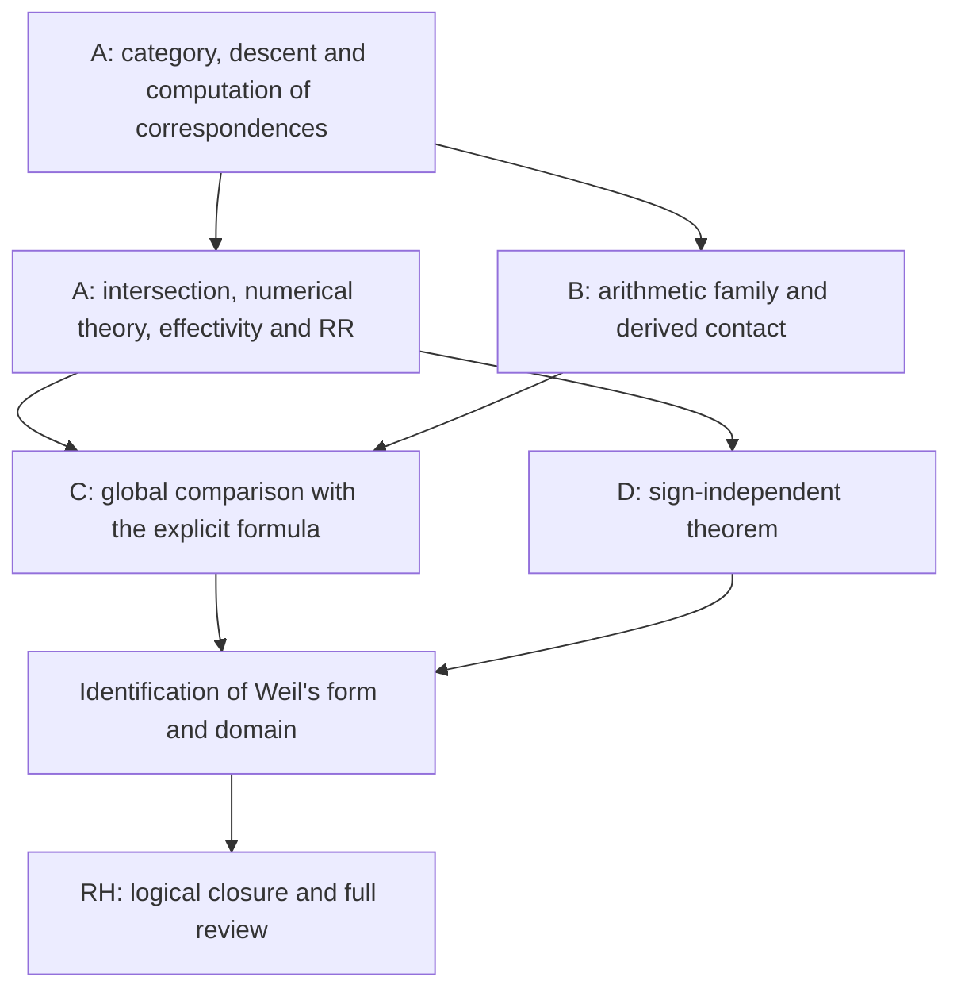

# A–B–C–D closure plan over Spec Z

Status: **research plan; no row is closed by this document**.

**Update 2026-09-12.** Rows A and B are closed at Weil-strength
over the graph sector, in
[paper 43](../../04-papers/43-row-a-torsion-theory/main.md) (phase 125) and
[paper 44](../../04-papers/44-row-b-arithmetic-family/main.md) (phase 126).
The blockage of B (§6, "test that can quickly discard the candidate", and
P123.060) is resolved by coprime support: the two contacts live in `V(n)` and
`V(n−1)`, and A's local factor is their product. The §6.6 requirement of
monoidality of the primitive extraction is **refuted** as a requirement
(`Λ(6)=0≠log 6`) and replaced with the correct structure. C inherits a
new and exact obligation: absorb `w_unit(Γ_n)=n−1` in the Tate and
Gamma sectors.

**Correction (phase 128).** Three adversarial audits of
papers 43, 44 and 45 found real errors. **All three `WEIL-STRENGTH-COMPLETE`
labels are withdrawn.** Honest labels, findings,
verifications and dispositions in
[phase 128](../../03-research/phase-128-adversarial-audit/), and what
actually survives in
[D128.004](../../03-research/phase-128-adversarial-audit/D128_004_WHAT_SURVIVES.md). That obligation is **discharged** in
[paper 45](../../04-papers/45-row-c-explicit-formula/main.md) (phase 127), which
closes C with no analytic black box: there are no corner terms because
`log p / log q` is irrational, the archimedean term is the zeta determinant
of the modulus operator, the poles are the rulings, and it also closes the gap
—recorded in `113_07` and never covered— of the step `q_T >= 0` over
primitive tests ⟹ RH. D inherits a Hodge-index statement.

**Update (phase 130).** Row A recovers the
`WEIL-STRENGTH-COMPLETE` label on the declared carrier (fixed finite chart,
chart system and colimit as additional structure, invertible sector),
with A.6 under the amendment accepted by the author and A.8 with target
`Pic_b(B_T)` forced by Theorem 10.8 of
[paper 43](../../04-papers/43-row-a-torsion-theory/main.md). Record audit decision
in
[R130.005](../../03-research/phase-130-row-a-closure/R130_005_FINAL_AUDIT_AND_LABEL.md);
adversarial auditor's dissent on A.8 recorded. B and C keep their
phase-128 labels until their own campaigns.

**Update (phase 131).** Row B rebuilt in
[paper 44](../../04-papers/44-row-b-arithmetic-family/main.md) around the
norm class `Γ_n^rad`; finite contact `Λ(n)n^{-1/2}` as the volume of the valuation
layer; the `n−1` obligation to C is withdrawn. Label (record
audit [R131.005](../../03-research/phase-131-row-b-closure/R131_005_FINAL_AUDIT_AND_LABEL.md)):
`WEIL-STRENGTH-COMPLETE` on the declared carrier, **conditional on the author's
acceptance of amendment B.4** (§6 item 4, note).

**Update (phase 131, final closure, R131.019).** Row B closed
after seven construction rounds and five adversarial audits. Final object: the
Frobenius family `Frob_n` (Haar measures of the fixed-point strata,
true unit, inverse semigroup graded by prime sets); integral
shadow `Sh_Z` over the objects (amended B.4 proved by degree); two Gram
forms: the Weil kernel is the Gram form of `Frob ⋆ Δ^rad` and the
Frobenius family alone carries the finite half (Thm 8bis.1e); `vol(Z_p^×) = log p` is
the only normalisation with a universal Tate residue (Thm 8bis.8, modulo
global scale). Label: `ROW B: WEIL-STRENGTH-COMPLETE on the declared carrier of
Paper 43`. Recorded alongside the label: no sign, no zeros; the interface
with the Weil criterion is a colimit statement and false at finite charts;
no divergence rate is convention-free; the import `(Wgr)` was
withdrawn as false (Lemma 8bis.6b) and «positivity in Dirichlet profiles ⟹
RH» stays `OPEN`. Row C follows (Paper 45), with the correction to its §11.

**Update (phase 132, closure of C, R132.007).** Paper 45 was
written against the old row A (Fell completion, `E_u`, zero strata,
assembled `χ_A`) and was rebuilt on the closed Papers 43 and 44: the test
class is `Γ_h ∈ D_A^{rad}` (Paper 44 Def 3bis.6); the trace identity is Paper 43
Thm 8.8 evaluated via Lemma 5.1a; **the Weil explicit formula is proved in the
repository** (Thm 9.4, correct contour: reflection first, expansion at
`Re s = c > 1`, shift of each prime term with entire integrand); the
comparison theorem `T_∞(Γ_{F⋆F^†}) = 2Φ_F(0)Φ_F(1) − Σ_ρ Φ_F(ρ)Φ_F(1−ρ)` with
a colimit quantifier (C1); `c = 0` is no longer a declaration of A and is the only
constant with `I_∞ = B_nuc` (Cor 9.6a, closes D128 C9); the Tate poles by
residues of the continued Euler symbol (Thm 9bis.2′: `|S_f|+1` and `0` at the chart,
`1` and `1` in the continuation); sufficiency of primitive tests (Thm 10.4 with
correction C10). Label: `ROW C: WEIL-STRENGTH-COMPLETE on the declared
carrier`, granted after three rounds and two adversarial audits. Recorded alongside
the label: carrying and fixed `c = 0` normalisation; additivity by places as
definitional (not localisation); no sign; imports (E1)–(E8), (R1) named;
Mertens quarantined. Rows A, B, C complete; the three-review panel follows,
then row D.

**Update (phase 133, A/B/C review panel).** Three independent
reviewers (proofs; connections; labels and chain to RH). No FATAL. Panel 1:
more than thirty load-bearing theorems re-derived, four exposition MAJORs repaired.
Panel 2: a consistent theory, no cross-contradiction; a dangling reference and an
unpropagated relabel repaired; row D's target now boxed identically
across the three papers. Panel 3: honest labels as recorded; the
name overclaims relative to spec §1 (equal structural load with
Weil, not established per Paper 43 §11bis); the A.8 and B.7 dissents are won by
the adversarial auditor and must go to the author as amendments (synthesis §4.2, decision
pending). Step-by-step map against Weil (synthesis §3): complete chain above
the sign; exactly one functor to something with a non-negative invariant is missing,
plus a vanishing theorem turning equality (10.10) into an inequality. Row D
opens after the author's decision on A.8 and B.7.

**Update (phase 133, amendments A.8 and B.7 accepted).** `[phase 133, amendment accepted]` The author (D. Trejo Pizzo) accepted the two amendments proposed in PANEL_SYNTHESIS §4.2: A.8 (Paper 43, row A) and B.7 (Paper 44, row B). Both clauses move to `REFUTED AS WRITTEN + PROVED AS AMENDED`; the ruling decisions (R130.005 for A.8, R131.019 for B.7) are superseded by the author's decision and the adversarial auditors' dissents are recorded as history. The `WEIL-STRENGTH-COMPLETE` labels of rows A and B become **unconditional** on the declared carrier. No theorem, no proof and no other grading changes. Record: `03-research/phase-133-abc-review-panel/AMENDMENTS_A8_B7_RECORD.md`. Row D remains open.

**Update (phase 134, opening of D, R134.007).** Paper 47
opened with no label and no sign, by design. Proved: `Π = −∂²+¼` is a bijection
on the primitive class (the two Tate conditions are exactly the compact
support of `e^{−|t|/2}∗F`); `Λ(g) = 𝔏(g⋆g^†)` with `𝔏 = −Π²(W_fin+ω_∞)` and
`Π²ϖ = 0`; the state reformulation (RESTATEMENT): RH ⟺ D's target ⟺ `𝔏`
positive definite ⟺ unitary representation of the modulus group of the carrier with
`Λ(g) = ‖π(g)Ω‖²` — the missing non-negative invariant is a **norm**; swap
law (`Σ(T)` Toeplitz, target of P124.013 split even/odd); Thm 5.8 (the
archimedean diagonal dominates for small `ε`: finite inertia carries no information; D.3
withdrawn); five negatives and the list (R1)–(R5): **no duality exists in A–C
that takes the primitive sector out of itself (without `K`-twist)**, so there is no
Riemann–Roch form that can carry a sign; battery of falsifiers (`Ξ_a` has no
Frobenius family in the sense of B; DH has neither Frobenius nor a Tate block).
Prop 3.6a(iii) withdrawn (false under RH; the final audit had also
accepted it). Findings against the corpus recorded in phases 124 and 118 (Galerkin
eigenvalues = variational upper bounds; P124.014 brackets unstable).
Recommendation for the next D campaign: start with (R5).

**Approved execution and active objective.** The [record of the first campaign](../../03-research/phase-123-weil-strength-abc/P123_024_FIRST_CAMPAIGN_LEDGER.md) contains the local repairs, their proofs and the result of B's integral test. The next construction is the integral source with analytic realisation; the complete milestones remain subject to their acceptance criteria.

The goal is a complete proof of the four rows in a single theory and, via the Weil criterion, of RH. The plan specifies what would need to be proved and how to decide the next step. It does not presuppose that the current candidates admit those theorems, nor does it assign a probability of success without evidence.

**Recommendation:** start with a short A/B viability campaign, accompanied by the specification of the theorem D must supply. First fix P123.018's two obstructions and require a real derived contact for a prime and its square before investing in the global completion. Do not restart D's two-prime computation: it was already carried out in P122.028.

Complementary documents: [first work block](FIRST_CAMPAIGN.md) and [corpus coverage](CORPUS_COVERAGE.md).

## 1. Basis for the decision and scope of the review

**123 phase directories** and **42 paper directories** were inventoried. A lexical sweep covered **5,359 `.md`, `.tex` and `.txt` files** across the five documentary sectors listed in the coverage index. The general maps, the index of the 42 papers, summaries and excerpts of their sources, the historical audit and, in more detail, the notes underpinning the 119–123 front were consulted.

This is a strategic review with traceability, **not a new line-by-line audit of every proof**. The inventory distinguishes reading of decisive sources, consulting summaries, and mechanical exploration. Revalidating any old result that enters the final proof is an obligation of the plan.

Internal sources governing this plan:

- [P123.018: carrier obstructions](../../03-research/phase-123-weil-strength-abc/P123_018_ADVERSARIAL_CARRIER_AUDIT.md).
- [A's strong contract](../../03-research/phase-123-weil-strength-abc/P123_A_ACCEPTANCE_SPECIFICATION.md).
- [P122: effective scope of A/B/C and sources](../../03-research/phase-122-row-d-integrity-and-construction/P122_ROWS_ABC_REFERENCE_AUDIT.md).
- [Phase 119: what the contacts separate](../../03-research/phase-119-what-a-finite-compression-certifies/RESULTS_119_SEPARATOR.md).
- [Phase 120 closure](../../03-research/phase-120-global-polarization/PHASE_120_CLOSURE.md) and [phase 121 audit](../../03-research/phase-122-row-d-integrity-and-construction/P122_008_PHASE121_LOAD_BEARING_AUDIT.md).
- [P122.028: finite Green computation](../../03-research/phase-122-row-d-integrity-and-construction/P122_028_TWO_PRIME_FINITE_GREEN_COMPLEX.md) and [P122.029: critical transmission](../../03-research/phase-122-row-d-integrity-and-construction/P122_029_LIONS_MAGENES_TRANSMISSION_AUDIT.md).
- [Historical restart: RH-strength is not a veto](../RH-MASTER-CONTEXT/LIVE_FRONTIER_AND_RESTART_PLAN.md).

## 2. Corrections that change the order of work

| Inherited claim | Status to be used |
|---|---|
| «Only D is missing» | Valid only under paper 42's restricted contracts. Under the strong contract, bridges in A, B and C are missing. |
| «P123.014–017 globally close A.1–A.6» | P123.018 reopens the lifting change, the semilocal descent and completion operations. |
| «The finite two-prime model is the next computation» | It already exists: P122.028. Zero flux remains to be proved, not the energy to be computed. |
| «Calderón or Lions–Magenes will automatically produce R» | P122.029 identifies the exact condition, but the boundary computation does not prove its arithmetic fulfilment. |
| «A form equivalent to RH is not a valid target» | An equivalence is a legitimate target; its useful sense must be proved without assuming RH. |
| «Any argument built with Euler–Gamma is just a repackaging» | There is no universal impossibility theorem here. A new inequality proved from that data would be valid. Every no-go must keep its exact class of hypotheses. |
| «The square cone is already geometric effectivity» | Its relation to effective cycles must be proved; operator positivity and cycle effectivity are distinct notions. |

The root indices and `OPTIONS.md` contain earlier states and some overly broad prohibitions. They are kept as history; they are not used to block a new theorem nor to certify rows beyond their audits.

## 3. Proof architecture and research organisation

The proof's dependency order will be:

The research order will be less rigid: B's small tests and D's needs are examined **before** finishing A. This avoids building a category that later cannot host the arithmetic or the sign mechanism. This does not authorise introducing B/C/D's conclusions into A's definition.

Two conceptual fronts accompany the campaign, without multiplying carriers:

1. **A/B/C construction:** common theory and comparison theorems.
2. **D viability:** locate an identity that forces the sign or the vanishing of the defect, keeping explicit what information A needs to preserve.

Initial effort concentrates on A/B. D's analysis must produce a checkable proposition; if it only produces another equivalent coordinate of the defect, it is recorded and does not displace the main construction.

## 4. G0 — fix the mathematical bookkeeping

Create a record per result used: identifier, statement with quantifiers, domain, proof or exact reference, imported hypotheses, dependencies, retractions, computational scope and place of use.

States: `PROVED-REVIEWED`, `IMPORTED-VERIFIED`, `CONDITIONAL`, `CANDIDATE`, `REFUTED-IN-THIS-CLASS`, `NOT-REVIEWED`. «Finite» and «completed» must appear in the statement; they are not interchangeable labels.

Also fix a single convention for Mellin, half-density, dagger, orientation and sign. In the balanced profile F, primitivity will be the vanishing of the two integrals against `exp(t/2)` and `exp(-t/2)`. Explicitly write the change from `M_0,M_1` of the multiplicative profile f. Verify that `q=-B_nuc` is the positive sign used by D.

Separate the indices: `F^m ∘ F^n=F^(m+n)` for Frobenius iterations; multiplicative notation uses the labels `Q^m,Q^n`. Do not assert `Gamma_m Gamma_n=Gamma_mn` if m and n simultaneously denote additive exponents.

**G0 closure:** acyclic diagram of the selected dependencies and a dictionary of conventions. It does not require auditing the thousands of documents that will not be used.

## 5. A — build the common theory

### A0. Choose the minimal category that supports A, B and D

First candidate to study: a non-unital ideal of kernels, essential bimodules and intertwiners in multipliers. The identity correspondence lives in the category; it need not be an element of the trace ideal.

As a reference model, Hilbert correspondences over the crossed product C* allow typing multipliers and inversion. But transporting this to the rapid/nuclear kernel and to integral arithmetic requires a comparison; a C* realisation does not by itself prove RR nor cyclotomic contact.

Backup alternative: a larger unital algebra containing the needed multipliers. Choose it only if it allows proving the tests' estimates and preserving the integral datum. P123.014's minimal unitisation does not serve the map written there.

For each candidate specify objects, morphisms, balanced tensor, topology, unit, duality and geometric realisation. Prove the tensor without using `z tensor 1` where no 1 exists. Lifting changes must be maps with correct domain and codomain and triple coherence.

**Output:** a valid local category, or a counterexample that rules out precisely that candidate.

### A1. Resolve the semilocal transitions

Keep as a checkable base the coefficient inclusions `f -> f tensor 1_Zp`. Do not turn them into a point map nor into extension by one over idelic classes.

Compare two concrete options: chart-change correspondences via induction/groupoid spans, or an initial definition over the global adelic groupoid with later recovery of the semilocal models. In the global option the relation with the sheaf over Spec Z and the exhaustions of tests must still be proved; «global» does not remove those obligations.

Prove composition of transitions, coherence across three charts, gauge equivalence and compatibility with tensor/dagger. Redo the `S={infinity,2}`, `S'={infinity,2,3}` example from P123.018 with the new operation.

The available external source proves the sheaf of **algebraic** crossed products and describes its coefficient maps; it does not automatically import the descent of the completed category. [Connes–Consani, §5, especially Theorem 5.3](https://arxiv.org/html/2501.06560v1#S5).

### A2. Subject the classical control to an early test

Re-audit P123.011: rebuilding the theory in another classical category is a control, not a proved specialisation of the arithmetic candidate.

Check separately: automorphism graphs, finite endomorphism graphs, transposition, diagonal, rulings and intersection. A Frobenius graph is not in general invertible as a scheme bimodule; if only invertible bimodules are available, make explicit the enlargement or the localised category where the comparison would make sense. Distinguish the Frobenius scheme morphism from the inverse called geometric Frobenius in cohomology.

Effectivity test: the graph of a three-point permutation is an effective cycle, but its matrix is not self-adjoint and cannot be a sum of `X*X` in the usual matrix representation. This invalidates an automatic identification of both cones, not every possible comparison functor. Declare which relation between them is actually needed for RR.

### A3. Build the trace and determinant with separate types

Define the traceable domain before the trace value. If pull–tensor–push is written, prove existence of the functors, projection and base change; if a bicategory of bimodules is used, build its trace and compare it with diagonal contact.

Also verify the meaning of the gauge representation: passing to coinvariants where U_gamma acts trivially does not automatically prove a representation of the whole coefficient algebra; check covariance and domain.

Treat separately the non-identity contacts, the excess at the identity, the finite strata and the archimedean one. Define the subtraction of the generic orbit from the source. The sum of local contributions must be a localisation theorem.

Specify torsion lines, norms, logarithmic degrees and Fredholm determinants. The identity `d_rel(h)=exp(T(h))` is not by itself a construction of the intrinsic determinant line.

### A4. Prove the topological and numerical operations

Choose a kernel of smooth/locally constant vectors preserved by the action, or prove that the alternative space of sections is stable. A continuous action on C_0 does not automatically imply smoothness of all its coefficients.

Prove joint continuity of convolution, dagger and action on tests; completeness; nuclearity only where required; descent; and limits in S. Do not deduce LF bilinear continuity merely from a universal property for linear maps.

Redo P123.017 using the appropriate anti-dual. Keep the vector radical `R_partial ∩ ker M`, the primitive–numerical–Tate sequence and the separation against tests. Decide whether the topology is the quotient one or the one induced by J, and prove the chosen relation. Prove extension of dagger and of every action used; an action for each fixed test does not prove an action of the whole completed carrier.

Multiplying arbitrary distributions is not required if the proof only uses the action of correspondences on numerical classes. A sufficient pairing is required for all pairs appearing in C and D.

### A5. Effectivity, integral theory and mixed RR

Choose an effective class from geometry or exact categories, preserving the discrete data needed for the RR strategy. Resolve what remains of phase 113's obstacle O1: the mere structure of a complex vector space does not produce classical growth of sections.

Build its map to the numerical quotient. For a completed real cone K, prove `K ∩ (-K)={0}` if this is the property used, and declare whether K is obtained by closing before or after the quotient. Prove stability under the relevant positive operations; never require stability of a non-zero proper cone under all multipliers and their negatives.

Build a single mixed determinant functor and a natural comparison with the earlier periodic model. If the earlier model does not admit that comparison, record its explicit replacement and prove all consumed properties again; do not keep a nominal equivalence.

The RR formula must contain correctly typed terms for trace, excess and renormalisation, identity, Gamma, Tate and compatibility with effectivity. If D will use growth of `h^0(nD)`, that growth needs a theory of sections and a specific proof: an equality of determinant degrees is not enough.

**Closure of A:** A0–A5 reviewed, classical controls with their explicit scope, and no pending sign hypothesis hidden in effectivity/RR. A's completeness will not automatically imply D.

## 6. B — produce the arithmetic correspondences inside A

**Early viability test:** obtain, in A's candidate, the objects for `2,4,3,6` and compute their contact. This test precedes A's completion; B's general closure comes after.

1. Define the Witt/cyclotomic category of origin, its morphisms and its operation. The equality of Witt rings with certain finite cycles is not yet a monoidal functor to A's endocorrespondences.
2. Select external classes or real finite correspondences, without using a diagonal rational that is gauge. Prove independence from uniformisers, charts and liftings with the repaired transitions.
3. Build the realisation functor and prove composition, unit and transposition, including half-densities.
4. Derive `LDelta* Gamma_n` in the chosen category. For `n>1`, prove that its relevant arithmetic contribution is identified with `[Z --Phi_n(1)--> Z]`; specify any truncation and prove it is compatible with later uses.
**Amendment to item 4 — ACCEPTED by the author (D. Trejo Pizzo); text proposed in phase 131:** Item 4 is `REFUTED AS WRITTEN` and `PROVED AS AMENDED`; the original text is kept above unchanged. `LDelta^* Gamma_n` is the fixed-point complex, with differential `n-1`, not the cyclotomic one (P123.060), and no `C`-linear category can carry `Z/p` (P123.022); moreover the class of the element `a_S(n)` in the carrier is `delta_S(1/n)=(1/n at infinity; 1 at every finite place)`, which is not in the image of any slice map `j_q`, so the literal clause has no object. Proposed amended text, for the author's decision: «the derived contact of the **ideal class** `Gamma_n^rad` — the unitary average over `K = {+-1} x prod_p Z_p^x` of the classes of all generators of the ideal `(n)` — with the diagonal, computed in the declared category, i.e. **the mass at `t = log n` of the unique Radon measure `omega_fin` representing `T` in the radial sector `D_A^rad ∩ D_A^0`** (Paper 44 Thm 3bis.7; existence and uniqueness in Def-Thm 3bis.8, uniqueness because a Radon measure is determined by its integrals against `C_c^inf` tests), whose integrand is, place by place, the Haar-regularised rank of the relative Hochschild shadow weighted by the semidensity-Lefschetz weight (Paper 43 Thm 7.1, Thm 8A.9 (8A.24)-(8A.24')), has degree at the finite places `Lambda(n) n^{-1/2}`, equal to `n^{-1/2} deg_det [Z --Phi_n(1)--> Z]`, P123.037's integral cotangent model transported to the lattice `L_S subset X_S` (P123.038); the identification is of **degrees**, and an identification at the level of objects is impossible in a `C`-linear category (P123.022)». This amendment reflects the decision made for A.6 (Paper 43 §14.2): the constructor proposes it and the author adopts it. Proved in Paper 44 §6.2a' and Theorem 6.3a. **Type warning (round 2, finding F2 of R131.002):** `T(Gamma_n^rad)` is **undefined** — `T` is only defined on `D_A` and the class is a measure, not an element of `D_A` — and the naive place-by-place evaluation gives **0**, because the image of `j_p` is a null set for the class; that is why the amendment is formulated via `omega_fin`. The reading «`Lambda` is the multiplicative Haar volume of the layer `p^k Z_p^x`» is Paper 43's Rem 9.7a and row B **inherits** it; what row B adds is attaching it to the family and to its **contact location** (Thm 3bis.7'): the finite part of `T` in the radial sector is a purely atomic measure with support exactly `{+-k log p}`. No zero, no RH, no sign and no von Mangoldt function are used as input.

5. Obtain `deg_det(contact)=log|Phi_n(1)|=Lambda(n)` as a consequence. Treat n=1 as identity/excess, not via that formula.
6. Prove the general family by structure, not by extrapolation from cases. Incorporate its classes, moments and primitive components into A's numerical object.

**Test that can quickly discard the candidate:** the simple linear contact of a dilation uses `1-u^(-1)`, while the sought contact is cyclotomic. Compute both, with rings and valuations, for p and p². If they differ, locate the geometric mechanism producing the cyclotomic factor; do not substitute one determinant for another just because their motivation is correct.

**Amendment to item 7 — ACCEPTED by the author (D. Trejo Pizzo); text proposed in phase 133 (PANEL_SYNTHESIS §4.2):** `[phase 133, amendment accepted]` Item 7 (the discriminant test at `p`, `p²` and the localisation of the mechanism) is `REFUTED AS WRITTEN` and `PROVED AS AMENDED`; the original text is kept above unchanged. Amended, accepted text: «the discriminant test at `p, p²` is `PROVED`; the mechanism is localised in the carrier (layer volume, trivial fixed-point weight, Paper 44 Thm 6.5) and in the `Z` model (deck `μ_n`, Thm 6.4(iv)); a map between both localisations is `REFUTED` over a `C`-linear carrier (P123.022), so the clause's requirement of a single mechanism producing the cyclotomic factor is unsatisfiable as written». This amendment reflects the decision made for A.6 (Paper 43 §14.2) and for item 4 (above): the panel proposes it, the final audit adopts it, and the author accepts it. Paper 44's Rem. 6.5a′ remains **unchanged**, so anyone following the auditor still reads `PARTIAL` there and loses nothing; no theorem depends on which grading is adopted. With this acceptance, the adversarial auditor's dissent on B.7 is recorded as history and row B's label becomes **unconditional**.

Deninger offers a precise entry point: Theorem 5.1 for noetherian normal affine schemes and Proposition 5.2 for Frobenius/Verschiebung. It is a source for investigating B, with no bridge yet proved toward our carrier nor toward a Hodge norm. [Deninger, §5](https://arxiv.org/html/2508.05329v1#S5).

**Closure B:** general functor and derived contacts, adversarial verifications at `p,p²,p³,pq,p²q,pqr`, and compatibility with A. The index by places must be preserved: phase 119 shows that grouping only by norms loses information.

## 7. C — identify the intersection with the explicit formula

1. Fix the class of test functions and the construction of `K_h` as an integrated section or admissible superposition in A. A sum of deltas needs justification as a multiplier/distribution; a Schwartz function is not declared.
2. Build a realisation of A's complex in Meyer's Poisson model. It must identify action, coboundaries, duality and the two Tate terms. A whole-category equivalence is not required if a realisation preserving the operations used is enough.
3. Prove the trace identity over a common kernel, with finite, archimedean and identity contact. Then extend by continuity, density and the appropriate estimates.
4. Derive the prime term `sum_(p,k) (log p)p^(-k/2)(h(k log p)+h(-k log p))` with the convention fixed in G0. Prove the Gamma term and the poles in the same comparison.
5. Record the order of limits: charts S, spatial cutoff, spectral cutoff, regularisation and window T. Each exchange needs a uniform local estimate or a convergence theorem that covers it. Avoid requiring unnecessary global uniformity if an exhaustion of compact tests suffices.
6. Finally prove `I_A([K_F],[K_G])=B_nuc(F,G)` and that A's primitive tests cover a class sufficient for the Weil criterion.

Meyer's external result is a nuclear spectral realisation and a character formula. Proving that trace is A's intersection remains our comparison theorem. [Meyer, corrected version](https://arxiv.org/abs/math/0412277v3).

**Closure C:** global identity on the sufficient domain, with limits, Tate and Gamma, without assuming the location of the zeros. The zeros may be used in the explicit formula's comparison theorem; what is forbidden is assuming their position to prove the sign.

## 8. D — prove the sign with new mathematics

**Execution:** [P123.036](../../03-research/phase-123-weil-strength-abc/P123_036_D_NORMALIZATION_AND_ENDPOINT_REPLAY.md)
reproduces the certificate's seven interval tasks at `T=log2`,
checks its bounds against the recombination data, and verifies the
final margins with Arb. It also verifies that D's operator already uses
the correct Gamma normalisation. The global law described
below remains pending; reproducing the starting point does not prove it.

D is probably the hardest conceptual problem, but A and B also contain research problems. No progress percentages are assigned from the number of lemmas written.

Common target: `q_T(F)=-I_A([K_F],[K_F])>=0` in every window and for every primitive F in the domain. There are two sufficient routes; closing one suffices. Do not accumulate them as simultaneous requirements.

### D-H: Hodge index from the source theory

Build a polarisation H and prove an index theorem on the appropriate numerical space. The signature of the Tate hyperbolic plane has to be placed in the relevant scalar intersection form: a signature is not assigned to a trace vector without specifying its geometric scalarisation.

Prove non-positivity in the primitive sector. An RR route requires growth of sections, duality and cone effects sufficient to deduce the inequality; an energy route needs a global inequality with an exact constant and a proved domain. The theorem may be specific to the arithmetic data if its proof is independent of the sign it seeks.

Do not impose the absence of global null classes if only semidefiniteness is needed: the equality classification is required only in the scope the proof actually uses. In infinite rank, finite-dimensional arguments must be replaced by proved estimates or approximations.

### D-E: exclude the first contact via a source law

Revalidate the entry point: strict certificate at `T=log2`, P122.002's compact first-contact theorem, primitive restrictions, parity and channel births. The certificate has two levels: recombining bounds and regenerating the intervals; neither substitutes for the other.

The existing reduction seeks a law prior to the supertrace that, for a first-contact state, annihilates its oriented defect. R and S are a candidate factorisation of that obligation:

- **R:** a source transmission relation implies that the incoming flux belongs to the appropriate critical space, cancelling the Tate jump.
- **S:** the same global structure forces the coincidence of two relevant prime channels and eliminates the state via the already-established rigidity.

P122.028 fixes exactly the detector:

`E_eff(F)=||(E_q,T-E_p,T) h_F||² / log(q/p)`.

Its harmonicity implies constant flux, not zero flux. The new goal is to prove why the arithmetic state must have zero flux. P122.029 identifies `H^(1/2)_00` and the weighted boundary condition; no generic regularity remains to be imported.

**D's first task:** write a single candidate global boundary relation and the Green identity that produces it, with each source term and its domain. Check what it allows one to deduce about R or S without adding the vanishing condition as a definition. A merely local identity that works for any data has not yet selected the arithmetic state.

If no such law appears, study D-H or the direct signed inequality of papers 36–40; do not rebuild faithful detectors again. A direct proof of a criterion equivalent to RH is valid. To also complete the four requested rows it must be transported to theory A via C and cover D's declared sector; proving RH by another route does not retroactively fill the A/B/C bridges.

**Closure D:** an independent proof of D-H or D-E with all its hypotheses verified, and the sign transferred to C's domain. No hypothesis «a contraction exists», «there is a positive metric» or «the connection is horizontal» may remain unproved.

## 9. Falsifiers and permanent controls

| Control | Question it decides | What it does not decide |
|---|---|---|
| Finite fields | Do we recover the classical operations and intersections via a specified map? | Does not transport Hodge to Z by analogy. |
| Lifting/chart change | Is the object independent of the promised choices? | Does not prove contact or sign. |
| Davenport–Heilbronn | What concrete arithmetic hypothesis fails in this control? | An argument can distinguish it and still not prove RH. |
| Shifted pair `xi(s+a)xi(s-a)` | Does the hypothesis use anything beyond symmetry and positive weights? | Is not a counterexample to a class that excludes it via other proved hypotheses. |
| Matrix models and port changes | Does a formal identity lose orientation or confuse cones? | Does not certify completeness or descent. |
| Number-field zeta | How general would the theorem be? | An extension to GRH needs all hypotheses checked again. |
| Windows and discretisations | Are there normalisation, threshold or tail errors? | Finite positivity is not positivity of the full operator without a bound on the complement. |

Counterexamples must satisfy the candidate's exact hypotheses before invalidating it. Numerical tests help falsify or conjecture; the final proof needs exact arguments or intervals plus uniform estimates.

## 10. Milestones and continuation decisions

| Milestone | Deliverable and acceptance | If it fails |
|---|---|---|
| M0 | Record of dependencies and coherent conventions | Correct the statement before building. |
| M1 | Local category with well-typed lifting change | Change the category, not just the map's name. |
| M2 | Coherent transitions and `S -> S' -> S''` control | Evaluate the global model with its own comparison theorem. |
| M3 | B prototype for 2,4,3,6 with derived contact | Reject the identification between simple graphs and cyclotomic data, or build its justified enlargement. |
| M4 | A complete in its domain, with effectivity/RR | Locate the missing lemma; do not declare a partial closure as total closure. |
| M5 | General B and global C comparison | Keep arithmetic/analytic results separate until the bridge is proved. |
| M6 | New law that proves D-H or D-E | Record the discarded class and evaluate the signed alternative, without renaming the same assumption. |
| M7 | Assembled proof, dependencies with no open hypotheses, and full review | Reopen exactly the affected dependencies. |

M1–M3 are the first concrete campaign. M6 is prepared from the start as a viability specification and test, but its final acceptance depends on the theory identified.

There is no honest timeline for M6 or for RH. Each block is measured by a mathematical output — proof, comparison or counterexample — not by the number of documents. After each candidate, review whether an open statement changed, or only its notation.

## 11. Full closure of the proof

1. Write the final theorem with exactly the proved domain and the normalised sign.
2. Check that the covered tests suffice for the Weil criterion; prove any necessary density or approximation.
3. Remove all open conditions from the dependency graph. Circular equivalences do not count as proofs of their members.
4. Reproduce only the certificates the proof uses, including interval generators and complement bounds.
5. Independently audit categories/descent, determinants/RR, functional analysis, contact arithmetic, the explicit formula, and the sign.
6. Update paper 42 to the theory actually proved. If the architecture changes, rewrite the statement and do not add an incompatible layer of notation.

External review is a stage of scientific verification, not a mathematical premise. This plan does not send documents nor request third-party review.

## 12. What is worth doing now

**Start with M1 and M2, with test M3 already written.** The first positive goal is to prove that the same correspondence keeps its class under a change of lifting and chart, composes correctly, and admits a computable diagonal contact. It is a verifiable and necessary advance.

At the same time, keep a single visible question for D: **what global arithmetic identity forces the zero flux that P122.028 does not obtain from harmonicity?** The plan does not promise to find it, but it places the work exactly where a new proof would change the state of the problem.

**Phase 135 (2026-09-12/13) — row D, first construction campaign: the canonical class.** Starting finding: Paper 47's requirement (R5) sought an involution of the algebra; Weil duality is affine (`E ↦ K − E`), so what was missing was a *class*, not an involution. `K` was built with `Φ_K = ξ` (Pólya kernel, positive; `I_∞(F,K) = ½ deg F`, `K·K = ½`), the Weil completion `D^W` (not the colimit), the radical `𝓝_∞ ≠ 0` (null on compact support by counting distinct zeros, importing Conrey), the affine duality `σ_K` (closes item 3a of §9.1), and the **Hodge-index transfer theorem** (Thm 12.3): any `h⁰` with (a) non-negativity, (b′) positivity ⇒ effective non-zero modulo the radical, (c) Riemann–Roch inequality, implies RH. For the `Ξ_a` falsifier those three axioms are inconsistent (Thm 12.4, rank-4 primitive sector). Two natural constructions of `h⁰` examined: the integral one (translates of `ΠK` by prime powers) satisfies (a) and (b′) and fails (c) at every finite truncation; the full lattice is OPEN. Three construction rounds, two adversarial audits (one FATAL: Corollary 12.4a was a non sequitur, recast as a scheme), audit (R135_003) with four own findings not seen by the final audit and caught by the auditor. No label, no sign (R135_007). Next campaign: sections indexed by pairs `Frob_m ⋆ Frob_n^†` with unimodularity `Frob_n ⋆ Frob_n^† = Δ^{(n)}` in the definition; pure mathematics first.

**Phase 136 — the "where not to go" map and the decision for D.** Five semantic-search reviews rebuilt the grid: ~200 mechanisms across 135 phases; almost all "proved impossibilities" are impossibilities of concrete constructions, ~65 are reformulations equivalent to RH, and the real unconditional positivities are only prime-side (purity `|α| = √p`: Docs 131/135) or only archimedean (Connes–Consani, `T ≤ log 2`). Map meta-theorem: **the sign is the interaction term between the polar/archimedean block and the Frobenius lattice, and it is a phase-coherence phenomenon of unimodular roots** (phase 60 "phase, not magnitude" = Paper 47 Restatement 12.4a = the "small square Δ" of CC 2006.13771). Decision: the analytic page is painted; the geometric page has a single unrealised object (MW-5); the arithmetic-combinatorial page (Riemann–Roch with section dimension over the **square**) is nearly blank and has every ingredient. MW-5/R16 (answered only for the curve), P122.007 (forbids importing, not rebuilding, the Hilbert–Samuel mechanism) and GAP-135.B are reopened; an adversarial audit of phase 65's `RH-PROOF.md` (a claimed proof never audited) is ordered. Campaign 136: S1 full-lattice growth (item 23), S2 semilocal positivity with the polar block, S3 dictionary with CC's intersection theory over the scale site's square, S4 `H⁰` over the square via fibre-by-fibre CC cohomology with isometric Frobenius transport (the new mathematics). Document: `03-research/phase-136-row-d-map/PHASE_136_MAP_SYNTHESIS_AND_PLAN.md`.

**Phase 137 (open) — coupling the canonical class with the Frobenius lattice.** Blueprint `03-research/phase-137-row-d-canonical-coupling/R137_000_BLUEPRINT.md`: D.0 adversarial audit of phase 65's `RH-PROOF.md`; D.11 growth of `h⁰_Z(mK)` on the full lattice (item 23); D.12 semilocal positivity with the polar block (GAP-135.B); D.13 dictionary with Connes–Consani's scale-site square; D.14 conditional. Constructor + adversarial auditor per round. In parallel, at the author's request: Papers 43, 44 and 45 rewritten in LaTeX (Paper 42's style), only proved constructions with complete proofs, titles naming what is built, no mention of RH or internal programme language, with an adversarial review of fidelity and completeness.

## Phase 137 — closed

Verdicts: D.0 `RH-PROOF.md` (phase 65) REFUTED as a proof, correct as a reduction of RH to uniformity
in `P` of a renormalised family (bifurcation Prop. 1.1 of R137_005: the bound and the identification live in
distinct objects); D.11 growth `≫ (log m)^{3/2}/log log m` on the full lattice, threshold per
generator `e^{πq²} ≤ m ≲ e^{5.1q²}`, item (23) unilaterally reduced to bounding `Q(m)`, condition (c)
requires `Q(m) ≫ m√log m`; D.12 blueprint sign corrected, `S={∞}` vacuous in the CC window; D.13 only
`Q = Π` is exact. D.14 not opened. No label change in D. Permanent finding: the class with G4's form
(simple pole, positive atoms, functional equation) contains every `ζ_K` but no member with proved
off-line zeros: the `Ξ_a` test does not adjudicate arguments that use rank-one polar divergence. Decision: `R137_007_CLOSING_DECISION.md`.

Collateral record repairs (LaTeX conversion of papers 43–45, accepted after two
adversarial rounds each): Thm 8A.12 (A.2) restored in Paper 43; continuity of the crossed-product splitting
(Paper 43 Thm 7.1(a)) marked CONDITIONAL; Paper 44's off-diagonal Gram constant and the structure of
`Prim_n` corrected (§12 of the md).

## Phase 138 — open: primitive sector and detector cones

Author's direction: a single question — what intrinsically distinguishes the primitive radial sector from
the positive directions that make `I_A` indefinite; find a non-circular reason for the relevant
arithmetic classes to live in a cone with `I_∞ ≤ 0`; do not attack the sign from the explicit formula;
structure prior to the zeros. Formulation: **detector cones** (RH ⟺ Hodge index over
any cone containing Theorem F's detectors). Items: D.15 intrinsic characterisation (sector =
radical of the polar block; Lorentzian criterion; reverse Cauchy–Schwarz on the effective cone `{F ≥ 0}`);
D.16 detector closure (what operation creates detection and destroys CC's structural proof); D.17 Pólya
cone (decreasing convex ⟹ positive type with no zeros; a detector? locate the term carrying zero
information, possibly the PNT error term — if so, record a no-go). Blueprint `R138_000_BLUEPRINT.md`.

**Phase 138 — closed.** Prior corpus check (`CORPUS_CHECK_R138.md`, author's
rule). Answer to Q: the primitive sector is the `I_∞`-orthogonal complement of the hyperbolic plane
`Λ = span(K, K_odd)` (splitting `D^W = Λ ⊥ P^W`, Thm D.15.1); the polar block satisfies Hodge identically
(no detection); the triangle family detects every off-line zero (`RH ⟺ W(h_T) ≥ 0 ∀T`, a
one-parameter criterion after Landau, OPEN novelty), so the effective cone `{F ≥ 0}` is a detector but its sign
is the PNT remainder (no-go, phase 114); zero-free separator invariant: equimodularity of `|p−½|` (for `Ξ_a`
Hodge fails on an effective class by strict Cauchy–Schwarz), with a ceiling at `ζ_K`. Q: PROVED in
restricted form, OPEN in existential form (clause (iii) on `E`). No label change. Decision:
`R138_005_CLOSING_DECISION.md`. Phase 139 recommended: clause (iii) on `E`, starting with the
negative task (does any structural inequality distinguish `ξ` from data shaped like `ζ_K`?).

**D completion plan.** `ROW-D-COMPLETION-PLAN.md`: phases 139–143 organised around two
method theorems — T1 (proved, R137/R138): every local zero-free structure is shared by the `ζ_K`, so
the sign proof must be uniform in the field; T2 (to be proved in 139): Epstein zetas with
`h > 1` share everything except the Euler product and have off-line zeros, so the proof must
use Frobenius multiplicativity essentially. Three permanent falsifiers: `Ξ_a`, Epstein `Z_Q`,
the `ζ_K` non-distinction test. Prior corpus check: `CORPUS_CHECK_ROW_D_PLAN.md` (Bost–Connes/KMS
no-go robust; Weil pillars named 3 times but with no consolidated ledger; phase-15 Thm B and phase-41
tropical toy reusable; the Hodge index over the square is the programme's sole difficulty).

**Phase 139 (open) — the two falsifiers and the method theorem.** Blueprint
`03-research/phase-139-row-d-two-falsifiers/R139_000_BLUEPRINT.md`: D.19 Epstein falsifier in D's
framework (canonical class `K_Q`, equimodular polar block, Hodge failure, T2); D.20 field-uniform
framework and base change (Artin formalism at the level of forms); D.21 line-by-line ledger of
Weil's proof with labels PRESENT / CONDITIONAL / ABSENT and the construction problem `(P139)`.

**Phase 139 — closed.** T2 established as METHOD-CONSTRAINT with an axiom list and a transfer
lemma: the Epstein zeta `Ξ_Q` (principal form, `h > 1`) has an explicit canonical class `K_Q`,
equimodular polar block, positive coefficients, and **fails the Hodge index** in the effective
cone (Landau + strong Davenport–Heilbronn; Voronin zeros are not enough; `Λ_Q` has real zeros,
so `K_Q > 0` is false). Every sign proof must use A3 (equimodularity) and at least one of
A7/A8/A9, and be uniform in the field; escaping Epstein via A9 is equivalent to excluding Siegel zeros.
Field-uniform framework proved (`K_K` by contour shift); additive base change on conjugate
packets (unconditional abelian). Weil ledger: only W2 (Riemann–Roch over the square) is ABSENT.
Problem `(P139)` formulated with tests (AT-1..3). No label change. `R139_005_CLOSING_DECISION.md`.

**Phase 140 (open) — the Frobenius side of `(P139)`: the square as a tensor structure.**
Idea to build or refute: in Weil's proof the quadratic growth `h⁰(m(F_1+F_2)) ≍ m²`
is automatic from the product structure of the square (`H⁰ ⊗ H⁰`); W2 is not a new counting problem
but the tensor square of the curve's RR plus the intersection theory of correspondences. The
law `Frob_m ⋆ Frob_n = Frob_{mn}` (which Epstein lacks) is the product structure; CC's `H⁰` for
`Spec Z̄` (linear growth) is the curve-level candidate. Items: D.22 `Sh_Z` for a general field (O-9);
D.23 `Div_□`, bidegree, multiplicative semigroup, intersection matrix with named regularisations, table
against Weil; D.24 candidates `h⁰_□ = h_c ⊗ h_c` with a clause-by-clause analysis ((b′) as a moment
problem at the zeros; (c) as an explicit inequality) and tests AT-1..3; D.25 synthesis. Blueprint
`03-research/phase-140-row-d-frobenius-square/R140_000_BLUEPRINT.md`.

**Phase 140 — closed.** O-9 closed (`Frob_𝔫`, `Sh_{O_K}` for every field). The tensor
square `h⁰_□ = h_c(deg⁻)h_c(deg⁺)` reaches exactly the growth `(r²/4)m²` required by (c) (phase 136's
"¼m² wall" is surpassed by this object), but **no `h⁰` factoring through the bidegree
satisfies (b′)** (Thm D.24.7). Complementary failure: `h⁰_Z` satisfies (b′) and fails (c); `h⁰_□` satisfies (c) and
fails (b′). The realisation `r(Frob_n) = τ_{log n}(2K)` collapses to `NS(P¹×P¹)` because it erases the
arithmetic weights; three Gram forms: (A) pure Frobenius (unsigned at finite charts, 8bis.4a), (B)
averaged = the complete Weil kernel, (C) Pólya realisation, rank 2. Cor. D.24.12: an admissible `h⁰`
must read the zeros through pairings `I_∞(E,X)` with `Z(X) ≠ 0` (family A = axiom A8 read
directly). Optimal `χ` is `1/8`. No label change. `R140_005_CLOSING_DECISION.md`.

**Phase 141 (open) — an `h⁰` that reads Frobenius traces.** Traces
`t_n(E) := I_∞(E, τ_{log n} g)` (arithmetic, naming no zeros); determine `E` mod `𝓝_∞`; moment
cone `𝔐` (tool, model-uniform); quadratic candidate `h⁰_C = (Σ C_{mn} t_m t_n)_+` with (c) as a
quadratic-form inequality and (b′) as a cone containment defined with no zeros; arithmetic
choice `C` = Paper 44's Frobenius Gram with the 8bis.4a caveat; O-17 primitive bridge for
Epstein. Blueprint `03-research/phase-141-row-d-frobenius-traces/R141_000_BLUEPRINT.md`.

**Phase 141 — closed.** The Frobenius traces `t_n(E) = I_∞(E, τ_{log n}g)` determine `E`
mod `𝓝_∞`; the moment cone `𝔐` is convex and pointed; the 2-homogeneous functionals of the traces are
the wrong shape (the dichotomy reproduces Thm 12.3's proof). O-17 closed (primitive bridge for
Epstein). **Main result (§D.30, construction by the adversarial arbiter):** the `h⁰` defined by
Riemann–Roch, `h⁰_RR⁺(E) = max(R(E),0)·1_{deg E>0}`, `R(E) = ½I_∞(E,E) − ¼deg E + χ`, satisfies (a) and (c)
**unconditionally** (Serre symmetry `R(K−E) = R(E)`), grows `¼m²`, `χ > 0` is refuted, `χ = 0` is
calibrated. **All of row D is a single zero-free clause, (b′)⁺:** `deg E > 0 ∧ R(E) > 0 ⟹ E ≡ E' ≥ 0`
mod `𝓝_∞`. (b′)⁺ ⟹ RH; false for `Ξ_a` (A3 must enter); for `Ξ_Q` the framework breaks earlier (A7). Whether
RH ⟹ (b′)⁺ is O-18 (exponential moment problem). `R141_005_CLOSING_DECISION.md`.

**Phase 142 (open) — the clause.** Q-A: consistency of `S_0` with every known
necessary condition of `𝔐`, starting with (C4.1) `C_F ≥ √(−I_∞(F,F)/2)` (cheap and capable of refutation);
modification if it fails. Q-B: sufficiency criterion for the exponential moment problem; where
A3 and A8 enter; if (b′)⁺ ⟺ RH, state it as a final reduction. FATAL from the first line.
Blueprint `03-research/phase-142-row-d-the-clause/R142_000_BLUEPRINT.md`.

**Phase 142 — main result (final confirmation pending).** (C4.1) is FALSE and (b′)⁺
is refuted given (X19) (first simple on-line zero): **no `h⁰` satisfies (a),(b′),(c) of
Thm 12.3 for `ξ` with any `χ`** (Thm D.31.12, confirmed by the arbiter and numerically verified by
the final audit). Mechanism: hyperbolic-cosine bound for effective classes, `|Re e^{iθ}Φ_{E'}(ρ₁)| ≤ ½ s₁ deg E'`
with `s₁ = 0.99846 < 1`, and explicit witness `E = 53.11911·e^{−u²/18}sin(γ₁u) + 400K`, `R(E) = 10`. Holds
for every admissible `Z` with a simple on-line zero (`ξ_K`). Diagnosis: the framework keeps `C×C`'s
intersection theory and discards its linear systems (in geometry `D²>0, D·H>0 ⟹ D` large; here the effective
cone is a fine moment cone). Two outs for phase 143 (§D.32): Horn A, a defect in (c) vanishing at
degrees 0 and 1 used by the proof of 12.3; Horn B, enlarge effectivity (only live candidate: non-negative
Frobenius traces). Record note added beside Thm 12.3 in Paper 47; map updated in
`ROW-D-MAP-b.md`. No label change.

**Phase 142 — closed.** Final confirmation: Thm D.31.12 stands; §D.32 audited. Favourable
finding (J3): the entire witness family falls inside cone B4 of non-negative Frobenius traces, which passes
test D.32.4 with equality. Order for 143 (from the arbiter): (0) `s_*` (O-19); (1) Horn B/B4, starting with
the zero-free question "does a primitive `F` outside the radical with all traces ≥ 0 exist?"; (2) Horn A with
a primitive gate, blocker O-18′. `R142_005_CLOSING_DECISION.md`.

**Phase 143 (open) — `s_*`, cone B4 and a repaired transfer theorem.** D.33 `s_*`
certified; D.34 B4 (zero-free definition, (T1) mod `𝓝_∞`, (T2), theorem 12.3-B4, exact computation of whether
`R>0, deg>0 ⟹ t_n ≥ 0`), falsifiers and reading of A8; D.35 cheap Horn A; D.36 synthesis. Blueprint
`03-research/phase-143-row-d-trace-positive-cone/R143_000_BLUEPRINT.md`.

**Phase 143 — closed.** `s_* = m(γ₁) ∈ [0.99845824, 0.99846016]` (the cone
constant remains open). (T1′) proved unconditionally by Landau on the traces' Dirichlet series
(`B4 ∩ P^W ⊆ 𝓝_∞`). **Unconditional transfer theorem 12.3-B4** (with no ample class nor Thm 11.14).
`(G⁺)` unconditional for `g = K + λh`. `(b′)_{B4}` for `h⁰_RR⁺` **true under RH**; hence
**RH ⟺ positivity of Frobenius traces over the RR-positive set** (PROVED + RESTATEMENT);
false for `Ξ_a` (FATAL rule invoked and resolved). Prop. D.34.16: without RH the traces are positive for
`n ≥ N(E)`; under RH `N ≤ 64d²` by degree slice; for `Ξ_a` the violation sits at a fixed index (the
A3 line is at the head). `R143_005_CLOSING_DECISION.md`.

**Phase 144 (open) — the fixed-index inequality.** D.37 the smallest index where `Ξ_a` fails
and the polar exponent set lemma (two equimodular points give an AM–GM floor; four do not); D.38
`(P_m)` for `ξ` at that index and at `m = 1` (diagonal trace `I_∞(E,g) ≥ 0` over `S_0`, a
bounded-density bound over `S_0` instead of the effective cone); the head as a finite system on slice
`d = 1`. Blueprint `03-research/phase-144-row-d-fixed-index/R144_000_BLUEPRINT.md`.

**Phase 144 — closed in substance (brief confirmation pending).** The A3 line proposed
by the final audit (AM–GM floor of two exponents vs. four) is REFUTED (every symmetric polar set
has a floor, attained at `n = 1`). `(P_m) ⟺ RH` at **every** fixed index (construction of an index
`E_t = tF + K`); bounded density over `S_0` ⟺ RH (closes (★) negatively); O-29 and O-30 closed
negatively. Final form of the route: **RH ⟺ `I_∞(E, g_λ) ≥ 0` over `S_0`** (Restatement D.38.3a). §D.40:
a single ray `tF + K`, with `(a,b,deg,R)` frozen, refutes the six weakenings; the framework does not see that
`W` is a norm nor that `|n^{½−ρ}| = 1` (facts about zero positions). **Record conclusion: the
Riemann–Roch/Hodge framework produces reformulations, not reductions; the sign must come from outside.** Synthesis and
options (α change the form with a Frobenius cross term; β function-field model of the framework
with the defect theorem as a test; γ stay inside) in `ROW-D-SYNTHESIS-PHASES-135-144.md`;
recommendation: β, then α. Author's decision pending.

**Author's decision:** β in phase 145 (function-field model of the framework, judged
by whether it names the missing ingredient), α in phase 146 (pairing `J ≥ I_∞` with `J ≤ 0` on `P^W`, from
Frobenius multiplicativity). State of D: ~55%; one single thing is missing: a structure that sees `W` as
a norm — the arithmetic analogue of the sections functor, or a pairing distinct from `I_∞`.

**Phase 145 (open) — function-field model.** Blueprint
`03-research/phase-145-row-d-function-field-model/R145_000_BLUEPRINT.md`: D.41 the model over `C/F_q`
(discrete carrier, form `I_∞^C`, dictionary with `Div(C×C)`, `K_C`, pointwise effective cone vs sections
cone, `s_C`, trace cone); D.42 name the ingredient and formulate `(P145)`; D.43 synthesis.
Written prediction: the defect theorem fails in the model; the value is the ingredient's name.

**Phase 145 — closed.** Prediction refuted: the framework's defect theorem also holds
over the elliptic curve `E/F_2` (sharp constant `s_C* = √(7/11) = 0.798`, witness at degree 3),
where RH is a theorem: `s < 1` is a property of the cone, not of the zeros. Dictionary `I_∞^C = +(D·D)`; the
framework's effective cone = Frobenius graphs; the framework's `K` is the ample class `½(F₁+F₂)`, not the canonical one.
Ingredient named (sharpened by the arbiter): **the framework has `⋆` and lacks `+`**; the missing effective
classes are the graphs of the sums `Γ_{m+nπ}`; for `g = 1` "largeness" is positive semidefiniteness
of the norm form `deg(m+nπ) = #ker` over `Z[π]`, a count. Largeness clause ⟺ RH (Prop. D.42.5);
record target `(P145′)` = the mechanism (`H⁰` functor with a divisor map, degree gate, bounded
density). Named obstruction: infinite genus `Δ·Δ = −∞`. `R145_005_CLOSING_DECISION.md`.

**Phase 146 (open) — the degree form on `Z[Frob]` with a counting interpretation.** New to the
corpus (CORPUS_CHECK_R146b). Q0: the form is already in the Euler product (interpretation); the shadow gives
`Z[Frob] → Z` of rank 1 with `deg_det = log|m+nℓ|` (rigidity). Q1: does `Z⟨Frob_n⟩` admit a finite
symmetric form (counterterm `2−2g`, difference form `deg(α−β)`) that is a count over sums? Sum classes `c_{m,n}`
and the hyperbolic-cosine test; theorem "a count on monomials and differences, never on sums." Warnings:
deliver the count, never positivity (positivity of the form = RH); `g = 1` degenerate. Blueprint
`03-research/phase-146-row-d-coupled-pairing/R146_000_BLUEPRINT.md`.

**Phase 146 — closed.** The degree form on `Z⟨Frob_n⟩` exists, is indefinite and **is not a
count**; it is `2ab − W` with no sum over zeros: blind to the zeros and `Ξ_a`-uniform. New and proved: Paper 44's
Frobenius diagonal (Thm 8bis.1b) has an archimedean part independent of `n`, its differences live in
`P(m) △ P(n)` and `P(m) = P(n) ⟹ δ_m = δ_n` exactly. One-prime tower: one-parameter Toeplitz Gram,
PSD ⟺ `τ_p ≥ 2/(√p+1)`; but it is pure magnitude (phase 60, P122.028): its sign carries no information about `ξ`; "A3 does
not enter" withdrawn (no diagonal of `Ξ_a`; Doc 131 Thm 6.7 is sensitive to `a = ½`). O-46.6 refuted. The
tower thread closed negatively except for one object with explicit phase data. Programme state and options for the
author in `R146_005_CLOSING_DECISION.md` §4.

**Author's decision: option (iii).** Paper 47's Part III (drafter in progress: §§17–23,
P47-xx corrections to Parts I–II, `PART_III_NOTES.md`; then adversarial reviewer) and phase 147.

**Answer on "can the `+` be created?":** from Weil's literal form, forbidden
(`Hom(Spec Z, Spec Z) = {id}`; the arithmetic Frobenius is a translation of the class group, not a
homomorphism; translations plus integers generate the affine group, not a ring); formal sums exist but
are blind to the zeros (phase 146); the only open door is `Z[Gal(K/Q)]` over `Spec O_K` (genuine
automorphisms, effective graphs, degrees as fixed-point counts, `Frob_𝔭 ∈ G`; collapses to `Z` over `Q`, which
is the reason for T1; `Ξ_a` has no Galois structure; Epstein as a mixed-sign combination).

**Phase 147 (open) — the Galois ring as the missing `+`.** New to the corpus
(CORPUS_CHECK_R147b). D.50 correspondences `Γ_σ` over `C_{K,S}`, pairings via Artin decomposition (the
character table enters the intersection numbers), the ring `Z[G]` and the cones `𝓔_G`, `𝓔_{G,Frob}`,
hyperbolic-cosine constant of the new cone against `s₁`; D.51 falsifiers by structure (early
Epstein test: is the principal Epstein zeta an effective class with off-line zeros?); D.52
what largeness would require without RH ((4a) via the regular representation); D.53 model: curve with automorphisms
over `F_q`. Binding warning: no claim of positivity for trace forms on `Z[G]` (that is
RH); only support-function computations. Blueprint `03-research/phase-147-row-d-galois-ring/R147_000_BLUEPRINT.md`.

**Paper 47, Part III — written, under adversarial review.** §§17–23 (197 numbered statements with
proof or pointer; "Withdrawn" tables per section), imports (X19)–(X29a), seven record
corrections to Parts I–II (`M(F)` convention, Remark 12.3c, splitting with `K_odd`, ample cone, item (23)
unilateral, bidirectional Remark 13.6a, `K` = ample class). Editorial record in `PART_III_NOTES.md`.
Adversarial reviewer: list of withdrawn claims that cannot appear as theorems, labels, 12
proofs read in full, imports, corrections, §23 against `R146_005` §4.

**Paper 47, Part III — adversarial review R1: ACCEPT WITH MINOR REPAIRS.** One MAJOR finding:
phase 140 (§§D.22–D.24: `h⁰_□`, Pólya collapse to `NS(P¹×P¹)`, Thm D.24.7/D.24.11, Cor D.24.12, Gram forms
D.23.12–13, O-9, residue R2) does not appear and is not recorded as an exclusion; consequence: Prop. 19.7 cites a
witness never introduced and §23.1 is not complete. Nine MINOR findings (cross references, statement
types, RESTATEMENT label in 21.21, hypothesis `Φ_E(0)>0` in §23.1 item 9, `Sh_Z` pointer, tag
collision (T1)/(T2), programme vocabulary in note §12.2, order of (X19)). Verified with no failure: the 18
withdrawn claims appear only in Withdrawn tables, 34 labels, 12 complete proofs, imports,
seven corrections, §23 against `R146_005`/`R144_005`. Repair orders sent to the drafter (add
phase 140 as a section, not as an exclusion). `PART_III_ADVERSARIAL_REVIEW_R1.md`.

**Paper 47, Part III — repairs applied, under confirmation.** New §19bis (phase 140: Frobenius
family indexed by ideals over every number field, `Sh_{O_K}`, collapse of the Pólya realisation
to `NS(P¹×P¹)`, three Gram forms with residue R2, `h⁰_□` with optimal `χ = 1/8`, Thm 19bis.19/22 and Cor
19bis.23; nine-row Withdrawn table), 23 statements; Prop. 19.7 now names its witness; §23.1–23.3
completed; the nine minor findings fixed; 220 cross references resolved. `main.md` 10182 lines.
Adversarial reviewer in confirmation pass (`PART_III_ADVERSARIAL_REVIEW_R2.md`).

**Phase 147 — round 1 received, under adversarial audit.** Construction result: **collapse**
(Lemma D.50.2): every `σ ∈ Gal(K/Q)` preserves the idelic modulus and the framework's carrier is radial, so
`Γ_σ = Δ` and `Z[G]` acts via augmentation; `𝓔_G = 𝓔`, the character table enters no
intersection number, `dim H⁰ = 1`, everything `Ξ_a`-uniform. The model `E/F_5` (`Aut = μ_4`) does win: `[Γ_i] = ½[Γ_π] −
½[Δ] − F_1 + F_2` effective with negative coefficients, `s` goes from `2/3` to `cos(π/4)`, bounded by
`cos(π/|G|) < 1`. Epstein test: membership of `K_{Q_0}` in the effective cone correlates neither with `h` nor
with zero position (`D = 15`, `h = 2`, effective with zeros to the right of 1; `D = 163`, `h = 1`, not
effective): the effective cone is blind to the zeros in both directions, which kills the "enlarge the cone" horn.
By-product D.50.6: `Σ_{σ≠1}(Γ_σ·Δ)_Arak = log|d_K|` (different from Hilbert + conductor-discriminant). Reading:
this is a statement about the **radial carrier**, not about the ring; it closes, by a single mechanism,
the whole "more correspondences" family. Pending: audit `R147_002`, repairs, `R147_005`.

**Paper 47, Part III — confirmation R2: ACCEPT.** §19bis faithful to phase 140 (R140's FATAL H1 on
`L_S` does not reappear; residue R2 present; exact PROVED/GUIDANCE split). Five residual defects
sent to the drafter: a claim of closing a non-existent item of §14.5 (reformulate: the step from
`Q` to a general number field; §19bis narrows item (18) without closing it), a reference 19bis.18→19,
the `certify_chi.py` script in §23.6, three §19bis OPENs in §23.4, a mention in the frontispiece. Paper 47's line
updated in `04-papers/README.md`.

**Paper 47, Part III — CLOSED.** The five R2 residuals applied (`PART_III_NOTES.md` §7);
item (18) of §14.5 marked NARROWED, not closed; §23.4 gains (27a)–(27c); 220 statements, zero dangling
references; `main.md` 10207 lines. No label, no sign. LaTeX conversion pending the author's
decision.

**Phase 147 — audit R147_002: ACCEPT WITH REPAIRS, no FATAL, six MAJOR.** (1) `K ∈ 𝓔` is already
Paper 47's Def–Thm 11.7(i); (2) the witness for "effective with zeros to the right of 1" is trivial
(`3e^{−t²} + e^{−(t−log 2)²}`), with no Epstein; (3) "kills the enlarge-the-cone horn" is a non sequitur (the
horn is about the support function); (4) two carriers conflated: `Γ_σ` lives in `C_{K,S}` (not radial); the
collapse is "the radial realisation `R(Γ_σ) = id`"; (5) **decisive corpus failure: phase 139 (Thm D.20.2) already
has the Weil forms graded by characters `Ŵ^{(Λ_[χ])}`; on `⊕_χ D^W` the ring `Z[G]` acts by
`χ(σ)`, so the pairing requested by the blueprint exists and is not refuted**; (6) the `cos(π/m)` lemma was badly
proved (the value is `cos(π/(2m))` for odd `m`). Verified: intersection numbers, Riemann–Hurwitz,
`d₀ = 5`, F-147-1. Round 2 ordered: repairs + the graded carrier `𝒟_K = ⊕_χ D^W` (diagonal action
`χ(σ)`, form `Σ_χ I_∞^{(χ)}`, canonical class `Σ K_χ`, three effective-cone candidates and their support function
against `s₁`, FATAL/GRH check, Epstein as the image of the trivial idempotent, model with `Aut = G`).

**Phase 147 — round 2 received, under adversarial audit R147_004.** Part A: the 17 findings of
R147_002 discharged (record corrections C1–C19 in R147_001; `K ∈ 𝓔` withdrawn as a result; trivial
witness `3e^{−t²} + e^{−(t−log 2)²}`; "kills the horn" withdrawn; carriers separated: the collapse is
`R(Γ_σ) = id`; `cos` lemma corrected). Part B, graded carrier `𝒟_K = ⊕_χ D^W`: the blueprint's formula
`I(Γ_σE, Γ_τF) = Σ_χ χ(στ⁻¹) I^{(χ)}(E_χ,F_χ)` is confirmed (abelian, unconditional, phase 139 D.20.2); correct
cone = isotypic image of non-negative non-radial tests on `C_{Q,S}`, with `Γ_σ` realised as
translation by norm-one ideles; `Z[G]`-stable, with a degree gate, strictly contains `ι(𝓔)`;
**it does supply a `+`** (rays `δ_{(u,g)}` with coordinate `χ(g) = −1`, analogue of `[Γ_i]`). But it does not reach
`ζ`: support function `S(γ,θ,m) = max_k s(γ, θ − 2πk/m)`, `σ(γ,m) < 1` for every finite `m`
(`0.998456 → 0.999613 (m=4) → 0.999956 (m=12)`); Thm D.55.9: the `G`-invariant sector is exactly the
`χ = 1` component, so at `ζ`'s zeros the constant remains `s(γ,θ)` for every abelian `K`;
Thm D.55.11: `𝒟_K` is a sum of eigenlines, `dim H⁰ ≤ 1`, the missing object is called **multiplicity**.
FATAL point examined: `S(γ,π/2,m) = 1` if `4 ∣ m`, only at zeros of `L(s,χ)`, with no transfer theorem
that runs; to be verified by the auditor (is the trivial direction `θ = 0` already present?). Thm D.55.10: the class
of Epstein is the trace of a graded class under a non-isometric projection that destroys the grading.
Construction recommendation: close negatively; the only opening is O-47.3′ (multiplicity = (4a)).

**Phase 147 — audit R147_004: Part A ACCEPT; Part B with 7 repairable MAJORs, 0 FATAL.**
(1–2) grading by individual characters (the error phase 139 already avoided with packets `[χ] = {χ, χ̄}`:
for complex `χ` the form is neither real nor symmetric; the bilinear formula gives `χ(στ)`, not `χ(στ⁻¹)`); (3) rays
`δ_{(u,g)} ∉ D^W`, the support function's formula needs the proof in two halves (cosh per coset +
concentration); (4) `s(γ,0) = 1` always (Paper 47 (19.2)): "first support function reaching 1" withdrawn,
it is the `μ_m` orbit of `π/2` touching `πZ`; (5) the defect theorem does not "choose θ": no analogue of
19.19–19.23 exists for `L(s,χ)` (O-47.7); (6) `t` does send the cone to the effective cone; the non-isometric
half remains; (7) D.55.11 vacuous in `m`, "multiplicity" is a slogan. The negative closure holds **only via
D.55.9**; the non-abelian `K` case and the `χ ≠ 1` sectors remain open for a framework theorem on `ζ_K`. Round 3
of repairs ordered; then `R147_005`.

**Phase 147 — CLOSED negatively (R147_005).** Three rounds, two adversarial audits plus
confirmation (ACCEPT with final, mechanical C1–C7). Three theorems: (1) collapse in the radial carrier
(`R(Γ_σ) = id`); (2) the packet-graded carrier `𝒟_L = ⊕_χ D^W ⊗ C` **does** supply the `+` (formula
`Σ_χ χ(στ⁻¹) I^{[χ]}`, `Z[G]`-stable cone `𝓒` with a degree gate and coordinate classes `χ(g) = −1`, exact
analogue of `[Γ_i]` in the model), with `σ(γ,m) < 1` for every `m`; (3) **Thm D.55.9′: the `G`-invariant sector
is the trivial component, so at the zeros of `ζ_F` nothing changes.** Record reading: `ζ`'s sign
lives in the radial sector, `G`-invariant, of trivial character, where every additive Galois structure acts
trivially; every future "more correspondences" proposal must first show it does not commute with the
radial projection. Open: O-47.7 (`χ ≠ 1` sectors, defect theorem for `L(s,χ)`), O-47.8 (non-
abelian), O-47.1′, O-47.3′. Row D: no label, no sign. Recommendation to the author: pause construction;
or attack O-47.7 if a framework theorem for `ζ_L` is worth it, or close D in the map and record 134–147 in
Paper 47's Part IV.
Final corrections C1–C9 applied and verified by the final audit (D.55.9′ with statement and proof in
`R147_003b` §R3.3; `deg K_L = 1` restricted to `F = Q`; `K_H ∉ closure(𝓒)` proved/certified). `R147_005`
unconditional. Phase 147 closed on record.

**Phase 148 (open) — mixed effectivity over the complete square.** Author's direction: D
needs a new mathematical idea, not another analogy; every `+` must not commute with the radial projection.
Corpus check: the extension to the square `C_Q × C_Q` was named (113, 136, 146) and never built;
rank-one kernels `φ⊗ψ` as cone generators and mixed classes `Φ(y/x) − φ(x)ψ(y) ≥ 0` are NEW; 146's "do not
pursue" (D.49.4, via P122.028) refers to new data, and this phase supplies no data but a new
**effectivity restriction**. Idea: the mixed effectivity condition is `Φ ≥ φ ⊛ ψ` with the
max-plus (tropical) convolution, the first encounter of `+` and `×` of the integers inside the framework. Death
test first (D.56): does it improve the support-function constant at `ρ₁` relative to `s₁`? (i) same ⟹
negative closure; (ii) improves `< 1`; (iii) reaches 1 ⟹ FATAL flag, run `Ξ_a`. Blueprint
`03-research/phase-148-row-d-mixed-effectivity/R148_000_BLUEPRINT.md`; constructor in progress.
Phase 148, round 1: death test with result (i), constant unchanged. Elementary reason: the
rank-one factors decay, so `φ ⊛ ψ ≥ 0` and mixed effectivity implies `Φ ≥ 0` (Thm D.56.4: the
shadow of the mixed cone is exactly `𝓔`). Findings about form `B`: two distinct representing
densities (`w_Φ` in (T), `Φ` in (R)), with no radial projection nor degree over the square, linear divergence in
the cutoff along the averaging limit (Connes–Consani's "delicate principal value," reproduced
elementarily); the (T)×(R) block is blind to the zeros. Everything `Ξ_a`-uniform. Phase 41's Doc 125
located at `phase-41-build-G2/125-construction-of-the-intersection-form.md`. Adversarial auditor in progress, with the order
to attack the negative: does the decay hypothesis force the collapse? does the quadrant `k_Φ + φ⊗ψ ≥ 0` with
non-decaying factors enlarge the shadow?
Phase 148, audit R148_002: ACCEPT WITH REPAIRS; the negative holds but was badly
proved. `L²` does not imply vanishing at infinity (A-1); the replacement D.56.3′ is stronger: for `φ, ψ ≥ 0`,
`φ ⊛ ψ ≥ 0` with no decay hypothesis at all, and with signed factors a bad `w` destroys the (T)×(R) block
(`χ = −∞`). The quadrant `k_Φ + φ⊗ψ ≥ 0` (O-148.3) also closes (D.56.4′). D.55.5's title
withdrawn (no single trace gives the three blocks). Corpus row corrected: phase 41's Doc 125
is the same object and shows that the square does admit finite intersection numbers (`f₁·f₂ = 1`) in
classes that `B` cannot pair: phase 148 proved that `B` is trivial in its domain, not that the square has
no intersection theory. Main residue: O-148.2, a class of kernels with degree, outside `B`'s
domain. Repairs ordered (R148_003).

**Phase 148 — CLOSED negatively by theorem (R148_005).** The idea (mixed effectivity
on the complete square) refuted in two lines: for non-negative factors `φ ⊛ ψ ≥ 0` with no hypothesis, so
`Φ ≥ φ ⊛ ψ ⟹ Φ ≥ 0`; with signed factors the (T)×(R) block is infinite. Shadow of the mixed cone = `𝓔`,
`s₁` unchanged, no FATAL, `Ξ_a`-uniform. Also established: `B` exists but with no common radial
representation, no radial projection or degree; the (T)×(R) block is a count blind to the zeros; Doc 125 (phase 41)
located, the same object one level up, with integer `f₁·f₂ = 1` in classes `B` does not pair. Error
recorded (should have been seen in the blueprint). Record reading after 145–148: **the zero data enters the
framework only through the regularised trace of the radial sector; any object with a genuine degree-count either is
supported there (and is `Φ ≥ 0`) or pairs infinitely.** The only remaining question: O-148.2, a regularisation
of the trace over the square that is not the radial one, with degree and zero data — the question
Connes–Consani left open at the scale site. Confirmation `R148_004`: ACCEPT; unconditional closure.

**Phase 149 (open) — the additive sheaf of `Spec Z` and Deligne's extraction.** Route change:
transport Deligne's mechanism (Rankin, Landau, a priori poles via a FAMILY's invariant theory,
fibre extraction ≤ family, Künneth) instead of Weil's. Family = additive sheaf `Σ Λ(n)e(nα)n^{−s}`; rational
fibres = `L(s,χ)`; `α = 0` is `ζ`; field size = length `N`. D.59 extraction theorem: `2k` Gaussian
moments of prime sums centred over Farey `q ≤ N^c`, for every `k` with constants only in `k`
⟹ RH (a folklore chain, never stated: verified in the literature). D.60 death test: what the PROVED
moments give (large sieve/BDH, Hooley, Green–Tao) and whether Hooley's refutation (Bober–Goldmakher) already kills the
hypothesis. D.61 coinvariants block: additive correspondences `T_h`, pairing `κ(d) = Σ_{q|d}1/φ(q)`,
positive definite (Bochner), blind to zeros = singular series; Künneth of the additive square (Fujii,
Languasco–Perelli) with the double sum over zeros. D.62 the problem to create: a symmetry whose
invariant theory computes the family's moments without looking at fibres, compatible with the known
large-deviation results. Corpus: everything NEW except adjacent NG-B8/NG-B1. Blueprint
`03-research/phase-149-row-d-additive-pencil/R149_000_BLUEPRINT.md`; constructor in progress.

**Phase 149 — adversarial audit done.** `R149_002_AUDIT.md`: D.59 STANDS (it is Hölder, not
Weil I 3.2); D.60 STANDS, D.60.7's scope lowered, still needs running the de la Bretèche–Fiorilli /
Harper–Soundararajan Ω check against `H(k,c)`; **D.61.10 DOWNGRADE** (Parseval over `χ` and Goldston–Montgomery do
transport moments; what does not cross over is the polar/positive structure: "promoting the density singular series
to a polar divisor"); **(P149) DOWNGRADE**: the `k`-tuple conjecture in Deligne's clothing. D.62.2 must cite
Granville 2007 + 2008 corrigendum (Bhowmik–Ruzsa gives only quasi-RH). Pending `R149_003`–`R149_005`.
Row D: no label.

**Row D closure plan.** `ROW-D-CLOSURE-PLAN.md`: diagnosis (the two
squares are `A/Q` and `A/Q^×`, sole bridge = Tate; dlVP = archimedean Deligne `k=1`; Beurling's calibration
⇒ T3; finiteness is not essential in Deligne, holomorphy of the zero block is; the Weil conjectures were
proved by four routes and the corpus transposed two). Phases: 150 T3 + **Laumon route** (ℓ-adic Fourier,
unimodular Gauss sums: 0 occurrences in the corpus); 151 Dolgopyat / Bourgain–Dyatlov (upper bound with no
positivity; modular-surface resonances = `ρ/2`); 152 Mayer / Lewis–Zagier (one object with `+` and `×`);
153 synthesis or closure in the map with Part IV.

**Phase 150 — method theorems T3, T4, T5. CLOSED.** `R150_005_CLOSING_DECISION.md`.
T5 PROVED (no Parseval-type moment extracts a fibre beyond the trivial bound; closes every "Deligne extraction over
Z" fed by `L²` orthogonality). T4 downgraded: the correct statement is the classical
**polar-at-the-zeros / entire-at-the-zeros** classification (Thm 4.12/4.13): the obstruction is the polar structure at the
zeros, not the regime; Voronoi gives power saving in the smooth regime for cuspidal-form coefficients with no zero information.
T3 conditional on (H-DMV), blocking reading O-150.1; the observation was already in `114_d_240`/`114_d_246`.
No sign. Recommendation: close D in the map with T1, T2, T5 and the classification as the wall's exact statement and
write Paper 47's Part IV; MW-5 only with a concrete idea.

**Closure of row D in the map (author's decision).** Paper 47 Part IV §§24–28 written (phases
147–150), adversarial review R1 ACCEPT WITH REPAIRS (3 MAJOR, 8 MINOR, all repaired), R2 ACCEPT. §28.2 fixes the wall
with T1 (Thm 18.1), T2 (Thm 18.16), T5 (Thm 27.3) and the polar/entire classification (Thms 27.10–27.11): *the sign is
`ψ(x) − x ≪ x^{1/2+ε}`, a bound on partial sums of a sequence polar at the zeros; every proof is uniform in the
field, uses the Euler product essentially, is not obtained by extracting a fibre from any `L²`
orthogonality moment, and is not obtained from partial-sum bounds of entire sequences at the zeros.* §28.4: six-clause
reopening criterion. Phases 149 and 150 closed (`R149_005`, `R150_005`). **Rows A–D: A, B, C
WEIL-STRENGTH-COMPLETE; D closed in the map, no label.** Pending: LaTeX for Parts III–IV; O-150.1 (read DMV
2006); commit/push.

##  (late) — Phase 153 opened: does the certified endpoint carry sign?

Directive: advance D, no editorial work, real mathematics. Corpus re-checked (phases 46/106/114/118/119/137/138,
Paper 42 §row-d). Frontier: the log 2 certificate is the only theorem ahead of Connes–Consani (primes 2,3 coupled vs
CC's prime-free T = ½ log 2). Phase 137's open acceptance test D.12-α (ζ ≥ 0 but Ξ_a < 0 at finite (S,T)) has never
been run on the endpoint. Phase 153 blueprint: `03-research/phase-153-row-d-sign-carrying-endpoint/R153_000_BLUEPRINT.md`
(Q1 D.12-α at log 2; Q2 prime-blindness / sign flip; Q3 identify v1, capacity identity in T). Construction + adversarial audit pending.

### Phase 153 closed (late)
D.12-α **PROVED** for `(S,T) = ({∞,2,3}, log 2)`: `ξ ≥ 0` (Paper 42 certificate) and `Ξ_a < 0` for `a ∈ {0.30, 0.45}`
(interval certificate, adversarial-confirmed). Theorem A: `A_T^{(a)} = E_{-a}A_TE_a + E_aA_TE_{-a}` (Ξ_a form = cross term
of two ξ forms). First sign-carrying theorem of row D. New diagnostic object `T*(a) ≈ 0.62 + 0.027 log(1/a)`.
Endpoint critical (`λ_min(A_{log2}) ≲ 1e-7`); prime-blindness refuted. Row D label unchanged (no sign for ζ past log 2).
Open: (P153.1)–(P153.5) in `03-research/phase-153-row-d-sign-carrying-endpoint/R153_005_CLOSING_DECISION.md`.
Paper 47 §§26–28 must receive Theorem A, C1/C3, the certificate, D.12-α (pending; not editorial priority by decision).
Round 3 of phase 153 (same day): (P153.5) single off-line pair → closed negative (Q_T = A_T − 4ReX measures Weil-mass
concentration; a-independent at short support; conditional exclusions subsumed by Platt–Trudgian; "γ_0^max ≈ 201" refuted,
non-monotone in γ_0). (P153.4) b = log 3 needle → closed negative (exact even/odd crossing, drifts with T, T_c ≈ 0.703).
R153_005 amended (R153_010 §2). Standing substance of phase 153: Theorem A + D.12-α certificate. New low-priority open:
(P153.4′), (P153.6), (P153.10). Expect the ½log5 obstruction in the odd parity block.
Round 4 of phase 153: decay law of the sign in the certified window. λ(T) from 0.69 (T=0.30) to ≈1e-7 (log 2), c(T) → ≈76;
Slepian prediction refuted; the minimiser clears zeros up to height ≍ 2πe^{2T+1} (the prime scale) and leaks above; rate is a
5–6-order cancellation of O(1) Gamma/prime transport terms ⇒ no term-by-term induction (D.133 with a number). Theorem 4.1
(second-order expansion of A_T^{(a)}) PROVED. New open: (P153.11) clearing inequality, (P153.12), (P153.13). R153_014.
Round 5 of phase 153: Φ_N constructed at the symbol level (σ_T, wells N_T to τ≍e^{2T}, prime bands (2.27,4.29)); hand proof by
uncertainty fails at both endpoints by factors 3.7 and 20; no soft minorant proof exists (Bochner; corpus ES-14). Ξ_a separation is
depth (weights n^a+n^{-a}), not width. Phase 153 closed. R153_015–R153_017.
Round 6 of phase 153: body W_T (prime-free) vs half-space H_w (arithmetic). W_T ≠ projection box (deficit 1.28 in
direction w_ζ): no Ingham/Boas–Kac-only argument can reach Weil positivity. Lemma 3.1 PROVED (autocorrelation extrema ±cos(π/m),
m = ⌈2T/a⌉+1). Krein-band "edge" percentages withdrawn (= λ_min/(2x_n), Hellmann–Feynman). One curvature datum: apex offset of
w_2, 12× first order (P153.16). λ_min(A_{½log5}) ≤ 3.2e-12 (upper bound only). Phase 153 closed. R153_018–R153_021.

##— Phase 154 opened: the law of the body
Brief: construct to completion. Target: analytic form / proved lower bound for λ_min(M₀ − v·S) on P_T via the Z²-orbit fibration of
the shift part coupled with the Gamma kernel; hand proof at ½log3 then log 2; 3-smooth breakpoint theorem; Hessian at w_ζ.
`03-research/phase-154-row-d-law-of-the-body/R154_000_BLUEPRINT.md`. Construction round 1 running.
Phase 154 round 1: Theorem A exact — λ_min(A_T(v)) = C₀ − Λ_T(v), C₀ = ψ(¼) − log π, Λ_T = sup over normalised
positive-definite Φ supported in [−2T,2T] of Σ v_nΦ(log n) − 𝔈(Φ), 𝔈 = Lévy energy with K(u) = ½/sinh(u/2) + ½/cosh(u/2)
(Lévy–Khintchine form of the archimedean multiplier verified to 1e-26; partial RESTATEMENT of phase 64). Audit: the construction's class
imposed only one of the two primitivity conditions (order-1 condition ∫Φ·u·sinh(u/2) = 0 missing) → values 62×/206× too small;
one-multiplier dual not tight. Orbit fibration does not exist at log 2 (dense subgroup, ergodic). 3-smooth breakpoints dense.
Lead's anchors for round 2: phase 64 Lévy generator + Γ₂ ≥ 0 marginal; D.98 killed-process gap formulation (RESTATEMENT);
NEW: archimedean exponent is a complete Bernstein function of τ² (the D.76 ladder) ⇒ subordinate BM ⇒ subordination upper bound
≈ 9.98 vs required 9.87 at log 2 (1% margin). Round 2 blueprint R154_003 running.
Phase 154 round 2: Theorem W PROVED (E-L = finite-interval Wiener–Hopf, symbol σ_T − λ non-elliptic; primes destroy
factorisation); Theorem O PROVED (LP dual never attained; forbids attainment only — certificates in (0, λ_min) still suffice; zero
duality gap OPEN). Constants settled: 2Σw − C₀ = 6.3524 (½log3), 7.6210 (log 2); subordination UB 1.29 / 2.33 > 0 (FATAL ok).
Archimedean generator = pure-jump subordinate BM (ν CM, φ CBF) — phase 64 §5 diffusion reading untenable in that scaling. Two-multiplier
certificate at ½log3: −3.02e-2 provable (target > 0); Kwaśnicki two-term law 1e-2 off at n = 1,2. Round 3 (R154_006): strong duality
theorem, explicit certificate at ½log3 with c > 0, structure of near-optimal ν, log 2 diagnostic.
Phase 154 round 3: **Theorem D1 PROVED** (strong duality, zero gap, sup exhausted by finitely atomic ν; repair RJ) —
together with Theorem O: the dual-certificate route is COMPLETE (equivalence, not proof). Equivalent formulation of Weil positivity at
support T: ∃ finite atomic ν on |u| ≥ 2T and β₀, β₁ with σ_T + ν̂ + β₀ĝ₀ + β₁ĝ₁ ≥ 0 on R. Lemma D2.1 PROVED (lattice atoms ⇒ periodic
ν̂ ⇒ tail certified on one period). Certified record at ½log3: λ_min ≥ −1.65e-3 (auditor's exhaustive cover; the construction's −3.70e-3 had a
verifier defect). Optimal duals have β₀ → 2, β₁ → 0: the dual restores exactly the polar term of the explicit formula (exact). Contact set
is a comb; ν has no arithmetic structure. log 2 diagnostic −8.5e-2. Round 4 (R154_009): close c > 0 at ½log3 with exhaustive verification.
Phase 154 round 4: **Theorem C(½log3) PROVED, adversarial confirmation PROOF ACCEPTED** — explicit dual certificate (437 atoms,
β₀ = 2.0026, β₁ = −0.0097) gives λ_min(A_{½log3}) ≥ 4.43e-5 > 0 on P_T; exhaustive B&B 2.37e8 evals, iv enclosures, independent replay.
First proof of Weil positivity with a prime coupled by an explicit outside-window dual certificate (Galerkin-certified windows beyond ours exist: Zhu 2608.24827, Groskin 2607.02828). Lemma D2.3 (phase collapse of the tail). Rounds 1–4
closed in R154_012; phase open on (P154.1) certificate at log 2 (incommensurable contacts). Row D: global sign unchanged.
Phase 154 round 5 opened: (P154.1) two-frequency staircase T = 0.58 → 0.62 → 0.65 → 0.68 → log 2 with outside-window dual
certificates; (F1) two-frequency tail lemma, (F2) high-precision active-set polish. Literature review R154_013 applied (Theorem C wording
narrowed; CBF credit to D.69/D.182; read Zhu 2608.24827, Groskin 2607.02828, Suzuki screw functions before write-up).
Phase 154 round 5 interim (verified on disk): (F2) high-precision polish raised the certified bound at ½log3 to
c = 8.8577e-5 (CERT_log3_R5.json, ALL CHECKS PASSED; B&B 2.4e6 evals vs 2.4e8 in round 4). Step 1 (T = 0.58, contacts {2,3}) in
progress: first LP shape −3.17e-3 (M = 24), β₀ = 2.04; M = 32/44 runs pending. Two harness interruptions; construction resumed from disk.
Phase 154 round 5 delivered (2026-09-20/21): (F1) two-frequency tail lemma PROVED — the "log 3 incommensurability obstruction" of
R154_010/011 is WITHDRAWN (periodicity is used only for ν̂); (F3, new) second-order Taylor B&B: 100× cheaper verification, ½log3 bound
doubled to 8.8577e-5 (CERT_log3_R5.json); (F2) polish sound but not binding. Step 1 T = 0.58 (two contacts): certified only
λ_min ≥ −3.1964e-3 (M = 24); saturating factor = atom budget M; dense LP at M = 32 > 45 min. Round 6: cutting-plane LP, M-sweep.
Adversarial audit of round 5 (F3 bound) running.
Phase 154 round 5 audit (R154_016): F3 second-order B&B SOUND, reproduced from scratch (8.8578e-5 at ½log3 stands; 437 atoms bit-identical
to round 4 — the doubling is verification power, not a new certificate). F1 confirmed; incommensurability obstruction withdrawn (amendments
A–H to R154_010/011/012 pending). Six text/justification repairs (false auxiliary inequality −1/(96y²) → −1/(50y²); D2.3 is "⟸" only;
ε_fp sampled; tail row binding but worth 0.05% of deficit; shape transfer untested). Passed to round 6 construction.
Phase 154 round 6 (2026-09-20/21) closed INTERIM: cutting-plane/column-generation LPs at T = 0.58 did not converge for M ≥ 32 (machine
crashes under load); M = 24 converged at −3.1802e-3; shape transfer 0.58 → 0.62 gives −0.404 (REFUTES round 5's transfer claim).
Author directive : pure mathematics, compute only when strictly necessary. Round 7 (R154_018): Weil positivity at support T as
a one-sided approximation problem with spectral gap (−2T,2T); Jackson-type rate theorem for lattice certificates (predict M needed at
½log3, 0.58, log 2); analytic cost of the off-lattice atom log 3; analytic near-certificates from the E-L; β₀ → 2 analytically.
Phase 154 round 7 (pure math): reformulation = one-sided majorant problem with spectral gap 2T (Beurling–Selberg with the band
condition complemented; no rate theory on the gapped side in the literature). **Theorem K** (rate; adversarial audit running): forced zeros
N in (0,u_max] ⇒ exponential type ≥ πN/(e·u_max) ⇒ wall M_crit(T) = 2eTτ₁(T)/π, α = 1; calibrates to the measured sign crossing at
½log3 (15.9 vs crossing between M=16 and 19); predicts 59.8 at 0.58, 71.4 at log 2; τ₁ ≍ 2πe^{2S_T} ⇒ M_crit doubly exponential in T
(quantitative "no uniform family"). Second-contact cost = τ₁ jump 16.7 → 59.5 (incommensurability irrelevant — the earlier hypothesis refuted).
Remedy candidate: cluster atoms on [2T,V] (density is what matters) — ~175 columns at log 2. Prop E: E-L near-certificates impossible.
Prop P: β₀ = 2 unique polar multiplier; limit OPEN (data drift to 2.04). (P154.6) Turán/Remez stability of K.
Phase 154 round 7 audit + closing (R154_020/021): Theorem K's constant correct but K is a SUPPORT bound, not a rate (Fejér witness);
"M_crit"/α=1/calibration WITHDRAWN (calibration cited fictitious LP values); incommensurability refutation stands; Props E, P as identities;
β₀→2 limit OPEN (values at different T, no drift). Missing lemma = mass-vs-value (logarithmic exchange) — unfavourable; uniform route
closed. Round 8: single authorised falsifier LP (clustered atoms on [2T, 2T+2], N=175, vs matched control) at 0.58, ≤ 15 min.
Phase 154 round 8: clustering REFUTED (deficit 4× worse than matched control; 63 s). Binding object = tail-lemma slack
(0.60 / 0.096 / 0.018 vs targets 2e-4 … 1e-7). Phase 154 open only on pure-math problems (P154.7) tail problem, (P154.8) mass-vs-value;
no further LP/B&B authorised. Standing: Theorems A, W, O, D1, C(½log3) at 8.8577e-5. Uniform route closed (τ₁ doubly exponential).
Phase 154 round 9 opened: author demands an aggressive, non-stopping effort on (P154.7)/(P154.8). Lead's idea: smooth
exponential (Laplace) columns for ν outside the window — tail controlled analytically (1/τ decay), no period, incommensurability
irrelevant; one LP ≤ 10 min after Lemma T is proved; mass-vs-value on atomic minimisers (Cor. K0); Riemann-tools identity search (C1)
against Theorem O. Corpus semantic check running in parallel. R154_024.
Phase 154 round 9: **Lemma T PROVED** (exponential/Laguerre columns: exact transforms, single monotone tail row, no period;
Cor. T2 tail row vacuous beyond explicit τ₁) — (P154.7) solved by construction; Theorem E (exponential class exhausts the sup); one LP
at 0.58 (60 params → −0.217; class dimension binds, tail no longer); **Lemma V** (mass-vs-value exchange exactly logarithmic, Fejér
witness attains it) — (P154.8) closed NEGATIVE (rate lemma false; audit to check moment constraints of the witness); C1 identity:
σ_T + ν̂_K = const + ∫_0^{2T}(1−cos τu)K − Σv_n cos(τ log n) with ν_K = ½K·1_{|u|≥2T}: the outside-window Lévy tail band-limits the symbol;
K ≈ 2e^{−u/2} picks s = ½. Adversarial audit running. Next: re-optimise the 437-atom class at 0.58 with Lemma T's row (F1 slack 1.8e-2 > deficit 3.2e-3).
Phase 154 round 9 audit (R154_026): Lemma T PROVED but tail cost is linear in ℓ¹ (not removed; Theorem O forces A → ∞); useless for atomic
classes (τ₁ ~ 1e41); F1 stays for the lattice part. Lemma V hole: Fejér witness violates both primitivity moments (1.193, 0.133) — repair
prescribed. Theorem E, Identity M confirmed (ν_K = 2e^{−T}ν_{½,0}). Licensed next: HYBRID certificate (F1 block rows + monotone column term,
canonical Lévy column s = ½). Round 10 (R154_027) running: repair V, Hybrid Lemma, one LP at 0.58 vs control.
Phase 154 round 10: Lemma W (moment interior) + Lemma V′ PROVED on the primitive relaxation — logarithmic mass-vs-value
exchange is sharp; (P154.8) closed negative unconditionally. Hybrid Lemma PROVED. Hybrid LP at 0.58: solver sub-optimal at size, iterates
diagnostic; Prop. X: canonical column costs 2.7–3.9e-3 in the active worst-case block row > deficit 3.18e-3 (audit to decide whether this
refutes all c₀ or only the canonical value). Remedy: push worst-case block out (N ≥ 6), logarithmic return. Audit running.
Phase 154 rounds 5–10 CLOSED (R154_030). Tail theory finished (F1, Lemma T, Hybrid Lemma); F3 verification; Theorem E; Identity M;
Lemma W/V′ (no rate uniform in R). Two-prime step at 0.58 = value problem with logarithmic returns; solver void at size; not runnable on the
author's machine. Prop. X UNRESOLVED. Decisions: Paper 46 write-up; off-machine N ≥ 6 computation; pure-math phase on class-dependent
value bounds.
Phase 154 → Paper 46 (author's order: (1) Paper 46 after reading Zhu/Groskin/Suzuki/Bombieri/Yoshida; (2) LP off-machine;
(3) pure-math phase on class-dependent value bounds; (4) LaTeX paper of D with a reasoned closing path). Done: R154_031 literature
reading (all five primary texts; Zhu uses literally our symbol Ψ_L and certifies support 1.6 by envelope+Cholesky, Thm 1.4 doubly
exponential barrier; Bombieri Thm 3 = primal attained ↔ our O dual never attained; Yoshida = prime-free window; Suzuki: Kreĭn rep of
the ZERO measure, not of the archimedean multiplier → our CBF/Lévy claim stands). **Paper 46 written in LaTeX**
(`04-papers/46-row-d-dual-certificates/main.tex`, 22 pp.): §2 Lévy form (A, S), §3 D1/O/W/P, §4 tails F1/T/Hybrid/E/Identity M/F3,
§5 Theorem C, §6 Lemma W/V′/envelope threshold + honest two-prime state, **§7 NEW Theorem Z: the dual certificate = Weil explicit
formula on w(u)cos(τu), value = flat-top smoothing Σ_ρ ŵ(τ−γ_ρ) of the zero measure; exhaustion sup_w inf f_w = λ^W; RH ⟺ ∀T a
flat-top one-sided smoothing exists; certificates are unconditional zero inequalities; β₀→2 explained; certificate at infinity = primes
outside the window** (corpus-check review: not in the corpus), §8 what a closing argument must do / cannot be (O, V′, envelope,
monotonicity, prime-side ≡ zero-side), Problems A (class-dependent value bound) and B (arithmetic certificate = RH). Adversarial TeX
review R1 running. Off-machine package written: `phase-154/scripts/offmachine/` (E1 M-sweep r6cg M=32..128 N=3; E2 hybrid N=6 with
IPM + control feasibility check (control reproduces −3.180338e-3); E3 polish→cover→archive). **Phase 155 opened**
(`03-research/phase-155-row-d-flat-kernel-criterion/R155_000`): Problem A, levers L1–L4, four pure-math rounds. Global sign unchanged.
**Phase 155 round 1 (construction, `R155_001`):** L1 — the primal minimiser's endpoint profile is *logarithmic* (`|log(T−|t|)|^{−1/2}`, log-symbol boundary regularity already in the corpus), **not** the power law the blueprint expected, so the predicted tail is `μ⋆(|τ|>R) ≍ R^{−1}(log R)^{−1}` (`CONDITIONAL`); unconditionally only the Chebyshev tail `(λ+B)/(m(R)−C₀)` (`PROVED`); the "Bombieri Lemma 2 ⇒ Hölder-½" attribution is withdrawn (it is the Morrey embedding for `W₀^{1,2}`). Bounded-set reduction `PROVED`, without a rate. L2 — **Theorem TK** (`PROVED`, new): non-negative trigonometric polynomials of degree `< M` are orthogonal to every lattice `ν̂` over one period, so `c(T,2T/M,U;β) ≤ λ_min(C_M(τ₀,β))` with `C_M` an explicit Hermitian Toeplitz matrix (Fejér–Riesz); `DIAGNOSTIC` at `½log3`: ceiling `4.15·10⁻⁴` at `M = 24` (the certified `8.86·10⁻⁵` is 21 % of its class's maximum, not 9 % of `λ^prim`), and **negative** for `M ≤ 8` (no lattice certificate of that step can prove positivity). Problem A (the *lower* bound) remains `OPEN`: the test direction is one-sided and its sharp form is the lattice LP itself. Global sign unchanged.
Paper 46 adversarial TeX review R1: ACCEPT WITH REPAIRS, no FATAL; 8 MAJOR (ε_fp a priori bound for Theorem C; abstract
overclaimed λ_min(A_T|P_T) — only λ^prim is the LP value; K^prim moment gloss wrong (two real conditions, not double zeros);
Identity M "bounded" false (log growth, band-limited yes); Prop 8.1 negative branch/proof; τ_env with vs without ‖ν‖_TV
(10⁴⁰ for the real certificate — periodic lemma is what closes the tail); "factor 5–10 per contact" unlabelled) + 11 MINOR
+ 4 COSMETIC; all applied, recompiled (22 pp., 0 errors). Phase 155 round 1 delivered (R155_001): **Theorem TK** — test-kernel
ceiling: c(class) ≤ λ_min of an M×M Toeplitz matrix of windowed Fourier coefficients of σ_T + β·ĝ, independent of ν; at ½log3
M ≤ 8 impossible (−1.33e-2), M = 24 ceiling 4.15e-4 (certificate at 21% of its class ceiling), saturation ≈ 4.17e-4 ⇒
λ^prim(½log3) ≲ 4.17e-4 (DIAGNOSTIC, β-conditional); L1 hints (Bombieri Hölder-½, power boundary rate) withdrawn — log-Laplacian
boundary rate |log ρ|^{-1/2} (corpus 114_d_174). Adversarial audit R155_002 running.
Phase 155 round 1 CLOSED (R155_002 audit, R155_003 decision): Theorem TK PROVED and new (distinct from the ES-13
Fejér–Riesz operator no-go); auditor's β-uniform form (concave in β): Ceil(8,½log3) = −5.4e-3 < 0 (class impossibility, interval
enclosure = round 2 task), Ceil(12) = 7.6e-5 ≤ c(24) (sublattice check), Ceil(24) = 5.9e-4 (certificate at 15 % of ceiling); reading
"λ^prim ≲ 4.17e-4" WITHDRAWN; λ^P/λ^A conflation to repair. Prop. TK added to Paper 46 §8 (23 pp., recompiled clean). Round 2
orders: interval enclosure of Ceil(8)<0; Ceil(M,0.58) for M=24…128 by eigenvalues (decides whether off-machine sweep E1 can succeed);
a priori |β| bound; rate λ^P − Ceil(M) → 0.
**Phase 155 REVERSE-ENGINEERING track (`R155_005`, construction, , author's idea "use the verified zeros as training data"):** Odlyzko's first 10⁵ zeros (γ ≤ 74920.83) + an LP over flat-top weights that never sees the primes, at T = ½log3, 0.58, 0.62, 0.65, log2, 0.75, 0.80. **Theorem Z verified numerically for the first time (2.4e-8)**; new structural point: the weight must be C² across the window edge or the far-zero residual (Γ⁻¹logΓ for a jump, Γ⁻²logΓ for a kink, Γ⁻³logΓ for C²) swamps any attainable c — a refinement of Cor. 7.4 that Paper 46 does not state. All results DIAGNOSTIC and all negative for the programme: the reverse-engineered w_T is a structureless smooth shoulder (≈ e^{−1.2v}, no log p spacing, edge scale 2.5 not ½ — neither of Rem. 7.6's guesses supported); its shape is destroyed (‖w‖_∞ 1 → 262) as the value approaches the class optimum (Theorem O in the weight); the single positive LP value (+1.4e-6 at ½log3) is refuted by the prime-side check (min f_prime = −8.7e-5) and even tame grid values are 2× optimistic; c(T) is a step function of N_T (four orders across the entry of 3, factor 1.3 within {2,3}); contacts sit at the class's Nyquist comb 2π/U, at neither zero sparsity nor prime alignment; the difficulty index is τ_env/2πe^{2T} (0.89 at ½log3 — the last window entirely below the resolution scale — and 2.4–4.2 afterwards). Extrapolation test fails (61×, 234×). Two pure-math items proposed: the smoothness⇒decay lemma for Cor. 7.4, and a bounded-‖w‖_∞ value bound as a weight-side Theorem O (a genuine Problem-A lower bound if provable). Global sign unchanged; no label changes.
**Phase 155 round 2 DELIVERED (`R155_004`, construction):** four new theorems and the first **proved negative class statement** of the programme. **Theorem N `PROVED (machine-verified)`** — interval enclosure `Ceil(8, ½log3) ≤ −5.6974e-3 < 0`, β-uniformly: *no lattice certificate of step ≥ 2T/8 proves λ^P(½log3) > 0*, for any β, range, atom count or tail lemma (certified for M = 3,5,6,7,8; M = 1,2,4 by sublattice inclusion; mpmath intervals, ψ-series with a convex-midpoint tail bracket, Simpson with explicit C₄; 42 s). **Theorem B `PROVED`** — a priori multiplier bound ‖β‖₂ ≤ (V⋆−c)/r₀; at ½log3, r₀ = 8.45e-5, V⋆ = 3.8175, so ‖β‖_∞ ≤ 45169 for c ≥ 0 (this is what makes Theorem N β-uniform); B = O(T^{-4}) structurally, since g₀ − ¼g₁ = 1 + O(u⁴) makes the two Tate moment functionals nearly parallel. **Theorem SC `PROVED`** (author's question) — any non-negative sub-comb of total mass A < −C₀ = 5.3721834 gives a NEGATIVE form for all T ≥ T₀(A), T₀ explicit; ten random primes < 10⁶ have A = 0.5637 and λ ≤ −2.1228 at T = ½log(908861)+0.01: **positivity is a collective property of the complete initial segment {n < e^{2T}} and cannot be built prime by prime**. **Theorem R `PROVED`** — the P-periodisation of any (P)-feasible measure IS a test kernel (Poisson + Fejér–Riesz), giving Ceil(M,T;β) ≤ ∫σ_T dμ + Δ(M,β)·μ(|τ|>πM/2T) with Δ = O(log M), hence Ceil(M,T;β) → λ^P: the test-kernel family is not lossy in the limit (settles the M→∞ half of audit MAJOR-4); rate O(1/M) CONDITIONAL, fit p = 1.25, extrapolated limit 9.82e-4 vs Galerkin 9.893e-4 (DIAGNOSTIC). **E1 verdict (DIAGNOSTIC):** Ceil(M, 0.58) is POSITIVE and rises 9.67e-5 (M=24) → 2.00e-4 (M=128, 92 % of the Galerkin 2.16e-4), so the off-machine sweep is NOT refuted but is capped at 2.00e-4 while the recorded certificate sits at −3.196e-3; and Ceil(24, 0.68) = −2.28e-7 and Ceil(24, log2) = −6.82e-7 are NEGATIVE, so M = 24 provably cannot carry the last two steps (two more enclosures would make these the first proved negatives at a two-prime window). R155_001 amended in place with the ten repairs of R155_003 §2 (λ^P vs λ^A, β qualifier, maximum-principle caveat, §4.4 → OPEN, crossing 10–11, reading 5 withdrawn, 15 %, ES-13 entry, exec path, sign slip, direct L1.3). Global sign unchanged; no label change for row D. Recommended next: author decision on inserting Theorem N into Paper 46 §8 (main.tex:1272), and the two cheap enclosures at T = 0.68 and log 2.

**Phase 155 REVERSE-ENGINEERING track, 103-window regime scan (`R155_008`, construction, , author's request "100 cases where we already know RH holds"):** one C² flat-top class fixed in `v = u − 2T` and scanned over 103 windows `T ∈ [½log3, 1.20]` covering all eight prime regimes `{2} … {2,3,4,5,7,8,9,11}`, LP trained on the 491 zeros below `γ = 800` (beyond that the change is `< 1e−9`, because the C² edge gives `ŵ = O(t⁻⁴)`), every value re-certified on a `0.005` grid with the Bernstein slack `0.0133`, and Theorem Z verified on both sides in every regime (`2.6e−7 … 2.8e−6`). **The pattern exists and is provable without any zeros:** (E) `A_T` jumps by exactly `v_n = 2Λ(n)/√n` at `T = ½log n`, so the verification threshold `τ_env = 2πe^{A_T}` is multiplied by exactly `e^{v_n}` — measured 6/6 to five significant figures (`2.0000, 4.2187, 4.3535, 1.6325, 2.0801, 4.2460`); (D) the difficulty index is the closed form `D(T) = τ_env/2πe^{2T} = e^{A_T−2T}`, so `R155_005`'s empirical index needs no experiment and the expensive steps are exactly the primes (`e^{v_p} ≈ 3.6–4.4`) while prime powers are cheap (`1.6–2.1`); (C) **the objective is CONTINUOUS across every prime entry** (measured value ratios `0.999–1.011`, profile jumps `≤ 0.023`), proved from Theorem Z because `w(2T) = 1` makes every prime coefficient `v_n w(log n)` continuous in `T` — so `R155_005`'s "`c(T)` is a step function of `N_T`, four orders across the entry of 3" is **superseded**: the step was produced by letting the LP domain `min(τ_env,200)` move with `T`, and what jumps at an entry is only the length of the interval on which the certificate must be defended; (M) `W_{T'} ⊆ W_T`, so `λ^W(T)` is non-increasing and there is no upward induction in `T`. **Lemma R (`PROVED`, answering the author's ten-zero question):** an even `w ∈ L¹` with `w ≡ 1` on `[−2T,2T]` and `ŵ ≥ 0` is positive definite (Bochner) and therefore, by `|φ(u+a)−φ(u)|² ≤ 2φ(0)(φ(0)−Re φ(a))` with `|a| ≤ 2T`, periodic with every small period, hence `w ≡ 1`; so **no non-trivial flat-top weight has a non-negative transform, `f_w ≥ 0` is never a termwise statement, and no finite universe of zeros admits a flat-top certificate at all** — positivity is cancellation against the infinite zero density, which is why a toy universe informs nothing (its optimal dual certificate is the spectrum itself, trivially, and determines no prime comb). `DIAGNOSTIC` findings: the reverse-engineered profile is **universal** — every one of the 103 windows is within `0.0785` sup of a single shape `1.000, 0.859, 0.790, 0.735, 0.662, …`, with `‖w‖_∞ = 1.0002 ± 0.0014`, non-negative tail, `∫w = 3.128 ± 0.067`, decay `0.173 ± 0.014`, `23.8 ± 1.7` contacts, the support cap binding at 102/103 windows; in-regime training predicts the first window of the **next** regime to `2–6 %` in profile and `0.3–11 %` in value (`0.2–1.1 %` for the trivial last-value predictor), keeping the sign 6/6 — **and the sign is negative every time, so the pattern that extrapolates is the pattern of not closing**; un-capping the LP domain from `[0,60]` to `[0,τ_env]` costs a further `2.4×` at `|N_T|=3` and `4.6×` at `|N_T|=4` with the argmin at the right end, which is where the real wall sits; the cancellation budget at `½log3` is `4.0e−4` with 10 zeros, `6.0e−6` with 100 and the `1.2e−7` floor by 1000, i.e. the first ~100 zeros are the whole budget of a certificate of value `8.86e−5`. Two `R155_005` readings **not reproduced**: contacts at the Nyquist comb `2π/U` (class-specific), and "no law for `w_T` in `T`". One new reproducible artefact recorded: truncating the prime sum at `e^U` costs `1.6e−4` two-sided, larger than the certified `λ_min(A_{½log3})`, because the `ψ_s` edge functions are not compactly supported. Proposed for Paper 46: the regime dichotomy (E+D+C) in §8.2, Lemma R beside Cor. 7.4, Prop. M in §8.3(4), the sharpened bounded-profile conjecture `0 ≤ w ≤ 1` for Problem A, and a verification-budget lemma (a finite table can falsify a certificate, never verify one). Global sign unchanged; no label change for row D; endpoint of record unchanged (`λ_min(A_{½log3}) ≥ 8.8577e−5`).

**Phase 155 round 2 and reverse track CLOSED (`R155_010`, final audit, , after adversarial audits `R155_007` on `R155_004` and `R155_009` on `R155_008`):** labels of record set. Theorem N **`PROVED (machine-verified)`** with scope corrected to *step `2T/M, M ≤ 8`* (not "≥ 2T/8"); Theorem B, Theorem SC and Theorem R/Cor. R2/Cor. R3 **`PROVED`**; the `M = 64` positivity claim and "the sweep must start at `M ≥ 64`" are **WITHDRAWN** (unsupported — the refinement run could not complete inside budget); `Ceil(24,0.68)<0` and `Ceil(24,log2)<0` remain **DIAGNOSTIC**, sign robust but digits spurious; two cosmetic slips fixed (`T₀(0.563667)=1.313456` vs the table's rounded-mass entry; the faithful window's contact set is sixteen prime powers, not "the first ten primes"); the surviving "21 %" figure in `R155_001`/README corrected to **15 %**. Reverse-engineering track: the `t_sanity` weight is **C¹, not C²**; the one apparently positive LP value (`+1.39e−6`) is not a prime-side refutation (that was a Gauss–Legendre quadrature-order artefact) but dies on the fine `τ`-grid; "no law in `T`" is **withdrawn** — an in-regime (non-prime-straddling) extrapolation fits and predicts to `1.3e−2`/`4 %`, so the obstruction is the *value* functional's conditioning, not the absence of a profile law; the 103-window regime scan's universal-profile statistics are corrected (sup deviation `0.1332`, mean `0.060`, not `0.0785`/`0.041`; `‖w‖_∞=1` within `10⁻²` at 102/103 but within `10⁻⁶` at only 98/103; `τ` capped at 82/103, not 79/103); Proposition C's continuity is real but its corollary ("nothing jumps but the domain") and "`R155_005`'s step was a moving-domain artefact" are **not established**, and "the domain is the whole of it" and "real analytic off `{½log n}`" are withdrawn; Lemma R's consequence (b) is restricted to compactly supported `w`; the missing end-to-end conditioning test was run and costs `1.2–1.6×` against re-optimising. **Answer of record to the author's reverse-engineering question:** a finite universe of zeros determines no prime comb (its optimal certificate is the zero measure itself, positivity automatic by Bochner); what must hold "sí o sí" is prime-side positive-definiteness (Weil, rows A/B/C) — building row D from the prime side alone, without the zeros, is Problem B and is RH; the zero-side LP does learn a universal profile that extrapolates in-regime and stays negative at all 103 windows, traced to the lattice class (`h=0.25`, effective order `M≈4.4`) sitting inside Theorem N's impossibility region — the rule for every future track is to start above the TK ceiling; positivity is collective (Theorem SC), never termwise (Lemma R), for both primes and zeros. Paper 46 change orders: Theorem N (§8, replacing the `main.tex:1269–1272` parenthesis) with Theorem B; Theorem SC after Cor. mono; Lemma R + consequence (a) and the smoothness/far-zero lemma (extends Thm Z(ii) to `C_c^k`) beside Cor. 7.4; the Bernstein grid lemma in §5; one paragraph on the (E)+(D) regime dichotomy in §8.2; Theorem R/Cor. R3 as the resolution of the `M→∞` ceiling-convergence question at `main.tex:1276–1277` (fixed-`M` rate left `OPEN`); §9 tables relabelled accordingly, nothing beyond one significant figure from `R155_004 §3`, no `M=64` claims, nothing from the zero table beyond `DIAGNOSTIC`. Round 3 ordered: interval enclosures of `Ceil(24,0.68)<0` and `Ceil(24,log2)<0`; the `λ^P` version of Theorem 3.3; Problem A's proper lower bound (everything so far is upper-bound-side). Global sign unchanged; no label change for row D; endpoint of record unchanged (`λ_min(A_{½log3}) ≥ 8.8577e−5`).

**Phase 155 REVERSE-ENGINEERING track, `D` for a bounded zero universe (`R155_011`, construction, , author's request "let's bound the zero universe to 1000 and build right now the D that satisfies only those"):** protocol **zeros to FIND, primes to PROVE** — an LP over C² flat-top weights on a lattice of step `h = 2T/24` (above Theorem N's impossibility region `M ≤ 8`, obeying `R155_010 §2.3`), trained on Odlyzko's first 1000 zeros (`γ ≤ 1419.42`) and never seeing a prime, every optimum then re-evaluated from the prime/Γ side of (7.2) with the complete prime-power sum to `e^{14}` (no `e^U` truncation) and Gauss–Legendre order 800, every interval minimum certified with the `‖f″‖_∞δ²/8` form of `lem:bern` and a computed `B₂ = 4∫u²|w||Z|`. The zero side is evaluated through the identity `f_w(τ) = 4∫_0^U w(u)cos(τu)Z(u)du`, `Z(u) = Σ_γ cos γu`, which makes every LP row one matrix product (checked against the closed-form transforms to `1.8e−11`). **The headline number is positive and it is not a certificate.** At `T = ½log3`, with the two primitivity multipliers free, `min_{[0,16.75]} f_w = +1.3744·10⁻³` **on the prime/Γ side**, certified `≥ +1.3703·10⁻³` on that interval — `15.5×` the endpoint of record `8.8577·10⁻⁵`. But `[0, 2πe^{A_T}]` is only the *multiplier-free* part of Prop. env's threshold: the same `f_w` is `−7.321` at `τ = 17.436`, and `+1.38e−3` **exceeds its own β-uniform lattice ceiling** `Ceil(24, ½log3) ≈ 5.9e−4`, so Prop. TK proves it cannot be positive on `ℝ` with no far scan needed, and `cor:nontermwise`(ii) says the same from the C² edge. Re-running the identical LP over `[0,60]` flips the sign to `−2.8633·10⁻³`; at `0.58`, `0.62`, `log 2` — whose own multiplier-free envelope is already `59.54` — the values are `−5.865e−3`, `−2.381e−2`, `−3.440e−2`, each confirmed prime-side to 3–4 significant figures. **The wall is the LENGTH of the interval that must be defended, not the window `T` and not the resolution of the class**; the honest Prop.-env threshold for these weights is `10^{22.6}…10^{44.3}` (`E = ‖ν_w‖ = 50.1–100.2`, dominated by the `cosh` term, which is exactly what a large `‖w‖_∞` far from the origin buys). **A new and provable residual law:** the far-zero residual at `Γ = 1419` is `3.6e−6 … 1.1e−5`, four orders above the naive `Γ⁻³logΓ ≈ 1e−9`, because for a cubic-B-spline lattice of step `h` the `O(t⁻⁴)` amplitude of `ŵ` is `32Σ|x_j|/h³`; hence `Γ ≳ (‖x‖₁M³/c)^{1/3}` — **lattice fineness (needed to escape Theorem N) and zero economy conflict as `h⁻³`**, a two-sided constraint on every future zero-trained experiment, proposed as a one-page lemma for Paper 46 §7 beside `lem:smooth`. Below that threshold the LP optimises *into* the truncation residual: a weight trained on 100 zeros is prime-side **negative** (`−5.07e−4`), on 10 zeros `−1.303`. `DIAGNOSTIC` insight into the shape of `D`: `ŵ` carries 12 negative lobes on `[0,60]`, the first at `t = 2.6–3.6`, i.e. at the mean gap of the **lowest** zeros (`3.03` at `γ≈50`, not `1.16` at `γ≈1400`), and at `½log3` deeper than the central peak (`−2.55` vs `ŵ(0)=+0.93`); the contacts sit on the class Nyquist comb `2π/U ≈ 0.81` and have **no relation to zero positions** (at `½log3` the entire verification interval lies below `γ₁ = 14.135`), growing `21 → 56` as the domain lengthens exactly as Theorem O requires; five of the first nine zeros carry `50–76 %` of the absolute mass at each contact, rotating from contact to contact, with individual terms of size `≈1` against a value of `10⁻³` — **three orders of cancellation among the first ten zeros**, the quantitative shadow of `lem:Rrig`; and Remark 7.6's "mass at `log p` for `p ∉ N_T`" is **rejected** as a general pattern (by `T = log 2` the optimal `w` is positive, smooth and comb-free on `[1.6,3.4]`), with the one `log 4` bin carrying `8.4 %` of `∫|w|` at `½log3` recorded as a single-window coincidence pending reproduction at another `|N_T| = 1` window. First quantitative measurement of `λ^P − λ^W` in a flat-top class: at `½log3` it is the **whole** value (`+1.38e−3` with `β` free against `−2.24e−5` without), bought by multipliers of size `3.6e−3` and `2.6e−2`. Proposals: the resolution/zero-economy lemma (P1), the envelope-budget lemma with `E₃ ≤ 8e^{U/2}` under `0 ≤ w ≤ 1` — which turns `R155_008`'s bounded-profile conjecture into the quantitative hypothesis that makes `τ_env` singly rather than doubly exponential (P2), a one-LP test of the bounded class on the long domain (P3), the `λ^P−λ^W` sweep (P4), and a recommendation not to repeat the finite-universe experiment (P5). Compute-budget deviation declared (`§2.5`): the LPs run in 12–64 s each, but the eight prime-side checks took `≈ 35 min` of single-process wall time. Global sign unchanged; **no label change for row D; no new endpoint at any `T`; endpoint of record unchanged (`λ_min(A_{½log3}) ≥ 8.8577e−5`)**.

**Phase 155, row D for the universe of the first 1000 zeros (`R155_014`, construction, , author's end goal "provide, in pure mathematics, the row D that, alongside rows A/B/C already proven, gives RH for the small universe of the first 1000 zeros"):** pure mathematics, no experiment in any proof. **The row D that does hold for `Z_1000` is the zero measure itself and it is empty.** Theorem D_N (`PROVED`, trivial): `W_N(F⋆F̃) = Σ_{j≤1000}|F̂(γ_j)|² ≥ 0`, the dual certificate in the sense of Paper 46's programme (D) is `μ_N = Σ_j(δ_{γ_j}+δ_{−γ_j})` and it is the **unique** positive representing measure; the prime side of the toy universe is `g_N(u) = Σ_j 2cos(γ_j u) = μ̂_N`, and positivity of `W_N` ⟺ `g_N` positive definite ⟺ `Z_N ⊂ ℝ` (Bochner) — a tautology whose only input is that the 1000 ordinates are real. Of the proven rows, **only row C transfers, and only as a definition** (the toy "explicit formula" *is* the definition of `g_N`, so paper 45's comparison theorem has no analogue); **rows A and B do not transfer at all** — a finite set of reals carries no idele class group, no Frobenius family and no Tate residue, so asserting them for `Z_1000` would be a category error. **The real result is negative and it is new: Theorem 2.2 (`PROVED`) — no finite zero universe admits a flat-top certificate.** For every `T > 0`, every finite symmetric multiset `Z` of non-zero reals and every even continuous integrable `w` with `w ≡ 1` on `[−2T,2T]` and `w(u) → 0`, the truncated smoothing `Σ_{γ∈Z} ŵ(τ−γ)` takes negative values on `ℝ`; **no compact support, no regularity beyond continuity, no genericity in `T`, no hypothesis on the exponential sums `Σ_γ e^{isγ}`**. The proof runs through the dictionary `f_{w,Z} ≥ 0 ⟺ φ = w·g_Z` positive definite (Bochner), then observes that on a lattice of step `a ≤ 2T/|Z|` the Toeplitz forms of `φ` inherit the rank `|Z|` of the finite exponential sum, so positive semidefiniteness against the kernel vector `v` = coefficients of `Π_γ(z − e^{iγa})` forces the linear recursion of that polynomial for **all** `m`, i.e. `φ(ma) = g_Z(ma)` for every `m`; by Weyl `limsup_m|g_Z(ma)| ≥ √|Z| > 0`, contradicting `φ(ma) → 0`. This **closes negatively the case Paper 46's `cor:nontermwise`(ii) explicitly leaves open** (non-compactly-supported weights, vanishing edge amplitude) and supplies the proof that `R155_008 §7bis` consequence (b) never had — its argument was a non sequitur, and `R155_010` had rightly restricted it to compactly supported `w`. **Corollary: row D is intrinsically infinite.** Theorem Z's certificates for ζ exist, when they exist, only through the infinitely many zeros; the structural reason is the Kreĭn/de Branges dichotomy — a finite zero set makes the extension problem determinate (finite-dimensional `ℋ(E_N)`, rank-deficient Toeplitz data, unique positive-definite extension = the non-decaying comb), while for ζ no finite rank exists and the problem is indeterminate at every scale, which is exactly the room a certificate lives in. The asymptotic route is kept (Prop. 2.7/Cor. 2.8) because it *locates* the violation: leading tail `τ^{−k−2}`, frequency given by the edge positions `s` of finite regularity, amplitude `Σ_s J_s Σ_γ cos(sγ)`, with the exceptional set of `T` discrete (and, by Theorem 2.2, empty) — this is what the numerics see (`R155_011`: `f_w(17.436) = −7.321` just outside the trained domain). What it dictates for the shape of `D` for ζ: never termwise (`lem:Rrig`); the tail of `f_w` pairs the edge regularity with `Σ_ρ e^{−2iTγ_ρ}`, dual to the prime comb `Σ_n v_nδ_{log n}` evaluated at the window edge `u = 2T` (entry law (E), continuity (C), Theorem SC — positivity is a property of the complete initial segment of the comb); contacts on the class Nyquist comb `2π/U` are **necessary**, not observed; and `N ≥ N(T)` (`lem:smooth`(iii), with `R155_011`'s P1 kept only as an upper bound per `R155_012 §7`) is a budget for **evaluating** a candidate `f_w`, never for proving it. Paper 46 untouched. Global sign unchanged; **no label change for row D; no new endpoint at any `T`; endpoint of record unchanged (`λ_min(A_{½log3}) ≥ 8.8577e−5`)**; the remaining problem is Paper 46's Problem B.

**Phase 155, adversarial audit of `R155_011` and the decay-based tail lemma (`R155_012` auditor, `R155_013` construction):** the audit reproduced every headline number of `R155_011` and struck its two structural arguments as **category errors** — `prop:TK`/`thm:N` hypothesise a finite even measure supported on the lattice `{±jd : j ≥ M}` and use exactly that (periodicity of `ν̂` with modes `|j| ≥ M`, hence orthogonality to every non-negative degree-`≤M−1` trigonometric polynomial), whereas a flat-top `ν_w` is an absolutely continuous shoulder plus atoms at `{log n}`: so `Ceil(24,½log3) ≈ 5.9e−4` is no ceiling for this class, "effective order 24, above Theorem N" is void, `R155_010 §2.3`'s "start above the TK ceiling" is **inapplicable** to flat-top classes rather than obeyed, and the far negativity of the `½log3` optimum rests **only** on the far scan (`−7.321 @ 17.436`, three independent routes), with `cor:nontermwise`(ii) forcing *some* far negativity of the truncated sum without locating it. `R155_011` was amended in place (marker `[amended  per R155_012]`, struck text kept): the TK/Theorem-N arguments struck; the `λ^P−λ^W` reading demoted to "releasing `(β₀−2,β₁)` moves this budgeted LP from `−2.2e−5` to `+1.4e−3`, both non-certificates"; "12 negative lobes" identified as an `insight.py:31` `[:24]` artefact and recounted (**16–33** on `[0,60]`); the first-lobe/zero-gap attribution withdrawn (`π/2T = 2.3–2.9` explains the same numbers from class geometry); contacts-on-Nyquist moved from *observed* to **necessary** (band-limitation + Theorem O); the top-5 share corrected to `0.35–0.76` of a first-60-zero denominator; P1 kept as an **upper bound** that overshoots the measured residual by `10³`; the envelope constants recomputed (`A_T` had been omitted; `‖ν_w‖_TV = 39.9–89.9`, `log₁₀τ_env = 18.5–40.3`), the audit's proposed factor 2 on `E₂` **rejected with proof** (the atoms are `(v_n/2)δ_{±log n}`); and the enclosure repaired — the audit's own `+1.364e−3` rests on `B₂(0.005)²/8 = 1.03e−5` whose correct value is `1.03e−2`, so at `δ = 0.005` the Bernstein pad swamps the value and a dense `δ = 2.5e−4` grid of `[0,16.75]` was run instead: **`min f_w ≥ +1.3486e−3` on the prime side**, still not a certificate. **`R155_013` supplies the object the audit named as the track's highest-value open item. Theorem D (`PROVED`):** for `w ∈ W_T ∩ C²` (compactly supported, or with exponential decay `s > ½` — the same threshold that makes the `cosh`-weighted integrals and the prime-atom sum converge), `|Ψ_w| ≤ D_Kτ^{−2}` and `|Φ_w| ≤ D_cτ^{−2}` with `D_K = ∫_{2T}^∞|((1−w)K)″|`, `D_c = 4∫_0^∞|(w cosh(u/2))″|`, so `f_w(τ) ≥ log(τ/2π) − 1/τ − 1/(2τ²) − A_T − E_at(w) − |β₀−2|k₀ − |β₁|k₁ − D(w)τ^{−2}`, a nondecreasing lower bound, and positivity need only be checked on `[0,τ_stop]`. The structural point (§1.1) is that the `cosh` tail **cannot** be treated alone: its density jumps by `2cosh T` at the window edge and gives an irreducible `O(τ^{−1})`, which the canonical column `2ĝ₀` cancels exactly — the lemma is a statement about `ν̂_w + 2ĝ₀`. The prime atoms carry **no decay** and enter only through their mass `E_at = Σ_{log n>2T}v_n|w(log n)|`, i.e. exponentially: `τ_stop = 10⁹…10²⁰` for the `R155_011` optima (`D(w) = 2.6e4…5.1e4`, `D_c ≫ D_K` by `20–40×`), against `10^{18.5}…10^{40.3}` from `prop:env`. **Cor. D.2 (`PROVED`):** `E_at = 0` is a *finite* set of linear conditions — `w(log n) = 0` at the `373…491` prime powers in `(2T,U]` — and then `τ_stop = O(D^{1/2}) = 118, 196, 170, 179` at `½log3, 0.58, 0.62, log 2`: **the corpus's first non-doubly-exponential tail bound for flat-top classes, and the exact analogue of what `lem:F1` does for lattice atoms** (Remark D.2: `lem:F1` meets the comb by exact evaluation on `N` periods, Theorem D meets it by its mass; the hybrid does not exist yet and is the natural Paper-47 §7 question). **Cor. D.3 (`PROVED`):** `0 ≤ w ≤ 1` gives `D = O(e^{U/2})`, `τ_stop = O(e^{U/4})`, but bounds `E_at` only by `Σ_{2T<log n≤U}v_n = 185–219`, four to ten times the measured `E_at` — so the audit's recommended pair (decay lemma **+ bounded profile**) is the wrong pair; the right one is **decay lemma + comb-vanishing**, and the successor experiment is the same LP with the `373` comb equalities added (`≈ 60 s`, and by `R155_011 §5(iv)` the constraint bites exactly where the value lives, so the honest expectation is that it is worse — which is what makes the measurement decisive). **P3 was run and the answer is NO:** the bounded-profile class `0 ≤ w ≤ 1` (pointwise on an `h/8` grid, same `C²` `ψ`-edge + B-spline lattice `h = 2T/24`, 1000 zeros, `[0,60]`, `β` free and `β = (2,0)`) gives **eight negative values** — `−1.71e−2`/`−3.10e−2` (`½log3`), `−2.91e−2`/`−3.18e−2` (`0.58`), `−2.82e−2`/`−3.08e−2` (`0.62`), `−3.85e−2`/`−4.64e−2` (`log 2`) — each confirmed on the prime side at the argmin to `5e−6`, and **worse than the unconstrained class at every window** (`6.0×` at `½log3`, `5.0×` at `0.58`). Per `R155_012 §12` — *until P3 returns a non-negative value on `[0,60]` there is no path to a new endpoint at any `T ∈ (½log3, log 2]`* — **the flat-top LP track is measured negative on every honest interval at every window tested**, and what Theorem D changes is that the interval is now honestly `O(10²)` rather than `10^{40}`, so the negative is a real negative and not an artefact of an unreachable verification threshold. Paper 46 untouched. Compute deviation declared (eight P3 LPs, `47–78 s` each, `≈ 7.5 min` single-process, over the `5 min` budget). Global sign unchanged; **no label change for row D; no new endpoint at any `T`; endpoint of record unchanged (`λ_min(A_{½log3}) ≥ 8.8577e−5`)**.

**Phase 155, the comb-vanishing LP (`R155_016`, construction, , executing `R155_013 §8(1)`):** the successor of (P3) and the end of the tail programme. Corollary D.2 says that forcing `w(log n) = 0` at every prime power with `2T < log n ≤ U` makes `E_at(w) = 0` and closes the tail at `τ_stop = O(D(w)^{1/2}) ≈ 10²`; this note builds the class in which that hypothesis is admissible (a compactly supported `C²` cubic-spline flat top — the `ψ`-edge basis of `R155_011` has infinite support and therefore an infinite `E_at`, so Cor. D.2 could never have applied to it), imposes the equalities exactly by SVD elimination, and solves the LP on `[0,200] ⊃ [0,τ_stop]` at the four windows. **Certificate on `ℝ`: NO, at no `T`** — LP values `−1.166e−2` (`½log3`), `−1.704e−2` (`0.58`), `−5.193e−2` (`0.62`), `−8.907e−2` (`log 2`), certified on the dense `δ = 0.005` grid with the honest Bernstein pad `B₂δ²/8` and **confirmed on the prime side at every argmin to `1.3e−5…6.3e−5`**. What is new and survives is the *shape* of the negative: with `τ_stop = 135.6, 182.9, 168.8, 183.1` computed from Theorem D for the weights the LP actually returned, and `L_w(200) = +1.50, +0.27, +0.47, +0.26 > 0`, this is **the first flat-top run in the corpus whose failure is a statement about all of `ℝ` rather than about a conveniently chosen interval**. Two findings: (F1) `DIAGNOSTIC` — the comb system is always *feasible* (least-squares residual `0` even with `450` equalities against `147` unknowns, because it is rank-deficient and almost homogeneous) but its null space **saturates**, `dim null = 41` for every `U ≥ 5` at lattice `M = 24` and `126` for every `U ≥ 6` at `M = 48`, so **comb-vanishing implies an effectively bounded support `U_eff ≈ log(1/h) + 1.9`** and `U = 5` and `U = 6` return the same LP value to `5e−8`; (F2) the diagnosis — against the no-comb control on the same interval the comb costs `2.68×` at `M = 24` but only `1.36×` at `M = 48`, while lengthening `[0,60] → [0,115]` costs `3.0×`, so **both bind and the interval binds harder**, yet neither is the obstruction: the binding minimum sits at `τ ≈ 4–8`, well inside `[0,60]`, where no tail lemma of any kind is in force. The tail programme (`prop:env` `10^{40}` → Theorem D `10^{20}` → Cor. D.2 `10²`) is therefore **finished, and the sign did not change**. Next: `M = 96` to settle whether the comb penalty tends to `1` as `h → 0`; then a Toeplitz-type ceiling for `min_{τ ≤ 10} f_w` over the whole flat-top class (the Theorem-TK style closure of the class by proof rather than by LP); the graded/decay hybrid of `R155_013 §8(2)` remains untouched. Paper 46 not modified; endpoint of record unchanged (`λ_min(A_{½log3}) ≥ 8.8577e−5`, Thm C); **no sign for `ζ` beyond `log 2`**.

**Phase 155, closing decision, reverse-engineering track cycle 2 (`R155_018`, final audit, , after audits `R155_015` on `R155_014` and `R155_019` on `R155_016`):** answer of record to the author's 1000-zero end goal, delivered in Paper 46 §7 — the row D that satisfies exactly `Z_1000` is trivial (its own spectrum, `prop:finuniv`) and does not exist in the programme's certificate form; **Theorem finZ (`PROVED`, `thm:finZ`): no finite zero set carries a flat-top certificate** (multiplicities repaired via `R155_015`'s distinct-value construction); **Cor. infinite (`cor:infinite`): row D in the form of Theorem Z is intrinsically infinite**, certified, when it exists, only through infinitely many zeros; **Theorem D (decay tail, `PROVED`, `thm:Dtail`)** and Cor. D.2/D.3 stand. The reverse-engineering track is declared **CLOSED** as a constructive route to a new endpoint: its constructive side is exhausted (bounded-profile P3 and the comb-vanishing LP both measured negative on all of `ℝ` for the class tried, the comb-vanishing verdict subject to `R155_019`'s `≈29 %` margin on the `D(w)` quadrature and its `E_at(w) ≤ 2e−14` correction). Round 3 opened in the phase: a Toeplitz-type ceiling for `min_{τ≤10} f_w` over the compactly supported flat-top class, the graded/decay hybrid, enclosures of `Ceil(24,0.68)<0`/`Ceil(24,log2)<0`, the `λ^P` version of Theorem 3.3, and Problem A's lower bound. Row-D label unchanged; endpoint of record unchanged (`λ_min(A_{½log3}) ≥ 8.8577e−5`); no sign for `ζ` beyond `log 2`.

**Phase 155, round 3a (`R155_023`).** The archimedean block of the Weil form was isolated and its bottom computed as a function of the window for the first time in the programme. `PROVED`: `λ^∞_min(T)` (bottom of `pole + gamma` on `L²(−T,T)`) and `λ^{∞,P}_min(T)` (its restriction to the primitive subspace `P_T`, where the pole term vanishes) are non-increasing, non-negative for `2T < log 2` by the prime-free citation, and bounded above by `C₀ + φ((3π/2T)²)`, which is Paper 46 `cor:mono`/`thm:SC` at `A = 0` and is negative from `T₀(0) = 0.74921` on; so each has a threshold in `[½log2, 0.74921]`. `DIAGNOSTIC` (Galerkin, `N = 18`, validated against the known `λ_min(W_T) > 0` at eight windows `T ≤ log 2`): `T*_∞ = 0.3716` and `T*_{∞,P} = 0.5958`. The structural consequence for row D is that **the two windows Paper 46 works in, `½log3` and `0.58`, are both *below* the primitive archimedean threshold**: there the archimedean form is already positive on `P_T` (`+0.0826`, `+0.0274`) and the prime comb is a net *cost* (the bottom falls to `+9.77·10⁻⁴`, `+2.16·10⁻⁴`), which is why Theorem C's multipliers sit at `β ≈ (2,0)`, the polar multiplier almost exactly — the certificate pays for the comb, it does not create positivity. From `T = 0.5958` on the job changes: the archimedean block is indefinite (`η_P(log2) = 0.154`), there is at least one direction on which it is actively negative (asymptotically `(2τ₀/π)T` of them, `τ₀ = 6.2898` the root of `m`), and a certificate must use the outside prime atoms to reach the inside comb — which is the structural reason `R155_016`'s comb-vanishing LP got strictly worse. Together with `thm:SC` (positivity is collective in the comb) this pins the shape of a closing argument at both ends. The order's guess `λ^{∞,P}_min ≤ λ^∞_min` was refuted (the inclusion runs the other way). Row-D label unchanged; endpoint of record unchanged (`λ_min(A_{½log3}) ≥ 8.8577e−5`); no sign for `ζ` beyond `log 2`; Paper 46 not edited.

**Phase 155, round 3a adversarial audit (`R155_025`, applied in place to `R155_023`).** All four scripts rerun, every number reproduced to the digits printed. The Theorem 1 chain (monotonicity, prime-free positivity, the `C₀+φ((3π/2T)²)` bound, existence of the two archimedean thresholds) and Corollary 2 stand as `PROVED`. Eight repairs (E1–E8) corrected mislabelled or overreaching claims without changing the conclusions: the two thresholds are now stated explicitly as Galerkin **upper bounds** on the true values (`T*_∞,true ≤ 0.3716` on all of `L²`, `T*_{∞,P},true ≤ 0.5958` on the primitive subspace `P_T`); the "`ν` reaches the inside comb only via `|τ|≲τ₀`" mechanism was withdrawn (Paper 46's explicit formula combines inside and outside prime terms at all `τ`), demoting the §5.1–5.2 causal readings to `HEURISTIC`; Proposition 3(ii)'s asymptotic count of negative directions was downgraded from `PROVED` to `HEURISTIC` (only the min–max upper bound `n₋ ≤ 2Tτ₀/π + O(log T) + 2` is proved); and several numerical/labelling slips (a mislabelled Lévy cross-check, a mis-stated table row, a notation collision between the prime quadratic form and the subspace `P_T`, renamed `Π_T`) were fixed. Net picture for row D, now on the corrected footing: two archimedean thresholds exist with the structure `PROVED` and the values `DIAGNOSTIC` upper bounds — `≤ 0.3716` on all of `L²`, `≤ 0.5958` on `P_T`. Theorem C's certificate window (`½log3`) sits below the `P_T` threshold, so there the primes are a net cost, not a resource, for positivity; `log 2` sits above it, so there the primes are necessary and the necessity size `η_P(log2) = 0.154` is `DIAGNOSTIC` (a Galerkin deficit, not a certified obstruction). Endpoint of record unchanged; no sign for `ζ` beyond `log 2`; Paper 46 not edited.

**Phase 155, round 3b (`R155_024`).** The two enclosures that `R155_010 §5` and `R155_018 §4(iii)` ordered are done, and they close with room: at the two-prime windows `T = 0.68` and `T = log 2` (contact set `{2,3}`, `A_T = 2.24882634`), **no dual certificate supported on a lattice of step `2T/M` with `M ≤ 24` has non-negative value**, uniformly in the two polar multipliers `β`, for any range, any atom count and any tail lemma. `Ceil(24, 0.68) ≤ −7.493129·10⁻⁶` and `Ceil(24, log 2) ≤ −6.584324·10⁻⁷`, by interval arithmetic; thirty further enclosures cover the rest of `M ≤ 24` (sixteen values certified directly at each window, the divisors of `16, 20, 24` by sublattice inclusion). These are the programme's **first proved negative class statements at a window with two primes** — the place where the staircase is actually stuck — and they upgrade the two entries that the round-2 record carried as `DIAGNOSTIC, sign robust, digits spurious`. Their sharpest reading is structural, not numerical: `M = 24` is exactly the resolution of the 437-atom certificate that carries the endpoint of record `λ_min(A_{½log3}) ≥ 8.8577·10⁻⁵` (Paper 46 Thm C), and at `0.68` and `log 2` that class is provably empty. The rule of `R155_010 §2` item 3, *"start above the TK ceiling"*, now has its numbers at the two-prime windows: any search over lattice certificates of order `M ≤ 24` there is searching an empty set. The `β`-box objection `R155_007 R-2` is retired by a tolerance rather than a sharper constant — the certified bound stays negative for every `B` up to `4.7·10⁹` in the worst of the thirty-two rows, against Theorem-B constants `1.89·10⁴` and `1.70·10⁴`. Two methodological records, both honest: the composite-Simpson enclosure of round 2 could not reach these windows (it would need `~10⁵` interval nodes), and was replaced by composite **Gauss–Legendre with the classical panel remainder** on the corpus's own Bernstein/Leibniz derivative bounds extended to order `2p` (`≈3300` nodes); and the first version of those Gauss–Legendre nodes was **wrong** — two Newton seeds converged to the same root, `Σw_i = 2.189`, and the resulting "enclosure" did not contain the true value. It was caught by an independent `2²²`-node cross-check and is now guarded by a `Σw_i = 2` test archived in every run. *An interval computation is only as rigorous as its least-checked input.* On the theory side the round also pays the debt that `R155_003` repair (1) and `R155_018 §4(iv)` recorded: the **`λ^P` version of Theorem 3.3**. Round 1 proved the bounded-set reduction for `λ^A`, through the minimiser of the form on `P_T`; the programme (P) whose value is `λ^P` has **no** minimiser (Theorem O forbids attainment), so the statement had to be made uniform over the near-optimal feasible set. It now is, with an explicit radius `R(ε,η;T) = 2π exp(1 + C₀ + (λ^P + ε + B)/η)`, `B = A_T − C₀ = 7.62100976`, beyond which every (P)-feasible measure of value `≤ λ^P + ε` has mass `≤ η` (`R(0.5,0.5) = 8.98·10⁵`, `R(0.1,0.1) = 2.70·10³²`, between Paper 46's multiplier-free envelope threshold `59.5` and the `~10⁴⁰` of the §5 certificate) — and the doubly exponential shape is **not** an artefact of Chebyshev: Theorem V′(iii) forces it. The consequences are a window-only verification bound `c ≤ (λ^P + ε + Wη)/(1−η)` with `W` explicit in `‖ν‖_TV` and `|β|`, and the first explicit `M`-rate for the test-kernel ceiling, `Ceil(M,T;β) ≤ λ^P + ε + O(K(log M)^{−δ})` on the sub-family with a finite `(1+δ)`-moment of `m` — while unconditionally, on the whole feasible set, Theorem R's convergence admits **no** rate, again by V′. Problem A proper (a class-dependent **lower** bound on `c`) remains untouched: everything in rounds 1–3b is upper-bound side. Row-D label unchanged; endpoint of record unchanged; no sign claimed for any `T > log 2`; Paper 46 untouched, with six changes proposed in `R155_024 §5`.

**Phase 155, adversarial audit of round 3b (`R155_027`).** The independent audit reproduces round 3b in full and upholds it, with repairs now folded into `R155_024`. **Theorem N′ UPHELD**: all 32 enclosures of Table 2.2 reproduced exactly from the archived JSONs and by one live re-run, and every `M ≤ 24` is covered — either directly (16 values per window) or via sublattice inclusion (`5,10 | 20`; `1,2,3,4,6,8,12 | 24`). **Theorem 3.3ᴾ PROVED with the `(E_R+C₀)⁺` repair**: the tail step silently needed `E_R + C₀ ≥ 0`, which fails for small certificates since `C₀ = −5.372 < 0`; the statement is now made unconditional by replacing `E_R+C₀` with its positive part. **Remark P3 corrected**: the boxed claim that no radius `R'(ε,η) = o(e^{cB/η})` can work overstated Theorem V′(ii) (misattributed to V′(iii)); the proved form is the weaker, honest one — no radius with `log R'(ε,η) = o(1/η)` can work, exponential dependence on `1/η` is forced, and the constant in the exponent is open between `ε` and `G(ε)`. Five further defects, all cosmetic or minor, were fixed in place in `R155_024` (marked `[amended  per R155_027]`): `M = 6` also needed the placement-scan remedy (`ncand = 8`), previously disclosed only for `M = 9`; a stale tolerance digit (`9.7·10¹⁰ → 1.0·10¹¹` at `M=24, T=0.68`) now agrees with §0.3 and Table 2.2; `M = 9` was mislabelled `DIAGNOSTIC` in §5 while §4 correctly had it `PROVED (machine-verified)` — §5 corrected; a rigour note records that the Gauss–Legendre node widening (`10⁻⁴⁵`) is not itself a certified node-error bound, covered by margin rather than by a certificate (same species as `R155_007` R-2); and `φ = re²+im²` is noted as making non-negativity of the test kernel structural for any complex `q`, not a certified eigenvector property. FATAL-rule compliance of `R155_024` verified: no statement concerns the zeros of `ζ`, no sign claimed for `T > log 2`, endpoint of record untouched. Paper 46, `scripts/`, and `R155_026` untouched.

**Phase 155, round 3c (`R155_026`).** The positivity question on the primitive subspace was split exactly in two at the archimedean ground state. `PROVED` (Prop. 3c.1, algebraic, valid for unbounded forms): writing `F = xF* + G` with `F*` the ground state of the **archimedean** block `A_∞|P_T` and `G ∈ V = F*^⊥ ∩ P_T`, `W_T[F] = w₁₁(x + β(G)/w₁₁)² + s[G]` with `w₁₁ = W_T(F*)`, `β(G) = W_T(F*,G)` and `s = W_T|_V − β²/w₁₁`; so when `w₁₁ > 0`, `W_T ≥ 0` on `P_T` holds **iff** the Schur form `s ≥ 0` on `V`, and the reduction is a congruence (it preserves the sign, not the values). `PROVED` (Theorem 3c.3, machine-verified in 9.5 s): for the explicit degree-17 polynomial `F*` archived in `scripts/r3c/r3c_02.json`, `W_{log2}[F*] ∈ [0.0341712660, 0.0342537492] > 0` — a rigorous two-sided Lévy-side enclosure (exact polynomial autocorrelation, monotone `K`, `3·10⁶` panels, exact prime atoms, the tiny pole defect paid for), width `8.25·10⁻⁵` against a value `3.4·10⁻²`. This is the corpus's first **rigorous** positivity value of the complete Weil form at `log 2`, and it is a statement about **one named direction**, not a sign for the form: the endpoint of record is unchanged (`λ_min(A_{½log3}) ≥ 8.8577·10⁻⁵`) and no sign for `ζ` is claimed anywhere. The structural payoff is negative and sharp. `w₁₁` is *large* — `0.092, 0.063, 0.042, 0.034` at `T = 0.58, 0.62, 0.65, log 2`, three to five orders above `λ_min(W_T|P_T)` — so the one direction on which the archimedean block is negative is **not** where the form is nearly failing: the primes over-cover its deficit there by a factor `1.2`–`2.5`. All the difficulty is in `s ≥ 0` on the codimension-one complement, and no norm inequality reaches it: the crude condition `λ₂ − ‖Π_T|_V‖ − c²/w₁₁ > 0` fails by `1.07`–`1.49`, and — after the `PROVED` parity splitting `S = S_even ⊕ W_T|_{V_odd}` (the Schur correction is inert on the odd half, and its ground state is `99.7 %` the third archimedean eigenvector) — even the ideal even-sector condition `λ₃ − c²/w₁₁ > 0`, in which the primes cost nothing, fails by `0.064` at `0.58` growing to `0.310` at `log 2`. The rank-one Schur coupling is by itself bigger than the archimedean positivity available where it acts, so positivity on `V` is a cancellation between `bb^*/w₁₁` and the comb inside one parity sector, never a margin. In the dual language this locates every class impossibility proved so far: Prop. TK and Theorem N′ are obstructions to certifying the **second** half (`s ≥ 0` on `V`); the first half (`w₁₁ > 0`) is cheap, one-dimensional, and now proved at `log 2`. Hypothesis (H1) (`n₋(A_∞|P_T) = 1` past `T*_{∞,P}`) remains `DIAGNOSTIC` and is stated as a hypothesis wherever it is used. Row-D label unchanged; Paper 46 not edited (§7 of `R155_026` proposes three additions).

**Phase 155, adversarial audit of round 3c (`R155_028`), repairs applied.** The independent audit reruns the round-3c scripts, **reproduces Theorem 3c.3 exactly** and upholds the mathematics: Prop. 3c.1, Cor. 3c.2, the parity splitting and the sign-consistency test stand, and the structure of the enclosure (exact polynomial autocorrelation, `g ≥ 0`, a genuine `sup|g'|`, `K` decreasing, the closed form of `∫_{2T}^∞K`, the contact set `{2,3}`, the pole defect **paid for** rather than assumed zero) is verified step by step. Four defects, now repaired in place in `R155_026` under the marker `[amended  per R155_028]`. (1) **Rigour.** The published enclosure was rigorous in structure but not in arithmetic — `EPS = 1e−9` was an error *budget*, not directed rounding — and the script recomputed the coefficient vector instead of loading the archived one the theorem names. Both are fixed by a new script `scripts/r3c/r3c_04_enclosure_iv.py` (`18.2 s`), which **loads** `a` from `scripts/r3c/r3c_02.json`, works throughout in `mpmath` interval arithmetic at `dps = 60` with **no error budget at all**, builds the autocorrelation as an **exact** polynomial of degree `≤ 35` by rational/interval algebra (Legendre recurrence over `Fraction`s, binomial expansions, term-by-term integration), bounds `sup|G'| ≤ 4.7518` from the exact Chebyshev expansion, and encloses the body integral by squeezing `K` between two **affine** functions on each panel — using the convexity of `1/(2 sinh(u/2))` and the concavity of `1/(2 cosh(u/2))` on `u < 1.7627 > 2T` — integrated against `g ≥ 0` with `∫G` and `∫sG` exact, so that no quadrature remainder and no derivative bound on `g` enter. The singular end uses `G(s) ≤ G₁s`, `K ≤ 1/u + 1/2`, `δ = 10⁻⁶`; `C₀ = −γ − 3log2 − π/2 − logπ`, the tail, the atoms `v_2c(log2)`, `v_3c(log3)` and `2|A||B| ≤ 3.4·10⁻²⁸` are all intervals. Hardened result: **`W_{log2}[F*] ∈ [0.0342113430, 0.0342182500]`**, width `6.91·10⁻⁶` — contained in, and `12×` narrower than, the superseded float interval `[0.0341712660, 0.0342537492]`, which is an independent cross-check of two quite different implementations. The theorem is restated in the audit's permissible wording: it is about **the archived direction `F*`** (never "the ground state", which would need (H1) plus Galerkin convergence), and it is **one direction at `log 2`, not a sign for the form**. (2) **Attribution.** The corpus row `Schur | 2 documents only` was false: **177 files** contain "Schur complement". `114_d_56` (D.56) — exact reflection splitting of a Schur core plus **Feshbach/Schur elimination with interval enclosures**, a `rank one minus positive` congruence and the inertia `(1,1,0)` — and `114_d_49` (D.49, the Lévy ground state and its rank-two jet defect) are now cited as the closest prior art, and the "no overlap" claim is **withdrawn**. What is a re-application is said to be one (the Schur/Feshbach congruence and its parity splitting, here generalised from a finite matrix core to an unbounded form on a form domain); what is new is stated narrowly: the **archimedean-only, prime-independent ground state as pivot** inside the already-primitive `P_T`, the **rigorous Lévy-side enclosure at `log 2` actually run**, and the **even-sector obstruction numbers** `c²/w₁₁ − λ₃ = 0.064, 0.101, 0.154, 0.310`. (3) **Masses vs amplitudes.** `0.9973` and `0.9243` are overlap amplitudes; the masses are `99.46 %` and `85.43 %`. (4) **Prop. 3c.1(i).** The coercive clause is `⟹` unconditionally; the converse needs `β` bounded, which holds under Cor. 3c.2 but not for a general form. §6's label table is updated accordingly. Row-D label unchanged; endpoint of record unchanged (`λ_min(A_{½log3}) ≥ 8.8577·10⁻⁵`); no sign for `ζ` anywhere. Paper 46, `scripts/r3a`, `scripts/r3b` and `R155_024` untouched.
**Phase 155, round 4c — the Li/Keiper dictionary: P4 closed by a proved mismatch.**
`R155_031` §4 ranked P4 ("Li/Keiper and Báez-Duarte criteria as flat-top dual certificates") fourth,
as the only unattempted move connecting the corpus's two culminations — Paper 36's chain ending at
`λ_n ≥ 0` and Paper 42/47's row D. `R155_034` runs it and lands on the *failure* branch P4 itself
anticipated, with a theorem. **Theorem L1:** `λ_n = Σ_ρ Φ_n(γ_ρ)` where `Φ_n = 1 − ½(B^n + B^{−n})`,
`B(γ) = (2iγ−1)/(2iγ+1)`, is an even rational kernel whose only poles are of order `n` at `γ = ±i/2`
— on the boundary of the Weil admissibility strip — with `Φ_n = ŵ_n`, `w_n(u) = P_n(|u|)e^{−|u|/2}`,
and `Φ_n = 1 − cos(nθ(γ)) ≥ 0` on `ℝ`; the `√m` of the Weil comb is consumed by the `e^{−u/2}`,
returning the Bombieri–Lagarias arithmetic side `−2Σ_m Λ(m)P_n(log m)/m`. **Theorem L2:**
`w_n ∉ 𝒲_T` for every `n` and every `T`, for three independent reasons (`ŵ_n ≥ 0`, which
`cor:nontermwise` forbids for flat-top weights; decay exactly `e^{−|u|/2}`, i.e. `δ = 0`; no flat
top). The two families are **disjoint**: no Li coefficient is a dual certificate, no certificate is a
`λ_n`, and no window map `T(N)` is derivable through Theorem Z in either direction. The structural
reading is that Li positivity is precisely the *termwise* strategy Paper 46 proves empty inside
`𝒲_T`; it survives only outside, which is why `thm:finZ` has no Li analogue. **Theorem L4** is the
finding worth carrying: the Li version of Theorem SC is **false**. Under RH
`λ_n = (n/2)(log n + γ_E − 1 − log 2π) + O(√n log n)`, so a finite sub-comb perturbs `λ_n` by
`o(n log n)` and leaves it eventually positive, where `thm:SC` makes every sub-comb of mass below
`−C₀ = 5.372` negative in a large window. The separation is the normalisation and nothing else —
`Λ(m)m^{−1/2}` (critical, comb mass `∼ 4e^T` against a constant archimedean budget) versus
`Λ(m)m^{−1}` (subcritical, against a budget growing like `(n/2)log n`). At `n = 1000` the entire
prime contribution to `λ_n` is `2.5` out of `2326.1`. Consequence for how the programme reads
evidence: the numerical positivity of `λ_n` to `n ∼ 10⁵` is almost entirely archimedean and is not
commensurable with a window certificate. Báez-Duarte/Nyman–Beurling: the NB dual is a witness of
*non*-approximability (it certifies against RH) while the Paper 46 dual certifies positivity, and the
Mellin route substitutes `|ζ(½+it)|²dt` for the zero measure, so any bridge crosses the
magnitude→phase gap — `HEURISTIC`, no further rounds recommended. **P4 is CLOSED**; the endpoint of
record is unchanged (`T = ½log3`, `c ≥ 8.86·10⁻⁵`); the live path remains P1/P2/P3. Paper 46 gets one
proposed subsection in §7 and one remark in §8; the paper itself was not touched.

**Phase 155, adversarial audit of round 4c (`R155_035`), repairs applied to `R155_034`.**
`R155_035` reruns `scripts/r4c/li_phi_check.py` (bit-for-bit) and confirms Theorem L1, strengthening it
with the closed form `w_n(u) = −½e^{−|u|/2}L_n'(|u|)` (`P_n = −½L_n'`, Laguerre), and fixes a pairing
slip: the sum `λ_n = Σ_ρ Φ_n(γ_ρ)` uses `ρ↔1−ρ` unconditionally, not `ρ↔\barρ` (the two coincide only
on the critical line). The material finding: **§2.2's arithmetic identity is downgraded
`PROVED → FORMAL`.** The prime sum `Σ_mΛ(m)P_n(log m)/m` does not converge — for `n=1` it behaves like
`−log X` (reproduced: truncations `−3.986, −6.329, −8.635, −11.629` against `−(log X−γ_E)=−11.639`).
This is in fact the sharp form of Theorem L2(b): `δ=0` means `ŵ_n(±i/2) = Φ_n(±i/2) = ∞`, a pole on
the boundary of the admissibility strip, and the prime sum diverges in step — the two infinities
cancel to give the finite `λ_n`. Consequently `w_n` is **not an admissible test function for the
explicit formula**, and `λ_n` is not a Weil-functional evaluation in the sense of `thm:Z`: it is only
the *zero-sum half* of one. Proposition L3's two asymmetries are demoted `PROVED → REMARK` (motivation
for the absence of a window map `T(N)`, not part of its proof). **Theorem L4 is re-sourced and split**:
Paper 36's `ng:envelope` states only that `|λ_n^{prime}| ≤ c√n log n` is an RH-strength *sufficient
route* to RH and never defines `λ_n^{prime}` itself, so it cannot be cited as the source of the
Bombieri–Lagarias/Coffey asymptotic used here. **L4a** (the `{2,3}` sub-comb `λ_n^{(S)}` is eventually
positive) is **unconditional** — an explicit arithmetic fact with no zero-sum content. **L4b**
(`λ_n^{(S)}` differs from the full `λ_n` by `o(n log n)`) is `CONDITIONAL` on RH via the correctly
sourced asymptotic. The §4.4 numerics are corrected: the script measures **no prime sum** — its
"residue" column is `λ_n(10⁴ zeros + tail model) − archimedean asymptotic`, dominated by the tail
model's own error (`5.8 %` of `λ_n` at `n=1000`, the same order as the quoted residue), so the earlier
readings `2.5`/`≈0.1 %`/"two orders of magnitude below `√n log n`" and "entire prime contribution" are
withdrawn. The true `{2,3}` prime side, computed in closed form from `w_n`, is small and bounded —
`n=1: −1.2425`, `n=10: +0.6305`, `n=100: −0.3098`, `n=1000: −1.6374` — supporting L4a/L4b but at a
different scale (`−1.64`, not `2.5`, at `n=1000`). The programme-level reading of §4.4 is relabelled
`INTERPRETIVE`, scoped explicitly to the computed range `n ≲ 10⁵`, since `{λ_n ≥ 0 ∀n}` is itself
equivalent to RH and so is not logically weaker evidence in general. All repairs applied in place to
`R155_034` under the marker `[amended  per R155_035]`; endpoint of record, Paper 46, and
`scripts/r4a`/`scripts/r4b`/`R155_032`/`R155_033` untouched. P4 stays **CLOSED**.

**Phase 155, round 4a (`R155_032`): positivity of the Weil form on explicit
finite-dimensional subspaces at `log 2`, and the withdrawal of the Galerkin bottom.** Order (a) of
`R155_029 §3` asked for the even-sector Schur complement. What came back is a genuine partial and a
correction. **The partial:** at `T = log 2` the complete Weil form `W = A_∞ + Π_{log2}`, primes
included, is **rigorously positive definite on every nested subspace `E_k = span{e₁,…,e_{2k−1}}` for
`k ≤ 7`**, where `e₁ = F*` is the archived archimedean ground state and `e₃,…,e₁₃` the next six even
archimedean eigenvectors — certified `λ_min ≥ 6.57·10⁻⁶` on the `7`-plane, by interval arithmetic
with no error budget (Theorems 4a.A, 4a.B). This extends the round-3c theorem (`W[F*] > 0.0342`, one
direction) from a line to a `7`-plane, and it is the first statement in the corpus about the Weil
form on a subspace of dimension greater than one. It remains **not** a positivity statement for the
form. Two devices made it affordable and both are new here: the matrix is built by **polarisation**,
so that only quadratic values are ever enclosed and the affine kernel sandwich (which needs
`c(0) − c ≥ 0`, true for autocorrelations and false for cross-correlations) stays licensed; and the
panel integration is refactored into two fixed linear functionals on the coefficients of `c`,
computed once, so each additional form value costs one dot product. Certification is by interval
Cholesky. **The structure:** the Schur coupling vector is *purely prime*, `b = P_VΠ_TF*` (Thm 4a.1,
two lines) — so the `0.06`–`0.31` failure of the ideal even-sector condition recorded in round 3c is
a statement about the primes cancelling against themselves, with the archimedean form entering only
through the gap `λ₃` and the denominator `w₁₁`. At `log 2` the prime form is exactly two shift forms,
and the single entry that decides the `2`-plane, `π₁₃ = 0.1867 − 0.1410 = 0.0457`, is a **76 %
cancellation between the atom at `2` and the atom at `3`**; with the `log 2` atom alone the `2 × 2`
determinant would be `−0.033` and the form indefinite already in two dimensions. Positivity at
`log 2` is therefore visible, in two dimensions, as an arithmetic cancellation. `Π_T` itself is minus
the real part of a finite sum of **truncated shifts**, each a partial isometry with
infinite-dimensional defect, hence neither finite rank nor compact (Prop. 4a.4); the honest matrix
bound is the row-`ℓ²` bound `Σ_j π_ij² ≤ A_T²` (Prop. 4a.5), and no `|i−j|`-decay strong enough to
truncate the even sector exists — the measured band maxima fall only by a factor `24` over seven
bands, with the diagonal not dominant. **The correction:** the trend `λ_min(W|E_k)` decreases
monotonically, but the near-zero bottom appears **only at the last even mode included**, at
`N = 18` (`k = 8`, `9.9·10⁻⁷`) and again at `N = 36` (`k = 17`, `1.0·10⁻⁷`), falling by an order
between the two truncations. The Galerkin value is an upper bound on the infimum; it has not
stabilised, and the `DIAGNOSTIC` figure `λ_min(W_{log2}|P_{log2}) ≈ 10⁻⁶` carried since round 3c is
**withdrawn as unsupported**. Nothing here bears on `ζ`; the endpoint of record remains
`λ_min(A_{½log3}) ≥ 8.8577·10⁻⁵`. Paper 46 untouched; four additions proposed, one of them a
cautionary sentence forbidding any numerical value of the infimum at `log 2` in print.

**Phase 155, adversarial audit of round 4a (`R155_036`): repairs applied, verdict stands.**
The mathematics and the enclosures of `R155_032` are correct and the §4/§6 withdrawal above is
confirmed as correct and mandatory — the audit's independent rerun at `M = 16000, k ≤ 7` (97.5 s)
reproduced `R155_032 §0` to every printed digit. Four bookkeeping repairs applied in place under the
marker `[amended  per R155_036]`: the printed determinant `2.136·10⁻⁴` was above its own
enclosure and is corrected to `2.10·10⁻⁴`; the `67 %`/`8 %` figures are mass fractions, now stated
alongside the norm fraction `b₇/‖b‖ = 0.820`; four of the eight row-norm entries were misprinted and
are corrected to `0.249, 0.446, 0.821, 0.623, 0.427, 0.544, 0.377, 0.141`; and "`k = 8` will not be
by this method" is softened to "out of reach at feasible panel cost" (the widths are `1.6`, not one,
order above the `N = 18` float bottom), since round 4a's own `N`-inconsistency shows the `N = 18`
`k = 8` value is not even the right target. Prop. 4a.4's non-compactness proof for `#contacts ≥ 2` is
rewritten with the audit's clean argument (functions supported in `(−T,−T+a₀)`, where every reverse
shift vanishes). The Galerkin caveat is propagated to every place in `R155_023`, `R155_026`, and
`R155_029` that quotes the `9.9416·10⁻⁷` bottom or a ratio built from it: these are unstabilised
Rayleigh–Ritz upper bounds and no numerical value of `inf W_{log2}|P_T` is supported by them (only
the sign). Theorem C's `λ_min(A_{½log3}) ≥ 8.8577·10⁻⁵` is a certified lower bound and is confirmed
unaffected. `scripts/r4a/r4a_02_nested_enclosure.py` now keys its output filename by
`(T, panels, kmax)` so a rerun at different resolution cannot silently overwrite an archived
certificate. Paper 46, `R155_033`, `R155_034`, `R155_037` untouched.

**Phase 155, round 4b (`R155_033`): Problem A is not about the primes.** The author's
round-4(c) order asked whether the class-dependent **lower** bound of Paper 46 `prob:A` can be proved
where no primes intervene — for the archimedean form `A_∞` on `P_T` alone — and said that if not, it
should be recorded as a structural negative. It cannot, and the negative is now quantitative. Paper 46
`thm:O` (non-attainment of the dual) is already stated "for every finite weight family, including
`v = 0`", and its proof locates the obstruction in the Lévy density's singularity `K(u) ~ 1/u` at
`u → 0⁺` — *inside* the window, at its edge, where the dual variable is forbidden to live. The new
Theorem AL closes the argument from the other side: if one *samples* a smooth flat-top weight onto the
lattice (Poisson summation in a third direction — rounds past periodised the dual measure, `lem:F1`,
and the primal measure, `lem:R1`; nobody had sampled), the resulting atomic measure is dual feasible
and loses only `ε_r(M) = 2(1−2^{−r})ζ(r)‖G^{(r)}‖_1(πM/2T)^{−r}`, an arbitrarily fast polynomial rate.
So the lattice class is *free*, and the entire Problem-A deficit is the continuous one-sided problem
that `thm:O` shows is never solved exactly: closing it forces the edge smoothness constant `V_r` to
blow up, at a rate the measured ceilings bound from below. The same round measures the archimedean
ceilings of `prop:TK` for `M = 8…64`: they converge **from below** to `λ^{∞,P}_min` at
`≈ 0.28·M^{−1.17}`, and — the sharpest reading in the round — the deficit is **independent of `T`** for
`M ≥ 24`, agreeing to `<1 %` at `½log3` and `log2` although the two limits differ by `0.24` and have
opposite signs. Since `prop:TK` is an upper bound on every certificate in the class, this is a proved
**floor** on any `D` answering `prob:A`: `D = O(M^{−2})` is refuted and `D ≍ M^{−1}` is the target.
Order 4(b) — proving `(H1)`, that `A_∞|P_T` has exactly one negative direction above `T*_{∞,P}` — is
answered only in the upper-bound half: Proposition NC turns the round-3a Landau–Widom sketch into a
proved, explicit min–max count against the Slepian/prolate spectrum, `n₋ ≤ ⌊inf_{τ₁>τ₀}2Tτ₁/(πθ(τ₁))⌋`
with `θ = m(τ₁)/(m(τ₁)−C₀)`, giving `37/47/54` at `½log3/log2/0.80` and `4/5/5` with computed prolate
eigenvalues, against a true `0/1/1`. The overcount is structural and proved: `m` grows only
logarithmically, so buying a larger threshold `θ` costs more bandwidth than it buys — the same wall as
Prop. L1.1. `(H1)` remains a `HYPOTHESIS` and no `T₂` is produced; a bound reaching `1` needs a
Birman–Schwinger count for the variable symbol `m`, not a two-level majorisation. Paper 46 is untouched
(three additions proposed: Theorem AL and Corollary AL′ into `§8.4`, the ceiling table into
`subsec:R`, Proposition NC into `subsec:arch`). Row-D label and the endpoint of record
(`λ_min(A_{½log3}) ≥ 8.8577·10⁻⁵`) unchanged; no sign for `ζ` beyond `T ≤ log 2`.

**Phase 155, adversarial audit of round 4b (`R155_037`): the wall survives, with the
displays repaired.** Theorem AL is sound but was stated with an unspelled hypothesis: `G_e ∈
C^{r−1}`, `G_e^{(r)} ∈ L¹` must be unpacked as two-sided `C^{r−1}` contact of `w` with the constant
`1`, at the window edge `2T⁺` and again at `U⁻`, and the feasibility objection the audit checked for
is void — `(D)`'s only constraints on the dual measure `ν` are support and finiteness, with no
moment equalities, so a boundary atom at `±2T` is harmless. Corollary AL′'s quantitative display had
the deficit bracket and the prefactor both wrong (`Def(M) − δ`, not `δ − Def`; `(π/2T)^rM^r`, not
`(2T/π)^rM^r`), and its "`V_r ↑ ∞`" reading is conditional on the numerical ceilings, not a
consequence of `thm:O` alone; "none of the deficit is the lattice" is true only at fixed smoothness,
since in the joint optimisation `V_r(w)M^{−r}` *is* the lattice cost. The measured claim
**`D = O(M^{−2})` "REFUTED" does not survive**: the Galerkin reference and the numerical `sup_β`
ceiling both err the same unsafe way, `β` had not converged at `M ≤ 16`, and the local slope still
drifts over `M ≤ 64` — the claim is downgraded to `DIAGNOSTIC`, leaving only the honest floor
`D_∞ ≳ 0.28M^{−1.17}` and the `T`-independence of the deficit as the round's real content. Proposition
NC stands as `PROVED`, with three numerical slips corrected (`37/47/54` and `4/5/5`, not `38/48/55`
and `4/5/6`; the trace-bound infimum is the exact `68.5135·T` at `τ₁ = 14.8815`, not `≳30T`) and its
scope narrowed — it replaces only the upper-bound half of `R155_023` Prop. 3(ii), never its
`HEURISTIC` lower/asymptotic half. Two overclaims are withdrawn: dictionary (2.1) is algebra, not
`thm:Z`, since it drops the polar term `2ĝ₀` along with the primes and so carries no explicit-formula
reading; and "Problem A is hard because of the primes — REFUTED" is restated as the narrower, actually
proved claim, "the primes are not necessary for the obstruction: non-attainment and the edge
singularity survive at `v = 0`". All repairs applied in place to `R155_033`, marked `[amended
 per R155_037]`; row-D label and the endpoint of record unchanged.

**Phase 155, round 5b (`R155_040`): the Kreĭn frame is an equivalence, not a shortcut.**
Item (iii) of the round-5 order (`R155_038 §3`) asked for P5 — Kreĭn indeterminacy for ζ — "as a
theorem, turning `thm:finZ` into a dichotomy". It is now a theorem, and it says the opposite of what
the ranking assumed. Write `KEP(T)` for the extension problem *find the positive symmetric tempered
measures `ν` with `ν̂ = g` on `(−2T,2T)`*, where `g` is the explicit-formula distribution of Paper 46
`thm:Z` (prime atoms `−(v_n/2)δ_{±log n}`, the Lévy pair `C₀δ₀ − ½Pf K` whose transform is `m ≥ 0`, and
the polar term `2cosh(u/2)`). Then: every flat-top certificate at `T` is an absolutely continuous
solution of `KEP(T)`, and a strict certificate generates a continuum of them; conversely solvability of
`KEP(T)` forces `λ^W_T ≥ 0`. Hence `λ^W_T > 0 ⟹ indeterminate ⟹ λ^W_T ≥ 0`, and — quantifying over
windows — **RH is equivalent to `KEP(T)` being indeterminate for every `T > 0`**. The dichotomy the order
asked for exists, in the form: *at each window, either the solution set contains `μ_ζ` together with a
continuum of absolutely continuous measures, or RH is false.* What this removes is the hope recorded in
`R155_031 §4 P5` that indeterminacy is a "moderate, likely routine" obstruction-removal, merely
necessary and not sufficient: it is neither routine nor merely necessary, and no certificate can be
extracted from the Nevanlinna parametrisation of a solution set one must already know a member of. P5 is
closed as a route. Two things are gained. First, `thm:finZ` is superseded by a clean determinacy theorem:
for a finite symmetric zero multiset `Z`, `μ_Z` is the **unique finite positive symmetric** solution of
the corresponding window problem — no decay hypothesis, no product form — proved by letting the lattice
step of `thm:finZ` Steps 1–4 vary and invoking continuity, with `thm:finZ` following in three lines.
Second, a correction of record: `thm:C` does **not** give an unconditional flat-top certificate at
`½log3`, because its multipliers are `β = (2.00256…, −0.00965…) ≠ (2,0)` while `g₀, g₁` are supported
*inside* the window; it solves the perturbed datum `g + (β₀−2)g₀ + β₁g₁`, and the defect
`|β₀−2|·ĝ₀(0) = 5.9·10⁻³` dwarfs `c = 8.86·10⁻⁵`. Whether `λ^W_{½log3} > 0` unconditionally is therefore
`OPEN`, and it is the sharp form of the remaining question, since every unconditional positivity known at
that window (`Paper 42`, `Zhu 2026`, `thm:C`) is for the primitive form and `λ^W ≤ λ^P ≤ λ^A`. A reusable
by-product: the polar kernel `2cosh((s−t)/2)` has Gram matrix `ab^T + ba^T`, signature `(1,1)`, so it
carries exactly one negative square at every window — the extension-problem shadow of the phase-21-negative-directions-geometry–26
Kreĭn index and the structural reason `β₀ = 2` is the unique flat-top value (`rem:RHcert`, previously
heuristic). Remark 2.5 of `R155_014` is reclassified `HEURISTIC → RH-EQUIVALENT`. Paper 46 untouched;
four additions proposed (a §7 subsection carrying the equivalence, the determinacy theorem placed before
`thm:finZ`, an amendment to open item (5), and the pointer from `R155_014`). Row-D label and the endpoint
of record unchanged; no sign.

**Phase 155, adversarial audit of round 5b (`R155_041`, , amends `R155_040`).** Lemma 2.2 and
Theorems 1, 3, 4, 5 confirmed `PROVED` (Thm 2/3 modulo one added form-core line). One major correction:
"`λ^W_{½log3} > 0` unconditionally is `OPEN`" was **false** — Zhu 2026 Thm 1.2 certifies the **complete**
Weil form `W_T` (not merely the primitive form) on `supp ⊆ [−0.8,0.8]` (`main.tex` l. 994–997,
`CITED-NOT-VERIFIED`), and `λ^W_T` is nonincreasing in `T`, so `λ^W_{½log3} ≥ λ^W_{0.8} ≥ 8.9·10⁻¹⁸ > 0`;
by `R155_040`'s own Thm 3(a), `KEP(T)` is therefore **unconditionally indeterminate for every `T ≤ 0.8`**,
`½log3` included — via Zhu, not via `thm:C`, whose defect argument (`β ≠ (2,0)`) stays correct as a
separate, narrower fact. Two minor corrections: Lemma 2.2 explains the polar term's rank (one negative
square), not the coefficient `β₀ = 2` itself, which `prop:P` already proves independently; and the
perturbing test function transported below `½log2` must be supported in `{|u| ≥ log2}`, not merely
outside the window. The genuinely open question is pushed to `λ^W_T > 0` for `T > 0.8`. Repairs applied
in place to `R155_040` (marked `[amended  per R155_041]`); no change to Paper 46. Row-D label
and the endpoint of record unchanged; P5 stays closed as a route, with the unconditional half of the
dichotomy now correctly attributed to Zhu 2026 rather than left open.

**Phase 155, round 5a (`R155_039`): (H1) is bounded above by nothing better, and bounded
below for the first time.** Item (i) of the round-5 order (`R155_038 §3`) asked for a Birman–Schwinger
count of `n₋(A_∞|P_T)` with the variable symbol `m`. The route is a **closed negative**, and for a
reason worth recording: writing `A_∞|P_T = M₊ − M₋` with `m₋` supported in `|τ| < τ₀ = 6.28983599`,
the operator `M₊` is strictly positive by Paley–Wiener (`PROVED`) but **has no spectral gap** — its
symbol vanishes identically on a whole band, so `M₊^{−1}` is not bounded and the Birman–Schwinger
operator is not trace class. Numerically `λ_min(M₊) = 2.9·10⁻³` at `½log3` and `5.0·10⁻⁴` at `log 2`
(falling with the truncation), giving `tr(M₊^{−1}M₋) = 584` and `3548` against Proposition NC's
`37` and `47`: the count is two orders of magnitude worse than the min–max bound it was meant to
replace. The `ε`-regularisations move the count the wrong way (`A_∞ ≤ (M₊+ε) − M₋`), and a
Cwikel/CLR bound is unavailable in one dimension with a band-vanishing symbol. **`(H1)` remains
`HYPOTHESIS`, no `T₂` is produced, and `n₋ ≤ 68.5135·T` stands as the best proved upper bound.**
What the round does produce is the other side, which had never been proved: **Theorem J** — on the
span of the first `k` Dirichlet modes of `(−T,T)`, Plancherel bounds `‖F′‖²` by `(kπ/2T)²`, and
the *concavity* of the complete Bernstein function `φ` of `thm:S` (`m − C₀ = φ(τ²)`) turns Jensen
into `A_∞ ≤ C₀ + φ((kπ/2T)²)`, negative exactly when `kπ/2T < τ₀`, since `φ(τ₀²) = −C₀` identically.
Hence `n₋(Γ_T) ≥ ⌈2Tτ₀/π⌉ − 1` and `n₋(A_∞|P_T) ≥ ⌈2Tτ₀/π⌉ − 3` (`PROVED`), sharp at `½log3`. This
upgrades the heuristic half of `R155_023` Prop 3(ii): `n₋(T) = (2τ₀/π)T + O(log T)` is now proved on
both sides, `2τ₀/π = 4.00405`. It also puts a hard ceiling on the hypothesis itself: **any `T₂` in
(H1) satisfies `T₂ < 2π/τ₀ = 0.998988`**, so `(H1)` is a bounded-window statement with `log 2` well
inside it. And it explains the pattern of failures: **Theorem J′**, the concavity no-go — because `φ`
is concave, every moment/Jensen/Dirichlet argument yields a *ceiling* and never a floor, so a floor
is equivalent to an explicit prolate concentration estimate. That is one and the same wall behind
Proposition NC, the `R155_001` Chebyshev tail and the Birman–Schwinger count, and it is why the
Bonami–Karoui import (still uncited in `00-references`) would give `n₋ ≤ 5` at `log 2` and not `1`.
Item (ii) — the analytic structure of the even Schur complement at `log 2` — came out **structural**.
**Lemma N** (`PROVED`, two lines): for even `F, e`, `⟨Re(R_Tτ_aR_T)F, e⟩ = ∫_{a−T}^{T}F(z−a)e(z)dz`,
so each prime atom is a one-sided overlap through the window `(a−T, T)`, and the `76 %` cancellation
`π₁₃ = +0.1867 − 0.1410` is a **nodal** fact: the overlap function `I(a) = ⟨Re(R_Tτ_aR_T)F*, e₃⟩`
has zeros at `a = 0.2128, 0.6087, 1.0225` at `log 2`, and the contact set `{log 2, log 3}` straddles
the third; the same straddle holds at `0.62` and `0.65`, with the outer zero tracking `T + z_F`
(`z_F` the node of the ground state `F*`) to `0.015`. So the cancellation that makes the `2`-plane
positive at `log 2` is not an arithmetic coincidence of the primes `2` and `3`: it is the statement
that an **archimedean** zero — the position of `F*`'s node — falls in the gap `(log 2, log 3)`.
**Proposition G** (`PROVED`) makes the other half explicit: the atom sign is *forced* once
`a > T + max(z_e, z_F) = 1.1717`, and `log 3 = 1.0986` misses that threshold by `6 %` — the sign is
free exactly where the cancellation lives. The order's hypothesis that `F*` is a positive bump is
**refuted** (`F*` has nodes at `±0.3152`; the two Tate constraints force a sign change). Row-D label
and the endpoint of record are unchanged (`λ_min(A_{½log3}) ≥ 8.8577·10⁻⁵`); no sign for `ζ` beyond
`log 2`; no value of `inf W` at `log 2` is asserted. Paper 46 untouched; five additions proposed
(Theorem J, the `T₂ < 0.998988` remark, Theorem J′ as a no-go after `cor:mono`, Lemma N and
Proposition G in the Schur subsection). Scripts: `scripts/r5a/` with its own README.

**Phase 155, adversarial audit of round 5a (`R155_042`, , amends `R155_039`).** Mathematics
sound, four numerical/scope errors and one label demoted, no endpoint change. `2π/τ₀ = 0.9989426`
(not `0.998988`), and `T₂ ≤ 2π/τ₀`, non-strict; `tr M₋ = 4.495774·T` (not `4.4956·T`); the mixed-space
`2 ≤ n₋(Γ_{log2}) ≤ 47` is corrected to `0 ≤ n₋(A_∞|P_{log2}) ≤ 47` on `P_T`; the ceiling was missing
from `n₋(A_∞|P_T) ≥ ⌈2Tτ₀/π⌉ − 3`; Theorem J's `P_T` bound is **vacuous** (`= 0`) at both `½log3` and
`log 2` and first bites (`≥ 1`) only for `T > 3π/(2τ₀) ≈ 0.74922`. **Theorem J′ is demoted** from a
`PROVED` theorem to an unlabelled remark: it quantifies over an unformalised class of arguments, and
only the ceiling `A_∞(F) ≤ C₀ + φ(‖F′‖²)` is actually proved. The log-3 miss of Proposition G's
threshold is `6.65 %` (not `6 %`); Lemma N's numerical check agrees to `3` digits (not `4`); runtime
is `≈ 6.7 min` (not `4 min`). "Both sides proved" now cites `R155_023` Prop 3(ii) (min–max upper
bound, `PROVED`) rather than Proposition NC's `68.51·T`, which is a different, non-matching bound.
The audit also flags that the true `tr(M₊^{−1}M₋)` is plausibly `+∞`, since `M₊`'s spectrum
accumulates at `0` and the Galerkin `584`/`3548` are lower bounds growing with the truncation `N`.
Row-D label and endpoint of record unchanged.

### Phase 155, round 6a (P8): the nodal criterion, and why the tail is the obstruction

`R155_044` executes the round-6 order (a). The nodal picture of the even archimedean modes is now
explicit and, in its base case, proved: the two Tate constraints `{e^{t/2},e^{-t/2}}` form a
Chebyshev system, so **every** nonzero element of `P_T` has at least two sign changes (Prop N2),
while the unconstrained ground state of the archimedean form is nodeless (Prop N1, Beurling-Deny on
the kernel `c\delta - K(|x-y|)`); the codim-2 compression therefore shifts the Sturm index by exactly
one nodal pair, and the numerics then show the `k`-th even mode carrying exactly `k` nodes in
`(0,T)`, with strict interlacing, for `k \le 8` (CONJECTURE N-Sturm). The oscillation theorem the
order hoped for is **closed negative**: the Levy density `K` is completely monotone, hence
log-convex, hence `K(|\cdot|)` is not a Polya frequency function, so Karlin's total-positivity route
does not apply (Theorem N3) - the same verdict the corpus already recorded for two other kernels
(`106_42`, Paper 37 `thm:pf2`), now with a one-line cause. As a *diagnostic law* the nodes work
well: a node-only rule predicts the sign of every one-sided overlap `J_n(i,j)` with `|J| \ge 0.10`
correctly (100 %), covering 90-96 % of the mass, and fails only on the small near-cancelling entries
- exactly the ones that carry arithmetic. The round's real gain is quantitative and negative:
`\lambda_{2k+1}(A_\infty|P_T) \le m((2k+3)\pi/2T) = \log k + O(1)` (Theorem N4), so the
archimedean gap grows only logarithmically while the prime form is bounded and non-compact; the
arena `#\{k : \lambda_{2k+1} \le \mathsf A_T\}` has at least 12 even modes at `log 2` (Galerkin
finds exactly 12) and, since `\mathsf A_T \sim 4e^{T}`, at least `\exp(4e^{T}(1+o(1)))` in general
(Theorem N5). That is the structural explanation of the `R155_032` withdrawal: `E_7` sits strictly
inside the arena, and no fixed truncation can close `S_even`. **P8 is closed as a route and kept as
a diagnostic law**; the live formulation of the tail problem is unchanged - an explicit prolate
concentration estimate (a floor, not a ceiling). Row-D label and the endpoint of record unchanged.

### Phase 155, round 6a adversarial audit: three corrections, no endpoint change

`R155_045` audits `R155_044` (ACCEPT). The written kernel of Prop N1 was divergent; the correct
object is the pure-jump Dirichlet form with killing `\kappa(x) = \int_{|y|>T}K(|x-y|)dy`, plus a
compact-resolvent remark, and the label `PROVED` stands. Theorem N3 was overstated: "closed
negative" is corrected to a route closure for the kernel `K` specifically (not an impossibility for
`PF_2` structure in general), the `t \ge 1` semigroup case stays `OPEN`, and the `p_t \asymp
|x|^{t-1}` claim for `t<1` is demoted to `HEURISTIC` since the Tauberian step was never supplied.
Theorem N4's index bookkeeping did not actually prove the even-sector statement it was used for; the
fix is free and sharper - restrict to `P_T^{even}`, where the two Tate constraints coincide into one
and the even Dirichlet trial modes give `\lambda^{even}_{k+1}(A_\infty|P_T) \le m((2k+3)\pi/2T)`
directly. The arena's closed form was off by one half-unit (`\lfloor T\tau_*/\pi - 1/2\rfloor`, not
`-1`), and exact `lem:mbounds`(ii) evaluations upgrade `N^* \ge 12` at `log 2` and `N^* \ge 2` at
`\frac12\log 3` from asymptotic to genuinely `PROVED`; Theorem N5's prefactor is `2T`, not `4T`. The
N-Sturm base case is downgraded from "proved" to "lower bound proved" (N1+N2 give at least one nodal
pair, not exactly one). All corrections applied in place to `R155_044`; Row-D label and the endpoint
of record unchanged, no sign for `\zeta`.

**Phase 155, round 7a - the prolate concentration floor (`R155_047`).** The single
analytic lever named independently by rounds 4, 5 and 6 has been built, and it is elementary.
Theorem P: expanding `L^2(-T,T)` in Legendre polynomials makes the diagonal of the time--band-limiting
operator `S_c = Q_T B_s Q_T` a spherical-Bessel integral `R_j(c) = (2(2j+1)/\pi)\int_0^c j_j^2`, whose
sum over `j` is exactly the trace `2c/\pi`; Ky Fan and positivity then bound every eigenvalue,
`\lambda_k(S_c) \le (2/\pi)\int_0^c (1-\sum_{j<k}(2j+1)j_j^2)`, with a quadrature-free series variant.
Fed into Proposition NC this gives the first small **proved** bounds on the negative index of the
archimedean form: `n_-(A_\infty|P_T) \le 5, 6, 7` at `T = \frac12\log 3, \log 2, 0.80` (or `5, 7, 8`
using only the explicit series), replacing `37, 47, 54`, and a two-sided proved interval `[2,5]`,
`[2,6]`, `[3,7]` with Theorem J. No literature import was needed: Landau--Widom is asymptotic, and the
Bonami--Karoui non-asymptotic bounds - now listed in `00-references/PROLATE-REFERENCES.md` - are cited
but unused. The round also **closes** the lever: at the optimal band `\tau_1` the exact count
`\#\{\lambda_n > \theta(\tau_1)\}` already equals `5` at `\log 2`, so no sharpening of the prolate
estimate can prove `n_- = 1`; the remaining distance is charged to the two-value relaxation of the
symbol `m` and to `\mathrm{codim} P_T = 2`. Problem A is untouched: the floor is a min--max statement
(one direction per subspace) whereas the deficit `\Delta` needs a floor uniform over the feasible set,
which fails precisely because the flat top is itself the extremal concentrator. Row-D label and the
endpoint of record are unchanged; no sign for `\zeta` beyond `\log 2`; Paper 46 was not touched.

**[amended  per R155_048] Adversarial audit of round 7a.** ACCEPT with one numerical erratum
and three scope caveats; all labels stand. Erratum: the `0.80` diagnostic prolate count is `6`, not
`5` (so `4, 5, 6`, not `4, 5, 5`). Caveat: "the route cannot reach `1`" is proved for the two-value
relaxation of `m` only; a multi-band relaxation `\sum_i c_i \mathbf{1}_{B_i}` is the untested
refinement, exact in the limit. Caveat: Remark PA's closing clause ("no such uniform-codimension `d`
exists") is heuristic, not proved. Minor script corrections: measured runtimes `6.4 s + 2 s`, not
`\sim 55 s`; the closed-form series overflows and skips `\tau_1` with `c \gtrsim 100` (optimum
unaffected); the quadrature-free bound is a partial sum `j<80` with tail `< 10^{-170}`. Repairs applied
in place to `R155_047` and `scripts/r7a/README.md`. Row-D label and the endpoint of record remain
unchanged; Paper 46 was not modified.

### Phase 155, `thm:AL` correction: the lattice costs the edge, not the smoothness

`R155_049` executes finding 1 of the R2 adversarial review of Paper 46's LaTeX, which was FATAL on
`thm:AL`. The theorem as printed sampled the wrong density: by `eq:nuw` the absolutely continuous
part of `ν_w` is `½(1−w)K + 2w cosh(u/2)`, and at the window edge `u = 2T⁺` this equals `2cosh T`,
not `0` — the very jump that `thm:Dtail` regroups with `2ĝ₀`. A jump kills the `O(M^{−r})` Poisson
bound, so `thm:AL` and `cor:ALdef` are **RETRACTED** as printed. The correct theorem is proved in
`R155_049`: with the boundary atom at `±2T` given half weight (admissible, since `(D)` imposes no
moment equality on `ν`), the lattice sampling of a flat-top certificate is dual feasible at
`β = (2,0)` and loses exactly `Θ(1/M)` — precisely `(4/π)cosh T·(2T/M) + O(M^{−2})`, a constant
attained and independent of the smoothness `r`, confirmed numerically to three digits. The whole
loss is the quadrature error of the polar block `2cosh(u/2)1_{|u|<2T}` on the window, whose edge
jump aliases coherently because `2T` is a lattice point; the two smooth blocks still cost only
`O_r(M^{−r})`. Three consequences for the programme: the claim that "the deficit of Problem A is
never the lattice" is **withdrawn**; the `Θ(M^{−1})` sampling rate now agrees with, instead of
contradicting, the measured ceiling deficit `≈0.28M^{−1.17}`, making `D ≍ M^{−1}` the coherent
reading; and the identity `f_lat − f_w = 2ĝ₀ − T_d + O(M^{−r})` exhibits the flat-top class as the
lattice class plus a trigonometric polynomial of degree `< M`, which is the structural reason
`prop:TK`'s ceiling does not bind flat-top certificates. `R155_033`'s archimedean Theorem AL stands
in `(D_∞)`, where the sampled density does vanish at the edge. Exact replacement text for
`subsec:lat` is supplied in `R155_049 §4`; `main.tex` is not touched. Row-D label and the endpoint
of record are unchanged.

`R155_050`'s adversarial audit confirms the retraction and Theorem AL′ but finds four defects, now fixed
in place (`R155_049`, marked amended): `ν_lat` has countably many atoms, not finitely many (`G = ½K
> 0` off the window), with finite total variation the only thing the proof needs, and no `G ≥ 0`/
`0 ≤ w ≤ 1` hypothesis, since `(D)` allows signed `ν`; the alleged pole of the Mittag-Leffler `cot`
sum is spurious (`π cot πz − 1/z` is regular at `z = 0`, no two-jump cancellation needed); the plain
(uncorrected) sampling's sharp constant is `cosh T·√(4+16/π²) = 2.3708 cosh T`, so the `±2T` boundary
atom improves the constant by a factor of `1.862`, not the previously claimed `2.57`; and the reading
that the edge rate `Θ(M^{−1})` is "coherent with" the measured archimedean `Ceil_∞` deficit
`0.28·M^{−1.17}` is a **conflation** of two different programmes (no polar block, no jump in
`(D_∞)`) and is struck, taking "`D ≍ M^{−1}` natural" and the `prop:TK`-applicability remark down to
`READING`. None of this touches Theorem AL′ itself, the `(4/π)cosh T·d` edge rate, or the endpoint of
record.

** — Paper 46 whole-paper adversarial review R2 → MAJOR REVISION, applied (R155_051).** No headline theorem false. One FATAL: thm:AL (round 4b) had the wrong certificate density and a hypothesis contradicting def:W; it had passed audit R155_037 — retracted and replaced by Theorem AL′ (lattice sampling of a comb-vanishing flat-top certificate loses exactly Θ(1/M), E_edge = (4/π)cosh T·d; R155_049/050). Constants unified (A_T(log 2) = 2.24883), cor:KEP08 extended to T < ½log 2, abstract attributes the unconditional T ≤ 0.8 indeterminacy to Zhu, "necessary at log 2" made conditional on the diagnostic threshold, Theorem P (n₋ ≤ 5/7/8) added, paper restructured to core §1–§11 + appendices A/B/C (57 pp.). Process rule of record: the integrating editor must check every new statement against the paper's own definitions; whole-paper review after every three rounds. Confirmatory review R3 pending. Rounds 1–7 of phase 155 closed; round 8 optional (multi-band relaxation for n₋); author decisions pending on P6/P7 and on committing phases 147–155 + Paper 46 + repo-root scripts/.
